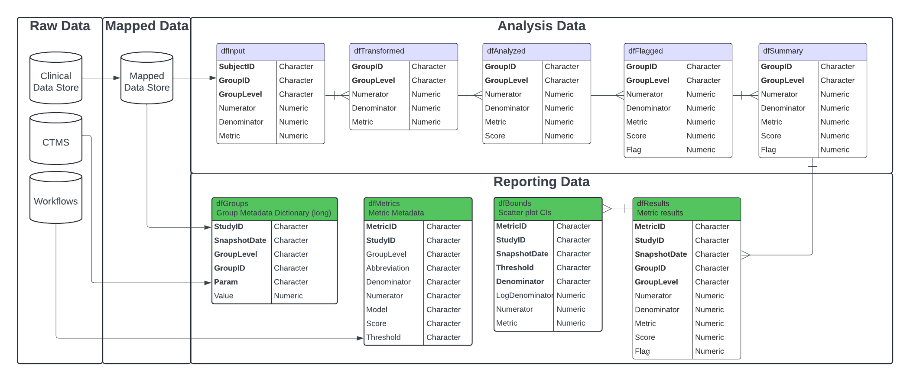

# Reporting Data Model

``` r

library(gsm.reporting)
library(dplyr)
```

## Introduction

The `{gsm}` suite of packages monitors clinical trials with Key Risk
Indicators (KRIs).
[gsm.reporting](https://gilead-public.github.io/gsm.reporting/) sits
between analysis and reporting: it takes the output of metric workflows
and produces the tables of the reporting data model.



| Table | Function | Contents |
|----|----|----|
| `Reporting_Groups` | [`dplyr::bind_rows()`](https://dplyr.tidyverse.org/reference/bind_rows.html) | Long-format metadata for each study, site, and country |
| `Reporting_Metrics` | [`MakeMetric()`](https://gilead-public.github.io/gsm.reporting/dev/reference/MakeMetric.md) | One row of metadata per metric |
| `Reporting_Results` | [`BindResults()`](https://gilead-public.github.io/gsm.reporting/dev/reference/BindResults.md), [`CalculateChange()`](https://gilead-public.github.io/gsm.reporting/dev/reference/CalculateChange.md), [`FilterByLatestSnapshotDate()`](https://gilead-public.github.io/gsm.reporting/dev/reference/FilterByLatestSnapshotDate.md) | Stacked results for every metric and group |
| `Reporting_Bounds` | [`MakeBounds()`](https://gilead-public.github.io/gsm.reporting/dev/reference/MakeBounds.md) | Predicted bounds used to draw flag thresholds in charts |
| `Reporting_Distributions` | [`BindResults()`](https://gilead-public.github.io/gsm.reporting/dev/reference/BindResults.md) | Stacked category breakdowns of each metric’s numerator and denominator, for metrics that define them |

Each table has a YAML workflow in `inst/workflow/3_reporting`. This
vignette builds each table step by step and then runs the workflows. The
inputs are sample data from
[gsm.core](https://gilead-public.github.io/gsm.core) and mapped data
from [gsm.mapping](https://github.com/Gilead-Public/gsm.mapping).

For the full pipeline, from metric calculation through charts and HTML
reports, see the `{gsm.kri}` documentation.

## Inputs

The reporting workflows need three inputs:

- `lWorkflows`: metric workflows, whose `meta` sections describe each
  metric.
- `lAnalyzed`: analysis output, with one element per metric containing
  an `Analysis_Summary` data frame.
- `Mapped_STUDY`, `Mapped_SITE`, `Mapped_COUNTRY`: group metadata from
  [gsm.mapping](https://github.com/Gilead-Public/gsm.mapping).

In practice, `lWorkflows` and `lAnalyzed` come from metric workflows
such as those in `{gsm.kri}`. Here they are reconstructed from
[gsm.core](https://gilead-public.github.io/gsm.core) sample data, so the
vignette depends on no metric package.

``` r

lWorkflows <- gsm.core::reportingMetrics |>
  select(-MetricID) |>
  split(~ID) |>
  purrr::map(\(meta) list(meta = as.list(meta)))

dfLatest <- gsm.core::reportingResults |>
  filter(SnapshotDate == max(SnapshotDate))

lAnalyzed <- dfLatest |>
  select(GroupID, GroupLevel, Numerator, Denominator, Metric, Score, Flag, MetricID) |>
  split(~MetricID) |>
  purrr::map(\(df) list(Analysis_Summary = select(df, -MetricID)))

names(lAnalyzed)
#>  [1] "Analysis_kri0001"   "Analysis_kri0002"   "Analysis_kri0003"  
#>  [4] "Analysis_kri0004"   "Analysis_kri0005"   "Analysis_kri0006"  
#>  [7] "Analysis_kri0007"   "Analysis_kri0007-2" "Analysis_kri0008"  
#> [10] "Analysis_kri0009"   "Analysis_kri0010"   "Analysis_kri0011"  
#> [13] "Analysis_kri0012"   "Analysis_kri0013"   "Analysis_kri0014"  
#> [16] "Analysis_kri0015"   "Analysis_kri0019"   "Analysis_kri0020a" 
#> [19] "Analysis_kri0020b"  "Analysis_kri0020c"  "Analysis_kri0020d" 
#> [22] "Analysis_kri0020e"  "Analysis_kri0020f"  "Analysis_srs0001"
```

Group metadata comes from the
[gsm.mapping](https://github.com/Gilead-Public/gsm.mapping) workflows:

``` r

mappings_wf <- workr::MakeWorkflowList(
  strPath = "workflow/1_mappings",
  strPackage = "gsm.mapping"
)
# These domains are not present in gsm.core::lSource
mappings_wf <- mappings_wf[
  setdiff(names(mappings_wf), c("AntiCancer", "Baseline", "Consents"))
]
lRaw <- gsm.mapping::Ingest(
  gsm.core::lSource,
  gsm.mapping::CombineSpecs(mappings_wf)
)
mapped <- workr::RunWorkflows(mappings_wf, lRaw)
```

## Step by step

### Groups

`Reporting_Groups` stacks the long-format study, site, and country
metadata. Each row is one `Param`/`Value` pair for a group.

``` r

dfGroups <- bind_rows(
  mapped$Mapped_STUDY,
  mapped$Mapped_SITE,
  mapped$Mapped_COUNTRY
)
dfGroups
#> # A tibble: 1,669 × 4
#>    GroupID        Param          Value            GroupLevel
#>    <chr>          <chr>          <chr>            <chr>     
#>  1 AA-AA-000-0000 studyid        AA-AA-000-0000   Study     
#>  2 AA-AA-000-0000 nickname       OAK-99           Study     
#>  3 AA-AA-000-0000 protocol_title Protocol Title L Study     
#>  4 AA-AA-000-0000 status         Active           Study     
#>  5 AA-AA-000-0000 num_plan_site  150              Study     
#>  6 AA-AA-000-0000 num_plan_subj  1000             Study     
#>  7 AA-AA-000-0000 act_fpfv       2012-02-11       Study     
#>  8 AA-AA-000-0000 est_fpfv       2012-02-22       Study     
#>  9 AA-AA-000-0000 est_lplv       2012-05-29       Study     
#> 10 AA-AA-000-0000 est_lpfv       2012-04-05       Study     
#> # ℹ 1,659 more rows
```

### Metrics

[`MakeMetric()`](https://gilead-public.github.io/gsm.reporting/dev/reference/MakeMetric.md)
collects the `meta` section of each workflow into one row per metric and
adds `MetricID` (`{Type}_{ID}`).

``` r

dfMetrics <- MakeMetric(lWorkflows)
dfMetrics |>
  select(MetricID, Abbreviation, Metric, Model, Threshold)
#> # A tibble: 24 × 5
#>    MetricID           Abbreviation Metric                        Model Threshold
#>    <chr>              <chr>        <chr>                         <chr> <chr>    
#>  1 Analysis_kri0001   AE           Adverse Event Rate            Norm… -2,-1,2,3
#>  2 Analysis_kri0002   SAE          Serious Adverse Event Rate    Norm… -2,-1,2,3
#>  3 Analysis_kri0003   PD           Non-Important Protocol Devia… Norm… -3,-2,2,3
#>  4 Analysis_kri0004   IPD          Important Protocol Deviation… Norm… -3,-2,2,3
#>  5 Analysis_kri0005   LB           Grade 3+ Lab Abnormality Rate Norm… 2,3      
#>  6 Analysis_kri0006   SDSC         Study Discontinuation Rate    Norm… 2,3      
#>  7 Analysis_kri0007   TDSC         Treatment Discontinuation Ra… Norm… 2,3      
#>  8 Analysis_kri0007-2 PTDC         Premature Treatment Disconti… Norm… 2,3      
#>  9 Analysis_kri0008   QRY          Query Rate                    Norm… 2,3      
#> 10 Analysis_kri0009   OQRY         Delayed Query Resolution Rate Norm… 2,3      
#> # ℹ 14 more rows
```

### Results

[`BindResults()`](https://gilead-public.github.io/gsm.reporting/dev/reference/BindResults.md)
stacks the `Analysis_Summary` of each metric. It adds `MetricID` from
the list names, along with the snapshot date and study ID.

``` r

dfResults <- BindResults(
  lAnalysis = lAnalyzed,
  strName = "Analysis_Summary",
  dSnapshotDate = max(dfLatest$SnapshotDate),
  strStudyID = unique(dfLatest$StudyID)
)
dfResults
#>      GroupID GroupLevel Numerator Denominator       Metric        Score Flag
#> 1      0X031       Site         2          27 7.407407e-02           NA   NA
#> 2      0X103       Site         1          11 9.090909e-02           NA   NA
#> 3     0X1091       Site         6          22 2.727273e-01           NA   NA
#> 4      0X126       Site        10         178 5.617978e-02 -0.811843255    0
#> 5     0X1284       Site        23         337 6.824926e-02 -0.583692734    0
#> 6     0X1347       Site        38         361 1.052632e-01  1.088824107    0
#> 7     0X1437       Site        45         561 8.021390e-02 -0.070906745    0
#> 8     0X1589       Site         2          34 5.882353e-02 -0.317705276    0
#> 9     0X1675       Site        39         511 7.632094e-02 -0.279516588    0
#> 10    0X1755       Site         3          96 3.125000e-02 -1.184208994   -1
#> 11    0X1798       Site         2          27 7.407407e-02           NA   NA
#> 12    0X1934       Site         4          14 2.857143e-01           NA   NA
#> 13    0X1953       Site         8          69 1.159420e-01  0.689561213    0
#> 14    0X2025       Site        13          35 3.714286e-01  4.129645388    2
#> 15    0X2115       Site         6          93 6.451613e-02 -0.393291261    0
#> 16    0X2368       Site         3          37 8.108108e-02 -0.005511948    0
#> 17     0X239       Site        25         365 6.849315e-02 -0.596240518    0
#> 18    0X2516       Site        65         780 8.333333e-02  0.126114168    0
#> 19    0X2628       Site        57         602 9.468439e-02  0.781231353    0
#> 20    0X2775       Site        32         501 6.387226e-02 -0.947526875    0
#> 21    0X2801       Site        57         625 9.120000e-02  0.586319263    0
#> 22    0X2859       Site         4          58 6.896552e-02 -0.229018050    0
#> 23     0X291       Site         0          11 0.000000e+00           NA   NA
#> 24    0X2924       Site         3          16 1.875000e-01           NA   NA
#> 25    0X3017       Site        34         431 7.888631e-02 -0.128498484    0
#> 26    0X3040       Site         5          45 1.111111e-01  0.478859172    0
#> 27    0X3059       Site        19         248 7.661290e-02 -0.183657314    0
#> 28    0X3176       Site         9          86 1.046512e-01  0.517776695    0
#> 29    0X3235       Site        12         229 5.240175e-02 -1.058459071   -1
#> 30     0X328       Site         1          15 6.666667e-02           NA   NA
#> 31    0X3325       Site         2          58 3.448276e-02 -0.861197064    0
#> 32    0X3342       Site         5          39 1.282051e-01  0.702774332    0
#> 33     0X337       Site        16         210 7.619048e-02 -0.183738272    0
#> 34    0X3434       Site        15         169 8.875740e-02  0.228446064    0
#> 35    0X3447       Site        25         261 9.578544e-02  0.557221512    0
#> 36    0X3508       Site         4           6 6.666667e-01           NA   NA
#> 37    0X3553       Site         2          55 3.636364e-02 -0.805050160    0
#> 38    0X3599       Site        53         668 7.934132e-02 -0.131663987    0
#> 39    0X3743       Site        14         196 7.142857e-02 -0.337992433    0
#> 40    0X3811       Site         2          59 3.389831e-02 -0.879396323    0
#> 41     0X383       Site         7          18 3.888889e-01           NA   NA
#> 42    0X3843       Site         6          39 1.538462e-01  1.088245387    0
#> 43    0X3869       Site        36         413 8.716707e-02  0.279319944    0
#> 44    0X3989       Site        12         111 1.081081e-01  0.675915749    0
#> 45    0X4001       Site         7          46 1.521739e-01  1.154577712    0
#> 46    0X4059       Site         4          29 1.379310e-01           NA   NA
#> 47     0X412       Site        50         648 7.716049e-02 -0.263316649    0
#> 48    0X4270       Site         1           2 5.000000e-01           NA   NA
#> 49    0X4290       Site        21         354 5.932203e-02 -1.002569588   -1
#> 50    0X4303       Site         7          71 9.859155e-02  0.347546622    0
#> 51    0X4334       Site        19         296 6.418919e-02 -0.715187604    0
#> 52    0X4349       Site        17         261 6.513410e-02 -0.634826670    0
#> 53    0X4358       Site         3          40 7.500000e-02 -0.098314821    0
#> 54    0X4400       Site         9          72 1.250000e-01  0.889413280    0
#> 55    0X4420       Site         2           6 3.333333e-01           NA   NA
#> 56     0X451       Site        17         293 5.802048e-02 -0.965740528    0
#> 57    0X4609       Site         3          25 1.200000e-01           NA   NA
#> 58    0X4618       Site        54         702 7.692308e-02 -0.289211391    0
#> 59     0X464       Site         9         201 4.477612e-02 -1.251894892   -1
#> 60    0X4707       Site         9          68 1.323529e-01  1.010316281    0
#> 61    0X4769       Site         3          88 3.409091e-02 -1.069639938   -1
#> 62    0X4863       Site        37         449 8.240535e-02  0.048348300    0
#> 63    0X4889       Site         2          23 8.695652e-02           NA   NA
#> 64    0X4903       Site        46         479 9.603340e-02  0.767939621    0
#> 65    0X4910       Site         0           2 0.000000e+00           NA   NA
#> 66    0X4953       Site         1           7 1.428571e-01           NA   NA
#> 67    0X5047       Site         5          53 9.433962e-02  0.225761138    0
#> 68    0X5069       Site         0           8 0.000000e+00           NA   NA
#> 69    0X5343       Site        21         334 6.287425e-02 -0.817559032    0
#> 70    0X5351       Site        18         214 8.411215e-02  0.093483922    0
#> 71    0X5395       Site         2          19 1.052632e-01           NA   NA
#> 72    0X5467       Site         0          14 0.000000e+00           NA   NA
#> 73    0X5475       Site         6          35 1.714286e-01  1.281329882    0
#> 74    0X5512       Site         1           1 1.000000e+00           NA   NA
#> 75    0X5551       Site        47         524 8.969466e-02  0.453906747    0
#> 76    0X5629       Site         2          38 5.263158e-02 -0.427759025    0
#> 77    0X5697       Site         7          51 1.372549e-01  0.959230730    0
#> 78    0X5728       Site         6          78 7.692308e-02 -0.096403797    0
#> 79    0X5873       Site        57         739 7.713126e-02 -0.283111699    0
#> 80    0X5900       Site        54         590 9.152542e-02  0.588694087    0
#> 81    0X5919       Site         1          17 5.882353e-02           NA   NA
#> 82    0X5925       Site         1          41 2.439024e-02 -0.879636118    0
#> 83    0X5940       Site        18         338 5.325444e-02 -1.248184562   -1
#> 84    0X5993       Site        53         522 1.015326e-01  1.104119726    0
#> 85    0X6126       Site         2          51 3.921569e-02 -0.726192566    0
#> 86    0X6149       Site         5          15 3.333333e-01           NA   NA
#> 87    0X6152       Site         8          68 1.176471e-01  0.718392403    0
#> 88    0X6289       Site        33         379 8.707124e-02  0.263084584    0
#> 89    0X6315       Site         1          60 1.666667e-02 -1.208129024   -1
#> 90    0X6366       Site         0          23 0.000000e+00           NA   NA
#> 91    0X6527       Site         0          13 0.000000e+00           NA   NA
#> 92    0X6545       Site         7          50 1.400000e-01  0.996506847    0
#> 93    0X6618       Site        17         228 7.456140e-02 -0.250665927    0
#> 94    0X6650       Site         2          12 1.666667e-01           NA   NA
#> 95    0X6711       Site        19         319 5.956113e-02 -0.941437991    0
#> 96    0X6747       Site        49         654 7.492355e-02 -0.402243867    0
#> 97    0X6868       Site         1          13 7.692308e-02           NA   NA
#> 98    0X6889       Site        19         184 1.032609e-01  0.711961409    0
#> 99    0X6903       Site        16         201 7.960199e-02 -0.063326744    0
#> 100   0X7081       Site        50         588 8.503401e-02  0.208771737    0
#> 101   0X7110       Site        11         149 7.382550e-02 -0.224262062    0
#> 102   0X7225       Site        24         350 6.857143e-02 -0.580335165    0
#> 103   0X7261       Site        52         595 8.739496e-02  0.348644290    0
#> 104   0X7293       Site         4          34 1.176471e-01  0.507980140    0
#> 105   0X7303       Site        17         340 5.000000e-02 -1.396329278   -1
#> 106    0X731       Site         1          19 5.263158e-02           NA   NA
#> 107   0X7627       Site         3          41 7.317073e-02 -0.127732554    0
#> 108   0X7633       Site        26         334 7.784431e-02 -0.158960365    0
#> 109    0X768       Site         2           2 1.000000e+00           NA   NA
#> 110   0X7680       Site        39         460 8.478261e-02  0.171675315    0
#> 111   0X7688       Site         4          69 5.797101e-02 -0.469641856    0
#> 112   0X7772       Site        22         370 5.945946e-02 -1.018612697   -1
#> 113   0X7893       Site        47         432 1.087963e-01  1.367871241    0
#> 114    0X799       Site         1          50 2.000000e-02 -1.046126062   -1
#> 115   0X8066       Site         4          41 9.756098e-02  0.248219228    0
#> 116   0X8090       Site        23         323 7.120743e-02 -0.443457980    0
#> 117   0X8295       Site        16         172 9.302326e-02  0.365142206    0
#> 118   0X8328       Site         4          37 1.081081e-01  0.390240140    0
#> 119   0X8374       Site        19         245 7.755102e-02 -0.147195156    0
#> 120   0X8411       Site        28         320 8.750000e-02  0.260204727    0
#> 121   0X8464       Site        10         143 6.993007e-02 -0.331837051    0
#> 122   0X8499       Site         5          20 2.500000e-01           NA   NA
#> 123   0X8565       Site         2          46 4.347826e-02 -0.620082305    0
#> 124   0X8619       Site        12         170 7.058824e-02 -0.341152850    0
#> 125   0X8743       Site         4          16 2.500000e-01           NA   NA
#> 126   0X9103       Site         1          32 3.125000e-02 -0.683703381    0
#> 127   0X9166       Site        32         460 6.956522e-02 -0.614000167    0
#> 128   0X9167       Site         6          71 8.450704e-02  0.061856712    0
#> 129   0X9221       Site        26         251 1.035857e-01  0.843929252    0
#> 130   0X9248       Site         3          33 9.090909e-02  0.130703018    0
#> 131   0X9252       Site        41         486 8.436214e-02  0.154146399    0
#> 132   0X9261       Site        26         251 1.035857e-01  0.843929252    0
#> 133   0X9371       Site         5          10 5.000000e-01           NA   NA
#> 134   0X9375       Site        20         287 6.968641e-02 -0.480044989    0
#> 135   0X9377       Site        24         327 7.339450e-02 -0.350990422    0
#> 136   0X9392       Site        56         626 8.945687e-02  0.481799743    0
#> 137   0X9476       Site         0          14 0.000000e+00           NA   NA
#> 138   0X9490       Site        14         148 9.459459e-02  0.384728192    0
#> 139   0X9577       Site        17         206 8.252427e-02  0.036857524    0
#> 140    0X966       Site         2          41 4.878049e-02 -0.503684336    0
#> 141   0X9705       Site         1          48 2.083333e-02 -1.011091667   -1
#> 142   0X9794       Site         0           6 0.000000e+00           NA   NA
#> 143    0X984       Site         4          29 1.379310e-01           NA   NA
#> 144   0X9881       Site         2           7 2.857143e-01           NA   NA
#> 145   0X9895       Site         4          25 1.600000e-01           NA   NA
#> 146    0X031       Site         0          27 0.000000e+00           NA   NA
#> 147    0X103       Site         0          11 0.000000e+00           NA   NA
#> 148   0X1091       Site         0          22 0.000000e+00           NA   NA
#> 149    0X126       Site         4         178 2.247191e-02  0.968369810    0
#> 150   0X1284       Site         8         337 2.373887e-02  1.504398605    0
#> 151   0X1347       Site         7         361 1.939058e-02  0.946204528    0
#> 152   0X1437       Site        11         561 1.960784e-02  1.217587511    0
#> 153   0X1589       Site         0          34 0.000000e+00 -0.545580044    0
#> 154   0X1675       Site         8         511 1.565558e-02  0.501500221    0
#> 155   0X1755       Site         1          96 1.041667e-02 -0.162150446    0
#> 156   0X1798       Site         0          27 0.000000e+00           NA   NA
#> 157   0X1934       Site         0          14 0.000000e+00           NA   NA
#> 158   0X1953       Site         0          69 0.000000e+00 -0.777219276    0
#> 159   0X2025       Site         3          35 8.571429e-02  3.195700609    2
#> 160   0X2115       Site         2          93 2.150538e-02  0.631043956    0
#> 161   0X2368       Site         0          37 0.000000e+00 -0.569141010    0
#> 162    0X239       Site         3         365 8.219178e-03 -0.626581779    0
#> 163   0X2516       Site         9         780 1.153846e-02 -0.230557820    0
#> 164   0X2628       Site         9         602 1.495017e-02  0.416359019    0
#> 165   0X2775       Site         3         501 5.988024e-03 -1.103328407   -1
#> 166   0X2801       Site         4         625 6.400000e-03 -1.156177169   -1
#> 167   0X2859       Site         0          58 0.000000e+00 -0.712578992    0
#> 168    0X291       Site         0          11 0.000000e+00           NA   NA
#> 169   0X2924       Site         1          16 6.250000e-02           NA   NA
#> 170   0X3017       Site         6         431 1.392111e-02  0.194341737    0
#> 171   0X3040       Site         0          45 0.000000e+00 -0.627661188    0
#> 172   0X3059       Site         2         248 8.064516e-03 -0.534492375    0
#> 173   0X3176       Site         1          86 1.162791e-02 -0.070423574    0
#> 174   0X3235       Site         4         229 1.746725e-02  0.538421000    0
#> 175    0X328       Site         0          15 0.000000e+00           NA   NA
#> 176   0X3325       Site         0          58 0.000000e+00 -0.712578992    0
#> 177   0X3342       Site         1          39 2.564103e-02  0.599604724    0
#> 178    0X337       Site         1         210 4.761905e-03 -0.845695414    0
#> 179   0X3434       Site         2         169 1.183432e-02 -0.078881854    0
#> 180   0X3447       Site         6         261 2.298851e-02  1.234310368    0
#> 181   0X3508       Site         0           6 0.000000e+00           NA   NA
#> 182   0X3553       Site         1          55 1.818182e-02  0.303048930    0
#> 183   0X3599       Site        11         668 1.646707e-02  0.728458240    0
#> 184   0X3743       Site         2         196 1.020408e-02 -0.253696547    0
#> 185   0X3811       Site         1          59 1.694915e-02  0.243870674    0
#> 186    0X383       Site         0          18 0.000000e+00           NA   NA
#> 187   0X3843       Site         2          39 5.128205e-02  1.783530215    0
#> 188   0X3869       Site         4         413 9.685230e-03 -0.446226479    0
#> 189   0X3989       Site         3         111 2.702703e-02  1.119530730    0
#> 190   0X4001       Site         0          46 0.000000e+00 -0.634596882    0
#> 191   0X4059       Site         1          29 3.448276e-02           NA   NA
#> 192    0X412       Site         6         648 9.259259e-03 -0.639115608    0
#> 193   0X4270       Site         0           2 0.000000e+00           NA   NA
#> 194   0X4290       Site         4         354 1.129944e-02 -0.188573408    0
#> 195   0X4303       Site         1          71 1.408451e-02  0.089057487    0
#> 196   0X4334       Site         2         296 6.756757e-03 -0.750283895    0
#> 197   0X4349       Site         6         261 2.298851e-02  1.234310368    0
#> 198   0X4358       Site         0          40 0.000000e+00 -0.591764643    0
#> 199   0X4400       Site         2          72 2.777778e-02  0.948755555    0
#> 200   0X4420       Site         0           6 0.000000e+00           NA   NA
#> 201    0X451       Site         4         293 1.365188e-02  0.126162319    0
#> 202   0X4609       Site         2          25 8.000000e-02           NA   NA
#> 203   0X4618       Site         6         702 8.547009e-03 -0.804739573    0
#> 204    0X464       Site         2         201 9.950249e-03 -0.283519502    0
#> 205   0X4707       Site         2          68 2.941176e-02  1.021647688    0
#> 206   0X4769       Site         1          88 1.136364e-02 -0.089567089    0
#> 207   0X4863       Site         7         449 1.559020e-02  0.459850620    0
#> 208   0X4889       Site         0          23 0.000000e+00           NA   NA
#> 209   0X4903       Site         9         479 1.878914e-02  0.992608530    0
#> 210   0X4910       Site         0           2 0.000000e+00           NA   NA
#> 211   0X4953       Site         0           7 0.000000e+00           NA   NA
#> 212   0X5047       Site         0          53 0.000000e+00 -0.681172259    0
#> 213   0X5069       Site         0           8 0.000000e+00           NA   NA
#> 214   0X5343       Site         2         334 5.988024e-03 -0.900863872    0
#> 215   0X5351       Site         2         214 9.345794e-03 -0.357921719    0
#> 216   0X5395       Site         0          19 0.000000e+00           NA   NA
#> 217   0X5467       Site         0          14 0.000000e+00           NA   NA
#> 218   0X5475       Site         0          35 0.000000e+00 -0.553545137    0
#> 219   0X5512       Site         0           1 0.000000e+00           NA   NA
#> 220   0X5551       Site         5         524 9.541985e-03 -0.526871073    0
#> 221   0X5629       Site         1          38 2.631579e-02  0.622621470    0
#> 222   0X5697       Site         3          51 5.882353e-02  2.437742064    1
#> 223   0X5728       Site         0          78 0.000000e+00 -0.826354353    0
#> 224   0X5873       Site         7         739 9.472260e-03 -0.639706629    0
#> 225   0X5900       Site         9         590 1.525424e-02  0.466796582    0
#> 226   0X5919       Site         0          17 0.000000e+00           NA   NA
#> 227   0X5925       Site         0          41 0.000000e+00 -0.599116039    0
#> 228   0X5940       Site         2         338 5.917160e-03 -0.915874774    0
#> 229   0X5993       Site         8         522 1.532567e-02  0.451139983    0
#> 230   0X6126       Site         0          51 0.000000e+00 -0.668196361    0
#> 231   0X6149       Site         1          15 6.666667e-02           NA   NA
#> 232   0X6152       Site         1          68 1.470588e-02  0.125040495    0
#> 233   0X6289       Site         8         379 2.110818e-02  1.216735214    0
#> 234   0X6315       Site         0          60 0.000000e+00 -0.724760712    0
#> 235   0X6366       Site         0          23 0.000000e+00           NA   NA
#> 236   0X6527       Site         0          13 0.000000e+00           NA   NA
#> 237   0X6545       Site         1          50 2.000000e-02  0.384001697    0
#> 238   0X6618       Site         2         228 8.771930e-03 -0.433510847    0
#> 239   0X6650       Site         0          12 0.000000e+00           NA   NA
#> 240   0X6711       Site         4         319 1.253918e-02 -0.015294601    0
#> 241   0X6747       Site         5         654 7.645260e-03 -0.947242619    0
#> 242   0X6868       Site         0          13 0.000000e+00           NA   NA
#> 243   0X6889       Site         1         184 5.434783e-03 -0.724129431    0
#> 244   0X6903       Site         2         201 9.950249e-03 -0.283519502    0
#> 245   0X7081       Site         8         588 1.360544e-02  0.170399558    0
#> 246   0X7110       Site         3         149 2.013423e-02  0.675003874    0
#> 247   0X7225       Site         2         350 5.714286e-03 -0.960053017    0
#> 248   0X7261       Site         8         595 1.344538e-02  0.142543358    0
#> 249   0X7293       Site         1          34 2.941176e-02  0.722414008    0
#> 250   0X7303       Site         5         340 1.470588e-02  0.279599048    0
#> 251    0X731       Site         0          19 0.000000e+00           NA   NA
#> 252   0X7627       Site         2          41 4.878049e-02  1.710260461    0
#> 253   0X7633       Site         4         334 1.197605e-02 -0.091742939    0
#> 254    0X768       Site         1           2 5.000000e-01           NA   NA
#> 255   0X7680       Site         6         460 1.304348e-02  0.061602170    0
#> 256   0X7688       Site         2          69 2.898551e-02  1.002953377    0
#> 257   0X7772       Site         2         370 5.405405e-03 -1.031030697   -1
#> 258   0X7893       Site         4         432 9.259259e-03 -0.521835709    0
#> 259    0X799       Site         0          50 0.000000e+00 -0.661612985    0
#> 260   0X8066       Site         0          41 0.000000e+00 -0.599116039    0
#> 261   0X8090       Site         4         323 1.238390e-02 -0.036024254    0
#> 262   0X8295       Site         1         172 5.813953e-03 -0.663351628    0
#> 263   0X8328       Site         2          37 5.405405e-02  1.861863747    0
#> 264   0X8374       Site         1         245 4.081633e-03 -0.992182209    0
#> 265   0X8411       Site         4         320 1.250000e-02 -0.020501194    0
#> 266   0X8464       Site         2         143 1.398601e-02  0.117680762    0
#> 267   0X8499       Site         0          20 0.000000e+00           NA   NA
#> 268   0X8565       Site         0          46 0.000000e+00 -0.634596882    0
#> 269   0X8619       Site         1         170 5.882353e-03 -0.652889886    0
#> 270   0X8743       Site         1          16 6.250000e-02           NA   NA
#> 271   0X9103       Site         0          32 0.000000e+00 -0.529290388    0
#> 272   0X9166       Site         5         460 1.086957e-02 -0.283126782    0
#> 273   0X9167       Site         0          71 0.000000e+00 -0.788402862    0
#> 274   0X9221       Site         3         251 1.195219e-02 -0.082325464    0
#> 275   0X9248       Site         1          33 3.030303e-02  0.749565772    0
#> 276   0X9252       Site         4         486 8.230453e-03 -0.721180886    0
#> 277   0X9261       Site         5         251 1.992032e-02  0.851035879    0
#> 278   0X9371       Site         2          10 2.000000e-01           NA   NA
#> 279   0X9375       Site         0         287 0.000000e+00 -1.585112045   -1
#> 280   0X9377       Site         5         327 1.529052e-02  0.352367560    0
#> 281   0X9392       Site        11         626 1.757188e-02  0.909564273    0
#> 282   0X9476       Site         0          14 0.000000e+00           NA   NA
#> 283   0X9490       Site         1         148 6.756757e-03 -0.530530830    0
#> 284   0X9577       Site         6         206 2.912621e-02  1.747896592    0
#> 285    0X966       Site         0          41 0.000000e+00 -0.599116039    0
#> 286   0X9705       Site         0          48 0.000000e+00 -0.648245688    0
#> 287   0X9794       Site         0           6 0.000000e+00           NA   NA
#> 288    0X984       Site         2          29 6.896552e-02           NA   NA
#> 289   0X9881       Site         0           7 0.000000e+00           NA   NA
#> 290   0X9895       Site         0          25 0.000000e+00           NA   NA
#> 291    0X031       Site         0          27 0.000000e+00           NA   NA
#> 292    0X103       Site         1          11 9.090909e-02           NA   NA
#> 293   0X1091       Site         1          22 4.545455e-02           NA   NA
#> 294    0X126       Site         7         178 3.932584e-02 -0.168020751    0
#> 295   0X1284       Site        17         337 5.044510e-02  0.359973361    0
#> 296   0X1347       Site        17         361 4.709141e-02  0.188029988    0
#> 297   0X1437       Site        33         561 5.882353e-02  1.039172632    0
#> 298   0X1589       Site         0          34 0.000000e+00 -0.737533471    0
#> 299   0X1675       Site        12         511 2.348337e-02 -1.321853611    0
#> 300   0X1755       Site         3          96 3.125000e-02 -0.352552870    0
#> 301   0X1798       Site         5          27 1.851852e-01           NA   NA
#> 302   0X1934       Site         0          14 0.000000e+00           NA   NA
#> 303   0X1953       Site         3          69 4.347826e-02 -0.004716476    0
#> 304   0X2025       Site         4          35 1.142857e-01  1.209831832    0
#> 305   0X2115       Site         1          93 1.075269e-02 -0.919472908    0
#> 306   0X2368       Site         0          37 0.000000e+00 -0.769383978    0
#> 307    0X239       Site        18         365 4.931507e-02  0.312104255    0
#> 308   0X2516       Site        44         780 5.641026e-02  1.030135868    0
#> 309   0X2628       Site        27         602 4.485050e-02  0.083577481    0
#> 310   0X2775       Site        19         501 3.792415e-02 -0.372747933    0
#> 311   0X2801       Site        26         625 4.160000e-02 -0.150186528    0
#> 312   0X2859       Site         3          58 5.172414e-02  0.177548281    0
#> 313    0X291       Site         0          11 0.000000e+00           NA   NA
#> 314   0X2924       Site         1          16 6.250000e-02           NA   NA
#> 315   0X3017       Site        14         431 3.248260e-02 -0.672901533    0
#> 316   0X3040       Site         1          45 2.222222e-02 -0.416765827    0
#> 317   0X3059       Site        11         248 4.435484e-02  0.031037376    0
#> 318   0X3176       Site         0          86 0.000000e+00 -1.172982416    0
#> 319   0X3235       Site         8         229 3.493450e-02 -0.383033078    0
#> 320    0X328       Site         1          15 6.666667e-02           NA   NA
#> 321   0X3325       Site         2          58 3.448276e-02 -0.202730570    0
#> 322   0X3342       Site         6          39 1.538462e-01  1.992595154    0
#> 323    0X337       Site        12         210 5.714286e-02  0.565257577    0
#> 324   0X3434       Site         4         169 2.366864e-02 -0.753204249    0
#> 325   0X3447       Site         6         261 2.298851e-02 -0.967851992    0
#> 326   0X3508       Site         1           6 1.666667e-01           NA   NA
#> 327   0X3553       Site         6          55 1.090909e-01  1.405029492    0
#> 328   0X3599       Site        29         668 4.341317e-02 -0.019547029    0
#> 329   0X3743       Site         8         196 4.081633e-02 -0.115879001    0
#> 330   0X3811       Site         2          59 3.389831e-02 -0.217472240    0
#> 331    0X383       Site         4          18 2.222222e-01           NA   NA
#> 332   0X3843       Site         2          39 5.128205e-02  0.137595395    0
#> 333   0X3869       Site        18         413 4.358354e-02 -0.005342972    0
#> 334   0X3989       Site         6         111 5.405405e-02  0.316711678    0
#> 335   0X4001       Site         3          46 6.521739e-02  0.423158235    0
#> 336   0X4059       Site         0          29 0.000000e+00           NA   NA
#> 337    0X412       Site        28         648 4.320988e-02 -0.034239881    0
#> 338   0X4270       Site         0           2 0.000000e+00           NA   NA
#> 339   0X4290       Site        10         354 2.824859e-02 -0.840549833    0
#> 340   0X4303       Site         2          71 2.816901e-02 -0.378377719    0
#> 341   0X4334       Site        11         296 3.716216e-02 -0.324479033    0
#> 342   0X4349       Site        16         261 6.130268e-02  0.824799703    0
#> 343   0X4358       Site         0          40 0.000000e+00 -0.799967368    0
#> 344   0X4400       Site         1          72 1.388889e-02 -0.731958135    0
#> 345   0X4420       Site         0           6 0.000000e+00           NA   NA
#> 346    0X451       Site        11         293 3.754266e-02 -0.303967794    0
#> 347   0X4609       Site         0          25 0.000000e+00           NA   NA
#> 348   0X4618       Site        33         702 4.700855e-02  0.255847093    0
#> 349    0X464       Site         6         201 2.985075e-02 -0.567589546    0
#> 350   0X4707       Site         1          68 1.470588e-02 -0.691824010    0
#> 351   0X4769       Site         3          88 3.409091e-02 -0.260361886    0
#> 352   0X4863       Site        20         449 4.454343e-02  0.053335490    0
#> 353   0X4889       Site         2          23 8.695652e-02           NA   NA
#> 354   0X4903       Site        28         479 5.845511e-02  0.936875429    0
#> 355   0X4910       Site         3           2 1.500000e+00           NA   NA
#> 356   0X4953       Site         0           7 0.000000e+00           NA   NA
#> 357   0X5047       Site         2          53 3.773585e-02 -0.125206941    0
#> 358   0X5069       Site         1           8 1.250000e-01           NA   NA
#> 359   0X5343       Site        19         334 5.688623e-02  0.699286396    0
#> 360   0X5351       Site        10         214 4.672897e-02  0.129415246    0
#> 361   0X5395       Site         2          19 1.052632e-01           NA   NA
#> 362   0X5467       Site         0          14 0.000000e+00           NA   NA
#> 363   0X5475       Site         1          35 2.857143e-02 -0.258767757    0
#> 364   0X5512       Site         0           1 0.000000e+00           NA   NA
#> 365   0X5551       Site        19         524 3.625954e-02 -0.491563581    0
#> 366   0X5629       Site         3          38 7.894737e-02  0.629725121    0
#> 367   0X5697       Site         3          51 5.882353e-02  0.313322337    0
#> 368   0X5728       Site         3          78 3.846154e-02 -0.133331454    0
#> 369   0X5873       Site        39         739 5.277402e-02  0.716416585    0
#> 370   0X5900       Site        26         590 4.406780e-02  0.027680004    0
#> 371   0X5919       Site         4          17 2.352941e-01           NA   NA
#> 372   0X5925       Site         2          41 4.878049e-02  0.094689881    0
#> 373   0X5940       Site        13         338 3.846154e-02 -0.277551554    0
#> 374   0X5993       Site        32         522 6.130268e-02  1.166442926    0
#> 375   0X6126       Site         2          51 3.921569e-02 -0.092215221    0
#> 376   0X6149       Site         1          15 6.666667e-02           NA   NA
#> 377   0X6152       Site         4          68 5.882353e-02  0.361793472    0
#> 378   0X6289       Site         9         379 2.374670e-02 -1.123546543    0
#> 379   0X6315       Site         5          60 8.333333e-02  0.889679841    0
#> 380   0X6366       Site         0          23 0.000000e+00           NA   NA
#> 381   0X6527       Site         1          13 7.692308e-02           NA   NA
#> 382   0X6545       Site         4          50 8.000000e-02  0.743900720    0
#> 383   0X6618       Site        10         228 4.385965e-02  0.008104719    0
#> 384   0X6650       Site         1          12 8.333333e-02           NA   NA
#> 385   0X6711       Site        12         319 3.761755e-02 -0.313293884    0
#> 386   0X6747       Site        25         654 3.822630e-02 -0.403499868    0
#> 387   0X6868       Site         0          13 0.000000e+00           NA   NA
#> 388   0X6889       Site         5         184 2.717391e-02 -0.648215806    0
#> 389   0X6903       Site         2         201 9.950249e-03 -1.384695043    0
#> 390   0X7081       Site        33         588 5.612245e-02  0.874196517    0
#> 391   0X7110       Site         5         149 3.355705e-02 -0.357661816    0
#> 392   0X7225       Site        14         350 4.000000e-02 -0.199079540    0
#> 393   0X7261       Site        31         595 5.210084e-02  0.595282563    0
#> 394   0X7293       Site         2          34 5.882353e-02  0.255826617    0
#> 395   0X7303       Site        18         340 5.294118e-02  0.494866755    0
#> 396    0X731       Site         1          19 5.263158e-02           NA   NA
#> 397   0X7627       Site         5          41 1.219512e-01  1.451582550    0
#> 398   0X7633       Site        12         334 3.592814e-02 -0.409993077    0
#> 399    0X768       Site         3           2 1.500000e+00           NA   NA
#> 400   0X7680       Site        21         460 4.565217e-02  0.122854283    0
#> 401   0X7688       Site         7          69 1.014493e-01  1.389889801    0
#> 402   0X7772       Site        17         370 4.594595e-02  0.126547837    0
#> 403   0X7893       Site        20         432 4.629630e-02  0.157829275    0
#> 404    0X799       Site         1          50 2.000000e-02 -0.484817850    0
#> 405   0X8066       Site         0          41 0.000000e+00 -0.809905232    0
#> 406   0X8090       Site        12         323 3.715170e-02 -0.339499406    0
#> 407   0X8295       Site         4         172 2.325581e-02 -0.775540101    0
#> 408   0X8328       Site         2          37 5.405405e-02  0.182853572    0
#> 409   0X8374       Site         9         245 3.673469e-02 -0.314582818    0
#> 410   0X8411       Site        14         320 4.375000e-02  0.003921015    0
#> 411   0X8464       Site        10         143 6.993007e-02  0.909303141    0
#> 412   0X8499       Site         0          20 0.000000e+00           NA   NA
#> 413   0X8565       Site         1          46 2.173913e-02 -0.430860208    0
#> 414   0X8619       Site         5         170 2.941176e-02 -0.538564636    0
#> 415   0X8743       Site         3          16 1.875000e-01           NA   NA
#> 416   0X9103       Site         0          32 0.000000e+00 -0.715512566    0
#> 417   0X9166       Site        17         460 3.695652e-02 -0.417274406    0
#> 418   0X9167       Site         0          71 0.000000e+00 -1.065789532    0
#> 419   0X9221       Site        12         251 4.780876e-02  0.189701482    0
#> 420   0X9248       Site         2          33 6.060606e-02  0.281692227    0
#> 421   0X9252       Site        14         486 2.880658e-02 -0.949246493    0
#> 422   0X9261       Site         8         251 3.187251e-02 -0.541503767    0
#> 423   0X9371       Site         2          10 2.000000e-01           NA   NA
#> 424   0X9375       Site        15         287 5.226481e-02  0.421478284    0
#> 425   0X9377       Site        17         327 5.198777e-02  0.435382980    0
#> 426   0X9392       Site        24         626 3.833866e-02 -0.386626184    0
#> 427   0X9476       Site         2          14 1.428571e-01           NA   NA
#> 428   0X9490       Site         9         148 6.081081e-02  0.603766532    0
#> 429   0X9577       Site         4         206 1.941748e-02 -1.008286606    0
#> 430    0X966       Site         1          41 2.439024e-02 -0.357607676    0
#> 431   0X9705       Site         0          48 0.000000e+00 -0.876320345    0
#> 432   0X9794       Site         1           6 1.666667e-01           NA   NA
#> 433    0X984       Site         1          29 3.448276e-02           NA   NA
#> 434   0X9881       Site         0           7 0.000000e+00           NA   NA
#> 435   0X9895       Site         1          25 4.000000e-02           NA   NA
#> 436    0X031       Site         1          27 3.703704e-02           NA   NA
#> 437    0X103       Site         0          11 0.000000e+00           NA   NA
#> 438   0X1091       Site         1          22 4.545455e-02           NA   NA
#> 439    0X126       Site         1         178 5.617978e-03 -1.525359478    0
#> 440   0X1284       Site        13         337 3.857567e-02 -0.039107331    0
#> 441   0X1347       Site        11         361 3.047091e-02 -0.564716146    0
#> 442   0X1437       Site        22         561 3.921569e-02  0.001149903    0
#> 443   0X1589       Site         1          34 2.941176e-02 -0.194331867    0
#> 444   0X1675       Site        21         511 4.109589e-02  0.145792081    0
#> 445   0X1755       Site         5          96 5.208333e-02  0.429687505    0
#> 446   0X1798       Site         3          27 1.111111e-01           NA   NA
#> 447   0X1934       Site         1          14 7.142857e-02           NA   NA
#> 448   0X1953       Site         2          69 2.898551e-02 -0.288894235    0
#> 449   0X2025       Site         4          35 1.142857e-01  1.512237539    0
#> 450   0X2115       Site         3          93 3.225806e-02 -0.227954485    0
#> 451   0X2368       Site         1          37 2.702703e-02 -0.252107227    0
#> 452    0X239       Site        15         365 4.109589e-02  0.123216798    0
#> 453   0X2516       Site        17         780 2.179487e-02 -1.654996261    0
#> 454   0X2628       Site        23         602 3.820598e-02 -0.083148157    0
#> 455   0X2775       Site        17         501 3.393214e-02 -0.401520632    0
#> 456   0X2801       Site        25         625 4.000000e-02  0.067966102    0
#> 457   0X2859       Site         5          58 8.620690e-02  1.218707060    0
#> 458    0X291       Site         0          11 0.000000e+00           NA   NA
#> 459   0X2924       Site         3          16 1.875000e-01           NA   NA
#> 460   0X3017       Site        13         431 3.016241e-02 -0.638846535    0
#> 461   0X3040       Site         2          45 4.444444e-02  0.119735961    0
#> 462   0X3059       Site        11         248 4.435484e-02  0.276285267    0
#> 463   0X3176       Site         4          86 4.651163e-02  0.230789235    0
#> 464   0X3235       Site         8         229 3.493450e-02 -0.219821388    0
#> 465    0X328       Site         3          15 2.000000e-01           NA   NA
#> 466   0X3325       Site         5          58 8.620690e-02  1.218707060    0
#> 467   0X3342       Site         2          39 5.128205e-02  0.256837631    0
#> 468    0X337       Site         3         210 1.428571e-02 -1.229192374    0
#> 469   0X3434       Site         5         169 2.958580e-02 -0.425557126    0
#> 470   0X3447       Site        15         261 5.747126e-02  1.004828378    0
#> 471   0X3508       Site         0           6 0.000000e+00           NA   NA
#> 472   0X3553       Site         1          55 1.818182e-02 -0.530692395    0
#> 473   0X3599       Site        27         668 4.041916e-02  0.107146591    0
#> 474   0X3743       Site        11         196 5.612245e-02  0.806476255    0
#> 475   0X3811       Site         0          59 0.000000e+00 -1.025096585    0
#> 476    0X383       Site         2          18 1.111111e-01           NA   NA
#> 477   0X3843       Site         1          39 2.564103e-02 -0.288298061    0
#> 478   0X3869       Site        14         413 3.389831e-02 -0.366896388    0
#> 479   0X3989       Site         3         111 2.702703e-02 -0.436662526    0
#> 480   0X4001       Site         5          46 1.086957e-01  1.604591781    0
#> 481   0X4059       Site         0          29 0.000000e+00           NA   NA
#> 482    0X412       Site        33         648 5.092593e-02  1.016058634    0
#> 483   0X4270       Site         1           2 5.000000e-01           NA   NA
#> 484   0X4290       Site         6         354 1.694915e-02 -1.425321811    0
#> 485   0X4303       Site         1          71 1.408451e-02 -0.720497455    0
#> 486   0X4334       Site        12         296 4.054054e-02  0.078433332    0
#> 487   0X4349       Site        16         261 6.130268e-02  1.215553672    0
#> 488   0X4358       Site         0          40 0.000000e+00 -0.844051171    0
#> 489   0X4400       Site         4          72 5.555556e-02  0.472422547    0
#> 490   0X4420       Site         0           6 0.000000e+00           NA   NA
#> 491    0X451       Site        10         293 3.412969e-02 -0.295547361    0
#> 492   0X4609       Site         0          25 0.000000e+00           NA   NA
#> 493   0X4618       Site        35         702 4.985755e-02  0.961180070    0
#> 494    0X464       Site         4         201 1.990050e-02 -0.931564951    0
#> 495   0X4707       Site         5          68 7.352941e-02  0.963695221    0
#> 496   0X4769       Site         2          88 2.272727e-02 -0.526115802    0
#> 497   0X4863       Site        17         449 3.786192e-02 -0.096628691    0
#> 498   0X4889       Site         0          23 0.000000e+00           NA   NA
#> 499   0X4903       Site        17         479 3.549061e-02 -0.276486910    0
#> 500   0X4910       Site         0           2 0.000000e+00           NA   NA
#> 501   0X4953       Site         2           7 2.857143e-01           NA   NA
#> 502   0X5047       Site         4          53 7.547170e-02  0.898929589    0
#> 503   0X5069       Site         2           8 2.500000e-01           NA   NA
#> 504   0X5343       Site         9         334 2.694611e-02 -0.762491013    0
#> 505   0X5351       Site         6         214 2.803738e-02 -0.555987826    0
#> 506   0X5395       Site         1          19 5.263158e-02           NA   NA
#> 507   0X5467       Site         2          14 1.428571e-01           NA   NA
#> 508   0X5475       Site         3          35 8.571429e-02  0.936793761    0
#> 509   0X5512       Site         0           1 0.000000e+00           NA   NA
#> 510   0X5551       Site        22         524 4.198473e-02  0.216902085    0
#> 511   0X5629       Site         1          38 2.631579e-02 -0.270417367    0
#> 512   0X5697       Site         3          51 5.882353e-02  0.477054042    0
#> 513   0X5728       Site         1          78 1.282051e-02 -0.793184172    0
#> 514   0X5873       Site        28         739 3.788904e-02 -0.121456515    0
#> 515   0X5900       Site        25         590 4.237288e-02  0.262253684    0
#> 516   0X5919       Site         0          17 0.000000e+00           NA   NA
#> 517   0X5925       Site         2          41 4.878049e-02  0.208810266    0
#> 518   0X5940       Site         6         338 1.775148e-02 -1.342522209    0
#> 519   0X5993       Site        25         522 4.789272e-02  0.676015500    0
#> 520   0X6126       Site         5          51 9.803922e-02  1.430468710    0
#> 521   0X6149       Site         2          15 1.333333e-01           NA   NA
#> 522   0X6152       Site         3          68 4.411765e-02  0.138013899    0
#> 523   0X6289       Site        18         379 4.749340e-02  0.549559446    0
#> 524   0X6315       Site         1          60 1.666667e-02 -0.594244897    0
#> 525   0X6366       Site         1          23 4.347826e-02           NA   NA
#> 526   0X6527       Site         1          13 7.692308e-02           NA   NA
#> 527   0X6545       Site         0          50 0.000000e+00 -0.943677897    0
#> 528   0X6618       Site        11         228 4.824561e-02  0.464915421    0
#> 529   0X6650       Site         3          12 2.500000e-01           NA   NA
#> 530   0X6711       Site        12         319 3.761755e-02 -0.096305696    0
#> 531   0X6747       Site        28         654 4.281346e-02  0.314468509    0
#> 532   0X6868       Site         1          13 7.692308e-02           NA   NA
#> 533   0X6889       Site         5         184 2.717391e-02 -0.555420172    0
#> 534   0X6903       Site         6         201 2.985075e-02 -0.451313276    0
#> 535   0X7081       Site        22         588 3.741497e-02 -0.147475122    0
#> 536   0X7110       Site         1         149 6.711409e-03 -1.350143662    0
#> 537   0X7225       Site        20         350 5.714286e-02  1.142688977    0
#> 538   0X7261       Site        23         595 3.865546e-02 -0.045337636    0
#> 539   0X7293       Site         1          34 2.941176e-02 -0.194331867    0
#> 540   0X7303       Site        11         340 3.235294e-02 -0.429903367    0
#> 541    0X731       Site         1          19 5.263158e-02           NA   NA
#> 542   0X7627       Site         3          41 7.317073e-02  0.740483740    0
#> 543   0X7633       Site        16         334 4.790419e-02  0.541461356    0
#> 544    0X768       Site         3           2 1.500000e+00           NA   NA
#> 545   0X7680       Site        17         460 3.695652e-02 -0.163913063    0
#> 546   0X7688       Site         6          69 8.695652e-02  1.350458339    0
#> 547   0X7772       Site        13         370 3.513514e-02 -0.266278543    0
#> 548   0X7893       Site        16         432 3.703704e-02 -0.153148944    0
#> 549    0X799       Site         2          50 4.000000e-02  0.019223717    0
#> 550   0X8066       Site         0          41 0.000000e+00 -0.854536681    0
#> 551   0X8090       Site        10         323 3.095975e-02 -0.504258899    0
#> 552   0X8295       Site         7         172 4.069767e-02  0.066804388    0
#> 553   0X8328       Site         4          37 1.081081e-01  1.426918357    0
#> 554   0X8374       Site        13         245 5.306122e-02  0.738544885    0
#> 555   0X8411       Site        11         320 3.437500e-02 -0.293925671    0
#> 556   0X8464       Site         4         143 2.797203e-02 -0.457152813    0
#> 557   0X8499       Site         1          20 5.000000e-02           NA   NA
#> 558   0X8565       Site         2          46 4.347826e-02  0.098750288    0
#> 559   0X8619       Site         8         170 4.705882e-02  0.348770814    0
#> 560   0X8743       Site         0          16 0.000000e+00           NA   NA
#> 561   0X9103       Site         2          32 6.250000e-02  0.448684700    0
#> 562   0X9166       Site        11         460 2.391304e-02 -1.116290846    0
#> 563   0X9167       Site         6          71 8.450704e-02  1.299625255    0
#> 564   0X9221       Site         9         251 3.585657e-02 -0.180405869    0
#> 565   0X9248       Site         2          33 6.060606e-02  0.418602405    0
#> 566   0X9252       Site        23         486 4.732510e-02  0.609688107    0
#> 567   0X9261       Site        10         251 3.984064e-02  0.034476142    0
#> 568   0X9371       Site         0          10 0.000000e+00           NA   NA
#> 569   0X9375       Site        12         287 4.181185e-02  0.150552667    0
#> 570   0X9377       Site        10         327 3.058104e-02 -0.530685838    0
#> 571   0X9392       Site        30         626 4.792332e-02  0.742908026    0
#> 572   0X9476       Site         1          14 7.142857e-02           NA   NA
#> 573   0X9490       Site         3         148 2.027027e-02 -0.784052052    0
#> 574   0X9577       Site         9         206 4.368932e-02  0.219287162    0
#> 575    0X966       Site         0          41 0.000000e+00 -0.854536681    0
#> 576   0X9705       Site         0          48 0.000000e+00 -0.924611732    0
#> 577   0X9794       Site         0           6 0.000000e+00           NA   NA
#> 578    0X984       Site         1          29 3.448276e-02           NA   NA
#> 579   0X9881       Site         1           7 1.428571e-01           NA   NA
#> 580   0X9895       Site         1          25 4.000000e-02           NA   NA
#> 581    0X031       Site         2         194 1.030928e-02           NA   NA
#> 582    0X103       Site         7         366 1.912568e-02           NA   NA
#> 583    0X126       Site        11         525 2.095238e-02  1.126361871    0
#> 584   0X1284       Site        28        2058 1.360544e-02 -0.520167085    0
#> 585   0X1347       Site        22        1445 1.522491e-02  0.072117104    0
#> 586   0X1437       Site        50        3678 1.359434e-02 -0.700939718    0
#> 587   0X1589       Site         8         400 2.000000e-02           NA   NA
#> 588   0X1675       Site        42        2774 1.514059e-02  0.063274167    0
#> 589   0X1755       Site         7         555 1.261261e-02           NA   NA
#> 590   0X1798       Site        10         551 1.814882e-02  0.610879506    0
#> 591   0X1934       Site         6         381 1.574803e-02           NA   NA
#> 592   0X1953       Site         8         579 1.381693e-02           NA   NA
#> 593   0X2025       Site         5         528 9.469697e-03           NA   NA
#> 594   0X2115       Site         8         573 1.396161e-02           NA   NA
#> 595   0X2368       Site         1         358 2.793296e-03           NA   NA
#> 596    0X239       Site        39        2317 1.683211e-02  0.729694272    0
#> 597   0X2516       Site        55        4416 1.245471e-02 -1.392967965    0
#> 598   0X2628       Site        37        3538 1.045789e-02 -2.226905670    0
#> 599   0X2775       Site        35        2578 1.357642e-02 -0.594347054    0
#> 600   0X2801       Site        50        3237 1.544640e-02  0.211921632    0
#> 601   0X2859       Site         6         550 1.090909e-02           NA   NA
#> 602    0X291       Site         3         185 1.621622e-02           NA   NA
#> 603   0X2924       Site         2         194 1.030928e-02           NA   NA
#> 604   0X3017       Site        50        2781 1.797914e-02  1.298563208    0
#> 605   0X3040       Site        10         734 1.362398e-02 -0.306503865    0
#> 606   0X3059       Site        15        1475 1.016949e-02 -1.529263350    0
#> 607   0X3176       Site         1         182 5.494505e-03           NA   NA
#> 608   0X3235       Site         8        1112 7.194245e-03           NA   NA
#> 609    0X328       Site        11         357 3.081232e-02  2.466096895    1
#> 610   0X3325       Site         6         184 3.260870e-02           NA   NA
#> 611   0X3342       Site         8         377 2.122016e-02           NA   NA
#> 612    0X337       Site        15         750 2.000000e-02  1.131039069    0
#> 613   0X3434       Site        15         910 1.648352e-02  0.370524471    0
#> 614   0X3447       Site        27        1476 1.829268e-02  1.045429842    0
#> 615   0X3508       Site         3         206 1.456311e-02           NA   NA
#> 616   0X3553       Site        14         749 1.869159e-02  0.834804713    0
#> 617   0X3599       Site        62        3793 1.634590e-02  0.686526389    0
#> 618   0X3743       Site        21         728 2.884615e-02  3.083859818    2
#> 619   0X3811       Site         1         195 5.128205e-03           NA   NA
#> 620    0X383       Site         8         732 1.092896e-02           NA   NA
#> 621   0X3843       Site         5         370 1.351351e-02           NA   NA
#> 622   0X3869       Site        47        2582 1.820294e-02  1.345078515    0
#> 623   0X3989       Site         8         545 1.467890e-02           NA   NA
#> 624   0X4001       Site         2         182 1.098901e-02           NA   NA
#> 625   0X4059       Site         7         361 1.939058e-02           NA   NA
#> 626    0X412       Site        60        3534 1.697793e-02  0.972709242    0
#> 627   0X4270       Site         3         196 1.530612e-02           NA   NA
#> 628   0X4290       Site        40        1874 2.134472e-02  2.268203933    1
#> 629   0X4303       Site         2         184 1.086957e-02           NA   NA
#> 630   0X4334       Site        13        1441 9.021513e-03 -1.871126217    0
#> 631   0X4349       Site        24        1304 1.840491e-02  1.016071523    0
#> 632   0X4358       Site         3         367 8.174387e-03           NA   NA
#> 633   0X4400       Site        11         535 2.056075e-02  1.062290534    0
#> 634   0X4420       Site         2         187 1.069519e-02           NA   NA
#> 635    0X451       Site        20        1085 1.843318e-02  0.934514988    0
#> 636   0X4609       Site         6         196 3.061224e-02           NA   NA
#> 637   0X4618       Site        48        3815 1.258191e-02 -1.229882151    0
#> 638    0X464       Site        24        1149 2.088773e-02  1.648235859    0
#> 639   0X4863       Site        32        2396 1.335559e-02 -0.662176498    0
#> 640   0X4903       Site        38        2763 1.375317e-02 -0.538638401    0
#> 641   0X4910       Site         3         185 1.621622e-02           NA   NA
#> 642   0X4953       Site         3         185 1.621622e-02           NA   NA
#> 643   0X5047       Site         5         359 1.392758e-02           NA   NA
#> 644   0X5343       Site        24        1865 1.286863e-02 -0.757741511    0
#> 645   0X5351       Site        18         946 1.902748e-02  1.023436955    0
#> 646   0X5395       Site         5         381 1.312336e-02           NA   NA
#> 647   0X5551       Site        42        3124 1.344430e-02 -0.715197840    0
#> 648   0X5697       Site         9         391 2.301790e-02           NA   NA
#> 649   0X5728       Site         9         553 1.627486e-02           NA   NA
#> 650   0X5873       Site        51        3506 1.454649e-02 -0.219139701    0
#> 651   0X5900       Site        37        2915 1.269297e-02 -1.025590760    0
#> 652   0X5919       Site         0         188 0.000000e+00           NA   NA
#> 653   0X5925       Site         4         200 2.000000e-02           NA   NA
#> 654   0X5940       Site        22        1691 1.301005e-02 -0.673541054    0
#> 655   0X5993       Site        55        3101 1.773621e-02  1.259611502    0
#> 656   0X6126       Site         3         532 5.639098e-03           NA   NA
#> 657   0X6152       Site         4         182 2.197802e-02           NA   NA
#> 658   0X6289       Site        29        2019 1.436355e-02 -0.234128266    0
#> 659   0X6315       Site         4         380 1.052632e-02           NA   NA
#> 660   0X6545       Site         4         368 1.086957e-02           NA   NA
#> 661   0X6618       Site        20        1622 1.233046e-02 -0.885506174    0
#> 662   0X6650       Site         3         195 1.538462e-02           NA   NA
#> 663   0X6711       Site        27        1667 1.619676e-02  0.404881762    0
#> 664   0X6747       Site        53        3557 1.490020e-02 -0.046656872    0
#> 665   0X6868       Site         1         184 5.434783e-03           NA   NA
#> 666   0X6889       Site        10        1221 8.190008e-03 -1.962133637    0
#> 667   0X6903       Site        11         940 1.170213e-02 -0.833071119    0
#> 668   0X7081       Site        43        2721 1.580301e-02  0.347796400    0
#> 669   0X7110       Site        10         574 1.742160e-02  0.479730552    0
#> 670   0X7225       Site        25        1449 1.725328e-02  0.709339815    0
#> 671   0X7261       Site        53        3477 1.524303e-02  0.120681019    0
#> 672   0X7293       Site         3         193 1.554404e-02           NA   NA
#> 673   0X7303       Site        28        1874 1.494130e-02 -0.019182234    0
#> 674    0X731       Site         3         360 8.333333e-03           NA   NA
#> 675   0X7627       Site         5         357 1.400560e-02           NA   NA
#> 676   0X7633       Site        42        2406 1.745636e-02  0.996243579    0
#> 677    0X768       Site         4         190 2.105263e-02           NA   NA
#> 678   0X7680       Site        27        2029 1.330705e-02 -0.627400170    0
#> 679   0X7688       Site         6         395 1.518987e-02           NA   NA
#> 680   0X7772       Site        33        2397 1.376721e-02 -0.496023310    0
#> 681   0X7893       Site        27        1993 1.354742e-02 -0.533262414    0
#> 682    0X799       Site         4         353 1.133144e-02           NA   NA
#> 683   0X8066       Site         3         358 8.379888e-03           NA   NA
#> 684   0X8090       Site        19        1067 1.780694e-02  0.757932132    0
#> 685   0X8295       Site        23        1082 2.125693e-02  1.699671032    0
#> 686   0X8328       Site         6         356 1.685393e-02           NA   NA
#> 687   0X8374       Site        34        2036 1.669941e-02  0.634608272    0
#> 688   0X8411       Site         9        1081 8.325624e-03           NA   NA
#> 689   0X8464       Site        16         718 2.228412e-02  1.611685925    0
#> 690   0X8499       Site         4         380 1.052632e-02           NA   NA
#> 691   0X8565       Site         2         181 1.104972e-02           NA   NA
#> 692   0X8619       Site        24        1297 1.850424e-02  1.042859878    0
#> 693   0X8743       Site         7         381 1.837270e-02           NA   NA
#> 694   0X9103       Site         5         172 2.906977e-02           NA   NA
#> 695   0X9166       Site        37        2529 1.463029e-02 -0.151345222    0
#> 696   0X9167       Site        15         750 2.000000e-02  1.131039069    0
#> 697   0X9221       Site        22        1608 1.368159e-02 -0.434596531    0
#> 698   0X9248       Site         9         368 2.445652e-02           NA   NA
#> 699   0X9252       Site        36        2217 1.623816e-02  0.483005656    0
#> 700   0X9261       Site        17        1485 1.144781e-02 -1.127952322    0
#> 701   0X9371       Site         3         188 1.595745e-02           NA   NA
#> 702   0X9375       Site        21        1249 1.681345e-02  0.530304613    0
#> 703   0X9377       Site        26        1825 1.424658e-02 -0.263829604    0
#> 704   0X9392       Site        72        4185 1.720430e-02  1.179357153    0
#> 705   0X9490       Site        17        1300 1.307692e-02 -0.570664835    0
#> 706   0X9577       Site        23        1485 1.548822e-02  0.156834464    0
#> 707   0X9705       Site         2         203 9.852217e-03           NA   NA
#> 708    0X984       Site         2         186 1.075269e-02           NA   NA
#> 709   0X9881       Site         1         168 5.952381e-03           NA   NA
#> 710   0X9895       Site         4         185 2.162162e-02           NA   NA
#> 711    0X031       Site         0           2 0.000000e+00           NA   NA
#> 712    0X103       Site         1           2 5.000000e-01           NA   NA
#> 713   0X1091       Site         0           3 0.000000e+00           NA   NA
#> 714    0X126       Site         0           4 0.000000e+00           NA   NA
#> 715   0X1284       Site         0           8 0.000000e+00           NA   NA
#> 716   0X1347       Site         1           8 1.250000e-01           NA   NA
#> 717   0X1437       Site         0          11 0.000000e+00           NA   NA
#> 718   0X1589       Site         0           2 0.000000e+00           NA   NA
#> 719   0X1675       Site         1          13 7.692308e-02           NA   NA
#> 720   0X1755       Site         0           2 0.000000e+00           NA   NA
#> 721   0X1798       Site         0           4 0.000000e+00           NA   NA
#> 722   0X1934       Site         0           2 0.000000e+00           NA   NA
#> 723   0X1953       Site         0           4 0.000000e+00           NA   NA
#> 724   0X2025       Site         0           5 0.000000e+00           NA   NA
#> 725   0X2115       Site         0           4 0.000000e+00           NA   NA
#> 726   0X2368       Site         0           2 0.000000e+00           NA   NA
#> 727    0X239       Site         1          11 9.090909e-02           NA   NA
#> 728   0X2516       Site         1          17 5.882353e-02           NA   NA
#> 729   0X2628       Site         2          13 1.538462e-01           NA   NA
#> 730   0X2775       Site         0          11 0.000000e+00           NA   NA
#> 731   0X2801       Site         0          10 0.000000e+00           NA   NA
#> 732   0X2859       Site         0           4 0.000000e+00           NA   NA
#> 733    0X291       Site         0           1 0.000000e+00           NA   NA
#> 734   0X2924       Site         0           3 0.000000e+00           NA   NA
#> 735   0X3017       Site         0          11 0.000000e+00           NA   NA
#> 736   0X3040       Site         0           5 0.000000e+00           NA   NA
#> 737   0X3059       Site         1           8 1.250000e-01           NA   NA
#> 738   0X3176       Site         0           4 0.000000e+00           NA   NA
#> 739   0X3235       Site         0           6 0.000000e+00           NA   NA
#> 740    0X328       Site         0           2 0.000000e+00           NA   NA
#> 741   0X3325       Site         0           3 0.000000e+00           NA   NA
#> 742   0X3342       Site         0           3 0.000000e+00           NA   NA
#> 743    0X337       Site         0           5 0.000000e+00           NA   NA
#> 744   0X3434       Site         1           5 2.000000e-01           NA   NA
#> 745   0X3447       Site         0           9 0.000000e+00           NA   NA
#> 746   0X3508       Site         0           1 0.000000e+00           NA   NA
#> 747   0X3553       Site         1           4 2.500000e-01           NA   NA
#> 748   0X3599       Site         0          14 0.000000e+00           NA   NA
#> 749   0X3743       Site         1           8 1.250000e-01           NA   NA
#> 750   0X3811       Site         0           3 0.000000e+00           NA   NA
#> 751    0X383       Site         1           4 2.500000e-01           NA   NA
#> 752   0X3843       Site         0           3 0.000000e+00           NA   NA
#> 753   0X3869       Site         2           8 2.500000e-01           NA   NA
#> 754   0X3989       Site         0           4 0.000000e+00           NA   NA
#> 755   0X4001       Site         0           5 0.000000e+00           NA   NA
#> 756   0X4059       Site         0           2 0.000000e+00           NA   NA
#> 757    0X412       Site         0          12 0.000000e+00           NA   NA
#> 758   0X4270       Site         0           1 0.000000e+00           NA   NA
#> 759   0X4290       Site         0           8 0.000000e+00           NA   NA
#> 760   0X4303       Site         0           2 0.000000e+00           NA   NA
#> 761   0X4334       Site         1           6 1.666667e-01           NA   NA
#> 762   0X4349       Site         0           6 0.000000e+00           NA   NA
#> 763   0X4358       Site         0           2 0.000000e+00           NA   NA
#> 764   0X4400       Site         0           4 0.000000e+00           NA   NA
#> 765   0X4420       Site         0           1 0.000000e+00           NA   NA
#> 766    0X451       Site         2           9 2.222222e-01           NA   NA
#> 767   0X4609       Site         0           2 0.000000e+00           NA   NA
#> 768   0X4618       Site         0          11 0.000000e+00           NA   NA
#> 769    0X464       Site         0           6 0.000000e+00           NA   NA
#> 770   0X4707       Site         0           4 0.000000e+00           NA   NA
#> 771   0X4769       Site         0           4 0.000000e+00           NA   NA
#> 772   0X4863       Site         1          13 7.692308e-02           NA   NA
#> 773   0X4889       Site         0           1 0.000000e+00           NA   NA
#> 774   0X4903       Site         0           9 0.000000e+00           NA   NA
#> 775   0X4910       Site         0           1 0.000000e+00           NA   NA
#> 776   0X4953       Site         0           1 0.000000e+00           NA   NA
#> 777   0X5047       Site         0           3 0.000000e+00           NA   NA
#> 778   0X5069       Site         0           1 0.000000e+00           NA   NA
#> 779   0X5343       Site         0           9 0.000000e+00           NA   NA
#> 780   0X5351       Site         1           7 1.428571e-01           NA   NA
#> 781   0X5395       Site         0           2 0.000000e+00           NA   NA
#> 782   0X5467       Site         0           1 0.000000e+00           NA   NA
#> 783   0X5475       Site         0           1 0.000000e+00           NA   NA
#> 784   0X5512       Site         0           1 0.000000e+00           NA   NA
#> 785   0X5551       Site         1          13 7.692308e-02           NA   NA
#> 786   0X5629       Site         0           2 0.000000e+00           NA   NA
#> 787   0X5697       Site         0           4 0.000000e+00           NA   NA
#> 788   0X5728       Site         0           5 0.000000e+00           NA   NA
#> 789   0X5873       Site         0          14 0.000000e+00           NA   NA
#> 790   0X5900       Site         1          10 1.000000e-01           NA   NA
#> 791   0X5919       Site         0           1 0.000000e+00           NA   NA
#> 792   0X5925       Site         0           2 0.000000e+00           NA   NA
#> 793   0X5940       Site         0           8 0.000000e+00           NA   NA
#> 794   0X5993       Site         0          14 0.000000e+00           NA   NA
#> 795   0X6126       Site         0           3 0.000000e+00           NA   NA
#> 796   0X6149       Site         0           3 0.000000e+00           NA   NA
#> 797   0X6152       Site         0           4 0.000000e+00           NA   NA
#> 798   0X6289       Site         1           9 1.111111e-01           NA   NA
#> 799   0X6315       Site         1           3 3.333333e-01           NA   NA
#> 800   0X6366       Site         0           1 0.000000e+00           NA   NA
#> 801   0X6527       Site         0           1 0.000000e+00           NA   NA
#> 802   0X6545       Site         0           4 0.000000e+00           NA   NA
#> 803   0X6618       Site         0           7 0.000000e+00           NA   NA
#> 804   0X6650       Site         0           2 0.000000e+00           NA   NA
#> 805   0X6711       Site         0           9 0.000000e+00           NA   NA
#> 806   0X6747       Site         1          12 8.333333e-02           NA   NA
#> 807   0X6868       Site         0           1 0.000000e+00           NA   NA
#> 808   0X6889       Site         0           5 0.000000e+00           NA   NA
#> 809   0X6903       Site         0           6 0.000000e+00           NA   NA
#> 810   0X7081       Site         0          14 0.000000e+00           NA   NA
#> 811   0X7110       Site         0           3 0.000000e+00           NA   NA
#> 812   0X7225       Site         1           5 2.000000e-01           NA   NA
#> 813   0X7261       Site         0          11 0.000000e+00           NA   NA
#> 814   0X7293       Site         0           2 0.000000e+00           NA   NA
#> 815   0X7303       Site         0          11 0.000000e+00           NA   NA
#> 816    0X731       Site         0           2 0.000000e+00           NA   NA
#> 817   0X7627       Site         0           3 0.000000e+00           NA   NA
#> 818   0X7633       Site         0           8 0.000000e+00           NA   NA
#> 819    0X768       Site         0           1 0.000000e+00           NA   NA
#> 820   0X7680       Site         0           9 0.000000e+00           NA   NA
#> 821   0X7688       Site         0           3 0.000000e+00           NA   NA
#> 822   0X7772       Site         0           7 0.000000e+00           NA   NA
#> 823   0X7893       Site         0           7 0.000000e+00           NA   NA
#> 824    0X799       Site         0           2 0.000000e+00           NA   NA
#> 825   0X8066       Site         0           2 0.000000e+00           NA   NA
#> 826   0X8090       Site         0           8 0.000000e+00           NA   NA
#> 827   0X8295       Site         0           6 0.000000e+00           NA   NA
#> 828   0X8328       Site         0           2 0.000000e+00           NA   NA
#> 829   0X8374       Site         0           8 0.000000e+00           NA   NA
#> 830   0X8411       Site         0           8 0.000000e+00           NA   NA
#> 831   0X8464       Site         0           3 0.000000e+00           NA   NA
#> 832   0X8499       Site         0           2 0.000000e+00           NA   NA
#> 833   0X8565       Site         1           2 5.000000e-01           NA   NA
#> 834   0X8619       Site         0           6 0.000000e+00           NA   NA
#> 835   0X8743       Site         0           2 0.000000e+00           NA   NA
#> 836   0X9103       Site         0           2 0.000000e+00           NA   NA
#> 837   0X9166       Site         0           9 0.000000e+00           NA   NA
#> 838   0X9167       Site         0           3 0.000000e+00           NA   NA
#> 839   0X9221       Site         0           8 0.000000e+00           NA   NA
#> 840   0X9248       Site         0           2 0.000000e+00           NA   NA
#> 841   0X9252       Site         0           9 0.000000e+00           NA   NA
#> 842   0X9261       Site         1           8 1.250000e-01           NA   NA
#> 843   0X9371       Site         0           2 0.000000e+00           NA   NA
#> 844   0X9375       Site         0           7 0.000000e+00           NA   NA
#> 845   0X9377       Site         1           7 1.428571e-01           NA   NA
#> 846   0X9392       Site         1          11 9.090909e-02           NA   NA
#> 847   0X9476       Site         0           1 0.000000e+00           NA   NA
#> 848   0X9490       Site         0           4 0.000000e+00           NA   NA
#> 849   0X9577       Site         0           5 0.000000e+00           NA   NA
#> 850    0X966       Site         0           3 0.000000e+00           NA   NA
#> 851   0X9705       Site         0           2 0.000000e+00           NA   NA
#> 852   0X9794       Site         0           1 0.000000e+00           NA   NA
#> 853    0X984       Site         0           2 0.000000e+00           NA   NA
#> 854   0X9881       Site         0           1 0.000000e+00           NA   NA
#> 855   0X9895       Site         0           2 0.000000e+00           NA   NA
#> 856    0X031       Site         0           2 0.000000e+00           NA   NA
#> 857    0X103       Site         0           2 0.000000e+00           NA   NA
#> 858   0X1091       Site         0           3 0.000000e+00           NA   NA
#> 859    0X126       Site         0           4 0.000000e+00           NA   NA
#> 860   0X1284       Site         0           8 0.000000e+00           NA   NA
#> 861   0X1347       Site         0           8 0.000000e+00           NA   NA
#> 862   0X1437       Site         1          11 9.090909e-02           NA   NA
#> 863   0X1589       Site         1           2 5.000000e-01           NA   NA
#> 864   0X1675       Site         0          13 0.000000e+00           NA   NA
#> 865   0X1755       Site         0           2 0.000000e+00           NA   NA
#> 866   0X1798       Site         0           4 0.000000e+00           NA   NA
#> 867   0X1934       Site         0           2 0.000000e+00           NA   NA
#> 868   0X1953       Site         0           4 0.000000e+00           NA   NA
#> 869   0X2025       Site         0           5 0.000000e+00           NA   NA
#> 870   0X2115       Site         1           4 2.500000e-01           NA   NA
#> 871   0X2368       Site         0           2 0.000000e+00           NA   NA
#> 872    0X239       Site         0          11 0.000000e+00           NA   NA
#> 873   0X2516       Site         1          17 5.882353e-02           NA   NA
#> 874   0X2628       Site         1          13 7.692308e-02           NA   NA
#> 875   0X2775       Site         0          11 0.000000e+00           NA   NA
#> 876   0X2801       Site         0          10 0.000000e+00           NA   NA
#> 877   0X2859       Site         0           4 0.000000e+00           NA   NA
#> 878    0X291       Site         0           1 0.000000e+00           NA   NA
#> 879   0X2924       Site         0           3 0.000000e+00           NA   NA
#> 880   0X3017       Site         0          11 0.000000e+00           NA   NA
#> 881   0X3040       Site         0           5 0.000000e+00           NA   NA
#> 882   0X3059       Site         0           8 0.000000e+00           NA   NA
#> 883   0X3176       Site         0           4 0.000000e+00           NA   NA
#> 884   0X3235       Site         2           6 3.333333e-01           NA   NA
#> 885    0X328       Site         0           2 0.000000e+00           NA   NA
#> 886   0X3325       Site         0           3 0.000000e+00           NA   NA
#> 887   0X3342       Site         0           3 0.000000e+00           NA   NA
#> 888    0X337       Site         0           5 0.000000e+00           NA   NA
#> 889   0X3434       Site         0           5 0.000000e+00           NA   NA
#> 890   0X3447       Site         0           9 0.000000e+00           NA   NA
#> 891   0X3508       Site         0           1 0.000000e+00           NA   NA
#> 892   0X3553       Site         0           4 0.000000e+00           NA   NA
#> 893   0X3599       Site         1          14 7.142857e-02           NA   NA
#> 894   0X3743       Site         0           8 0.000000e+00           NA   NA
#> 895   0X3811       Site         0           3 0.000000e+00           NA   NA
#> 896    0X383       Site         1           4 2.500000e-01           NA   NA
#> 897   0X3843       Site         0           3 0.000000e+00           NA   NA
#> 898   0X3869       Site         0           8 0.000000e+00           NA   NA
#> 899   0X3989       Site         0           4 0.000000e+00           NA   NA
#> 900   0X4001       Site         0           5 0.000000e+00           NA   NA
#> 901   0X4059       Site         0           2 0.000000e+00           NA   NA
#> 902    0X412       Site         2          12 1.666667e-01           NA   NA
#> 903   0X4270       Site         0           1 0.000000e+00           NA   NA
#> 904   0X4290       Site         0           8 0.000000e+00           NA   NA
#> 905   0X4303       Site         0           2 0.000000e+00           NA   NA
#> 906   0X4334       Site         0           6 0.000000e+00           NA   NA
#> 907   0X4349       Site         0           6 0.000000e+00           NA   NA
#> 908   0X4358       Site         0           2 0.000000e+00           NA   NA
#> 909   0X4400       Site         0           4 0.000000e+00           NA   NA
#> 910   0X4420       Site         0           1 0.000000e+00           NA   NA
#> 911    0X451       Site         0           9 0.000000e+00           NA   NA
#> 912   0X4609       Site         1           2 5.000000e-01           NA   NA
#> 913   0X4618       Site         0          11 0.000000e+00           NA   NA
#> 914    0X464       Site         1           6 1.666667e-01           NA   NA
#> 915   0X4707       Site         1           4 2.500000e-01           NA   NA
#> 916   0X4769       Site         0           4 0.000000e+00           NA   NA
#> 917   0X4863       Site         1          13 7.692308e-02           NA   NA
#> 918   0X4889       Site         0           1 0.000000e+00           NA   NA
#> 919   0X4903       Site         0           9 0.000000e+00           NA   NA
#> 920   0X4910       Site         0           1 0.000000e+00           NA   NA
#> 921   0X4953       Site         0           1 0.000000e+00           NA   NA
#> 922   0X5047       Site         0           3 0.000000e+00           NA   NA
#> 923   0X5069       Site         0           1 0.000000e+00           NA   NA
#> 924   0X5343       Site         1           9 1.111111e-01           NA   NA
#> 925   0X5351       Site         0           7 0.000000e+00           NA   NA
#> 926   0X5395       Site         0           2 0.000000e+00           NA   NA
#> 927   0X5467       Site         0           1 0.000000e+00           NA   NA
#> 928   0X5475       Site         0           1 0.000000e+00           NA   NA
#> 929   0X5512       Site         0           1 0.000000e+00           NA   NA
#> 930   0X5551       Site         2          13 1.538462e-01           NA   NA
#> 931   0X5629       Site         0           2 0.000000e+00           NA   NA
#> 932   0X5697       Site         0           4 0.000000e+00           NA   NA
#> 933   0X5728       Site         0           5 0.000000e+00           NA   NA
#> 934   0X5873       Site         0          14 0.000000e+00           NA   NA
#> 935   0X5900       Site         1          10 1.000000e-01           NA   NA
#> 936   0X5919       Site         0           1 0.000000e+00           NA   NA
#> 937   0X5925       Site         0           2 0.000000e+00           NA   NA
#> 938   0X5940       Site         0           8 0.000000e+00           NA   NA
#> 939   0X5993       Site         0          14 0.000000e+00           NA   NA
#> 940   0X6126       Site         0           3 0.000000e+00           NA   NA
#> 941   0X6149       Site         0           3 0.000000e+00           NA   NA
#> 942   0X6152       Site         0           4 0.000000e+00           NA   NA
#> 943   0X6289       Site         1           9 1.111111e-01           NA   NA
#> 944   0X6315       Site         0           3 0.000000e+00           NA   NA
#> 945   0X6366       Site         0           1 0.000000e+00           NA   NA
#> 946   0X6527       Site         0           1 0.000000e+00           NA   NA
#> 947   0X6545       Site         0           4 0.000000e+00           NA   NA
#> 948   0X6618       Site         1           7 1.428571e-01           NA   NA
#> 949   0X6650       Site         0           2 0.000000e+00           NA   NA
#> 950   0X6711       Site         0           9 0.000000e+00           NA   NA
#> 951   0X6747       Site         2          12 1.666667e-01           NA   NA
#> 952   0X6868       Site         0           1 0.000000e+00           NA   NA
#> 953   0X6889       Site         0           5 0.000000e+00           NA   NA
#> 954   0X6903       Site         0           6 0.000000e+00           NA   NA
#> 955   0X7081       Site         1          14 7.142857e-02           NA   NA
#> 956   0X7110       Site         0           3 0.000000e+00           NA   NA
#> 957   0X7225       Site         0           5 0.000000e+00           NA   NA
#> 958   0X7261       Site         1          11 9.090909e-02           NA   NA
#> 959   0X7293       Site         0           2 0.000000e+00           NA   NA
#> 960   0X7303       Site         0          11 0.000000e+00           NA   NA
#> 961    0X731       Site         0           2 0.000000e+00           NA   NA
#> 962   0X7627       Site         0           3 0.000000e+00           NA   NA
#> 963   0X7633       Site         0           8 0.000000e+00           NA   NA
#> 964    0X768       Site         0           1 0.000000e+00           NA   NA
#> 965   0X7680       Site         0           9 0.000000e+00           NA   NA
#> 966   0X7688       Site         0           3 0.000000e+00           NA   NA
#> 967   0X7772       Site         1           7 1.428571e-01           NA   NA
#> 968   0X7893       Site         0           7 0.000000e+00           NA   NA
#> 969    0X799       Site         0           2 0.000000e+00           NA   NA
#> 970   0X8066       Site         0           2 0.000000e+00           NA   NA
#> 971   0X8090       Site         0           8 0.000000e+00           NA   NA
#> 972   0X8295       Site         0           6 0.000000e+00           NA   NA
#> 973   0X8328       Site         0           2 0.000000e+00           NA   NA
#> 974   0X8374       Site         1           8 1.250000e-01           NA   NA
#> 975   0X8411       Site         0           8 0.000000e+00           NA   NA
#> 976   0X8464       Site         0           3 0.000000e+00           NA   NA
#> 977   0X8499       Site         0           2 0.000000e+00           NA   NA
#> 978   0X8565       Site         0           2 0.000000e+00           NA   NA
#> 979   0X8619       Site         0           6 0.000000e+00           NA   NA
#> 980   0X8743       Site         0           2 0.000000e+00           NA   NA
#> 981   0X9103       Site         0           2 0.000000e+00           NA   NA
#> 982   0X9166       Site         1           9 1.111111e-01           NA   NA
#> 983   0X9167       Site         0           3 0.000000e+00           NA   NA
#> 984   0X9221       Site         0           8 0.000000e+00           NA   NA
#> 985   0X9248       Site         0           2 0.000000e+00           NA   NA
#> 986   0X9252       Site         0           9 0.000000e+00           NA   NA
#> 987   0X9261       Site         0           8 0.000000e+00           NA   NA
#> 988   0X9371       Site         0           2 0.000000e+00           NA   NA
#> 989   0X9375       Site         1           7 1.428571e-01           NA   NA
#> 990   0X9377       Site         0           7 0.000000e+00           NA   NA
#> 991   0X9392       Site         1          11 9.090909e-02           NA   NA
#> 992   0X9476       Site         0           1 0.000000e+00           NA   NA
#> 993   0X9490       Site         0           4 0.000000e+00           NA   NA
#> 994   0X9577       Site         1           5 2.000000e-01           NA   NA
#> 995    0X966       Site         0           3 0.000000e+00           NA   NA
#> 996   0X9705       Site         0           2 0.000000e+00           NA   NA
#> 997   0X9794       Site         0           1 0.000000e+00           NA   NA
#> 998    0X984       Site         0           2 0.000000e+00           NA   NA
#> 999   0X9881       Site         0           1 0.000000e+00           NA   NA
#> 1000  0X9895       Site         0           2 0.000000e+00           NA   NA
#> 1001   0X031       Site         0           2 0.000000e+00           NA   NA
#> 1002   0X103       Site         0           1 0.000000e+00           NA   NA
#> 1003  0X1091       Site         0           2 0.000000e+00           NA   NA
#> 1004   0X126       Site         0           3 0.000000e+00           NA   NA
#> 1005  0X1284       Site         2           8 2.500000e-01           NA   NA
#> 1006  0X1347       Site         3           7 4.285714e-01  1.100513126    0
#> 1007  0X1437       Site         3          10 3.000000e-01  0.342374730    0
#> 1008  0X1589       Site         1           2 5.000000e-01           NA   NA
#> 1009  0X1675       Site         1          10 1.000000e-01           NA   NA
#> 1010  0X1755       Site         1           2 5.000000e-01           NA   NA
#> 1011  0X1798       Site         0           4 0.000000e+00           NA   NA
#> 1012  0X1934       Site         1           2 5.000000e-01           NA   NA
#> 1013  0X1953       Site         1           4 2.500000e-01           NA   NA
#> 1014  0X2025       Site         0           4 0.000000e+00           NA   NA
#> 1015  0X2115       Site         1           4 2.500000e-01           NA   NA
#> 1016  0X2368       Site         0           2 0.000000e+00           NA   NA
#> 1017   0X239       Site         2           7 2.857143e-01           NA   NA
#> 1018  0X2516       Site         2          15 1.333333e-01           NA   NA
#> 1019  0X2628       Site         2          10 2.000000e-01           NA   NA
#> 1020  0X2775       Site         6          10 6.000000e-01  2.612684832    1
#> 1021  0X2801       Site         4          10 4.000000e-01  1.099144764    0
#> 1022  0X2859       Site         0           4 0.000000e+00           NA   NA
#> 1023   0X291       Site         0           1 0.000000e+00           NA   NA
#> 1024  0X2924       Site         0           3 0.000000e+00           NA   NA
#> 1025  0X3017       Site         2          10 2.000000e-01           NA   NA
#> 1026  0X3040       Site         1           5 2.000000e-01           NA   NA
#> 1027  0X3059       Site         2           8 2.500000e-01           NA   NA
#> 1028  0X3176       Site         3           4 7.500000e-01  2.370342067    1
#> 1029  0X3235       Site         2           6 3.333333e-01           NA   NA
#> 1030  0X3325       Site         1           3 3.333333e-01           NA   NA
#> 1031  0X3342       Site         0           2 0.000000e+00           NA   NA
#> 1032   0X337       Site         1           4 2.500000e-01           NA   NA
#> 1033  0X3434       Site         3           4 7.500000e-01  2.370342067    1
#> 1034  0X3447       Site         2           8 2.500000e-01           NA   NA
#> 1035  0X3508       Site         0           1 0.000000e+00           NA   NA
#> 1036  0X3553       Site         0           3 0.000000e+00           NA   NA
#> 1037  0X3599       Site         5          14 3.571429e-01  0.916773175    0
#> 1038  0X3743       Site         2           7 2.857143e-01           NA   NA
#> 1039  0X3811       Site         2           3 6.666667e-01           NA   NA
#> 1040   0X383       Site         0           3 0.000000e+00           NA   NA
#> 1041  0X3843       Site         0           3 0.000000e+00           NA   NA
#> 1042  0X3869       Site         2           6 3.333333e-01           NA   NA
#> 1043  0X3989       Site         0           4 0.000000e+00           NA   NA
#> 1044  0X4001       Site         0           4 0.000000e+00           NA   NA
#> 1045  0X4059       Site         1           2 5.000000e-01           NA   NA
#> 1046   0X412       Site         5          12 4.166667e-01  1.342219435    0
#> 1047  0X4270       Site         0           1 0.000000e+00           NA   NA
#> 1048  0X4290       Site         4           8 5.000000e-01  1.659980659    0
#> 1049  0X4303       Site         0           1 0.000000e+00           NA   NA
#> 1050  0X4334       Site         4           6 6.666667e-01  2.414571333    1
#> 1051  0X4349       Site         0           5 0.000000e+00           NA   NA
#> 1052  0X4358       Site         0           2 0.000000e+00           NA   NA
#> 1053  0X4400       Site         1           4 2.500000e-01           NA   NA
#> 1054  0X4420       Site         0           1 0.000000e+00           NA   NA
#> 1055   0X451       Site         1           5 2.000000e-01           NA   NA
#> 1056  0X4609       Site         0           2 0.000000e+00           NA   NA
#> 1057  0X4618       Site         3          11 2.727273e-01  0.142620071    0
#> 1058   0X464       Site         1           5 2.000000e-01           NA   NA
#> 1059  0X4707       Site         0           4 0.000000e+00           NA   NA
#> 1060  0X4769       Site         1           4 2.500000e-01           NA   NA
#> 1061  0X4863       Site         2          11 1.818182e-01           NA   NA
#> 1062  0X4889       Site         0           1 0.000000e+00           NA   NA
#> 1063  0X4903       Site         2           8 2.500000e-01           NA   NA
#> 1064  0X4910       Site         1           1 1.000000e+00           NA   NA
#> 1065  0X4953       Site         0           1 0.000000e+00           NA   NA
#> 1066  0X5047       Site         0           3 0.000000e+00           NA   NA
#> 1067  0X5069       Site         0           1 0.000000e+00           NA   NA
#> 1068  0X5343       Site         0           8 0.000000e+00           NA   NA
#> 1069  0X5351       Site         1           6 1.666667e-01           NA   NA
#> 1070  0X5395       Site         0           2 0.000000e+00           NA   NA
#> 1071  0X5467       Site         0           1 0.000000e+00           NA   NA
#> 1072  0X5475       Site         0           1 0.000000e+00           NA   NA
#> 1073  0X5512       Site         0           1 0.000000e+00           NA   NA
#> 1074  0X5551       Site         5          12 4.166667e-01  1.342219435    0
#> 1075  0X5629       Site         1           2 5.000000e-01           NA   NA
#> 1076  0X5697       Site         0           4 0.000000e+00           NA   NA
#> 1077  0X5728       Site         3           4 7.500000e-01  2.370342067    1
#> 1078  0X5873       Site         4          12 3.333333e-01  0.651386071    0
#> 1079  0X5900       Site         1           9 1.111111e-01           NA   NA
#> 1080  0X5925       Site         1           2 5.000000e-01           NA   NA
#> 1081  0X5940       Site         3           8 3.750000e-01  0.813886040    0
#> 1082  0X5993       Site         3          14 2.142857e-01 -0.362401653    0
#> 1083  0X6126       Site         0           3 0.000000e+00           NA   NA
#> 1084  0X6149       Site         1           3 3.333333e-01           NA   NA
#> 1085  0X6152       Site         0           3 0.000000e+00           NA   NA
#> 1086  0X6289       Site         2           7 2.857143e-01           NA   NA
#> 1087  0X6315       Site         0           1 0.000000e+00           NA   NA
#> 1088  0X6366       Site         0           1 0.000000e+00           NA   NA
#> 1089  0X6527       Site         0           1 0.000000e+00           NA   NA
#> 1090  0X6545       Site         1           4 2.500000e-01           NA   NA
#> 1091  0X6618       Site         0           7 0.000000e+00           NA   NA
#> 1092  0X6650       Site         0           2 0.000000e+00           NA   NA
#> 1093  0X6711       Site         1           9 1.111111e-01           NA   NA
#> 1094  0X6747       Site         5          11 4.545455e-01  1.585723903    0
#> 1095  0X6868       Site         0           1 0.000000e+00           NA   NA
#> 1096  0X6889       Site         2           5 4.000000e-01           NA   NA
#> 1097  0X6903       Site         0           4 0.000000e+00           NA   NA
#> 1098  0X7081       Site         7          13 5.384615e-01  2.447934057    1
#> 1099  0X7110       Site         1           3 3.333333e-01           NA   NA
#> 1100  0X7225       Site         0           4 0.000000e+00           NA   NA
#> 1101  0X7261       Site         4          11 3.636364e-01  0.864171987    0
#> 1102  0X7293       Site         0           2 0.000000e+00           NA   NA
#> 1103  0X7303       Site         3          10 3.000000e-01  0.342374730    0
#> 1104   0X731       Site         1           2 5.000000e-01           NA   NA
#> 1105  0X7627       Site         1           3 3.333333e-01           NA   NA
#> 1106  0X7633       Site         4           8 5.000000e-01  1.659980659    0
#> 1107   0X768       Site         0           1 0.000000e+00           NA   NA
#> 1108  0X7680       Site         2           9 2.222222e-01           NA   NA
#> 1109  0X7688       Site         0           3 0.000000e+00           NA   NA
#> 1110  0X7772       Site         2           7 2.857143e-01           NA   NA
#> 1111  0X7893       Site         2           6 3.333333e-01           NA   NA
#> 1112   0X799       Site         0           1 0.000000e+00           NA   NA
#> 1113  0X8066       Site         1           2 5.000000e-01           NA   NA
#> 1114  0X8090       Site         0           7 0.000000e+00           NA   NA
#> 1115  0X8295       Site         1           6 1.666667e-01           NA   NA
#> 1116  0X8328       Site         0           2 0.000000e+00           NA   NA
#> 1117  0X8374       Site         3           6 5.000000e-01  1.437585421    0
#> 1118  0X8411       Site         4           7 5.714286e-01  2.005026322    1
#> 1119  0X8464       Site         1           3 3.333333e-01           NA   NA
#> 1120  0X8499       Site         0           2 0.000000e+00           NA   NA
#> 1121  0X8565       Site         1           1 1.000000e+00           NA   NA
#> 1122  0X8619       Site         1           6 1.666667e-01           NA   NA
#> 1123  0X8743       Site         0           2 0.000000e+00           NA   NA
#> 1124  0X9103       Site         0           2 0.000000e+00           NA   NA
#> 1125  0X9166       Site         2           8 2.500000e-01           NA   NA
#> 1126  0X9167       Site         1           3 3.333333e-01           NA   NA
#> 1127  0X9221       Site         3           8 3.750000e-01  0.813886040    0
#> 1128  0X9248       Site         0           2 0.000000e+00           NA   NA
#> 1129  0X9252       Site         2           8 2.500000e-01           NA   NA
#> 1130  0X9261       Site         1           6 1.666667e-01           NA   NA
#> 1131  0X9371       Site         0           1 0.000000e+00           NA   NA
#> 1132  0X9375       Site         1           6 1.666667e-01           NA   NA
#> 1133  0X9377       Site         2           6 3.333333e-01           NA   NA
#> 1134  0X9392       Site         3          10 3.000000e-01  0.342374730    0
#> 1135  0X9476       Site         0           1 0.000000e+00           NA   NA
#> 1136  0X9490       Site         0           3 0.000000e+00           NA   NA
#> 1137  0X9577       Site         1           5 2.000000e-01           NA   NA
#> 1138   0X966       Site         0           3 0.000000e+00           NA   NA
#> 1139  0X9705       Site         0           2 0.000000e+00           NA   NA
#> 1140  0X9794       Site         0           1 0.000000e+00           NA   NA
#> 1141   0X984       Site         0           2 0.000000e+00           NA   NA
#> 1142  0X9881       Site         1           1 1.000000e+00           NA   NA
#> 1143  0X9895       Site         0           2 0.000000e+00           NA   NA
#> 1144   0X031       Site        32         512 6.250000e-02  0.000000000    0
#> 1145   0X103       Site        32         512 6.250000e-02  0.000000000    0
#> 1146  0X1091       Site        48         768 6.250000e-02  0.000000000    0
#> 1147   0X126       Site       112        1792 6.250000e-02  0.000000000    0
#> 1148  0X1284       Site       256        4096 6.250000e-02  0.000000000    0
#> 1149  0X1347       Site       256        4096 6.250000e-02  0.000000000    0
#> 1150  0X1437       Site       400        6400 6.250000e-02  0.000000000    0
#> 1151  0X1589       Site        32         512 6.250000e-02  0.000000000    0
#> 1152  0X1675       Site       384        6144 6.250000e-02  0.000000000    0
#> 1153  0X1755       Site        64        1024 6.250000e-02  0.000000000    0
#> 1154  0X1798       Site        64        1024 6.250000e-02  0.000000000    0
#> 1155  0X1934       Site        32         512 6.250000e-02  0.000000000    0
#> 1156  0X1953       Site        64        1024 6.250000e-02  0.000000000    0
#> 1157  0X2025       Site        80        1280 6.250000e-02  0.000000000    0
#> 1158  0X2115       Site        64        1024 6.250000e-02  0.000000000    0
#> 1159  0X2368       Site        32         512 6.250000e-02  0.000000000    0
#> 1160   0X239       Site       304        4864 6.250000e-02  0.000000000    0
#> 1161  0X2516       Site       528        8448 6.250000e-02  0.000000000    0
#> 1162  0X2628       Site       448        7168 6.250000e-02  0.000000000    0
#> 1163  0X2775       Site       352        5632 6.250000e-02  0.000000000    0
#> 1164  0X2801       Site       400        6400 6.250000e-02  0.000000000    0
#> 1165  0X2859       Site        64        1024 6.250000e-02  0.000000000    0
#> 1166   0X291       Site        16         256 6.250000e-02           NA   NA
#> 1167  0X2924       Site        48         768 6.250000e-02  0.000000000    0
#> 1168  0X3017       Site       320        5120 6.250000e-02  0.000000000    0
#> 1169  0X3040       Site        80        1280 6.250000e-02  0.000000000    0
#> 1170  0X3059       Site       192        3072 6.250000e-02  0.000000000    0
#> 1171  0X3176       Site        64        1024 6.250000e-02  0.000000000    0
#> 1172  0X3235       Site       176        2816 6.250000e-02  0.000000000    0
#> 1173   0X328       Site        32         512 6.250000e-02  0.000000000    0
#> 1174  0X3325       Site        48         768 6.250000e-02  0.000000000    0
#> 1175  0X3342       Site        48         768 6.250000e-02  0.000000000    0
#> 1176   0X337       Site       144        2304 6.250000e-02  0.000000000    0
#> 1177  0X3434       Site       128        2048 6.250000e-02  0.000000000    0
#> 1178  0X3447       Site       208        3328 6.250000e-02  0.000000000    0
#> 1179  0X3508       Site        16         256 6.250000e-02           NA   NA
#> 1180  0X3553       Site        64        1024 6.250000e-02  0.000000000    0
#> 1181  0X3599       Site       464        7424 6.250000e-02  0.000000000    0
#> 1182  0X3743       Site       176        2816 6.250000e-02  0.000000000    0
#> 1183  0X3811       Site        48         768 6.250000e-02  0.000000000    0
#> 1184   0X383       Site        64        1024 6.250000e-02  0.000000000    0
#> 1185  0X3843       Site        48         768 6.250000e-02  0.000000000    0
#> 1186  0X3869       Site       272        4352 6.250000e-02  0.000000000    0
#> 1187  0X3989       Site        96        1536 6.250000e-02  0.000000000    0
#> 1188  0X4001       Site        80        1280 6.250000e-02  0.000000000    0
#> 1189  0X4059       Site        32         512 6.250000e-02  0.000000000    0
#> 1190   0X412       Site       448        7168 6.250000e-02  0.000000000    0
#> 1191  0X4270       Site        16         256 6.250000e-02           NA   NA
#> 1192  0X4290       Site       224        3584 6.250000e-02  0.000000000    0
#> 1193  0X4303       Site        48         768 6.250000e-02  0.000000000    0
#> 1194  0X4334       Site       208        3328 6.250000e-02  0.000000000    0
#> 1195  0X4349       Site       192        3072 6.250000e-02  0.000000000    0
#> 1196  0X4358       Site        32         512 6.250000e-02  0.000000000    0
#> 1197  0X4400       Site        64        1024 6.250000e-02  0.000000000    0
#> 1198  0X4420       Site        16         256 6.250000e-02           NA   NA
#> 1199   0X451       Site       224        3584 6.250000e-02  0.000000000    0
#> 1200  0X4609       Site        32         512 6.250000e-02  0.000000000    0
#> 1201  0X4618       Site       448        7168 6.250000e-02  0.000000000    0
#> 1202   0X464       Site       144        2304 6.250000e-02  0.000000000    0
#> 1203  0X4707       Site        64        1024 6.250000e-02  0.000000000    0
#> 1204  0X4769       Site        64        1024 6.250000e-02  0.000000000    0
#> 1205  0X4863       Site       352        5632 6.250000e-02  0.000000000    0
#> 1206  0X4889       Site        16         256 6.250000e-02           NA   NA
#> 1207  0X4903       Site       336        5376 6.250000e-02  0.000000000    0
#> 1208  0X4910       Site        16         256 6.250000e-02           NA   NA
#> 1209  0X4953       Site        16         256 6.250000e-02           NA   NA
#> 1210  0X5047       Site        48         768 6.250000e-02  0.000000000    0
#> 1211  0X5069       Site        16         256 6.250000e-02           NA   NA
#> 1212  0X5343       Site       240        3840 6.250000e-02  0.000000000    0
#> 1213  0X5351       Site       176        2816 6.250000e-02  0.000000000    0
#> 1214  0X5395       Site        32         512 6.250000e-02  0.000000000    0
#> 1215  0X5467       Site        16         256 6.250000e-02           NA   NA
#> 1216  0X5475       Site        32         512 6.250000e-02  0.000000000    0
#> 1217  0X5512       Site        16         256 6.250000e-02           NA   NA
#> 1218  0X5551       Site       384        6144 6.250000e-02  0.000000000    0
#> 1219  0X5629       Site        32         512 6.250000e-02  0.000000000    0
#> 1220  0X5697       Site        64        1024 6.250000e-02  0.000000000    0
#> 1221  0X5728       Site        80        1280 6.250000e-02  0.000000000    0
#> 1222  0X5873       Site       480        7680 6.250000e-02  0.000000000    0
#> 1223  0X5900       Site       384        6144 6.250000e-02  0.000000000    0
#> 1224  0X5919       Site        16         256 6.250000e-02           NA   NA
#> 1225  0X5925       Site        32         512 6.250000e-02  0.000000000    0
#> 1226  0X5940       Site       240        3840 6.250000e-02  0.000000000    0
#> 1227  0X5993       Site       416        6656 6.250000e-02  0.000000000    0
#> 1228  0X6126       Site        48         768 6.250000e-02  0.000000000    0
#> 1229  0X6149       Site        48         768 6.250000e-02  0.000000000    0
#> 1230  0X6152       Site        64        1024 6.250000e-02  0.000000000    0
#> 1231  0X6289       Site       304        4864 6.250000e-02  0.000000000    0
#> 1232  0X6315       Site        48         768 6.250000e-02  0.000000000    0
#> 1233  0X6366       Site        16         256 6.250000e-02           NA   NA
#> 1234  0X6527       Site        16         256 6.250000e-02           NA   NA
#> 1235  0X6545       Site        64        1024 6.250000e-02  0.000000000    0
#> 1236  0X6618       Site       176        2816 6.250000e-02  0.000000000    0
#> 1237  0X6650       Site        32         512 6.250000e-02  0.000000000    0
#> 1238  0X6711       Site       240        3840 6.250000e-02  0.000000000    0
#> 1239  0X6747       Site       448        7168 6.250000e-02  0.000000000    0
#> 1240  0X6868       Site        16         256 6.250000e-02           NA   NA
#> 1241  0X6889       Site       144        2304 6.250000e-02  0.000000000    0
#> 1242  0X6903       Site       160        2560 6.250000e-02  0.000000000    0
#> 1243  0X7081       Site       432        6912 6.250000e-02  0.000000000    0
#> 1244  0X7110       Site        96        1536 6.250000e-02  0.000000000    0
#> 1245  0X7225       Site       224        3584 6.250000e-02  0.000000000    0
#> 1246  0X7261       Site       416        6656 6.250000e-02  0.000000000    0
#> 1247  0X7293       Site        32         512 6.250000e-02  0.000000000    0
#> 1248  0X7303       Site       272        4352 6.250000e-02  0.000000000    0
#> 1249   0X731       Site        32         512 6.250000e-02  0.000000000    0
#> 1250  0X7627       Site        48         768 6.250000e-02  0.000000000    0
#> 1251  0X7633       Site       256        4096 6.250000e-02  0.000000000    0
#> 1252   0X768       Site        16         256 6.250000e-02           NA   NA
#> 1253  0X7680       Site       320        5120 6.250000e-02  0.000000000    0
#> 1254  0X7688       Site        48         768 6.250000e-02  0.000000000    0
#> 1255  0X7772       Site       256        4096 6.250000e-02  0.000000000    0
#> 1256  0X7893       Site       304        4864 6.250000e-02  0.000000000    0
#> 1257   0X799       Site        32         512 6.250000e-02  0.000000000    0
#> 1258  0X8066       Site        32         512 6.250000e-02  0.000000000    0
#> 1259  0X8090       Site       224        3584 6.250000e-02  0.000000000    0
#> 1260  0X8295       Site       144        2304 6.250000e-02  0.000000000    0
#> 1261  0X8328       Site        32         512 6.250000e-02  0.000000000    0
#> 1262  0X8374       Site       208        3328 6.250000e-02  0.000000000    0
#> 1263  0X8411       Site       224        3584 6.250000e-02  0.000000000    0
#> 1264  0X8464       Site        96        1536 6.250000e-02  0.000000000    0
#> 1265  0X8499       Site        32         512 6.250000e-02  0.000000000    0
#> 1266  0X8565       Site        32         512 6.250000e-02  0.000000000    0
#> 1267  0X8619       Site       144        2304 6.250000e-02  0.000000000    0
#> 1268  0X8743       Site        32         512 6.250000e-02  0.000000000    0
#> 1269  0X9103       Site        32         512 6.250000e-02  0.000000000    0
#> 1270  0X9166       Site       320        5120 6.250000e-02  0.000000000    0
#> 1271  0X9167       Site        80        1280 6.250000e-02  0.000000000    0
#> 1272  0X9221       Site       208        3328 6.250000e-02  0.000000000    0
#> 1273  0X9248       Site        32         512 6.250000e-02  0.000000000    0
#> 1274  0X9252       Site       336        5376 6.250000e-02  0.000000000    0
#> 1275  0X9261       Site       192        3072 6.250000e-02  0.000000000    0
#> 1276  0X9371       Site        32         512 6.250000e-02  0.000000000    0
#> 1277  0X9375       Site       192        3072 6.250000e-02  0.000000000    0
#> 1278  0X9377       Site       240        3840 6.250000e-02  0.000000000    0
#> 1279  0X9392       Site       432        6912 6.250000e-02  0.000000000    0
#> 1280  0X9476       Site        16         256 6.250000e-02           NA   NA
#> 1281  0X9490       Site       128        2048 6.250000e-02  0.000000000    0
#> 1282  0X9577       Site       160        2560 6.250000e-02  0.000000000    0
#> 1283   0X966       Site        48         768 6.250000e-02  0.000000000    0
#> 1284  0X9705       Site        32         512 6.250000e-02  0.000000000    0
#> 1285  0X9794       Site        16         256 6.250000e-02           NA   NA
#> 1286   0X984       Site        32         512 6.250000e-02  0.000000000    0
#> 1287  0X9881       Site        16         256 6.250000e-02           NA   NA
#> 1288  0X9895       Site        32         512 6.250000e-02  0.000000000    0
#> 1289   0X031       Site        29          32 9.062500e-01           NA   NA
#> 1290   0X103       Site        23          32 7.187500e-01           NA   NA
#> 1291  0X1091       Site        39          48 8.125000e-01  1.201551794    0
#> 1292   0X126       Site        88         112 7.857143e-01  1.146138888    0
#> 1293  0X1284       Site       185         256 7.226562e-01 -0.720397646    0
#> 1294  0X1347       Site       199         256 7.773438e-01  1.407153534    0
#> 1295  0X1437       Site       308         400 7.700000e-01  1.401817255    0
#> 1296  0X1589       Site        23          32 7.187500e-01           NA   NA
#> 1297  0X1675       Site       280         384 7.291667e-01 -0.572100061    0
#> 1298  0X1755       Site        49          64 7.656250e-01  0.475624855    0
#> 1299  0X1798       Site        46          64 7.187500e-01 -0.436182794    0
#> 1300  0X1934       Site        24          32 7.500000e-01           NA   NA
#> 1301  0X1953       Site        45          64 7.031250e-01 -0.740118677    0
#> 1302  0X2025       Site        59          80 7.375000e-01 -0.079894412    0
#> 1303  0X2115       Site        41          64 6.406250e-01 -1.955862208    0
#> 1304  0X2368       Site        21          32 6.562500e-01           NA   NA
#> 1305   0X239       Site       224         304 7.368421e-01 -0.183633950    0
#> 1306  0X2516       Site       405         528 7.670455e-01  1.445491056    0
#> 1307  0X2628       Site       326         448 7.276786e-01 -0.694523335    0
#> 1308  0X2775       Site       251         352 7.130682e-01 -1.282136717    0
#> 1309  0X2801       Site       298         400 7.450000e-01  0.186073724    0
#> 1310  0X2859       Site        48          64 7.500000e-01  0.171688972    0
#> 1311   0X291       Site        12          16 7.500000e-01           NA   NA
#> 1312  0X2924       Site        37          48 7.708333e-01  0.499641939    0
#> 1313  0X3017       Site       243         320 7.593750e-01  0.791680989    0
#> 1314  0X3040       Site        59          80 7.375000e-01 -0.079894412    0
#> 1315  0X3059       Site       145         192 7.552083e-01  0.472851486    0
#> 1316  0X3176       Site        48          64 7.500000e-01  0.171688972    0
#> 1317  0X3235       Site       122         176 6.931818e-01 -1.548088384    0
#> 1318   0X328       Site        23          32 7.187500e-01           NA   NA
#> 1319  0X3325       Site        35          48 7.291667e-01 -0.202267916    0
#> 1320  0X3342       Site        34          48 7.083333e-01 -0.553222844    0
#> 1321   0X337       Site       103         144 7.152778e-01 -0.755586151    0
#> 1322  0X3434       Site       101         128 7.890625e-01  1.317380492    0
#> 1323  0X3447       Site       159         208 7.644231e-01  0.815296578    0
#> 1324  0X3508       Site        12          16 7.500000e-01           NA   NA
#> 1325  0X3553       Site        48          64 7.500000e-01  0.171688972    0
#> 1326  0X3599       Site       343         464 7.392241e-01 -0.102108061    0
#> 1327  0X3743       Site       131         176 7.443182e-01  0.101433717    0
#> 1328  0X3811       Site        38          48 7.916667e-01  0.850596866    0
#> 1329   0X383       Site        47          64 7.343750e-01 -0.132246911    0
#> 1330  0X3843       Site        37          48 7.708333e-01  0.499641939    0
#> 1331  0X3869       Site       191         272 7.022059e-01 -1.562651379    0
#> 1332  0X3989       Site        79          96 8.229167e-01  1.947413452    0
#> 1333  0X4001       Site        60          80 7.500000e-01  0.191954106    0
#> 1334  0X4059       Site        24          32 7.500000e-01           NA   NA
#> 1335   0X412       Site       321         448 7.165179e-01 -1.268908164    0
#> 1336  0X4270       Site        13          16 8.125000e-01           NA   NA
#> 1337  0X4290       Site       165         224 7.366071e-01 -0.166181034    0
#> 1338  0X4303       Site        35          48 7.291667e-01 -0.202267916    0
#> 1339  0X4334       Site       158         208 7.596154e-01  0.646703284    0
#> 1340  0X4349       Site       146         192 7.604167e-01  0.648328950    0
#> 1341  0X4358       Site        24          32 7.500000e-01           NA   NA
#> 1342  0X4400       Site        49          64 7.656250e-01  0.475624855    0
#> 1343  0X4420       Site        15          16 9.375000e-01           NA   NA
#> 1344   0X451       Site       166         224 7.410714e-01 -0.003720471    0
#> 1345  0X4609       Site        25          32 7.812500e-01           NA   NA
#> 1346  0X4618       Site       331         448 7.388393e-01 -0.120138506    0
#> 1347   0X464       Site       106         144 7.361111e-01 -0.147714386    0
#> 1348  0X4707       Site        45          64 7.031250e-01 -0.740118677    0
#> 1349  0X4769       Site        41          64 6.406250e-01 -1.955862208    0
#> 1350  0X4863       Site       254         352 7.215909e-01 -0.893340629    0
#> 1351  0X4889       Site        13          16 8.125000e-01           NA   NA
#> 1352  0X4903       Site       254         336 7.559524e-01  0.658685844    0
#> 1353  0X4910       Site        13          16 8.125000e-01           NA   NA
#> 1354  0X4953       Site        12          16 7.500000e-01           NA   NA
#> 1355  0X5047       Site        32          48 6.666667e-01 -1.255132699    0
#> 1356  0X5069       Site        15          16 9.375000e-01           NA   NA
#> 1357  0X5343       Site       175         240 7.291667e-01 -0.452284810    0
#> 1358  0X5351       Site       126         176 7.159091e-01 -0.814967450    0
#> 1359  0X5395       Site        22          32 6.875000e-01           NA   NA
#> 1360  0X5467       Site        11          16 6.875000e-01           NA   NA
#> 1361  0X5475       Site        21          32 6.562500e-01           NA   NA
#> 1362  0X5512       Site        13          16 8.125000e-01           NA   NA
#> 1363  0X5551       Site       285         384 7.421875e-01  0.048306462    0
#> 1364  0X5629       Site        25          32 7.812500e-01           NA   NA
#> 1365  0X5697       Site        53          64 8.281250e-01  1.691368386    0
#> 1366  0X5728       Site        62          80 7.750000e-01  0.735651142    0
#> 1367  0X5873       Site       349         480 7.270833e-01 -0.750609006    0
#> 1368  0X5900       Site       284         384 7.395833e-01 -0.075774842    0
#> 1369  0X5919       Site        10          16 6.250000e-01           NA   NA
#> 1370  0X5925       Site        26          32 8.125000e-01           NA   NA
#> 1371  0X5940       Site       182         240 7.583333e-01  0.646377895    0
#> 1372  0X5993       Site       316         416 7.596154e-01  0.914576555    0
#> 1373  0X6126       Site        26          48 5.416667e-01           NA   NA
#> 1374  0X6149       Site        33          48 6.875000e-01 -0.904177771    0
#> 1375  0X6152       Site        46          64 7.187500e-01 -0.436182794    0
#> 1376  0X6289       Site       227         304 7.467105e-01  0.234732092    0
#> 1377  0X6315       Site        43          48 8.958333e-01  2.605371504    1
#> 1378  0X6366       Site        12          16 7.500000e-01           NA   NA
#> 1379  0X6527       Site        12          16 7.500000e-01           NA   NA
#> 1380  0X6545       Site        45          64 7.031250e-01 -0.740118677    0
#> 1381  0X6618       Site       134         176 7.613636e-01  0.651274417    0
#> 1382  0X6650       Site        21          32 6.562500e-01           NA   NA
#> 1383  0X6711       Site       175         240 7.291667e-01 -0.452284810    0
#> 1384  0X6747       Site       334         448 7.455357e-01  0.224492391    0
#> 1385  0X6868       Site        16          16 1.000000e+00           NA   NA
#> 1386  0X6889       Site       110         144 7.638889e-01  0.662781302    0
#> 1387  0X6903       Site       113         160 7.062500e-01 -1.074117413    0
#> 1388  0X7081       Site       318         432 7.361111e-01 -0.255848821    0
#> 1389  0X7110       Site        75          96 7.812500e-01  0.954763015    0
#> 1390  0X7225       Site       164         224 7.321429e-01 -0.328641597    0
#> 1391  0X7261       Site       312         416 7.500000e-01  0.437722709    0
#> 1392  0X7293       Site        25          32 7.812500e-01           NA   NA
#> 1393  0X7303       Site       202         272 7.426471e-01  0.059084766    0
#> 1394   0X731       Site        25          32 7.812500e-01           NA   NA
#> 1395  0X7627       Site        37          48 7.708333e-01  0.499641939    0
#> 1396  0X7633       Site       184         256 7.187500e-01 -0.872365587    0
#> 1397   0X768       Site        13          16 8.125000e-01           NA   NA
#> 1398  0X7680       Site       250         320 7.812500e-01  1.743150802    0
#> 1399  0X7688       Site        37          48 7.708333e-01  0.499641939    0
#> 1400  0X7772       Site       190         256 7.421875e-01  0.039442061    0
#> 1401  0X7893       Site       232         304 7.631579e-01  0.932008828    0
#> 1402   0X799       Site        18          32 5.625000e-01           NA   NA
#> 1403  0X8066       Site        23          32 7.187500e-01           NA   NA
#> 1404  0X8090       Site       158         224 7.053571e-01 -1.303404975    0
#> 1405  0X8295       Site        99         144 6.875000e-01 -1.566081839    0
#> 1406  0X8328       Site        24          32 7.500000e-01           NA   NA
#> 1407  0X8374       Site       144         208 6.923077e-01 -1.713602830    0
#> 1408  0X8411       Site       161         224 7.187500e-01 -0.816023286    0
#> 1409  0X8464       Site        73          96 7.604167e-01  0.458437797    0
#> 1410  0X8499       Site        29          32 9.062500e-01           NA   NA
#> 1411  0X8565       Site        26          32 8.125000e-01           NA   NA
#> 1412  0X8619       Site       104         144 7.222222e-01 -0.552962230    0
#> 1413  0X8743       Site        20          32 6.250000e-01           NA   NA
#> 1414  0X9103       Site        27          32 8.437500e-01           NA   NA
#> 1415  0X9166       Site       236         320 7.375000e-01 -0.159788824    0
#> 1416  0X9167       Site        57          80 7.125000e-01 -0.623591448    0
#> 1417  0X9221       Site       154         208 7.403846e-01 -0.027669892    0
#> 1418  0X9248       Site        21          32 6.562500e-01           NA   NA
#> 1419  0X9252       Site       250         336 7.440476e-01  0.128091867    0
#> 1420  0X9261       Site       141         192 7.343750e-01 -0.229058369    0
#> 1421  0X9371       Site        27          32 8.437500e-01           NA   NA
#> 1422  0X9375       Site       145         192 7.552083e-01  0.472851486    0
#> 1423  0X9377       Site       182         240 7.583333e-01  0.646377895    0
#> 1424  0X9392       Site       319         432 7.384259e-01 -0.138863845    0
#> 1425  0X9476       Site        10          16 6.250000e-01           NA   NA
#> 1426  0X9490       Site        99         128 7.734375e-01  0.887550244    0
#> 1427  0X9577       Site       121         160 7.562500e-01  0.463690031    0
#> 1428   0X966       Site        32          48 6.666667e-01 -1.255132699    0
#> 1429  0X9705       Site        18          32 5.625000e-01           NA   NA
#> 1430  0X9794       Site        11          16 6.875000e-01           NA   NA
#> 1431   0X984       Site        24          32 7.500000e-01           NA   NA
#> 1432  0X9881       Site        12          16 7.500000e-01           NA   NA
#> 1433  0X9895       Site        24          32 7.500000e-01           NA   NA
#> 1434   0X031       Site         0         128 0.000000e+00           NA   NA
#> 1435   0X103       Site         0         128 0.000000e+00           NA   NA
#> 1436  0X1091       Site         1         192 5.208333e-03           NA   NA
#> 1437   0X126       Site         1         448 2.232143e-03           NA   NA
#> 1438  0X1284       Site         1        1024 9.765625e-04           NA   NA
#> 1439  0X1347       Site         1        1024 9.765625e-04           NA   NA
#> 1440  0X1437       Site         2        1600 1.250000e-03           NA   NA
#> 1441  0X1589       Site         0         128 0.000000e+00           NA   NA
#> 1442  0X1675       Site         0        1536 0.000000e+00           NA   NA
#> 1443  0X1755       Site         1         256 3.906250e-03           NA   NA
#> 1444  0X1798       Site         0         256 0.000000e+00           NA   NA
#> 1445  0X1934       Site         0         128 0.000000e+00           NA   NA
#> 1446  0X1953       Site         0         256 0.000000e+00           NA   NA
#> 1447  0X2025       Site         1         320 3.125000e-03           NA   NA
#> 1448  0X2115       Site         0         256 0.000000e+00           NA   NA
#> 1449  0X2368       Site         0         128 0.000000e+00           NA   NA
#> 1450   0X239       Site         1        1216 8.223684e-04           NA   NA
#> 1451  0X2516       Site         2        2112 9.469697e-04           NA   NA
#> 1452  0X2628       Site         4        1792 2.232143e-03           NA   NA
#> 1453  0X2775       Site         2        1408 1.420455e-03           NA   NA
#> 1454  0X2801       Site         5        1600 3.125000e-03           NA   NA
#> 1455  0X2859       Site         1         256 3.906250e-03           NA   NA
#> 1456   0X291       Site         0          64 0.000000e+00           NA   NA
#> 1457  0X2924       Site         1         192 5.208333e-03           NA   NA
#> 1458  0X3017       Site         2        1280 1.562500e-03           NA   NA
#> 1459  0X3040       Site         0         320 0.000000e+00           NA   NA
#> 1460  0X3059       Site         1         768 1.302083e-03           NA   NA
#> 1461  0X3176       Site         0         256 0.000000e+00           NA   NA
#> 1462  0X3235       Site         2         704 2.840909e-03           NA   NA
#> 1463   0X328       Site         0         128 0.000000e+00           NA   NA
#> 1464  0X3325       Site         1         192 5.208333e-03           NA   NA
#> 1465  0X3342       Site         0         192 0.000000e+00           NA   NA
#> 1466   0X337       Site         1         576 1.736111e-03           NA   NA
#> 1467  0X3434       Site         1         512 1.953125e-03           NA   NA
#> 1468  0X3447       Site         3         832 3.605769e-03           NA   NA
#> 1469  0X3508       Site         0          64 0.000000e+00           NA   NA
#> 1470  0X3553       Site         1         256 3.906250e-03           NA   NA
#> 1471  0X3599       Site         2        1856 1.077586e-03           NA   NA
#> 1472  0X3743       Site         0         704 0.000000e+00           NA   NA
#> 1473  0X3811       Site         0         192 0.000000e+00           NA   NA
#> 1474   0X383       Site         0         256 0.000000e+00           NA   NA
#> 1475  0X3843       Site         1         192 5.208333e-03           NA   NA
#> 1476  0X3869       Site         1        1088 9.191176e-04           NA   NA
#> 1477  0X3989       Site         1         384 2.604167e-03           NA   NA
#> 1478  0X4001       Site         1         320 3.125000e-03           NA   NA
#> 1479  0X4059       Site         0         128 0.000000e+00           NA   NA
#> 1480   0X412       Site         4        1792 2.232143e-03           NA   NA
#> 1481  0X4270       Site         0          64 0.000000e+00           NA   NA
#> 1482  0X4290       Site         0         896 0.000000e+00           NA   NA
#> 1483  0X4303       Site         0         192 0.000000e+00           NA   NA
#> 1484  0X4334       Site         0         832 0.000000e+00           NA   NA
#> 1485  0X4349       Site         1         768 1.302083e-03           NA   NA
#> 1486  0X4358       Site         0         128 0.000000e+00           NA   NA
#> 1487  0X4400       Site         1         256 3.906250e-03           NA   NA
#> 1488  0X4420       Site         0          64 0.000000e+00           NA   NA
#> 1489   0X451       Site         6         896 6.696429e-03           NA   NA
#> 1490  0X4609       Site         0         128 0.000000e+00           NA   NA
#> 1491  0X4618       Site         6        1792 3.348214e-03           NA   NA
#> 1492   0X464       Site         1         576 1.736111e-03           NA   NA
#> 1493  0X4707       Site         3         256 1.171875e-02           NA   NA
#> 1494  0X4769       Site         0         256 0.000000e+00           NA   NA
#> 1495  0X4863       Site         7        1408 4.971591e-03           NA   NA
#> 1496  0X4889       Site         0          64 0.000000e+00           NA   NA
#> 1497  0X4903       Site         2        1344 1.488095e-03           NA   NA
#> 1498  0X4910       Site         0          64 0.000000e+00           NA   NA
#> 1499  0X4953       Site         0          64 0.000000e+00           NA   NA
#> 1500  0X5047       Site         0         192 0.000000e+00           NA   NA
#> 1501  0X5069       Site         0          64 0.000000e+00           NA   NA
#> 1502  0X5343       Site         4         960 4.166667e-03           NA   NA
#> 1503  0X5351       Site         0         704 0.000000e+00           NA   NA
#> 1504  0X5395       Site         0         128 0.000000e+00           NA   NA
#> 1505  0X5467       Site         0          64 0.000000e+00           NA   NA
#> 1506  0X5475       Site         0         128 0.000000e+00           NA   NA
#> 1507  0X5512       Site         0          64 0.000000e+00           NA   NA
#> 1508  0X5551       Site         2        1536 1.302083e-03           NA   NA
#> 1509  0X5629       Site         0         128 0.000000e+00           NA   NA
#> 1510  0X5697       Site         0         256 0.000000e+00           NA   NA
#> 1511  0X5728       Site         0         320 0.000000e+00           NA   NA
#> 1512  0X5873       Site         4        1920 2.083333e-03           NA   NA
#> 1513  0X5900       Site         4        1536 2.604167e-03           NA   NA
#> 1514  0X5919       Site         0          64 0.000000e+00           NA   NA
#> 1515  0X5925       Site         1         128 7.812500e-03           NA   NA
#> 1516  0X5940       Site         1         960 1.041667e-03           NA   NA
#> 1517  0X5993       Site         2        1664 1.201923e-03           NA   NA
#> 1518  0X6126       Site         0         192 0.000000e+00           NA   NA
#> 1519  0X6149       Site         0         192 0.000000e+00           NA   NA
#> 1520  0X6152       Site         0         256 0.000000e+00           NA   NA
#> 1521  0X6289       Site         5        1216 4.111842e-03           NA   NA
#> 1522  0X6315       Site         1         192 5.208333e-03           NA   NA
#> 1523  0X6366       Site         0          64 0.000000e+00           NA   NA
#> 1524  0X6527       Site         0          64 0.000000e+00           NA   NA
#> 1525  0X6545       Site         0         256 0.000000e+00           NA   NA
#> 1526  0X6618       Site         1         704 1.420455e-03           NA   NA
#> 1527  0X6650       Site         0         128 0.000000e+00           NA   NA
#> 1528  0X6711       Site         0         960 0.000000e+00           NA   NA
#> 1529  0X6747       Site         6        1792 3.348214e-03           NA   NA
#> 1530  0X6868       Site         0          64 0.000000e+00           NA   NA
#> 1531  0X6889       Site         2         576 3.472222e-03           NA   NA
#> 1532  0X6903       Site         0         640 0.000000e+00           NA   NA
#> 1533  0X7081       Site         1        1728 5.787037e-04           NA   NA
#> 1534  0X7110       Site         0         384 0.000000e+00           NA   NA
#> 1535  0X7225       Site         0         896 0.000000e+00           NA   NA
#> 1536  0X7261       Site         1        1664 6.009615e-04           NA   NA
#> 1537  0X7293       Site         0         128 0.000000e+00           NA   NA
#> 1538  0X7303       Site         3        1088 2.757353e-03           NA   NA
#> 1539   0X731       Site         0         128 0.000000e+00           NA   NA
#> 1540  0X7627       Site         0         192 0.000000e+00           NA   NA
#> 1541  0X7633       Site         3        1024 2.929688e-03           NA   NA
#> 1542   0X768       Site         1          64 1.562500e-02           NA   NA
#> 1543  0X7680       Site         3        1280 2.343750e-03           NA   NA
#> 1544  0X7688       Site         0         192 0.000000e+00           NA   NA
#> 1545  0X7772       Site         3        1024 2.929688e-03           NA   NA
#> 1546  0X7893       Site         6        1216 4.934211e-03           NA   NA
#> 1547   0X799       Site         0         128 0.000000e+00           NA   NA
#> 1548  0X8066       Site         1         128 7.812500e-03           NA   NA
#> 1549  0X8090       Site         1         896 1.116071e-03           NA   NA
#> 1550  0X8295       Site         1         576 1.736111e-03           NA   NA
#> 1551  0X8328       Site         0         128 0.000000e+00           NA   NA
#> 1552  0X8374       Site         1         832 1.201923e-03           NA   NA
#> 1553  0X8411       Site         1         896 1.116071e-03           NA   NA
#> 1554  0X8464       Site         0         384 0.000000e+00           NA   NA
#> 1555  0X8499       Site         1         128 7.812500e-03           NA   NA
#> 1556  0X8565       Site         0         128 0.000000e+00           NA   NA
#> 1557  0X8619       Site         0         576 0.000000e+00           NA   NA
#> 1558  0X8743       Site         0         128 0.000000e+00           NA   NA
#> 1559  0X9103       Site         1         128 7.812500e-03           NA   NA
#> 1560  0X9166       Site         4        1280 3.125000e-03           NA   NA
#> 1561  0X9167       Site         1         320 3.125000e-03           NA   NA
#> 1562  0X9221       Site         1         832 1.201923e-03           NA   NA
#> 1563  0X9248       Site         1         128 7.812500e-03           NA   NA
#> 1564  0X9252       Site         2        1344 1.488095e-03           NA   NA
#> 1565  0X9261       Site         0         768 0.000000e+00           NA   NA
#> 1566  0X9371       Site         0         128 0.000000e+00           NA   NA
#> 1567  0X9375       Site         1         768 1.302083e-03           NA   NA
#> 1568  0X9377       Site         0         960 0.000000e+00           NA   NA
#> 1569  0X9392       Site         1        1728 5.787037e-04           NA   NA
#> 1570  0X9476       Site         0          64 0.000000e+00           NA   NA
#> 1571  0X9490       Site         0         512 0.000000e+00           NA   NA
#> 1572  0X9577       Site         2         640 3.125000e-03           NA   NA
#> 1573   0X966       Site         0         192 0.000000e+00           NA   NA
#> 1574  0X9705       Site         0         128 0.000000e+00           NA   NA
#> 1575  0X9794       Site         0          64 0.000000e+00           NA   NA
#> 1576   0X984       Site         1         128 7.812500e-03           NA   NA
#> 1577  0X9881       Site         0          64 0.000000e+00           NA   NA
#> 1578  0X9895       Site         0         128 0.000000e+00           NA   NA
#> 1579   0X031       Site       344         512 6.718750e-01 -0.016030005    0
#> 1580   0X103       Site       338         512 6.601562e-01 -0.686220633    0
#> 1581  0X1091       Site       500         768 6.510417e-01 -1.478854950    0
#> 1582   0X126       Site      1206        1792 6.729911e-01  0.089421260    0
#> 1583  0X1284       Site      2735        4096 6.677246e-01 -0.716692846    0
#> 1584  0X1347       Site      2733        4096 6.672363e-01 -0.795675569    0
#> 1585  0X1437       Site      4332        6400 6.768750e-01  0.954304228    0
#> 1586  0X1589       Site       343         512 6.699219e-01 -0.127728443    0
#> 1587  0X1675       Site      4145        6144 6.746419e-01  0.492627982    0
#> 1588  0X1755       Site       698        1024 6.816406e-01  0.767157379    0
#> 1589  0X1798       Site       697        1024 6.806641e-01  0.688174656    0
#> 1590  0X1934       Site       347         512 6.777344e-01  0.319065309    0
#> 1591  0X1953       Site       668        1024 6.523438e-01 -1.602324309    0
#> 1592  0X2025       Site       857        1280 6.695313e-01 -0.237278548    0
#> 1593  0X2115       Site       710        1024 6.933594e-01  1.714950055    0
#> 1594  0X2368       Site       345         512 6.738281e-01  0.095668433    0
#> 1595   0X239       Site      3257        4864 6.696135e-01 -0.448045139    0
#> 1596  0X2516       Site      5679        8448 6.722301e-01  0.017380576    0
#> 1597  0X2628       Site      4790        7168 6.682478e-01 -0.836148031    0
#> 1598  0X2775       Site      3783        5632 6.716974e-01 -0.086843858    0
#> 1599  0X2801       Site      4309        6400 6.732813e-01  0.227663177    0
#> 1600  0X2859       Site       713        1024 6.962891e-01  1.951898224    0
#> 1601   0X291       Site       166         256 6.484375e-01 -0.959127601    0
#> 1602  0X2924       Site       523         768 6.809896e-01  0.618777083    0
#> 1603  0X3017       Site      3494        5120 6.824219e-01  1.856704640    0
#> 1604  0X3040       Site       869        1280 6.789063e-01  0.610452992    0
#> 1605  0X3059       Site      2081        3072 6.774089e-01  0.735946506    0
#> 1606  0X3176       Site       678        1024 6.621094e-01 -0.812497080    0
#> 1607  0X3235       Site      1910        2816 6.782670e-01  0.819717038    0
#> 1608   0X328       Site       330         512 6.445312e-01 -1.579808137    0
#> 1609  0X3325       Site       523         768 6.809896e-01  0.618777083    0
#> 1610  0X3342       Site       519         768 6.757812e-01  0.253971512    0
#> 1611   0X337       Site      1533        2304 6.653646e-01 -0.823832005    0
#> 1612  0X3434       Site      1384        2048 6.757812e-01  0.414733742    0
#> 1613  0X3447       Site      2194        3328 6.592548e-01 -1.880961394    0
#> 1614  0X3508       Site       167         256 6.523438e-01 -0.801162155    0
#> 1615  0X3553       Site       685        1024 6.689453e-01 -0.259618019    0
#> 1616  0X3599       Site      4961        7424 6.682381e-01 -0.853043506    0
#> 1617  0X3743       Site      1891        2816 6.715199e-01 -0.085222068    0
#> 1618  0X3811       Site       510         768 6.640625e-01 -0.566841023    0
#> 1619   0X383       Site       699        1024 6.826172e-01  0.846140102    0
#> 1620  0X3843       Site       532         768 6.927083e-01  1.439589617    0
#> 1621  0X3869       Site      2950        4352 6.778493e-01  0.949383359    0
#> 1622  0X3989       Site      1028        1536 6.692708e-01 -0.285721276    0
#> 1623  0X4001       Site       867        1280 6.773438e-01  0.469164402    0
#> 1624  0X4059       Site       326         512 6.367188e-01 -2.026601889    0
#> 1625   0X412       Site      4862        7168 6.782924e-01  1.313243724    0
#> 1626  0X4270       Site       174         256 6.796875e-01  0.304595967    0
#> 1627  0X4290       Site      2415        3584 6.738281e-01  0.253114882    0
#> 1628  0X4303       Site       525         768 6.835938e-01  0.801179868    0
#> 1629  0X4334       Site      2256        3328 6.778846e-01  0.835365985    0
#> 1630  0X4349       Site      2011        3072 6.546224e-01 -2.456102239    0
#> 1631  0X4358       Site       347         512 6.777344e-01  0.319065309    0
#> 1632  0X4400       Site       704        1024 6.875000e-01  1.241053717    0
#> 1633  0X4420       Site       165         256 6.445312e-01 -1.117093046    0
#> 1634   0X451       Site      2423        3584 6.760603e-01  0.590859212    0
#> 1635  0X4609       Site       341         512 6.660156e-01 -0.351125319    0
#> 1636  0X4618       Site      4812        7168 6.713170e-01 -0.179389439    0
#> 1637   0X464       Site      1573        2304 6.827257e-01  1.282373940    0
#> 1638  0X4707       Site       668        1024 6.523438e-01 -1.602324309    0
#> 1639  0X4769       Site       670        1024 6.542969e-01 -1.444358863    0
#> 1640  0X4863       Site      3768        5632 6.690341e-01 -0.592019051    0
#> 1641  0X4889       Site       173         256 6.757812e-01  0.146630521    0
#> 1642  0X4903       Site      3625        5376 6.742932e-01  0.396178370    0
#> 1643  0X4910       Site       173         256 6.757812e-01  0.146630521    0
#> 1644  0X4953       Site       163         256 6.367188e-01 -1.433023938    0
#> 1645  0X5047       Site       500         768 6.510417e-01 -1.478854950    0
#> 1646  0X5069       Site       179         256 6.992188e-01  1.094423196    0
#> 1647  0X5343       Site      2586        3840 6.734375e-01  0.200819040    0
#> 1648  0X5351       Site      1905        2816 6.764915e-01  0.581575168    0
#> 1649  0X5395       Site       352         512 6.875000e-01  0.877557499    0
#> 1650  0X5467       Site       166         256 6.484375e-01 -0.959127601    0
#> 1651  0X5475       Site       335         512 6.542969e-01 -1.021315947    0
#> 1652  0X5512       Site       165         256 6.445312e-01 -1.117093046    0
#> 1653  0X5551       Site      4100        6144 6.673177e-01 -0.958377291    0
#> 1654  0X5629       Site       337         512 6.582031e-01 -0.797919071    0
#> 1655  0X5697       Site       681        1024 6.650391e-01 -0.575548911    0
#> 1656  0X5728       Site       841        1280 6.570312e-01 -1.367587269    0
#> 1657  0X5873       Site      5171        7680 6.733073e-01  0.255160598    0
#> 1658  0X5900       Site      4063        6144 6.612956e-01 -2.151426071    0
#> 1659  0X5919       Site       163         256 6.367188e-01 -1.433023938    0
#> 1660  0X5925       Site       335         512 6.542969e-01 -1.021315947    0
#> 1661  0X5940       Site      2584        3840 6.729167e-01  0.119246035    0
#> 1662  0X5993       Site      4523        6656 6.795373e-01  1.522161205    0
#> 1663  0X6126       Site       527         768 6.861979e-01  0.983582654    0
#> 1664  0X6149       Site       503         768 6.549479e-01 -1.205250772    0
#> 1665  0X6152       Site       697        1024 6.806641e-01  0.688174656    0
#> 1666  0X6289       Site      3266        4864 6.714638e-01 -0.121887311    0
#> 1667  0X6315       Site       536         768 6.979167e-01  1.804395188    0
#> 1668  0X6366       Site       179         256 6.992188e-01  1.094423196    0
#> 1669  0X6527       Site       163         256 6.367188e-01 -1.433023938    0
#> 1670  0X6545       Site       692        1024 6.757812e-01  0.293261042    0
#> 1671  0X6618       Site      1877        2816 6.665483e-01 -0.752019304    0
#> 1672  0X6650       Site       343         512 6.699219e-01 -0.127728443    0
#> 1673  0X6711       Site      2568        3840 6.687500e-01 -0.533338009    0
#> 1674  0X6747       Site      4828        7168 6.735491e-01  0.298253173    0
#> 1675  0X6868       Site       181         256 7.070312e-01  1.410354088    0
#> 1676  0X6889       Site      1542        2304 6.692708e-01 -0.349935667    0
#> 1677  0X6903       Site      1688        2560 6.593750e-01 -1.634342103    0
#> 1678  0X7081       Site      4729        6912 6.841725e-01  2.525141462    1
#> 1679  0X7110       Site      1023        1536 6.660156e-01 -0.608166892    0
#> 1680  0X7225       Site      2375        3584 6.626674e-01 -1.435606768    0
#> 1681  0X7261       Site      4486        6656 6.739784e-01  0.375917014    0
#> 1682  0X7293       Site       342         512 6.679688e-01 -0.239426881    0
#> 1683  0X7303       Site      2918        4352 6.704963e-01 -0.276608582    0
#> 1684   0X731       Site       366         512 7.148438e-01  2.441335631    1
#> 1685  0X7627       Site       515         768 6.705729e-01 -0.110834059    0
#> 1686  0X7633       Site      2698        4096 6.586914e-01 -2.177873220    0
#> 1687   0X768       Site       176         256 6.875000e-01  0.620526858    0
#> 1688  0X7680       Site      3401        5120 6.642578e-01 -1.428255079    0
#> 1689  0X7688       Site       519         768 6.757812e-01  0.253971512    0
#> 1690  0X7772       Site      2781        4096 6.789551e-01  1.099909782    0
#> 1691  0X7893       Site      3272        4864 6.726974e-01  0.095551242    0
#> 1692   0X799       Site       332         512 6.484375e-01 -1.356411261    0
#> 1693  0X8066       Site       339         512 6.621094e-01 -0.574522195    0
#> 1694  0X8090       Site      2395        3584 6.682478e-01 -0.591245943    0
#> 1695  0X8295       Site      1544        2304 6.701389e-01 -0.244625370    0
#> 1696  0X8328       Site       337         512 6.582031e-01 -0.797919071    0
#> 1697  0X8374       Site      2245        3328 6.745793e-01  0.353436934    0
#> 1698  0X8411       Site      2448        3584 6.830357e-01  1.646310244    0
#> 1699  0X8464       Site      1051        1536 6.842448e-01  1.197528559    0
#> 1700  0X8499       Site       340         512 6.640625e-01 -0.462823757    0
#> 1701  0X8565       Site       354         512 6.914062e-01  1.100954375    0
#> 1702  0X8619       Site      1555        2304 6.749132e-01  0.334581265    0
#> 1703  0X8743       Site       340         512 6.640625e-01 -0.462823757    0
#> 1704  0X9103       Site       337         512 6.582031e-01 -0.797919071    0
#> 1705  0X9166       Site      3431        5120 6.701172e-01 -0.368590654    0
#> 1706  0X9167       Site       869        1280 6.789063e-01  0.610452992    0
#> 1707  0X9221       Site      2271        3328 6.823918e-01  1.492541963    0
#> 1708  0X9248       Site       353         512 6.894531e-01  0.989255937    0
#> 1709  0X9252       Site      3644        5376 6.778274e-01  1.051125210    0
#> 1710  0X9261       Site      2072        3072 6.744792e-01  0.325540238    0
#> 1711  0X9371       Site       344         512 6.718750e-01 -0.016030005    0
#> 1712  0X9375       Site      2085        3072 6.787109e-01  0.918349291    0
#> 1713  0X9377       Site      2556        3840 6.656250e-01 -1.022776042    0
#> 1714  0X9392       Site      4672        6912 6.759259e-01  0.792315000    0
#> 1715  0X9476       Site       160         256 6.250000e-01 -1.906920276    0
#> 1716  0X9490       Site      1374        2048 6.708984e-01 -0.143758448    0
#> 1717  0X9577       Site      1706        2560 6.664062e-01 -0.735187021    0
#> 1718   0X966       Site       516         768 6.718750e-01 -0.019632666    0
#> 1719  0X9705       Site       341         512 6.660156e-01 -0.351125319    0
#> 1720  0X9794       Site       175         256 6.835938e-01  0.462561413    0
#> 1721   0X984       Site       341         512 6.660156e-01 -0.351125319    0
#> 1722  0X9881       Site       168         256 6.562500e-01 -0.643196709    0
#> 1723  0X9895       Site       345         512 6.738281e-01  0.095668433    0
#> 1724   0X031       Site         0           2 0.000000e+00           NA   NA
#> 1725   0X103       Site         1           3 3.333333e-01  0.376805112    0
#> 1726  0X1091       Site         1           4 2.500000e-01  0.046617543    0
#> 1727   0X126       Site         1           5 2.000000e-01 -0.208479989    0
#> 1728  0X1284       Site         1           9 1.111111e-01 -0.901272493    0
#> 1729  0X1347       Site         1           9 1.111111e-01 -0.901272493    0
#> 1730  0X1437       Site         4          15 2.666667e-01  0.240731956    0
#> 1731  0X1589       Site         0           2 0.000000e+00           NA   NA
#> 1732  0X1675       Site         3          16 1.875000e-01 -0.489484199    0
#> 1733  0X1755       Site         2           4 5.000000e-01  1.212056111    0
#> 1734  0X1798       Site         0           4 0.000000e+00 -1.118821026    0
#> 1735  0X1934       Site         0           2 0.000000e+00           NA   NA
#> 1736  0X1953       Site         0           4 0.000000e+00 -1.118821026    0
#> 1737  0X2025       Site         2           7 2.857143e-01  0.281916400    0
#> 1738  0X2115       Site         0           4 0.000000e+00 -1.118821026    0
#> 1739  0X2368       Site         2           4 5.000000e-01  1.212056111    0
#> 1740   0X239       Site         2          13 1.538462e-01 -0.724045283    0
#> 1741  0X2516       Site         4          21 1.904762e-01 -0.528984655    0
#> 1742  0X2628       Site         2          15 1.333333e-01 -0.962927822    0
#> 1743  0X2775       Site         1          12 8.333333e-02 -1.264988590    0
#> 1744  0X2801       Site         4          14 2.857143e-01  0.398689996    0
#> 1745  0X2859       Site         1           5 2.000000e-01 -0.208479989    0
#> 1746   0X291       Site         1           2 5.000000e-01           NA   NA
#> 1747  0X2924       Site         1           4 2.500000e-01  0.046617543    0
#> 1748  0X3017       Site         4          15 2.666667e-01  0.240731956    0
#> 1749  0X3040       Site         0           5 0.000000e+00 -1.250879934    0
#> 1750  0X3059       Site         1           9 1.111111e-01 -0.901272493    0
#> 1751  0X3176       Site         2           6 3.333333e-01  0.532882900    0
#> 1752  0X3235       Site         5          11 4.545455e-01  1.658574723    0
#> 1753   0X328       Site         0           2 0.000000e+00           NA   NA
#> 1754  0X3325       Site         1           4 2.500000e-01  0.046617543    0
#> 1755  0X3342       Site         2           5 4.000000e-01  0.833919956    0
#> 1756   0X337       Site         1           6 1.666667e-01 -0.418693707    0
#> 1757  0X3434       Site         2           7 2.857143e-01  0.281916400    0
#> 1758  0X3447       Site         3          12 2.500000e-01  0.080743953    0
#> 1759  0X3508       Site         2           3 6.666667e-01  1.722537654    0
#> 1760  0X3553       Site         1           5 2.000000e-01 -0.208479989    0
#> 1761  0X3599       Site         2          16 1.250000e-01 -1.072203483    0
#> 1762  0X3743       Site         3          11 2.727273e-01  0.253002924    0
#> 1763  0X3811       Site         1           4 2.500000e-01  0.046617543    0
#> 1764   0X383       Site         0           4 0.000000e+00 -1.118821026    0
#> 1765  0X3843       Site         0           3 0.000000e+00 -0.968927431    0
#> 1766  0X3869       Site         3          11 2.727273e-01  0.253002924    0
#> 1767  0X3989       Site         2           6 3.333333e-01  0.532882900    0
#> 1768  0X4001       Site         1           6 1.666667e-01 -0.418693707    0
#> 1769  0X4059       Site         0           2 0.000000e+00           NA   NA
#> 1770   0X412       Site         3          15 2.000000e-01 -0.361097933    0
#> 1771  0X4166       Site         2           2 1.000000e+00           NA   NA
#> 1772  0X4270       Site         3           4 7.500000e-01  2.377494680    1
#> 1773  0X4290       Site         2          10 2.000000e-01 -0.294835228    0
#> 1774  0X4303       Site         1           3 3.333333e-01  0.376805112    0
#> 1775  0X4334       Site         1           7 1.428571e-01 -0.599072349    0
#> 1776  0X4349       Site         5          11 4.545455e-01  1.658574723    0
#> 1777  0X4358       Site         1           3 3.333333e-01  0.376805112    0
#> 1778  0X4400       Site         0           4 0.000000e+00 -1.118821026    0
#> 1779  0X4420       Site         1           2 5.000000e-01           NA   NA
#> 1780   0X451       Site         1          10 1.000000e-01 -1.031923298    0
#> 1781  0X4609       Site         1           3 3.333333e-01  0.376805112    0
#> 1782  0X4618       Site         4          15 2.666667e-01  0.240731956    0
#> 1783   0X464       Site         1           7 1.428571e-01 -0.599072349    0
#> 1784  0X4707       Site         0           4 0.000000e+00 -1.118821026    0
#> 1785  0X4769       Site         1           5 2.000000e-01 -0.208479989    0
#> 1786  0X4863       Site         2          15 1.333333e-01 -0.962927822    0
#> 1787  0X4889       Site         0           1 0.000000e+00           NA   NA
#> 1788  0X4903       Site         1          10 1.000000e-01 -1.031923298    0
#> 1789  0X4910       Site         1           2 5.000000e-01           NA   NA
#> 1790  0X4953       Site         0           1 0.000000e+00           NA   NA
#> 1791  0X5047       Site         1           4 2.500000e-01  0.046617543    0
#> 1792  0X5069       Site         0           1 0.000000e+00           NA   NA
#> 1793  0X5343       Site         1          10 1.000000e-01 -1.031923298    0
#> 1794  0X5351       Site         1           8 1.250000e-01 -0.758162354    0
#> 1795  0X5395       Site         0           2 0.000000e+00           NA   NA
#> 1796  0X5467       Site         0           1 0.000000e+00           NA   NA
#> 1797  0X5475       Site         2           3 6.666667e-01  1.722537654    0
#> 1798  0X5512       Site         0           1 0.000000e+00           NA   NA
#> 1799  0X5551       Site         2          15 1.333333e-01 -0.962927822    0
#> 1800  0X5629       Site         0           2 0.000000e+00           NA   NA
#> 1801  0X5697       Site         1           5 2.000000e-01 -0.208479989    0
#> 1802  0X5728       Site         1           6 1.666667e-01 -0.418693707    0
#> 1803  0X5873       Site         5          19 2.631579e-01  0.235285551    0
#> 1804  0X5875       Site         2           2 1.000000e+00           NA   NA
#> 1805  0X5900       Site         4          14 2.857143e-01  0.398689996    0
#> 1806  0X5919       Site         1           2 5.000000e-01           NA   NA
#> 1807  0X5925       Site         0           2 0.000000e+00           NA   NA
#> 1808  0X5940       Site         0           8 0.000000e+00 -1.582251869    0
#> 1809  0X5993       Site         0          14 0.000000e+00 -2.093122478   -1
#> 1810  0X6126       Site         2           5 4.000000e-01  0.833919956    0
#> 1811  0X6149       Site         2           5 4.000000e-01  0.833919956    0
#> 1812  0X6152       Site         0           4 0.000000e+00 -1.118821026    0
#> 1813  0X6289       Site         4          13 3.076923e-01  0.568892722    0
#> 1814  0X6315       Site         0           3 0.000000e+00 -0.968927431    0
#> 1815  0X6366       Site         1           2 5.000000e-01           NA   NA
#> 1816  0X6491       Site         1           1 1.000000e+00           NA   NA
#> 1817  0X6527       Site         0           1 0.000000e+00           NA   NA
#> 1818  0X6545       Site         3           7 4.285714e-01  1.162905148    0
#> 1819   0X659       Site         1           1 1.000000e+00           NA   NA
#> 1820  0X6618       Site         1           8 1.250000e-01 -0.758162354    0
#> 1821  0X6650       Site         0           2 0.000000e+00           NA   NA
#> 1822  0X6711       Site         1          10 1.000000e-01 -1.031923298    0
#> 1823  0X6747       Site         4          16 2.500000e-01  0.093235085    0
#> 1824  0X6868       Site         2           3 6.666667e-01  1.722537654    0
#> 1825  0X6889       Site         3           8 3.750000e-01  0.890016676    0
#> 1826  0X6903       Site         1           7 1.428571e-01 -0.599072349    0
#> 1827  0X7081       Site         1          15 6.666667e-02 -1.564757711    0
#> 1828  0X7110       Site         2           5 4.000000e-01  0.833919956    0
#> 1829  0X7225       Site         5          10 5.000000e-01  1.916428982    0
#> 1830  0X7261       Site         5          16 3.125000e-01  0.675954370    0
#> 1831  0X7293       Site         0           2 0.000000e+00           NA   NA
#> 1832  0X7303       Site         1          12 8.333333e-02 -1.264988590    0
#> 1833   0X731       Site         1           3 3.333333e-01  0.376805112    0
#> 1834  0X7627       Site         4           7 5.714286e-01  2.043893897    1
#> 1835  0X7633       Site         3          11 2.727273e-01  0.253002924    0
#> 1836   0X768       Site         1           2 5.000000e-01           NA   NA
#> 1837  0X7680       Site         4          13 3.076923e-01  0.568892722    0
#> 1838  0X7688       Site         1           4 2.500000e-01  0.046617543    0
#> 1839  0X7772       Site         8          15 5.333333e-01  2.648051511    1
#> 1840  0X7893       Site         2           9 2.222222e-01 -0.124313447    0
#> 1841   0X799       Site         0           2 0.000000e+00           NA   NA
#> 1842  0X8066       Site         2           4 5.000000e-01  1.212056111    0
#> 1843  0X8090       Site         3          11 2.727273e-01  0.253002924    0
#> 1844  0X8295       Site         2           8 2.500000e-01  0.065927161    0
#> 1845  0X8328       Site         0           2 0.000000e+00           NA   NA
#> 1846  0X8374       Site         4          12 3.333333e-01  0.753610224    0
#> 1847  0X8398       Site         1           1 1.000000e+00           NA   NA
#> 1848  0X8411       Site         5          13 3.846154e-01  1.215361725    0
#> 1849  0X8464       Site         0           3 0.000000e+00 -0.968927431    0
#> 1850  0X8499       Site         1           3 3.333333e-01  0.376805112    0
#> 1851  0X8565       Site         2           4 5.000000e-01  1.212056111    0
#> 1852  0X8619       Site         3           9 3.333333e-01  0.652645598    0
#> 1853  0X8743       Site         1           3 3.333333e-01  0.376805112    0
#> 1854  0X9103       Site         0           2 0.000000e+00           NA   NA
#> 1855  0X9166       Site         3          12 2.500000e-01  0.080743953    0
#> 1856  0X9167       Site         4           7 5.714286e-01  2.043893897    1
#> 1857  0X9221       Site         1           9 1.111111e-01 -0.901272493    0
#> 1858  0X9248       Site         1           3 3.333333e-01  0.376805112    0
#> 1859  0X9252       Site         2          11 1.818182e-01 -0.449782976    0
#> 1860  0X9261       Site         0           8 0.000000e+00 -1.582251869    0
#> 1861  0X9371       Site         3           5 6.000000e-01  1.876319901    0
#> 1862  0X9375       Site         1           8 1.250000e-01 -0.758162354    0
#> 1863  0X9377       Site         5          12 4.166667e-01  1.426476495    0
#> 1864  0X9392       Site         2          13 1.538462e-01 -0.724045283    0
#> 1865  0X9476       Site         2           3 6.666667e-01  1.722537654    0
#> 1866  0X9490       Site         2           6 3.333333e-01  0.532882900    0
#> 1867  0X9577       Site         2           7 2.857143e-01  0.281916400    0
#> 1868   0X966       Site         0           3 0.000000e+00 -0.968927431    0
#> 1869  0X9705       Site         0           2 0.000000e+00           NA   NA
#> 1870  0X9794       Site         1           2 5.000000e-01           NA   NA
#> 1871   0X984       Site         0           2 0.000000e+00           NA   NA
#> 1872  0X9881       Site         0           1 0.000000e+00           NA   NA
#> 1873  0X9895       Site         1           3 3.333333e-01  0.376805112    0
#> 1874   0X031       Site        17          17 1.000000e+00           NA   NA
#> 1875   0X103       Site        13          13 1.000000e+00           NA   NA
#> 1876  0X1091       Site        10          11 9.090909e-01           NA   NA
#> 1877   0X126       Site        27          30 9.000000e-01  0.900000000    0
#> 1878  0X1284       Site        76          79 9.620253e-01  0.962025316    0
#> 1879  0X1347       Site        93         102 9.117647e-01  0.911764706    0
#> 1880  0X1437       Site       142         147 9.659864e-01  0.965986395    0
#> 1881  0X1589       Site         5           5 1.000000e+00           NA   NA
#> 1882  0X1675       Site        91          93 9.784946e-01           NA   NA
#> 1883  0X1755       Site        28          29 9.655172e-01           NA   NA
#> 1884  0X1798       Site        22          22 1.000000e+00           NA   NA
#> 1885  0X1934       Site        19          19 1.000000e+00           NA   NA
#> 1886  0X1953       Site         6           6 1.000000e+00           NA   NA
#> 1887  0X2025       Site        18          20 9.000000e-01           NA   NA
#> 1888  0X2115       Site        15          15 1.000000e+00           NA   NA
#> 1889   0X239       Site        83          88 9.431818e-01  0.943181818    0
#> 1890  0X2516       Site       120         126 9.523810e-01  0.952380952    0
#> 1891  0X2628       Site       164         180 9.111111e-01  0.911111111    0
#> 1892  0X2775       Site        80          84 9.523810e-01  0.952380952    0
#> 1893  0X2801       Site       104         108 9.629630e-01  0.962962963    0
#> 1894  0X2859       Site        12          15 8.000000e-01  0.800000000   -2
#> 1895  0X2924       Site        18          19 9.473684e-01           NA   NA
#> 1896  0X3017       Site       116         122 9.508197e-01  0.950819672    0
#> 1897  0X3040       Site        18          18 1.000000e+00           NA   NA
#> 1898  0X3059       Site        66          66 1.000000e+00           NA   NA
#> 1899  0X3176       Site        23          24 9.583333e-01           NA   NA
#> 1900  0X3235       Site        38          40 9.500000e-01           NA   NA
#> 1901   0X328       Site         7           8 8.750000e-01           NA   NA
#> 1902  0X3325       Site        12          12 1.000000e+00           NA   NA
#> 1903  0X3342       Site        18          19 9.473684e-01           NA   NA
#> 1904   0X337       Site        48          50 9.600000e-01           NA   NA
#> 1905  0X3434       Site        25          27 9.259259e-01           NA   NA
#> 1906  0X3447       Site        28          28 1.000000e+00           NA   NA
#> 1907  0X3508       Site         5           6 8.333333e-01           NA   NA
#> 1908  0X3599       Site       133         138 9.637681e-01  0.963768116    0
#> 1909  0X3743       Site        59          66 8.939394e-01  0.893939394   -1
#> 1910  0X3811       Site         2           3 6.666667e-01           NA   NA
#> 1911   0X383       Site        10          11 9.090909e-01           NA   NA
#> 1912  0X3843       Site        24          26 9.230769e-01           NA   NA
#> 1913  0X3869       Site        71          73 9.726027e-01           NA   NA
#> 1914  0X3989       Site        28          29 9.655172e-01           NA   NA
#> 1915  0X4001       Site        17          17 1.000000e+00           NA   NA
#> 1916  0X4059       Site        10          10 1.000000e+00           NA   NA
#> 1917   0X412       Site       158         166 9.518072e-01  0.951807229    0
#> 1918  0X4290       Site        27          27 1.000000e+00           NA   NA
#> 1919  0X4303       Site        18          18 1.000000e+00           NA   NA
#> 1920  0X4334       Site        67          69 9.710145e-01           NA   NA
#> 1921  0X4349       Site        55          60 9.166667e-01  0.916666667    0
#> 1922  0X4358       Site        14          17 8.235294e-01  0.823529412   -2
#> 1923  0X4400       Site        10          10 1.000000e+00           NA   NA
#> 1924   0X451       Site        76          81 9.382716e-01  0.938271605    0
#> 1925  0X4609       Site        13          13 1.000000e+00           NA   NA
#> 1926  0X4618       Site       141         147 9.591837e-01  0.959183673    0
#> 1927   0X464       Site        21          22 9.545455e-01           NA   NA
#> 1928  0X4707       Site        22          22 1.000000e+00           NA   NA
#> 1929  0X4769       Site        24          24 1.000000e+00           NA   NA
#> 1930  0X4863       Site       108         114 9.473684e-01  0.947368421    0
#> 1931  0X4889       Site         9           9 1.000000e+00           NA   NA
#> 1932  0X4903       Site        97         101 9.603960e-01  0.960396040    0
#> 1933  0X4910       Site         6           7 8.571429e-01           NA   NA
#> 1934  0X4953       Site         7           7 1.000000e+00           NA   NA
#> 1935  0X5343       Site        46          47 9.787234e-01           NA   NA
#> 1936  0X5351       Site        69          74 9.324324e-01  0.932432432    0
#> 1937  0X5395       Site         8           8 1.000000e+00           NA   NA
#> 1938  0X5467       Site         7           8 8.750000e-01           NA   NA
#> 1939  0X5475       Site         6           6 1.000000e+00           NA   NA
#> 1940  0X5512       Site         5           5 1.000000e+00           NA   NA
#> 1941  0X5551       Site       101         107 9.439252e-01  0.943925234    0
#> 1942  0X5629       Site         4           4 1.000000e+00           NA   NA
#> 1943  0X5697       Site        29          29 1.000000e+00           NA   NA
#> 1944  0X5728       Site        23          25 9.200000e-01           NA   NA
#> 1945  0X5873       Site       150         156 9.615385e-01  0.961538462    0
#> 1946  0X5900       Site       107         109 9.816514e-01           NA   NA
#> 1947  0X5925       Site        10          10 1.000000e+00           NA   NA
#> 1948  0X5940       Site        39          44 8.863636e-01  0.886363636   -1
#> 1949  0X5993       Site       122         130 9.384615e-01  0.938461538    0
#> 1950  0X6149       Site        14          15 9.333333e-01           NA   NA
#> 1951  0X6152       Site        10          10 1.000000e+00           NA   NA
#> 1952  0X6289       Site        92          94 9.787234e-01           NA   NA
#> 1953  0X6315       Site         3           3 1.000000e+00           NA   NA
#> 1954  0X6366       Site         6           6 1.000000e+00           NA   NA
#> 1955  0X6545       Site        11          12 9.166667e-01           NA   NA
#> 1956  0X6618       Site        41          46 8.913043e-01  0.891304348   -1
#> 1957  0X6650       Site         8           8 1.000000e+00           NA   NA
#> 1958  0X6711       Site        52          55 9.454545e-01  0.945454545    0
#> 1959  0X6747       Site       118         127 9.291339e-01  0.929133858    0
#> 1960  0X6889       Site        26          28 9.285714e-01           NA   NA
#> 1961  0X6903       Site        57          57 1.000000e+00           NA   NA
#> 1962  0X7081       Site       120         124 9.677419e-01  0.967741935    0
#> 1963  0X7110       Site        29          29 1.000000e+00           NA   NA
#> 1964  0X7225       Site        83          87 9.540230e-01  0.954022989    0
#> 1965  0X7261       Site       110         118 9.322034e-01  0.932203390    0
#> 1966  0X7293       Site         8           8 1.000000e+00           NA   NA
#> 1967  0X7303       Site        63          66 9.545455e-01  0.954545455    0
#> 1968   0X731       Site        11          12 9.166667e-01           NA   NA
#> 1969  0X7627       Site         9          10 9.000000e-01           NA   NA
#> 1970  0X7633       Site        70          72 9.722222e-01           NA   NA
#> 1971   0X768       Site         8           9 8.888889e-01           NA   NA
#> 1972  0X7680       Site        67          71 9.436620e-01  0.943661972    0
#> 1973  0X7688       Site        12          12 1.000000e+00           NA   NA
#> 1974  0X7772       Site        59          61 9.672131e-01           NA   NA
#> 1975  0X7893       Site        94          97 9.690722e-01  0.969072165    0
#> 1976   0X799       Site         3           3 1.000000e+00           NA   NA
#> 1977  0X8066       Site         7           8 8.750000e-01           NA   NA
#> 1978  0X8090       Site        43          47 9.148936e-01  0.914893617    0
#> 1979  0X8295       Site        52          52 1.000000e+00           NA   NA
#> 1980  0X8328       Site        21          21 1.000000e+00           NA   NA
#> 1981  0X8374       Site        48          52 9.230769e-01  0.923076923    0
#> 1982  0X8411       Site        64          64 1.000000e+00           NA   NA
#> 1983  0X8464       Site        19          19 1.000000e+00           NA   NA
#> 1984  0X8499       Site        10          10 1.000000e+00           NA   NA
#> 1985  0X8619       Site        26          28 9.285714e-01           NA   NA
#> 1986  0X8743       Site         7           7 1.000000e+00           NA   NA
#> 1987  0X9103       Site        14          15 9.333333e-01           NA   NA
#> 1988  0X9166       Site        93          97 9.587629e-01  0.958762887    0
#> 1989  0X9167       Site        17          17 1.000000e+00           NA   NA
#> 1990  0X9221       Site        46          51 9.019608e-01  0.901960784    0
#> 1991  0X9248       Site        11          12 9.166667e-01           NA   NA
#> 1992  0X9252       Site       116         125 9.280000e-01  0.928000000    0
#> 1993  0X9261       Site        45          47 9.574468e-01           NA   NA
#> 1994  0X9371       Site         5           5 1.000000e+00           NA   NA
#> 1995  0X9375       Site        45          46 9.782609e-01           NA   NA
#> 1996  0X9377       Site        51          54 9.444444e-01  0.944444444    0
#> 1997  0X9392       Site       121         127 9.527559e-01  0.952755906    0
#> 1998  0X9490       Site        24          25 9.600000e-01           NA   NA
#> 1999  0X9577       Site        41          43 9.534884e-01           NA   NA
#> 2000   0X966       Site        14          14 1.000000e+00           NA   NA
#> 2001  0X9705       Site         6           6 1.000000e+00           NA   NA
#> 2002   0X984       Site         6           6 1.000000e+00           NA   NA
#> 2003  0X9881       Site         9           9 1.000000e+00           NA   NA
#> 2004   0X031       Site         0           2 0.000000e+00           NA   NA
#> 2005   0X103       Site         0           2 0.000000e+00           NA   NA
#> 2006  0X1091       Site         1           3 3.333333e-01  1.000000000    0
#> 2007   0X126       Site         0           4 0.000000e+00  0.000000000    0
#> 2008  0X1284       Site         2           8 2.500000e-01  2.000000000    1
#> 2009  0X1347       Site         4           8 5.000000e-01  4.000000000    2
#> 2010  0X1437       Site         1          11 9.090909e-02  1.000000000    0
#> 2011  0X1589       Site         0           2 0.000000e+00           NA   NA
#> 2012  0X1675       Site         3          13 2.307692e-01  3.000000000    2
#> 2013  0X1755       Site         0           2 0.000000e+00           NA   NA
#> 2014  0X1798       Site         0           4 0.000000e+00  0.000000000    0
#> 2015  0X1934       Site         0           2 0.000000e+00           NA   NA
#> 2016  0X1953       Site         3           4 7.500000e-01  3.000000000    2
#> 2017  0X2025       Site         1           5 2.000000e-01  1.000000000    0
#> 2018  0X2115       Site         0           4 0.000000e+00  0.000000000    0
#> 2019  0X2368       Site         0           2 0.000000e+00           NA   NA
#> 2020   0X239       Site         5          11 4.545455e-01  5.000000000    2
#> 2021  0X2516       Site        11          17 6.470588e-01 11.000000000    2
#> 2022  0X2628       Site         4          13 3.076923e-01  4.000000000    2
#> 2023  0X2775       Site         6          11 5.454545e-01  6.000000000    2
#> 2024  0X2801       Site         7          10 7.000000e-01  7.000000000    2
#> 2025  0X2859       Site         1           4 2.500000e-01  1.000000000    0
#> 2026   0X291       Site         0           1 0.000000e+00           NA   NA
#> 2027  0X2924       Site         1           3 3.333333e-01  1.000000000    0
#> 2028  0X3017       Site         3          11 2.727273e-01  3.000000000    2
#> 2029  0X3040       Site         0           5 0.000000e+00  0.000000000    0
#> 2030  0X3059       Site         4           8 5.000000e-01  4.000000000    2
#> 2031  0X3176       Site         2           4 5.000000e-01  2.000000000    1
#> 2032  0X3235       Site         2           6 3.333333e-01  2.000000000    1
#> 2033   0X328       Site         0           2 0.000000e+00           NA   NA
#> 2034  0X3325       Site         1           3 3.333333e-01  1.000000000    0
#> 2035  0X3342       Site         1           3 3.333333e-01  1.000000000    0
#> 2036   0X337       Site         2           5 4.000000e-01  2.000000000    1
#> 2037  0X3434       Site         2           5 4.000000e-01  2.000000000    1
#> 2038  0X3447       Site         4           9 4.444444e-01  4.000000000    2
#> 2039  0X3508       Site         0           1 0.000000e+00           NA   NA
#> 2040  0X3553       Site         1           4 2.500000e-01  1.000000000    0
#> 2041  0X3599       Site         6          14 4.285714e-01  6.000000000    2
#> 2042  0X3743       Site         5           8 6.250000e-01  5.000000000    2
#> 2043  0X3811       Site         2           3 6.666667e-01  2.000000000    1
#> 2044   0X383       Site         1           4 2.500000e-01  1.000000000    0
#> 2045  0X3843       Site         0           3 0.000000e+00  0.000000000    0
#> 2046  0X3869       Site         4           8 5.000000e-01  4.000000000    2
#> 2047  0X3989       Site         0           4 0.000000e+00  0.000000000    0
#> 2048  0X4001       Site         2           5 4.000000e-01  2.000000000    1
#> 2049  0X4059       Site         0           2 0.000000e+00           NA   NA
#> 2050   0X412       Site         5          12 4.166667e-01  5.000000000    2
#> 2051  0X4270       Site         0           1 0.000000e+00           NA   NA
#> 2052  0X4290       Site         2           8 2.500000e-01  2.000000000    1
#> 2053  0X4303       Site         1           2 5.000000e-01           NA   NA
#> 2054  0X4334       Site         1           6 1.666667e-01  1.000000000    0
#> 2055  0X4349       Site         4           6 6.666667e-01  4.000000000    2
#> 2056  0X4358       Site         0           2 0.000000e+00           NA   NA
#> 2057  0X4400       Site         1           4 2.500000e-01  1.000000000    0
#> 2058  0X4420       Site         0           1 0.000000e+00           NA   NA
#> 2059   0X451       Site         1           9 1.111111e-01  1.000000000    0
#> 2060  0X4609       Site         0           2 0.000000e+00           NA   NA
#> 2061  0X4618       Site         7          11 6.363636e-01  7.000000000    2
#> 2062   0X464       Site         1           6 1.666667e-01  1.000000000    0
#> 2063  0X4707       Site         1           4 2.500000e-01  1.000000000    0
#> 2064  0X4769       Site         0           4 0.000000e+00  0.000000000    0
#> 2065  0X4863       Site         4          13 3.076923e-01  4.000000000    2
#> 2066  0X4889       Site         1           1 1.000000e+00           NA   NA
#> 2067  0X4903       Site         4           9 4.444444e-01  4.000000000    2
#> 2068  0X4910       Site         0           1 0.000000e+00           NA   NA
#> 2069  0X4953       Site         1           1 1.000000e+00           NA   NA
#> 2070  0X5047       Site         1           3 3.333333e-01  1.000000000    0
#> 2071  0X5069       Site         1           1 1.000000e+00           NA   NA
#> 2072  0X5343       Site         4           9 4.444444e-01  4.000000000    2
#> 2073  0X5351       Site         1           7 1.428571e-01  1.000000000    0
#> 2074  0X5395       Site         0           2 0.000000e+00           NA   NA
#> 2075  0X5467       Site         0           1 0.000000e+00           NA   NA
#> 2076  0X5475       Site         0           1 0.000000e+00           NA   NA
#> 2077  0X5512       Site         0           1 0.000000e+00           NA   NA
#> 2078  0X5551       Site         7          13 5.384615e-01  7.000000000    2
#> 2079  0X5629       Site         1           2 5.000000e-01           NA   NA
#> 2080  0X5697       Site         1           4 2.500000e-01  1.000000000    0
#> 2081  0X5728       Site         3           5 6.000000e-01  3.000000000    2
#> 2082  0X5873       Site         7          14 5.000000e-01  7.000000000    2
#> 2083  0X5900       Site         3          10 3.000000e-01  3.000000000    2
#> 2084  0X5919       Site         1           1 1.000000e+00           NA   NA
#> 2085  0X5925       Site         1           2 5.000000e-01           NA   NA
#> 2086  0X5940       Site         1           8 1.250000e-01  1.000000000    0
#> 2087  0X5993       Site         6          14 4.285714e-01  6.000000000    2
#> 2088  0X6126       Site         3           3 1.000000e+00  3.000000000    2
#> 2089  0X6149       Site         1           3 3.333333e-01  1.000000000    0
#> 2090  0X6152       Site         1           4 2.500000e-01  1.000000000    0
#> 2091  0X6289       Site         2           9 2.222222e-01  2.000000000    1
#> 2092  0X6315       Site         2           3 6.666667e-01  2.000000000    1
#> 2093  0X6366       Site         0           1 0.000000e+00           NA   NA
#> 2094  0X6527       Site         1           1 1.000000e+00           NA   NA
#> 2095  0X6545       Site         0           4 0.000000e+00  0.000000000    0
#> 2096  0X6618       Site         1           7 1.428571e-01  1.000000000    0
#> 2097  0X6650       Site         1           2 5.000000e-01           NA   NA
#> 2098  0X6711       Site         5           9 5.555556e-01  5.000000000    2
#> 2099  0X6747       Site         3          12 2.500000e-01  3.000000000    2
#> 2100  0X6868       Site         0           1 0.000000e+00           NA   NA
#> 2101  0X6889       Site         2           5 4.000000e-01  2.000000000    1
#> 2102  0X6903       Site         2           6 3.333333e-01  2.000000000    1
#> 2103  0X7081       Site         5          14 3.571429e-01  5.000000000    2
#> 2104  0X7110       Site         1           3 3.333333e-01  1.000000000    0
#> 2105  0X7225       Site         5           5 1.000000e+00  5.000000000    2
#> 2106  0X7261       Site         5          11 4.545455e-01  5.000000000    2
#> 2107  0X7293       Site         0           2 0.000000e+00           NA   NA
#> 2108  0X7303       Site         3          11 2.727273e-01  3.000000000    2
#> 2109   0X731       Site         0           2 0.000000e+00           NA   NA
#> 2110  0X7627       Site         0           3 0.000000e+00  0.000000000    0
#> 2111  0X7633       Site         4           8 5.000000e-01  4.000000000    2
#> 2112   0X768       Site         1           1 1.000000e+00           NA   NA
#> 2113  0X7680       Site         5           9 5.555556e-01  5.000000000    2
#> 2114  0X7688       Site         2           3 6.666667e-01  2.000000000    1
#> 2115  0X7772       Site         2           7 2.857143e-01  2.000000000    1
#> 2116  0X7893       Site         4           7 5.714286e-01  4.000000000    2
#> 2117   0X799       Site         0           2 0.000000e+00           NA   NA
#> 2118  0X8066       Site         1           2 5.000000e-01           NA   NA
#> 2119  0X8090       Site         2           8 2.500000e-01  2.000000000    1
#> 2120  0X8295       Site         1           6 1.666667e-01  1.000000000    0
#> 2121  0X8328       Site         1           2 5.000000e-01           NA   NA
#> 2122  0X8374       Site         2           8 2.500000e-01  2.000000000    1
#> 2123  0X8411       Site         3           8 3.750000e-01  3.000000000    2
#> 2124  0X8464       Site         2           3 6.666667e-01  2.000000000    1
#> 2125  0X8499       Site         0           2 0.000000e+00           NA   NA
#> 2126  0X8565       Site         1           2 5.000000e-01           NA   NA
#> 2127  0X8619       Site         0           6 0.000000e+00  0.000000000    0
#> 2128  0X8743       Site         0           2 0.000000e+00           NA   NA
#> 2129  0X9103       Site         1           2 5.000000e-01           NA   NA
#> 2130  0X9166       Site         5           9 5.555556e-01  5.000000000    2
#> 2131  0X9167       Site         0           3 0.000000e+00  0.000000000    0
#> 2132  0X9221       Site         3           8 3.750000e-01  3.000000000    2
#> 2133  0X9248       Site         0           2 0.000000e+00           NA   NA
#> 2134  0X9252       Site         3           9 3.333333e-01  3.000000000    2
#> 2135  0X9261       Site         4           8 5.000000e-01  4.000000000    2
#> 2136  0X9371       Site         0           2 0.000000e+00           NA   NA
#> 2137  0X9375       Site         5           7 7.142857e-01  5.000000000    2
#> 2138  0X9377       Site         3           7 4.285714e-01  3.000000000    2
#> 2139  0X9392       Site         6          11 5.454545e-01  6.000000000    2
#> 2140  0X9476       Site         1           1 1.000000e+00           NA   NA
#> 2141  0X9490       Site         1           4 2.500000e-01  1.000000000    0
#> 2142  0X9577       Site         2           5 4.000000e-01  2.000000000    1
#> 2143   0X966       Site         1           3 3.333333e-01  1.000000000    0
#> 2144  0X9705       Site         0           2 0.000000e+00           NA   NA
#> 2145  0X9794       Site         0           1 0.000000e+00           NA   NA
#> 2146   0X984       Site         1           2 5.000000e-01           NA   NA
#> 2147  0X9881       Site         0           1 0.000000e+00           NA   NA
#> 2148  0X9895       Site         0           2 0.000000e+00           NA   NA
#> 2149   0X031       Site         0           2 0.000000e+00  0.000000000    0
#> 2150   0X103       Site         0           2 0.000000e+00  0.000000000    0
#> 2151  0X1091       Site         0           3 0.000000e+00  0.000000000    0
#> 2152   0X126       Site         1           4 2.500000e-01  1.000000000    1
#> 2153  0X1284       Site         0           8 0.000000e+00  0.000000000    0
#> 2154  0X1347       Site         0           8 0.000000e+00  0.000000000    0
#> 2155  0X1437       Site         0          11 0.000000e+00  0.000000000    0
#> 2156  0X1589       Site         0           2 0.000000e+00  0.000000000    0
#> 2157  0X1675       Site         0          13 0.000000e+00  0.000000000    0
#> 2158  0X1755       Site         0           2 0.000000e+00  0.000000000    0
#> 2159  0X1798       Site         0           4 0.000000e+00  0.000000000    0
#> 2160  0X1934       Site         0           2 0.000000e+00  0.000000000    0
#> 2161  0X1953       Site         0           4 0.000000e+00  0.000000000    0
#> 2162  0X2025       Site         0           5 0.000000e+00  0.000000000    0
#> 2163  0X2115       Site         0           4 0.000000e+00  0.000000000    0
#> 2164  0X2368       Site         0           2 0.000000e+00  0.000000000    0
#> 2165   0X239       Site         0          11 0.000000e+00  0.000000000    0
#> 2166  0X2516       Site         0          17 0.000000e+00  0.000000000    0
#> 2167  0X2628       Site         0          13 0.000000e+00  0.000000000    0
#> 2168  0X2775       Site         0          11 0.000000e+00  0.000000000    0
#> 2169  0X2801       Site         0          10 0.000000e+00  0.000000000    0
#> 2170  0X2859       Site         0           4 0.000000e+00  0.000000000    0
#> 2171   0X291       Site         0           1 0.000000e+00  0.000000000    0
#> 2172  0X2924       Site         0           3 0.000000e+00  0.000000000    0
#> 2173  0X3017       Site         0          11 0.000000e+00  0.000000000    0
#> 2174  0X3040       Site         0           5 0.000000e+00  0.000000000    0
#> 2175  0X3059       Site         0           8 0.000000e+00  0.000000000    0
#> 2176  0X3176       Site         0           4 0.000000e+00  0.000000000    0
#> 2177  0X3235       Site         0           6 0.000000e+00  0.000000000    0
#> 2178   0X328       Site         0           2 0.000000e+00  0.000000000    0
#> 2179  0X3325       Site         0           3 0.000000e+00  0.000000000    0
#> 2180  0X3342       Site         0           3 0.000000e+00  0.000000000    0
#> 2181   0X337       Site         0           5 0.000000e+00  0.000000000    0
#> 2182  0X3434       Site         0           5 0.000000e+00  0.000000000    0
#> 2183  0X3447       Site         0           9 0.000000e+00  0.000000000    0
#> 2184  0X3508       Site         0           1 0.000000e+00  0.000000000    0
#> 2185  0X3553       Site         0           4 0.000000e+00  0.000000000    0
#> 2186  0X3599       Site         0          14 0.000000e+00  0.000000000    0
#> 2187  0X3743       Site         0           8 0.000000e+00  0.000000000    0
#> 2188  0X3811       Site         0           3 0.000000e+00  0.000000000    0
#> 2189   0X383       Site         0           4 0.000000e+00  0.000000000    0
#> 2190  0X3843       Site         0           3 0.000000e+00  0.000000000    0
#> 2191  0X3869       Site         1           8 1.250000e-01  1.000000000    1
#> 2192  0X3989       Site         0           4 0.000000e+00  0.000000000    0
#> 2193  0X4001       Site         0           5 0.000000e+00  0.000000000    0
#> 2194  0X4059       Site         0           2 0.000000e+00  0.000000000    0
#> 2195   0X412       Site         0          12 0.000000e+00  0.000000000    0
#> 2196  0X4270       Site         0           1 0.000000e+00  0.000000000    0
#> 2197  0X4290       Site         0           8 0.000000e+00  0.000000000    0
#> 2198  0X4303       Site         0           2 0.000000e+00  0.000000000    0
#> 2199  0X4334       Site         0           6 0.000000e+00  0.000000000    0
#> 2200  0X4349       Site         0           6 0.000000e+00  0.000000000    0
#> 2201  0X4358       Site         0           2 0.000000e+00  0.000000000    0
#> 2202  0X4400       Site         0           4 0.000000e+00  0.000000000    0
#> 2203  0X4420       Site         0           1 0.000000e+00  0.000000000    0
#> 2204   0X451       Site         0           9 0.000000e+00  0.000000000    0
#> 2205  0X4609       Site         0           2 0.000000e+00  0.000000000    0
#> 2206  0X4618       Site         0          11 0.000000e+00  0.000000000    0
#> 2207   0X464       Site         0           6 0.000000e+00  0.000000000    0
#> 2208  0X4707       Site         0           4 0.000000e+00  0.000000000    0
#> 2209  0X4769       Site         0           4 0.000000e+00  0.000000000    0
#> 2210  0X4863       Site         0          13 0.000000e+00  0.000000000    0
#> 2211  0X4889       Site         0           1 0.000000e+00  0.000000000    0
#> 2212  0X4903       Site         0           9 0.000000e+00  0.000000000    0
#> 2213  0X4910       Site         0           1 0.000000e+00  0.000000000    0
#> 2214  0X4953       Site         0           1 0.000000e+00  0.000000000    0
#> 2215  0X5047       Site         0           3 0.000000e+00  0.000000000    0
#> 2216  0X5069       Site         0           1 0.000000e+00  0.000000000    0
#> 2217  0X5343       Site         0           9 0.000000e+00  0.000000000    0
#> 2218  0X5351       Site         0           7 0.000000e+00  0.000000000    0
#> 2219  0X5395       Site         0           2 0.000000e+00  0.000000000    0
#> 2220  0X5467       Site         0           1 0.000000e+00  0.000000000    0
#> 2221  0X5475       Site         0           1 0.000000e+00  0.000000000    0
#> 2222  0X5512       Site         0           1 0.000000e+00  0.000000000    0
#> 2223  0X5551       Site         0          13 0.000000e+00  0.000000000    0
#> 2224  0X5629       Site         0           2 0.000000e+00  0.000000000    0
#> 2225  0X5697       Site         0           4 0.000000e+00  0.000000000    0
#> 2226  0X5728       Site         0           5 0.000000e+00  0.000000000    0
#> 2227  0X5873       Site         0          14 0.000000e+00  0.000000000    0
#> 2228  0X5900       Site         0          10 0.000000e+00  0.000000000    0
#> 2229  0X5919       Site         0           1 0.000000e+00  0.000000000    0
#> 2230  0X5925       Site         0           2 0.000000e+00  0.000000000    0
#> 2231  0X5940       Site         0           8 0.000000e+00  0.000000000    0
#> 2232  0X5993       Site         0          14 0.000000e+00  0.000000000    0
#> 2233  0X6126       Site         0           3 0.000000e+00  0.000000000    0
#> 2234  0X6149       Site         0           3 0.000000e+00  0.000000000    0
#> 2235  0X6152       Site         0           4 0.000000e+00  0.000000000    0
#> 2236  0X6289       Site         0           9 0.000000e+00  0.000000000    0
#> 2237  0X6315       Site         0           3 0.000000e+00  0.000000000    0
#> 2238  0X6366       Site         0           1 0.000000e+00  0.000000000    0
#> 2239  0X6527       Site         0           1 0.000000e+00  0.000000000    0
#> 2240  0X6545       Site         0           4 0.000000e+00  0.000000000    0
#> 2241  0X6618       Site         0           7 0.000000e+00  0.000000000    0
#> 2242  0X6650       Site         0           2 0.000000e+00  0.000000000    0
#> 2243  0X6711       Site         0           9 0.000000e+00  0.000000000    0
#> 2244  0X6747       Site         1          12 8.333333e-02  1.000000000    1
#> 2245  0X6868       Site         0           1 0.000000e+00  0.000000000    0
#> 2246  0X6889       Site         0           5 0.000000e+00  0.000000000    0
#> 2247  0X6903       Site         0           6 0.000000e+00  0.000000000    0
#> 2248  0X7081       Site         0          14 0.000000e+00  0.000000000    0
#> 2249  0X7110       Site         0           3 0.000000e+00  0.000000000    0
#> 2250  0X7225       Site         0           5 0.000000e+00  0.000000000    0
#> 2251  0X7261       Site         0          11 0.000000e+00  0.000000000    0
#> 2252  0X7293       Site         1           2 5.000000e-01  1.000000000    1
#> 2253  0X7303       Site         1          11 9.090909e-02  1.000000000    1
#> 2254   0X731       Site         0           2 0.000000e+00  0.000000000    0
#> 2255  0X7627       Site         0           3 0.000000e+00  0.000000000    0
#> 2256  0X7633       Site         0           8 0.000000e+00  0.000000000    0
#> 2257   0X768       Site         0           1 0.000000e+00  0.000000000    0
#> 2258  0X7680       Site         0           9 0.000000e+00  0.000000000    0
#> 2259  0X7688       Site         0           3 0.000000e+00  0.000000000    0
#> 2260  0X7772       Site         0           7 0.000000e+00  0.000000000    0
#> 2261  0X7893       Site         0           7 0.000000e+00  0.000000000    0
#> 2262   0X799       Site         0           2 0.000000e+00  0.000000000    0
#> 2263  0X8066       Site         0           2 0.000000e+00  0.000000000    0
#> 2264  0X8090       Site         0           8 0.000000e+00  0.000000000    0
#> 2265  0X8295       Site         0           6 0.000000e+00  0.000000000    0
#> 2266  0X8328       Site         0           2 0.000000e+00  0.000000000    0
#> 2267  0X8374       Site         0           8 0.000000e+00  0.000000000    0
#> 2268  0X8411       Site         0           8 0.000000e+00  0.000000000    0
#> 2269  0X8464       Site         0           3 0.000000e+00  0.000000000    0
#> 2270  0X8499       Site         0           2 0.000000e+00  0.000000000    0
#> 2271  0X8565       Site         0           2 0.000000e+00  0.000000000    0
#> 2272  0X8619       Site         0           6 0.000000e+00  0.000000000    0
#> 2273  0X8743       Site         0           2 0.000000e+00  0.000000000    0
#> 2274  0X9103       Site         0           2 0.000000e+00  0.000000000    0
#> 2275  0X9166       Site         0           9 0.000000e+00  0.000000000    0
#> 2276  0X9167       Site         0           3 0.000000e+00  0.000000000    0
#> 2277  0X9221       Site         0           8 0.000000e+00  0.000000000    0
#> 2278  0X9248       Site         0           2 0.000000e+00  0.000000000    0
#> 2279  0X9252       Site         1           9 1.111111e-01  1.000000000    1
#> 2280  0X9261       Site         0           8 0.000000e+00  0.000000000    0
#> 2281  0X9371       Site         0           2 0.000000e+00  0.000000000    0
#> 2282  0X9375       Site         0           7 0.000000e+00  0.000000000    0
#> 2283  0X9377       Site         0           7 0.000000e+00  0.000000000    0
#> 2284  0X9392       Site         1          11 9.090909e-02  1.000000000    1
#> 2285  0X9476       Site         0           1 0.000000e+00  0.000000000    0
#> 2286  0X9490       Site         0           4 0.000000e+00  0.000000000    0
#> 2287  0X9577       Site         0           5 0.000000e+00  0.000000000    0
#> 2288   0X966       Site         0           3 0.000000e+00  0.000000000    0
#> 2289  0X9705       Site         0           2 0.000000e+00  0.000000000    0
#> 2290  0X9794       Site         0           1 0.000000e+00  0.000000000    0
#> 2291   0X984       Site         0           2 0.000000e+00  0.000000000    0
#> 2292  0X9881       Site         0           1 0.000000e+00  0.000000000    0
#> 2293  0X9895       Site         0           2 0.000000e+00  0.000000000    0
#> 2294   0X031       Site         0           2 0.000000e+00  0.000000000    0
#> 2295   0X103       Site         1           2 5.000000e-01  1.000000000    1
#> 2296  0X1091       Site         0           3 0.000000e+00  0.000000000    0
#> 2297   0X126       Site         0           4 0.000000e+00  0.000000000    0
#> 2298  0X1284       Site         0           8 0.000000e+00  0.000000000    0
#> 2299  0X1347       Site         1           8 1.250000e-01  1.000000000    1
#> 2300  0X1437       Site         1          11 9.090909e-02  1.000000000    1
#> 2301  0X1589       Site         0           2 0.000000e+00  0.000000000    0
#> 2302  0X1675       Site         3          13 2.307692e-01  3.000000000    2
#> 2303  0X1755       Site         0           2 0.000000e+00  0.000000000    0
#> 2304  0X1798       Site         0           4 0.000000e+00  0.000000000    0
#> 2305  0X1934       Site         0           2 0.000000e+00  0.000000000    0
#> 2306  0X1953       Site         0           4 0.000000e+00  0.000000000    0
#> 2307  0X2025       Site         0           5 0.000000e+00  0.000000000    0
#> 2308  0X2115       Site         0           4 0.000000e+00  0.000000000    0
#> 2309  0X2368       Site         0           2 0.000000e+00  0.000000000    0
#> 2310   0X239       Site         4          11 3.636364e-01  4.000000000    2
#> 2311  0X2516       Site         2          17 1.176471e-01  2.000000000    2
#> 2312  0X2628       Site         2          13 1.538462e-01  2.000000000    2
#> 2313  0X2775       Site         1          11 9.090909e-02  1.000000000    1
#> 2314  0X2801       Site         0          10 0.000000e+00  0.000000000    0
#> 2315  0X2859       Site         0           4 0.000000e+00  0.000000000    0
#> 2316   0X291       Site         0           1 0.000000e+00  0.000000000    0
#> 2317  0X2924       Site         0           3 0.000000e+00  0.000000000    0
#> 2318  0X3017       Site         1          11 9.090909e-02  1.000000000    1
#> 2319  0X3040       Site         0           5 0.000000e+00  0.000000000    0
#> 2320  0X3059       Site         0           8 0.000000e+00  0.000000000    0
#> 2321  0X3176       Site         0           4 0.000000e+00  0.000000000    0
#> 2322  0X3235       Site         0           6 0.000000e+00  0.000000000    0
#> 2323   0X328       Site         0           2 0.000000e+00  0.000000000    0
#> 2324  0X3325       Site         0           3 0.000000e+00  0.000000000    0
#> 2325  0X3342       Site         0           3 0.000000e+00  0.000000000    0
#> 2326   0X337       Site         1           5 2.000000e-01  1.000000000    1
#> 2327  0X3434       Site         1           5 2.000000e-01  1.000000000    1
#> 2328  0X3447       Site         1           9 1.111111e-01  1.000000000    1
#> 2329  0X3508       Site         0           1 0.000000e+00  0.000000000    0
#> 2330  0X3553       Site         1           4 2.500000e-01  1.000000000    1
#> 2331  0X3599       Site         0          14 0.000000e+00  0.000000000    0
#> 2332  0X3743       Site         1           8 1.250000e-01  1.000000000    1
#> 2333  0X3811       Site         0           3 0.000000e+00  0.000000000    0
#> 2334   0X383       Site         1           4 2.500000e-01  1.000000000    1
#> 2335  0X3843       Site         0           3 0.000000e+00  0.000000000    0
#> 2336  0X3869       Site         2           8 2.500000e-01  2.000000000    2
#> 2337  0X3989       Site         0           4 0.000000e+00  0.000000000    0
#> 2338  0X4001       Site         0           5 0.000000e+00  0.000000000    0
#> 2339  0X4059       Site         0           2 0.000000e+00  0.000000000    0
#> 2340   0X412       Site         0          12 0.000000e+00  0.000000000    0
#> 2341  0X4270       Site         0           1 0.000000e+00  0.000000000    0
#> 2342  0X4290       Site         0           8 0.000000e+00  0.000000000    0
#> 2343  0X4303       Site         0           2 0.000000e+00  0.000000000    0
#> 2344  0X4334       Site         0           6 0.000000e+00  0.000000000    0
#> 2345  0X4349       Site         0           6 0.000000e+00  0.000000000    0
#> 2346  0X4358       Site         0           2 0.000000e+00  0.000000000    0
#> 2347  0X4400       Site         0           4 0.000000e+00  0.000000000    0
#> 2348  0X4420       Site         0           1 0.000000e+00  0.000000000    0
#> 2349   0X451       Site         4           9 4.444444e-01  4.000000000    2
#> 2350  0X4609       Site         0           2 0.000000e+00  0.000000000    0
#> 2351  0X4618       Site         0          11 0.000000e+00  0.000000000    0
#> 2352   0X464       Site         0           6 0.000000e+00  0.000000000    0
#> 2353  0X4707       Site         0           4 0.000000e+00  0.000000000    0
#> 2354  0X4769       Site         0           4 0.000000e+00  0.000000000    0
#> 2355  0X4863       Site         2          13 1.538462e-01  2.000000000    2
#> 2356  0X4889       Site         0           1 0.000000e+00  0.000000000    0
#> 2357  0X4903       Site         1           9 1.111111e-01  1.000000000    1
#> 2358  0X4910       Site         0           1 0.000000e+00  0.000000000    0
#> 2359  0X4953       Site         0           1 0.000000e+00  0.000000000    0
#> 2360  0X5047       Site         0           3 0.000000e+00  0.000000000    0
#> 2361  0X5069       Site         0           1 0.000000e+00  0.000000000    0
#> 2362  0X5343       Site         1           9 1.111111e-01  1.000000000    1
#> 2363  0X5351       Site         0           7 0.000000e+00  0.000000000    0
#> 2364  0X5395       Site         0           2 0.000000e+00  0.000000000    0
#> 2365  0X5467       Site         0           1 0.000000e+00  0.000000000    0
#> 2366  0X5475       Site         0           1 0.000000e+00  0.000000000    0
#> 2367  0X5512       Site         0           1 0.000000e+00  0.000000000    0
#> 2368  0X5551       Site         1          13 7.692308e-02  1.000000000    1
#> 2369  0X5629       Site         0           2 0.000000e+00  0.000000000    0
#> 2370  0X5697       Site         0           4 0.000000e+00  0.000000000    0
#> 2371  0X5728       Site         0           5 0.000000e+00  0.000000000    0
#> 2372  0X5873       Site         2          14 1.428571e-01  2.000000000    2
#> 2373  0X5900       Site         1          10 1.000000e-01  1.000000000    1
#> 2374  0X5919       Site         0           1 0.000000e+00  0.000000000    0
#> 2375  0X5925       Site         0           2 0.000000e+00  0.000000000    0
#> 2376  0X5940       Site         0           8 0.000000e+00  0.000000000    0
#> 2377  0X5993       Site         0          14 0.000000e+00  0.000000000    0
#> 2378  0X6126       Site         0           3 0.000000e+00  0.000000000    0
#> 2379  0X6149       Site         0           3 0.000000e+00  0.000000000    0
#> 2380  0X6152       Site         0           4 0.000000e+00  0.000000000    0
#> 2381  0X6289       Site         2           9 2.222222e-01  2.000000000    2
#> 2382  0X6315       Site         1           3 3.333333e-01  1.000000000    1
#> 2383  0X6366       Site         0           1 0.000000e+00  0.000000000    0
#> 2384  0X6527       Site         0           1 0.000000e+00  0.000000000    0
#> 2385  0X6545       Site         0           4 0.000000e+00  0.000000000    0
#> 2386  0X6618       Site         0           7 0.000000e+00  0.000000000    0
#> 2387  0X6650       Site         0           2 0.000000e+00  0.000000000    0
#> 2388  0X6711       Site         0           9 0.000000e+00  0.000000000    0
#> 2389  0X6747       Site         1          12 8.333333e-02  1.000000000    1
#> 2390  0X6868       Site         0           1 0.000000e+00  0.000000000    0
#> 2391  0X6889       Site         0           5 0.000000e+00  0.000000000    0
#> 2392  0X6903       Site         2           6 3.333333e-01  2.000000000    2
#> 2393  0X7081       Site         1          14 7.142857e-02  1.000000000    1
#> 2394  0X7110       Site         0           3 0.000000e+00  0.000000000    0
#> 2395  0X7225       Site         1           5 2.000000e-01  1.000000000    1
#> 2396  0X7261       Site         0          11 0.000000e+00  0.000000000    0
#> 2397  0X7293       Site         0           2 0.000000e+00  0.000000000    0
#> 2398  0X7303       Site         1          11 9.090909e-02  1.000000000    1
#> 2399   0X731       Site         0           2 0.000000e+00  0.000000000    0
#> 2400  0X7627       Site         0           3 0.000000e+00  0.000000000    0
#> 2401  0X7633       Site         0           8 0.000000e+00  0.000000000    0
#> 2402   0X768       Site         0           1 0.000000e+00  0.000000000    0
#> 2403  0X7680       Site         0           9 0.000000e+00  0.000000000    0
#> 2404  0X7688       Site         0           3 0.000000e+00  0.000000000    0
#> 2405  0X7772       Site         0           7 0.000000e+00  0.000000000    0
#> 2406  0X7893       Site         1           7 1.428571e-01  1.000000000    1
#> 2407   0X799       Site         0           2 0.000000e+00  0.000000000    0
#> 2408  0X8066       Site         0           2 0.000000e+00  0.000000000    0
#> 2409  0X8090       Site         0           8 0.000000e+00  0.000000000    0
#> 2410  0X8295       Site         0           6 0.000000e+00  0.000000000    0
#> 2411  0X8328       Site         0           2 0.000000e+00  0.000000000    0
#> 2412  0X8374       Site         2           8 2.500000e-01  2.000000000    2
#> 2413  0X8411       Site         0           8 0.000000e+00  0.000000000    0
#> 2414  0X8464       Site         0           3 0.000000e+00  0.000000000    0
#> 2415  0X8499       Site         0           2 0.000000e+00  0.000000000    0
#> 2416  0X8565       Site         1           2 5.000000e-01  1.000000000    1
#> 2417  0X8619       Site         0           6 0.000000e+00  0.000000000    0
#> 2418  0X8743       Site         0           2 0.000000e+00  0.000000000    0
#> 2419  0X9103       Site         0           2 0.000000e+00  0.000000000    0
#> 2420  0X9166       Site         1           9 1.111111e-01  1.000000000    1
#> 2421  0X9167       Site         0           3 0.000000e+00  0.000000000    0
#> 2422  0X9221       Site         0           8 0.000000e+00  0.000000000    0
#> 2423  0X9248       Site         0           2 0.000000e+00  0.000000000    0
#> 2424  0X9252       Site         1           9 1.111111e-01  1.000000000    1
#> 2425  0X9261       Site         2           8 2.500000e-01  2.000000000    2
#> 2426  0X9371       Site         0           2 0.000000e+00  0.000000000    0
#> 2427  0X9375       Site         1           7 1.428571e-01  1.000000000    1
#> 2428  0X9377       Site         1           7 1.428571e-01  1.000000000    1
#> 2429  0X9392       Site         0          11 0.000000e+00  0.000000000    0
#> 2430  0X9476       Site         0           1 0.000000e+00  0.000000000    0
#> 2431  0X9490       Site         1           4 2.500000e-01  1.000000000    1
#> 2432  0X9577       Site         0           5 0.000000e+00  0.000000000    0
#> 2433   0X966       Site         0           3 0.000000e+00  0.000000000    0
#> 2434  0X9705       Site         0           2 0.000000e+00  0.000000000    0
#> 2435  0X9794       Site         0           1 0.000000e+00  0.000000000    0
#> 2436   0X984       Site         0           2 0.000000e+00  0.000000000    0
#> 2437  0X9881       Site         0           1 0.000000e+00  0.000000000    0
#> 2438  0X9895       Site         0           2 0.000000e+00  0.000000000    0
#> 2439   0X031       Site         2          10 2.000000e-01  0.200000000    1
#> 2440   0X103       Site         2          12 1.666667e-01  0.166666667    0
#> 2441  0X1091       Site         5          16 3.125000e-01  0.312500000    2
#> 2442   0X126       Site         1          22 4.545455e-02  0.045454545    0
#> 2443  0X1284       Site         1          43 2.325581e-02  0.023255814    0
#> 2444  0X1347       Site         2          46 4.347826e-02  0.043478261    0
#> 2445  0X1437       Site         1          59 1.694915e-02  0.016949153    0
#> 2446  0X1589       Site         5          12 4.166667e-01  0.416666667    2
#> 2447  0X1675       Site         4          73 5.479452e-02  0.054794521    0
#> 2448  0X1755       Site         1          11 9.090909e-02  0.090909091    0
#> 2449  0X1798       Site         6          22 2.727273e-01  0.272727273    1
#> 2450  0X1934       Site         1          12 8.333333e-02  0.083333333    0
#> 2451  0X1953       Site         6          24 2.500000e-01  0.250000000    1
#> 2452  0X2025       Site         7          29 2.413793e-01  0.241379310    1
#> 2453  0X2115       Site         6          24 2.500000e-01  0.250000000    1
#> 2454  0X2368       Site         1          11 9.090909e-02  0.090909091    0
#> 2455   0X239       Site         4          63 6.349206e-02  0.063492063    0
#> 2456  0X2516       Site         6          93 6.451613e-02  0.064516129    0
#> 2457  0X2628       Site        31          70 4.428571e-01  0.442857143    2
#> 2458  0X2775       Site        25          60 4.166667e-01  0.416666667    2
#> 2459  0X2801       Site         4          55 7.272727e-02  0.072727273    0
#> 2460  0X2859       Site         1          23 4.347826e-02  0.043478261    0
#> 2461   0X291       Site         0           3 0.000000e+00  0.000000000    0
#> 2462  0X2924       Site         0          18 0.000000e+00  0.000000000    0
#> 2463  0X3017       Site         3          60 5.000000e-02  0.050000000    0
#> 2464  0X3040       Site         1          28 3.571429e-02  0.035714286    0
#> 2465  0X3059       Site         2          42 4.761905e-02  0.047619048    0
#> 2466  0X3176       Site         2          24 8.333333e-02  0.083333333    0
#> 2467  0X3235       Site         3          36 8.333333e-02  0.083333333    0
#> 2468   0X328       Site         1          12 8.333333e-02  0.083333333    0
#> 2469  0X3325       Site         0          16 0.000000e+00  0.000000000    0
#> 2470  0X3342       Site         7          17 4.117647e-01  0.411764706    2
#> 2471   0X337       Site         1          27 3.703704e-02  0.037037037    0
#> 2472  0X3434       Site         2          28 7.142857e-02  0.071428571    0
#> 2473  0X3447       Site         4          48 8.333333e-02  0.083333333    0
#> 2474  0X3508       Site         0           6 0.000000e+00  0.000000000    0
#> 2475  0X3553       Site         1          23 4.347826e-02  0.043478261    0
#> 2476  0X3599       Site         3          79 3.797468e-02  0.037974684    0
#> 2477  0X3743       Site         3          46 6.521739e-02  0.065217391    0
#> 2478  0X3811       Site         0          15 0.000000e+00  0.000000000    0
#> 2479   0X383       Site         1          21 4.761905e-02  0.047619048    0
#> 2480  0X3843       Site         8          17 4.705882e-01  0.470588235    2
#> 2481  0X3869       Site         0          46 0.000000e+00  0.000000000    0
#> 2482  0X3989       Site         2          23 8.695652e-02  0.086956522    0
#> 2483  0X4001       Site         0          28 0.000000e+00  0.000000000    0
#> 2484  0X4059       Site         5          11 4.545455e-01  0.454545455    2
#> 2485   0X412       Site        18          66 2.727273e-01  0.272727273    1
#> 2486  0X4270       Site         5           6 8.333333e-01  0.833333333    2
#> 2487  0X4290       Site         2          48 4.166667e-02  0.041666667    0
#> 2488  0X4303       Site         8          12 6.666667e-01  0.666666667    2
#> 2489  0X4334       Site         2          34 5.882353e-02  0.058823529    0
#> 2490  0X4349       Site         1          30 3.333333e-02  0.033333333    0
#> 2491  0X4358       Site         1           9 1.111111e-01  0.111111111    0
#> 2492  0X4400       Site         1          23 4.347826e-02  0.043478261    0
#> 2493  0X4420       Site         0           6 0.000000e+00  0.000000000    0
#> 2494   0X451       Site         3          52 5.769231e-02  0.057692308    0
#> 2495  0X4609       Site         4          11 3.636364e-01  0.363636364    2
#> 2496  0X4618       Site         2          61 3.278689e-02  0.032786885    0
#> 2497   0X464       Site         9          34 2.647059e-01  0.264705882    1
#> 2498  0X4707       Site         1          22 4.545455e-02  0.045454545    0
#> 2499  0X4769       Site         7          23 3.043478e-01  0.304347826    2
#> 2500  0X4863       Site        22          75 2.933333e-01  0.293333333    1
#> 2501  0X4889       Site         0           5 0.000000e+00  0.000000000    0
#> 2502  0X4903       Site         2          50 4.000000e-02  0.040000000    0
#> 2503  0X4910       Site         1           5 2.000000e-01  0.200000000    1
#> 2504  0X4953       Site         0           6 0.000000e+00  0.000000000    0
#> 2505  0X5047       Site         1          18 5.555556e-02  0.055555556    0
#> 2506  0X5069       Site         0           6 0.000000e+00  0.000000000    0
#> 2507  0X5343       Site         3          48 6.250000e-02  0.062500000    0
#> 2508  0X5351       Site        12          41 2.926829e-01  0.292682927    1
#> 2509  0X5395       Site         1          11 9.090909e-02  0.090909091    0
#> 2510  0X5467       Site         0           6 0.000000e+00  0.000000000    0
#> 2511  0X5475       Site         1           5 2.000000e-01  0.200000000    1
#> 2512  0X5512       Site         1           5 2.000000e-01  0.200000000    1
#> 2513  0X5551       Site         4          70 5.714286e-02  0.057142857    0
#> 2514  0X5629       Site         1          11 9.090909e-02  0.090909091    0
#> 2515  0X5697       Site         1          22 4.545455e-02  0.045454545    0
#> 2516  0X5728       Site         8          27 2.962963e-01  0.296296296    1
#> 2517  0X5873       Site        13          80 1.625000e-01  0.162500000    0
#> 2518  0X5900       Site         0          57 0.000000e+00  0.000000000    0
#> 2519  0X5919       Site         0           5 0.000000e+00  0.000000000    0
#> 2520  0X5925       Site         0          10 0.000000e+00  0.000000000    0
#> 2521  0X5940       Site         2          46 4.347826e-02  0.043478261    0
#> 2522  0X5993       Site         4          79 5.063291e-02  0.050632911    0
#> 2523  0X6126       Site         2          18 1.111111e-01  0.111111111    0
#> 2524  0X6149       Site         2          18 1.111111e-01  0.111111111    0
#> 2525  0X6152       Site         1          22 4.545455e-02  0.045454545    0
#> 2526  0X6289       Site         2          52 3.846154e-02  0.038461538    0
#> 2527  0X6315       Site         1          17 5.882353e-02  0.058823529    0
#> 2528  0X6366       Site         0           6 0.000000e+00  0.000000000    0
#> 2529  0X6527       Site         3           6 5.000000e-01  0.500000000    2
#> 2530  0X6545       Site         2          23 8.695652e-02  0.086956522    0
#> 2531  0X6618       Site         2          39 5.128205e-02  0.051282051    0
#> 2532  0X6650       Site         1          12 8.333333e-02  0.083333333    0
#> 2533  0X6711       Site        14          52 2.692308e-01  0.269230769    1
#> 2534  0X6747       Site        19          70 2.714286e-01  0.271428571    1
#> 2535  0X6868       Site         0           6 0.000000e+00  0.000000000    0
#> 2536  0X6889       Site         3          26 1.153846e-01  0.115384615    0
#> 2537  0X6903       Site         0          31 0.000000e+00  0.000000000    0
#> 2538  0X7081       Site        21          78 2.692308e-01  0.269230769    1
#> 2539  0X7110       Site         1          16 6.250000e-02  0.062500000    0
#> 2540  0X7225       Site         2          28 7.142857e-02  0.071428571    0
#> 2541  0X7261       Site         3          63 4.761905e-02  0.047619048    0
#> 2542  0X7293       Site         1          12 8.333333e-02  0.083333333    0
#> 2543  0X7303       Site         4          61 6.557377e-02  0.065573770    0
#> 2544   0X731       Site         0          10 0.000000e+00  0.000000000    0
#> 2545  0X7627       Site         6          18 3.333333e-01  0.333333333    2
#> 2546  0X7633       Site         9          43 2.093023e-01  0.209302326    1
#> 2547   0X768       Site         3           6 5.000000e-01  0.500000000    2
#> 2548  0X7680       Site         2          50 4.000000e-02  0.040000000    0
#> 2549  0X7688       Site         1          18 5.555556e-02  0.055555556    0
#> 2550  0X7772       Site         2          42 4.761905e-02  0.047619048    0
#> 2551  0X7893       Site         9          41 2.195122e-01  0.219512195    1
#> 2552   0X799       Site         1          12 8.333333e-02  0.083333333    0
#> 2553  0X8066       Site         0          11 0.000000e+00  0.000000000    0
#> 2554  0X8090       Site         2          45 4.444444e-02  0.044444444    0
#> 2555  0X8295       Site         1          34 2.941176e-02  0.029411765    0
#> 2556  0X8328       Site         1          12 8.333333e-02  0.083333333    0
#> 2557  0X8374       Site         4          45 8.888889e-02  0.088888889    0
#> 2558  0X8411       Site         1          45 2.222222e-02  0.022222222    0
#> 2559  0X8464       Site         1          18 5.555556e-02  0.055555556    0
#> 2560  0X8499       Site         0          12 0.000000e+00  0.000000000    0
#> 2561  0X8565       Site         1          11 9.090909e-02  0.090909091    0
#> 2562  0X8619       Site         1          31 3.225806e-02  0.032258065    0
#> 2563  0X8743       Site         1          12 8.333333e-02  0.083333333    0
#> 2564  0X9103       Site         3          12 2.500000e-01  0.250000000    1
#> 2565  0X9166       Site         2          48 4.166667e-02  0.041666667    0
#> 2566  0X9167       Site         1          18 5.555556e-02  0.055555556    0
#> 2567  0X9221       Site         3          46 6.521739e-02  0.065217391    0
#> 2568  0X9248       Site         0          12 0.000000e+00  0.000000000    0
#> 2569  0X9252       Site        26          53 4.905660e-01  0.490566038    2
#> 2570  0X9261       Site        12          46 2.608696e-01  0.260869565    1
#> 2571  0X9371       Site         1          11 9.090909e-02  0.090909091    0
#> 2572  0X9375       Site         3          37 8.108108e-02  0.081081081    0
#> 2573  0X9377       Site         3          40 7.500000e-02  0.075000000    0
#> 2574  0X9392       Site         3          59 5.084746e-02  0.050847458    0
#> 2575  0X9476       Site         0           6 0.000000e+00  0.000000000    0
#> 2576  0X9490       Site         2          21 9.523810e-02  0.095238095    0
#> 2577  0X9577       Site         8          27 2.962963e-01  0.296296296    1
#> 2578   0X966       Site         1          17 5.882353e-02  0.058823529    0
#> 2579  0X9705       Site         3          12 2.500000e-01  0.250000000    1
#> 2580  0X9794       Site         1           6 1.666667e-01  0.166666667    0
#> 2581   0X984       Site         1          11 9.090909e-02  0.090909091    0
#> 2582  0X9881       Site         2           6 3.333333e-01  0.333333333    2
#> 2583  0X9895       Site         7          10 7.000000e-01  0.700000000    2
#> 2584   0X031       Site         0          10 0.000000e+00  0.000000000    0
#> 2585   0X103       Site         0          12 0.000000e+00  0.000000000    0
#> 2586  0X1091       Site         5          16 3.125000e-01  0.312500000    2
#> 2587   0X126       Site         1          22 4.545455e-02  0.045454545    0
#> 2588  0X1284       Site         2          43 4.651163e-02  0.046511628    0
#> 2589  0X1347       Site         3          46 6.521739e-02  0.065217391    0
#> 2590  0X1437       Site         1          59 1.694915e-02  0.016949153    0
#> 2591  0X1589       Site         1          12 8.333333e-02  0.083333333    0
#> 2592  0X1675       Site         5          73 6.849315e-02  0.068493151    0
#> 2593  0X1755       Site         1          11 9.090909e-02  0.090909091    0
#> 2594  0X1798       Site         6          22 2.727273e-01  0.272727273    1
#> 2595  0X1934       Site         1          12 8.333333e-02  0.083333333    0
#> 2596  0X1953       Site         1          24 4.166667e-02  0.041666667    0
#> 2597  0X2025       Site         2          29 6.896552e-02  0.068965517    0
#> 2598  0X2115       Site         1          24 4.166667e-02  0.041666667    0
#> 2599  0X2368       Site         0          11 0.000000e+00  0.000000000    0
#> 2600   0X239       Site         4          63 6.349206e-02  0.063492063    0
#> 2601  0X2516       Site         4          93 4.301075e-02  0.043010753    0
#> 2602  0X2628       Site         4          70 5.714286e-02  0.057142857    0
#> 2603  0X2775       Site        29          60 4.833333e-01  0.483333333    2
#> 2604  0X2801       Site         4          55 7.272727e-02  0.072727273    0
#> 2605  0X2859       Site         1          23 4.347826e-02  0.043478261    0
#> 2606   0X291       Site         0           3 0.000000e+00  0.000000000    0
#> 2607  0X2924       Site         1          18 5.555556e-02  0.055555556    0
#> 2608  0X3017       Site         2          60 3.333333e-02  0.033333333    0
#> 2609  0X3040       Site         1          28 3.571429e-02  0.035714286    0
#> 2610  0X3059       Site        12          42 2.857143e-01  0.285714286    1
#> 2611  0X3176       Site         2          24 8.333333e-02  0.083333333    0
#> 2612  0X3235       Site         3          36 8.333333e-02  0.083333333    0
#> 2613   0X328       Site         1          12 8.333333e-02  0.083333333    0
#> 2614  0X3325       Site         1          16 6.250000e-02  0.062500000    0
#> 2615  0X3342       Site         0          17 0.000000e+00  0.000000000    0
#> 2616   0X337       Site         1          27 3.703704e-02  0.037037037    0
#> 2617  0X3434       Site         1          28 3.571429e-02  0.035714286    0
#> 2618  0X3447       Site        12          48 2.500000e-01  0.250000000    1
#> 2619  0X3508       Site         0           6 0.000000e+00  0.000000000    0
#> 2620  0X3553       Site         1          23 4.347826e-02  0.043478261    0
#> 2621  0X3599       Site        19          79 2.405063e-01  0.240506329    1
#> 2622  0X3743       Site         3          46 6.521739e-02  0.065217391    0
#> 2623  0X3811       Site         1          15 6.666667e-02  0.066666667    0
#> 2624   0X383       Site         5          21 2.380952e-01  0.238095238    1
#> 2625  0X3843       Site         1          17 5.882353e-02  0.058823529    0
#> 2626  0X3869       Site         0          46 0.000000e+00  0.000000000    0
#> 2627  0X3989       Site         1          23 4.347826e-02  0.043478261    0
#> 2628  0X4001       Site         2          28 7.142857e-02  0.071428571    0
#> 2629  0X4059       Site         5          11 4.545455e-01  0.454545455    2
#> 2630   0X412       Site         3          66 4.545455e-02  0.045454545    0
#> 2631  0X4270       Site         1           6 1.666667e-01  0.166666667    0
#> 2632  0X4290       Site         3          48 6.250000e-02  0.062500000    0
#> 2633  0X4303       Site         0          12 0.000000e+00  0.000000000    0
#> 2634  0X4334       Site         1          34 2.941176e-02  0.029411765    0
#> 2635  0X4349       Site         2          30 6.666667e-02  0.066666667    0
#> 2636  0X4358       Site         1           9 1.111111e-01  0.111111111    0
#> 2637  0X4400       Site         1          23 4.347826e-02  0.043478261    0
#> 2638  0X4420       Site         0           6 0.000000e+00  0.000000000    0
#> 2639   0X451       Site        21          52 4.038462e-01  0.403846154    2
#> 2640  0X4609       Site         0          11 0.000000e+00  0.000000000    0
#> 2641  0X4618       Site        14          61 2.295082e-01  0.229508197    1
#> 2642   0X464       Site         4          34 1.176471e-01  0.117647059    0
#> 2643  0X4707       Site         1          22 4.545455e-02  0.045454545    0
#> 2644  0X4769       Site         1          23 4.347826e-02  0.043478261    0
#> 2645  0X4863       Site         1          75 1.333333e-02  0.013333333    0
#> 2646  0X4889       Site         0           5 0.000000e+00  0.000000000    0
#> 2647  0X4903       Site        13          50 2.600000e-01  0.260000000    1
#> 2648  0X4910       Site         3           5 6.000000e-01  0.600000000    2
#> 2649  0X4953       Site         0           6 0.000000e+00  0.000000000    0
#> 2650  0X5047       Site         0          18 0.000000e+00  0.000000000    0
#> 2651  0X5069       Site         0           6 0.000000e+00  0.000000000    0
#> 2652  0X5343       Site         3          48 6.250000e-02  0.062500000    0
#> 2653  0X5351       Site        12          41 2.926829e-01  0.292682927    1
#> 2654  0X5395       Site         5          11 4.545455e-01  0.454545455    2
#> 2655  0X5467       Site         0           6 0.000000e+00  0.000000000    0
#> 2656  0X5475       Site         4           5 8.000000e-01  0.800000000    2
#> 2657  0X5512       Site         0           5 0.000000e+00  0.000000000    0
#> 2658  0X5551       Site         4          70 5.714286e-02  0.057142857    0
#> 2659  0X5629       Site         5          11 4.545455e-01  0.454545455    2
#> 2660  0X5697       Site         7          22 3.181818e-01  0.318181818    2
#> 2661  0X5728       Site         2          27 7.407407e-02  0.074074074    0
#> 2662  0X5873       Site         6          80 7.500000e-02  0.075000000    0
#> 2663  0X5900       Site        19          57 3.333333e-01  0.333333333    2
#> 2664  0X5919       Site         0           5 0.000000e+00  0.000000000    0
#> 2665  0X5925       Site         0          10 0.000000e+00  0.000000000    0
#> 2666  0X5940       Site         2          46 4.347826e-02  0.043478261    0
#> 2667  0X5993       Site        20          79 2.531646e-01  0.253164557    1
#> 2668  0X6126       Site        14          18 7.777778e-01  0.777777778    2
#> 2669  0X6149       Site         0          18 0.000000e+00  0.000000000    0
#> 2670  0X6152       Site         1          22 4.545455e-02  0.045454545    0
#> 2671  0X6289       Site         1          52 1.923077e-02  0.019230769    0
#> 2672  0X6315       Site         1          17 5.882353e-02  0.058823529    0
#> 2673  0X6366       Site         5           6 8.333333e-01  0.833333333    2
#> 2674  0X6527       Site         2           6 3.333333e-01  0.333333333    2
#> 2675  0X6545       Site         2          23 8.695652e-02  0.086956522    0
#> 2676  0X6618       Site        11          39 2.820513e-01  0.282051282    1
#> 2677  0X6650       Site         1          12 8.333333e-02  0.083333333    0
#> 2678  0X6711       Site        14          52 2.692308e-01  0.269230769    1
#> 2679  0X6747       Site         3          70 4.285714e-02  0.042857143    0
#> 2680  0X6868       Site         0           6 0.000000e+00  0.000000000    0
#> 2681  0X6889       Site         3          26 1.153846e-01  0.115384615    0
#> 2682  0X6903       Site         1          31 3.225806e-02  0.032258065    0
#> 2683  0X7081       Site        21          78 2.692308e-01  0.269230769    1
#> 2684  0X7110       Site        12          16 7.500000e-01  0.750000000    2
#> 2685  0X7225       Site         2          28 7.142857e-02  0.071428571    0
#> 2686  0X7261       Site         2          63 3.174603e-02  0.031746032    0
#> 2687  0X7293       Site         1          12 8.333333e-02  0.083333333    0
#> 2688  0X7303       Site        24          61 3.934426e-01  0.393442623    2
#> 2689   0X731       Site         1          10 1.000000e-01  0.100000000    0
#> 2690  0X7627       Site         4          18 2.222222e-01  0.222222222    1
#> 2691  0X7633       Site         4          43 9.302326e-02  0.093023256    0
#> 2692   0X768       Site         1           6 1.666667e-01  0.166666667    0
#> 2693  0X7680       Site        12          50 2.400000e-01  0.240000000    1
#> 2694  0X7688       Site         0          18 0.000000e+00  0.000000000    0
#> 2695  0X7772       Site        24          42 5.714286e-01  0.571428571    2
#> 2696  0X7893       Site         3          41 7.317073e-02  0.073170732    0
#> 2697   0X799       Site         1          12 8.333333e-02  0.083333333    0
#> 2698  0X8066       Site         1          11 9.090909e-02  0.090909091    0
#> 2699  0X8090       Site        10          45 2.222222e-01  0.222222222    1
#> 2700  0X8295       Site        11          34 3.235294e-01  0.323529412    2
#> 2701  0X8328       Site         1          12 8.333333e-02  0.083333333    0
#> 2702  0X8374       Site         2          45 4.444444e-02  0.044444444    0
#> 2703  0X8411       Site         2          45 4.444444e-02  0.044444444    0
#> 2704  0X8464       Site         1          18 5.555556e-02  0.055555556    0
#> 2705  0X8499       Site         8          12 6.666667e-01  0.666666667    2
#> 2706  0X8565       Site         1          11 9.090909e-02  0.090909091    0
#> 2707  0X8619       Site         6          31 1.935484e-01  0.193548387    0
#> 2708  0X8743       Site         1          12 8.333333e-02  0.083333333    0
#> 2709  0X9103       Site         1          12 8.333333e-02  0.083333333    0
#> 2710  0X9166       Site         2          48 4.166667e-02  0.041666667    0
#> 2711  0X9167       Site         0          18 0.000000e+00  0.000000000    0
#> 2712  0X9221       Site         3          46 6.521739e-02  0.065217391    0
#> 2713  0X9248       Site         1          12 8.333333e-02  0.083333333    0
#> 2714  0X9252       Site         4          53 7.547170e-02  0.075471698    0
#> 2715  0X9261       Site        12          46 2.608696e-01  0.260869565    1
#> 2716  0X9371       Site         1          11 9.090909e-02  0.090909091    0
#> 2717  0X9375       Site         3          37 8.108108e-02  0.081081081    0
#> 2718  0X9377       Site         9          40 2.250000e-01  0.225000000    1
#> 2719  0X9392       Site         1          59 1.694915e-02  0.016949153    0
#> 2720  0X9476       Site         0           6 0.000000e+00  0.000000000    0
#> 2721  0X9490       Site         1          21 4.761905e-02  0.047619048    0
#> 2722  0X9577       Site         0          27 0.000000e+00  0.000000000    0
#> 2723   0X966       Site         1          17 5.882353e-02  0.058823529    0
#> 2724  0X9705       Site         5          12 4.166667e-01  0.416666667    2
#> 2725  0X9794       Site         1           6 1.666667e-01  0.166666667    0
#> 2726   0X984       Site         3          11 2.727273e-01  0.272727273    1
#> 2727  0X9881       Site         0           6 0.000000e+00  0.000000000    0
#> 2728  0X9895       Site         0          10 0.000000e+00  0.000000000    0
#> 2729   0X031       Site         0          10 0.000000e+00  0.000000000    0
#> 2730   0X103       Site         0          12 0.000000e+00  0.000000000    0
#> 2731  0X1091       Site         1          16 6.250000e-02  0.062500000    0
#> 2732   0X126       Site         7          22 3.181818e-01  0.318181818    2
#> 2733  0X1284       Site         2          43 4.651163e-02  0.046511628    0
#> 2734  0X1347       Site         3          46 6.521739e-02  0.065217391    0
#> 2735  0X1437       Site        14          59 2.372881e-01  0.237288136    1
#> 2736  0X1589       Site         1          12 8.333333e-02  0.083333333    0
#> 2737  0X1675       Site         3          73 4.109589e-02  0.041095890    0
#> 2738  0X1755       Site         1          11 9.090909e-02  0.090909091    0
#> 2739  0X1798       Site         1          22 4.545455e-02  0.045454545    0
#> 2740  0X1934       Site         1          12 8.333333e-02  0.083333333    0
#> 2741  0X1953       Site         6          24 2.500000e-01  0.250000000    1
#> 2742  0X2025       Site         2          29 6.896552e-02  0.068965517    0
#> 2743  0X2115       Site         1          24 4.166667e-02  0.041666667    0
#> 2744  0X2368       Site         1          11 9.090909e-02  0.090909091    0
#> 2745   0X239       Site         4          63 6.349206e-02  0.063492063    0
#> 2746  0X2516       Site         6          93 6.451613e-02  0.064516129    0
#> 2747  0X2628       Site         4          70 5.714286e-02  0.057142857    0
#> 2748  0X2775       Site         3          60 5.000000e-02  0.050000000    0
#> 2749  0X2801       Site         4          55 7.272727e-02  0.072727273    0
#> 2750  0X2859       Site         8          23 3.478261e-01  0.347826087    2
#> 2751   0X291       Site         0           3 0.000000e+00  0.000000000    0
#> 2752  0X2924       Site         6          18 3.333333e-01  0.333333333    2
#> 2753  0X3017       Site         2          60 3.333333e-02  0.033333333    0
#> 2754  0X3040       Site         7          28 2.500000e-01  0.250000000    1
#> 2755  0X3059       Site         2          42 4.761905e-02  0.047619048    0
#> 2756  0X3176       Site         6          24 2.500000e-01  0.250000000    1
#> 2757  0X3235       Site         2          36 5.555556e-02  0.055555556    0
#> 2758   0X328       Site         1          12 8.333333e-02  0.083333333    0
#> 2759  0X3325       Site         1          16 6.250000e-02  0.062500000    0
#> 2760  0X3342       Site         6          17 3.529412e-01  0.352941176    2
#> 2761   0X337       Site         8          27 2.962963e-01  0.296296296    1
#> 2762  0X3434       Site        10          28 3.571429e-01  0.357142857    2
#> 2763  0X3447       Site         4          48 8.333333e-02  0.083333333    0
#> 2764  0X3508       Site         0           6 0.000000e+00  0.000000000    0
#> 2765  0X3553       Site        11          23 4.782609e-01  0.478260870    2
#> 2766  0X3599       Site        23          79 2.911392e-01  0.291139241    1
#> 2767  0X3743       Site         3          46 6.521739e-02  0.065217391    0
#> 2768  0X3811       Site         0          15 0.000000e+00  0.000000000    0
#> 2769   0X383       Site         1          21 4.761905e-02  0.047619048    0
#> 2770  0X3843       Site         1          17 5.882353e-02  0.058823529    0
#> 2771  0X3869       Site         9          46 1.956522e-01  0.195652174    0
#> 2772  0X3989       Site         1          23 4.347826e-02  0.043478261    0
#> 2773  0X4001       Site         2          28 7.142857e-02  0.071428571    0
#> 2774  0X4059       Site         1          11 9.090909e-02  0.090909091    0
#> 2775   0X412       Site         4          66 6.060606e-02  0.060606061    0
#> 2776  0X4270       Site         0           6 0.000000e+00  0.000000000    0
#> 2777  0X4290       Site        25          48 5.208333e-01  0.520833333    2
#> 2778  0X4303       Site         0          12 0.000000e+00  0.000000000    0
#> 2779  0X4334       Site         2          34 5.882353e-02  0.058823529    0
#> 2780  0X4349       Site         2          30 6.666667e-02  0.066666667    0
#> 2781  0X4358       Site         1           9 1.111111e-01  0.111111111    0
#> 2782  0X4400       Site         6          23 2.608696e-01  0.260869565    1
#> 2783  0X4420       Site         0           6 0.000000e+00  0.000000000    0
#> 2784   0X451       Site         3          52 5.769231e-02  0.057692308    0
#> 2785  0X4609       Site         0          11 0.000000e+00  0.000000000    0
#> 2786  0X4618       Site         3          61 4.918033e-02  0.049180328    0
#> 2787   0X464       Site        12          34 3.529412e-01  0.352941176    2
#> 2788  0X4707       Site         1          22 4.545455e-02  0.045454545    0
#> 2789  0X4769       Site         1          23 4.347826e-02  0.043478261    0
#> 2790  0X4863       Site         1          75 1.333333e-02  0.013333333    0
#> 2791  0X4889       Site         0           5 0.000000e+00  0.000000000    0
#> 2792  0X4903       Site        14          50 2.800000e-01  0.280000000    1
#> 2793  0X4910       Site         0           5 0.000000e+00  0.000000000    0
#> 2794  0X4953       Site         0           6 0.000000e+00  0.000000000    0
#> 2795  0X5047       Site         0          18 0.000000e+00  0.000000000    0
#> 2796  0X5069       Site         0           6 0.000000e+00  0.000000000    0
#> 2797  0X5343       Site         3          48 6.250000e-02  0.062500000    0
#> 2798  0X5351       Site         3          41 7.317073e-02  0.073170732    0
#> 2799  0X5395       Site         1          11 9.090909e-02  0.090909091    0
#> 2800  0X5467       Site         0           6 0.000000e+00  0.000000000    0
#> 2801  0X5475       Site         0           5 0.000000e+00  0.000000000    0
#> 2802  0X5512       Site         0           5 0.000000e+00  0.000000000    0
#> 2803  0X5551       Site         1          70 1.428571e-02  0.014285714    0
#> 2804  0X5629       Site         3          11 2.727273e-01  0.272727273    1
#> 2805  0X5697       Site        13          22 5.909091e-01  0.590909091    2
#> 2806  0X5728       Site         2          27 7.407407e-02  0.074074074    0
#> 2807  0X5873       Site        15          80 1.875000e-01  0.187500000    0
#> 2808  0X5900       Site         2          57 3.508772e-02  0.035087719    0
#> 2809  0X5919       Site         3           5 6.000000e-01  0.600000000    2
#> 2810  0X5925       Site         0          10 0.000000e+00  0.000000000    0
#> 2811  0X5940       Site         2          46 4.347826e-02  0.043478261    0
#> 2812  0X5993       Site        20          79 2.531646e-01  0.253164557    1
#> 2813  0X6126       Site         2          18 1.111111e-01  0.111111111    0
#> 2814  0X6149       Site         2          18 1.111111e-01  0.111111111    0
#> 2815  0X6152       Site         6          22 2.727273e-01  0.272727273    1
#> 2816  0X6289       Site         3          52 5.769231e-02  0.057692308    0
#> 2817  0X6315       Site         1          17 5.882353e-02  0.058823529    0
#> 2818  0X6366       Site         1           6 1.666667e-01  0.166666667    0
#> 2819  0X6527       Site         0           6 0.000000e+00  0.000000000    0
#> 2820  0X6545       Site        12          23 5.217391e-01  0.521739130    2
#> 2821  0X6618       Site         2          39 5.128205e-02  0.051282051    0
#> 2822  0X6650       Site         1          12 8.333333e-02  0.083333333    0
#> 2823  0X6711       Site         3          52 5.769231e-02  0.057692308    0
#> 2824  0X6747       Site         4          70 5.714286e-02  0.057142857    0
#> 2825  0X6868       Site         0           6 0.000000e+00  0.000000000    0
#> 2826  0X6889       Site         1          26 3.846154e-02  0.038461538    0
#> 2827  0X6903       Site         1          31 3.225806e-02  0.032258065    0
#> 2828  0X7081       Site         4          78 5.128205e-02  0.051282051    0
#> 2829  0X7110       Site         1          16 6.250000e-02  0.062500000    0
#> 2830  0X7225       Site         2          28 7.142857e-02  0.071428571    0
#> 2831  0X7261       Site         9          63 1.428571e-01  0.142857143    0
#> 2832  0X7293       Site         1          12 8.333333e-02  0.083333333    0
#> 2833  0X7303       Site        24          61 3.934426e-01  0.393442623    2
#> 2834   0X731       Site         1          10 1.000000e-01  0.100000000    0
#> 2835  0X7627       Site         6          18 3.333333e-01  0.333333333    2
#> 2836  0X7633       Site         4          43 9.302326e-02  0.093023256    0
#> 2837   0X768       Site         1           6 1.666667e-01  0.166666667    0
#> 2838  0X7680       Site         2          50 4.000000e-02  0.040000000    0
#> 2839  0X7688       Site         0          18 0.000000e+00  0.000000000    0
#> 2840  0X7772       Site        13          42 3.095238e-01  0.309523810    2
#> 2841  0X7893       Site         2          41 4.878049e-02  0.048780488    0
#> 2842   0X799       Site         1          12 8.333333e-02  0.083333333    0
#> 2843  0X8066       Site         1          11 9.090909e-02  0.090909091    0
#> 2844  0X8090       Site        14          45 3.111111e-01  0.311111111    2
#> 2845  0X8295       Site         1          34 2.941176e-02  0.029411765    0
#> 2846  0X8328       Site         1          12 8.333333e-02  0.083333333    0
#> 2847  0X8374       Site         8          45 1.777778e-01  0.177777778    0
#> 2848  0X8411       Site         2          45 4.444444e-02  0.044444444    0
#> 2849  0X8464       Site         1          18 5.555556e-02  0.055555556    0
#> 2850  0X8499       Site         2          12 1.666667e-01  0.166666667    0
#> 2851  0X8565       Site         1          11 9.090909e-02  0.090909091    0
#> 2852  0X8619       Site         1          31 3.225806e-02  0.032258065    0
#> 2853  0X8743       Site         0          12 0.000000e+00  0.000000000    0
#> 2854  0X9103       Site         1          12 8.333333e-02  0.083333333    0
#> 2855  0X9166       Site         2          48 4.166667e-02  0.041666667    0
#> 2856  0X9167       Site         3          18 1.666667e-01  0.166666667    0
#> 2857  0X9221       Site        23          46 5.000000e-01  0.500000000    2
#> 2858  0X9248       Site         0          12 0.000000e+00  0.000000000    0
#> 2859  0X9252       Site         4          53 7.547170e-02  0.075471698    0
#> 2860  0X9261       Site         2          46 4.347826e-02  0.043478261    0
#> 2861  0X9371       Site         0          11 0.000000e+00  0.000000000    0
#> 2862  0X9375       Site         3          37 8.108108e-02  0.081081081    0
#> 2863  0X9377       Site        16          40 4.000000e-01  0.400000000    2
#> 2864  0X9392       Site        27          59 4.576271e-01  0.457627119    2
#> 2865  0X9476       Site         0           6 0.000000e+00  0.000000000    0
#> 2866  0X9490       Site         8          21 3.809524e-01  0.380952381    2
#> 2867  0X9577       Site         8          27 2.962963e-01  0.296296296    1
#> 2868   0X966       Site         8          17 4.705882e-01  0.470588235    2
#> 2869  0X9705       Site         1          12 8.333333e-02  0.083333333    0
#> 2870  0X9794       Site         0           6 0.000000e+00  0.000000000    0
#> 2871   0X984       Site         1          11 9.090909e-02  0.090909091    0
#> 2872  0X9881       Site         0           6 0.000000e+00  0.000000000    0
#> 2873  0X9895       Site         1          10 1.000000e-01  0.100000000    0
#> 2874   0X031       Site         0          10 0.000000e+00  0.000000000    0
#> 2875   0X103       Site         0          12 0.000000e+00  0.000000000    0
#> 2876  0X1091       Site         0          16 0.000000e+00  0.000000000    0
#> 2877   0X126       Site         1          22 4.545455e-02  0.045454545    0
#> 2878  0X1284       Site        12          43 2.790698e-01  0.279069767    1
#> 2879  0X1347       Site         3          46 6.521739e-02  0.065217391    0
#> 2880  0X1437       Site         1          59 1.694915e-02  0.016949153    0
#> 2881  0X1589       Site         1          12 8.333333e-02  0.083333333    0
#> 2882  0X1675       Site        23          73 3.150685e-01  0.315068493    2
#> 2883  0X1755       Site         1          11 9.090909e-02  0.090909091    0
#> 2884  0X1798       Site         1          22 4.545455e-02  0.045454545    0
#> 2885  0X1934       Site         5          12 4.166667e-01  0.416666667    2
#> 2886  0X1953       Site         6          24 2.500000e-01  0.250000000    1
#> 2887  0X2025       Site         2          29 6.896552e-02  0.068965517    0
#> 2888  0X2115       Site         1          24 4.166667e-02  0.041666667    0
#> 2889  0X2368       Site         0          11 0.000000e+00  0.000000000    0
#> 2890   0X239       Site        25          63 3.968254e-01  0.396825397    2
#> 2891  0X2516       Site         6          93 6.451613e-02  0.064516129    0
#> 2892  0X2628       Site        19          70 2.714286e-01  0.271428571    1
#> 2893  0X2775       Site        11          60 1.833333e-01  0.183333333    0
#> 2894  0X2801       Site         1          55 1.818182e-02  0.018181818    0
#> 2895  0X2859       Site         1          23 4.347826e-02  0.043478261    0
#> 2896   0X291       Site         0           3 0.000000e+00  0.000000000    0
#> 2897  0X2924       Site         1          18 5.555556e-02  0.055555556    0
#> 2898  0X3017       Site        32          60 5.333333e-01  0.533333333    2
#> 2899  0X3040       Site         1          28 3.571429e-02  0.035714286    0
#> 2900  0X3059       Site         2          42 4.761905e-02  0.047619048    0
#> 2901  0X3176       Site         0          24 0.000000e+00  0.000000000    0
#> 2902  0X3235       Site        14          36 3.888889e-01  0.388888889    2
#> 2903   0X328       Site         1          12 8.333333e-02  0.083333333    0
#> 2904  0X3325       Site         1          16 6.250000e-02  0.062500000    0
#> 2905  0X3342       Site         5          17 2.941176e-01  0.294117647    1
#> 2906   0X337       Site         1          27 3.703704e-02  0.037037037    0
#> 2907  0X3434       Site         1          28 3.571429e-02  0.035714286    0
#> 2908  0X3447       Site         2          48 4.166667e-02  0.041666667    0
#> 2909  0X3508       Site         0           6 0.000000e+00  0.000000000    0
#> 2910  0X3553       Site         0          23 0.000000e+00  0.000000000    0
#> 2911  0X3599       Site         3          79 3.797468e-02  0.037974684    0
#> 2912  0X3743       Site         1          46 2.173913e-02  0.021739130    0
#> 2913  0X3811       Site         1          15 6.666667e-02  0.066666667    0
#> 2914   0X383       Site         5          21 2.380952e-01  0.238095238    1
#> 2915  0X3843       Site         1          17 5.882353e-02  0.058823529    0
#> 2916  0X3869       Site         3          46 6.521739e-02  0.065217391    0
#> 2917  0X3989       Site         2          23 8.695652e-02  0.086956522    0
#> 2918  0X4001       Site         2          28 7.142857e-02  0.071428571    0
#> 2919  0X4059       Site         3          11 2.727273e-01  0.272727273    1
#> 2920   0X412       Site        15          66 2.272727e-01  0.227272727    1
#> 2921  0X4270       Site         0           6 0.000000e+00  0.000000000    0
#> 2922  0X4290       Site        14          48 2.916667e-01  0.291666667    1
#> 2923  0X4303       Site         1          12 8.333333e-02  0.083333333    0
#> 2924  0X4334       Site         1          34 2.941176e-02  0.029411765    0
#> 2925  0X4349       Site         9          30 3.000000e-01  0.300000000    2
#> 2926  0X4358       Site         1           9 1.111111e-01  0.111111111    0
#> 2927  0X4400       Site         1          23 4.347826e-02  0.043478261    0
#> 2928  0X4420       Site         0           6 0.000000e+00  0.000000000    0
#> 2929   0X451       Site         3          52 5.769231e-02  0.057692308    0
#> 2930  0X4609       Site         4          11 3.636364e-01  0.363636364    2
#> 2931  0X4618       Site         3          61 4.918033e-02  0.049180328    0
#> 2932   0X464       Site         2          34 5.882353e-02  0.058823529    0
#> 2933  0X4707       Site         1          22 4.545455e-02  0.045454545    0
#> 2934  0X4769       Site         1          23 4.347826e-02  0.043478261    0
#> 2935  0X4863       Site        35          75 4.666667e-01  0.466666667    2
#> 2936  0X4889       Site         0           5 0.000000e+00  0.000000000    0
#> 2937  0X4903       Site         2          50 4.000000e-02  0.040000000    0
#> 2938  0X4910       Site         5           5 1.000000e+00  1.000000000    2
#> 2939  0X4953       Site         0           6 0.000000e+00  0.000000000    0
#> 2940  0X5047       Site         0          18 0.000000e+00  0.000000000    0
#> 2941  0X5069       Site         0           6 0.000000e+00  0.000000000    0
#> 2942  0X5343       Site         3          48 6.250000e-02  0.062500000    0
#> 2943  0X5351       Site        10          41 2.439024e-01  0.243902439    1
#> 2944  0X5395       Site         1          11 9.090909e-02  0.090909091    0
#> 2945  0X5467       Site         3           6 5.000000e-01  0.500000000    2
#> 2946  0X5475       Site         0           5 0.000000e+00  0.000000000    0
#> 2947  0X5512       Site         0           5 0.000000e+00  0.000000000    0
#> 2948  0X5551       Site        25          70 3.571429e-01  0.357142857    2
#> 2949  0X5629       Site         1          11 9.090909e-02  0.090909091    0
#> 2950  0X5697       Site         7          22 3.181818e-01  0.318181818    2
#> 2951  0X5728       Site         0          27 0.000000e+00  0.000000000    0
#> 2952  0X5873       Site         6          80 7.500000e-02  0.075000000    0
#> 2953  0X5900       Site         4          57 7.017544e-02  0.070175439    0
#> 2954  0X5919       Site         1           5 2.000000e-01  0.200000000    1
#> 2955  0X5925       Site         0          10 0.000000e+00  0.000000000    0
#> 2956  0X5940       Site         2          46 4.347826e-02  0.043478261    0
#> 2957  0X5993       Site         4          79 5.063291e-02  0.050632911    0
#> 2958  0X6126       Site         2          18 1.111111e-01  0.111111111    0
#> 2959  0X6149       Site         2          18 1.111111e-01  0.111111111    0
#> 2960  0X6152       Site         1          22 4.545455e-02  0.045454545    0
#> 2961  0X6289       Site         1          52 1.923077e-02  0.019230769    0
#> 2962  0X6315       Site         1          17 5.882353e-02  0.058823529    0
#> 2963  0X6366       Site         5           6 8.333333e-01  0.833333333    2
#> 2964  0X6527       Site         0           6 0.000000e+00  0.000000000    0
#> 2965  0X6545       Site         0          23 0.000000e+00  0.000000000    0
#> 2966  0X6618       Site        11          39 2.820513e-01  0.282051282    1
#> 2967  0X6650       Site         1          12 8.333333e-02  0.083333333    0
#> 2968  0X6711       Site        14          52 2.692308e-01  0.269230769    1
#> 2969  0X6747       Site         4          70 5.714286e-02  0.057142857    0
#> 2970  0X6868       Site         4           6 6.666667e-01  0.666666667    2
#> 2971  0X6889       Site         3          26 1.153846e-01  0.115384615    0
#> 2972  0X6903       Site         9          31 2.903226e-01  0.290322581    1
#> 2973  0X7081       Site         4          78 5.128205e-02  0.051282051    0
#> 2974  0X7110       Site         1          16 6.250000e-02  0.062500000    0
#> 2975  0X7225       Site         2          28 7.142857e-02  0.071428571    0
#> 2976  0X7261       Site         5          63 7.936508e-02  0.079365079    0
#> 2977  0X7293       Site         1          12 8.333333e-02  0.083333333    0
#> 2978  0X7303       Site         4          61 6.557377e-02  0.065573770    0
#> 2979   0X731       Site         1          10 1.000000e-01  0.100000000    0
#> 2980  0X7627       Site         1          18 5.555556e-02  0.055555556    0
#> 2981  0X7633       Site         3          43 6.976744e-02  0.069767442    0
#> 2982   0X768       Site         3           6 5.000000e-01  0.500000000    2
#> 2983  0X7680       Site         3          50 6.000000e-02  0.060000000    0
#> 2984  0X7688       Site         0          18 0.000000e+00  0.000000000    0
#> 2985  0X7772       Site         4          42 9.523810e-02  0.095238095    0
#> 2986  0X7893       Site        17          41 4.146341e-01  0.414634146    2
#> 2987   0X799       Site         5          12 4.166667e-01  0.416666667    2
#> 2988  0X8066       Site         0          11 0.000000e+00  0.000000000    0
#> 2989  0X8090       Site         2          45 4.444444e-02  0.044444444    0
#> 2990  0X8295       Site         2          34 5.882353e-02  0.058823529    0
#> 2991  0X8328       Site         1          12 8.333333e-02  0.083333333    0
#> 2992  0X8374       Site        10          45 2.222222e-01  0.222222222    1
#> 2993  0X8411       Site         2          45 4.444444e-02  0.044444444    0
#> 2994  0X8464       Site         4          18 2.222222e-01  0.222222222    1
#> 2995  0X8499       Site         0          12 0.000000e+00  0.000000000    0
#> 2996  0X8565       Site         5          11 4.545455e-01  0.454545455    2
#> 2997  0X8619       Site         1          31 3.225806e-02  0.032258065    0
#> 2998  0X8743       Site         0          12 0.000000e+00  0.000000000    0
#> 2999  0X9103       Site         1          12 8.333333e-02  0.083333333    0
#> 3000  0X9166       Site         3          48 6.250000e-02  0.062500000    0
#> 3001  0X9167       Site         1          18 5.555556e-02  0.055555556    0
#> 3002  0X9221       Site         1          46 2.173913e-02  0.021739130    0
#> 3003  0X9248       Site         1          12 8.333333e-02  0.083333333    0
#> 3004  0X9252       Site        21          53 3.962264e-01  0.396226415    2
#> 3005  0X9261       Site         2          46 4.347826e-02  0.043478261    0
#> 3006  0X9371       Site         1          11 9.090909e-02  0.090909091    0
#> 3007  0X9375       Site        11          37 2.972973e-01  0.297297297    1
#> 3008  0X9377       Site         9          40 2.250000e-01  0.225000000    1
#> 3009  0X9392       Site        17          59 2.881356e-01  0.288135593    1
#> 3010  0X9476       Site         0           6 0.000000e+00  0.000000000    0
#> 3011  0X9490       Site         2          21 9.523810e-02  0.095238095    0
#> 3012  0X9577       Site         2          27 7.407407e-02  0.074074074    0
#> 3013   0X966       Site         1          17 5.882353e-02  0.058823529    0
#> 3014  0X9705       Site         1          12 8.333333e-02  0.083333333    0
#> 3015  0X9794       Site         1           6 1.666667e-01  0.166666667    0
#> 3016   0X984       Site         1          11 9.090909e-02  0.090909091    0
#> 3017  0X9881       Site         0           6 0.000000e+00  0.000000000    0
#> 3018  0X9895       Site         0          10 0.000000e+00  0.000000000    0
#> 3019   0X031       Site         0          10 0.000000e+00  0.000000000    0
#> 3020   0X103       Site         1          12 8.333333e-02  0.083333333    0
#> 3021  0X1091       Site         1          16 6.250000e-02  0.062500000    0
#> 3022   0X126       Site         1          22 4.545455e-02  0.045454545    0
#> 3023  0X1284       Site        12          43 2.790698e-01  0.279069767    1
#> 3024  0X1347       Site        21          46 4.565217e-01  0.456521739    2
#> 3025  0X1437       Site         4          59 6.779661e-02  0.067796610    0
#> 3026  0X1589       Site         1          12 8.333333e-02  0.083333333    0
#> 3027  0X1675       Site         5          73 6.849315e-02  0.068493151    0
#> 3028  0X1755       Site         0          11 0.000000e+00  0.000000000    0
#> 3029  0X1798       Site         1          22 4.545455e-02  0.045454545    0
#> 3030  0X1934       Site         1          12 8.333333e-02  0.083333333    0
#> 3031  0X1953       Site         1          24 4.166667e-02  0.041666667    0
#> 3032  0X2025       Site         9          29 3.103448e-01  0.310344828    2
#> 3033  0X2115       Site         6          24 2.500000e-01  0.250000000    1
#> 3034  0X2368       Site         0          11 0.000000e+00  0.000000000    0
#> 3035   0X239       Site         4          63 6.349206e-02  0.063492063    0
#> 3036  0X2516       Site         1          93 1.075269e-02  0.010752688    0
#> 3037  0X2628       Site         4          70 5.714286e-02  0.057142857    0
#> 3038  0X2775       Site        16          60 2.666667e-01  0.266666667    1
#> 3039  0X2801       Site         3          55 5.454545e-02  0.054545455    0
#> 3040  0X2859       Site         1          23 4.347826e-02  0.043478261    0
#> 3041   0X291       Site         0           3 0.000000e+00  0.000000000    0
#> 3042  0X2924       Site         1          18 5.555556e-02  0.055555556    0
#> 3043  0X3017       Site         2          60 3.333333e-02  0.033333333    0
#> 3044  0X3040       Site        13          28 4.642857e-01  0.464285714    2
#> 3045  0X3059       Site         2          42 4.761905e-02  0.047619048    0
#> 3046  0X3176       Site         9          24 3.750000e-01  0.375000000    2
#> 3047  0X3235       Site         2          36 5.555556e-02  0.055555556    0
#> 3048   0X328       Site         1          12 8.333333e-02  0.083333333    0
#> 3049  0X3325       Site         0          16 0.000000e+00  0.000000000    0
#> 3050  0X3342       Site         1          17 5.882353e-02  0.058823529    0
#> 3051   0X337       Site         1          27 3.703704e-02  0.037037037    0
#> 3052  0X3434       Site         1          28 3.571429e-02  0.035714286    0
#> 3053  0X3447       Site        16          48 3.333333e-01  0.333333333    2
#> 3054  0X3508       Site         0           6 0.000000e+00  0.000000000    0
#> 3055  0X3553       Site         1          23 4.347826e-02  0.043478261    0
#> 3056  0X3599       Site        23          79 2.911392e-01  0.291139241    1
#> 3057  0X3743       Site        19          46 4.130435e-01  0.413043478    2
#> 3058  0X3811       Site         4          15 2.666667e-01  0.266666667    1
#> 3059   0X383       Site         9          21 4.285714e-01  0.428571429    2
#> 3060  0X3843       Site         1          17 5.882353e-02  0.058823529    0
#> 3061  0X3869       Site         8          46 1.739130e-01  0.173913043    0
#> 3062  0X3989       Site         1          23 4.347826e-02  0.043478261    0
#> 3063  0X4001       Site         2          28 7.142857e-02  0.071428571    0
#> 3064  0X4059       Site         1          11 9.090909e-02  0.090909091    0
#> 3065   0X412       Site         3          66 4.545455e-02  0.045454545    0
#> 3066  0X4270       Site         0           6 0.000000e+00  0.000000000    0
#> 3067  0X4290       Site        11          48 2.291667e-01  0.229166667    1
#> 3068  0X4303       Site         2          12 1.666667e-01  0.166666667    0
#> 3069  0X4334       Site         1          34 2.941176e-02  0.029411765    0
#> 3070  0X4349       Site        16          30 5.333333e-01  0.533333333    2
#> 3071  0X4358       Site         0           9 0.000000e+00  0.000000000    0
#> 3072  0X4400       Site         1          23 4.347826e-02  0.043478261    0
#> 3073  0X4420       Site         0           6 0.000000e+00  0.000000000    0
#> 3074   0X451       Site         2          52 3.846154e-02  0.038461538    0
#> 3075  0X4609       Site         1          11 9.090909e-02  0.090909091    0
#> 3076  0X4618       Site        19          61 3.114754e-01  0.311475410    2
#> 3077   0X464       Site         2          34 5.882353e-02  0.058823529    0
#> 3078  0X4707       Site         6          22 2.727273e-01  0.272727273    1
#> 3079  0X4769       Site         0          23 0.000000e+00  0.000000000    0
#> 3080  0X4863       Site         1          75 1.333333e-02  0.013333333    0
#> 3081  0X4889       Site         1           5 2.000000e-01  0.200000000    1
#> 3082  0X4903       Site         2          50 4.000000e-02  0.040000000    0
#> 3083  0X4910       Site         0           5 0.000000e+00  0.000000000    0
#> 3084  0X4953       Site         1           6 1.666667e-01  0.166666667    0
#> 3085  0X5047       Site         6          18 3.333333e-01  0.333333333    2
#> 3086  0X5069       Site         0           6 0.000000e+00  0.000000000    0
#> 3087  0X5343       Site        13          48 2.708333e-01  0.270833333    1
#> 3088  0X5351       Site         3          41 7.317073e-02  0.073170732    0
#> 3089  0X5395       Site         3          11 2.727273e-01  0.272727273    1
#> 3090  0X5467       Site         0           6 0.000000e+00  0.000000000    0
#> 3091  0X5475       Site         1           5 2.000000e-01  0.200000000    1
#> 3092  0X5512       Site         1           5 2.000000e-01  0.200000000    1
#> 3093  0X5551       Site         1          70 1.428571e-02  0.014285714    0
#> 3094  0X5629       Site         3          11 2.727273e-01  0.272727273    1
#> 3095  0X5697       Site         0          22 0.000000e+00  0.000000000    0
#> 3096  0X5728       Site         2          27 7.407407e-02  0.074074074    0
#> 3097  0X5873       Site         8          80 1.000000e-01  0.100000000    0
#> 3098  0X5900       Site         4          57 7.017544e-02  0.070175439    0
#> 3099  0X5919       Site         1           5 2.000000e-01  0.200000000    1
#> 3100  0X5925       Site         0          10 0.000000e+00  0.000000000    0
#> 3101  0X5940       Site         2          46 4.347826e-02  0.043478261    0
#> 3102  0X5993       Site         4          79 5.063291e-02  0.050632911    0
#> 3103  0X6126       Site         2          18 1.111111e-01  0.111111111    0
#> 3104  0X6149       Site         0          18 0.000000e+00  0.000000000    0
#> 3105  0X6152       Site         1          22 4.545455e-02  0.045454545    0
#> 3106  0X6289       Site         4          52 7.692308e-02  0.076923077    0
#> 3107  0X6315       Site         1          17 5.882353e-02  0.058823529    0
#> 3108  0X6366       Site         0           6 0.000000e+00  0.000000000    0
#> 3109  0X6527       Site         2           6 3.333333e-01  0.333333333    2
#> 3110  0X6545       Site        10          23 4.347826e-01  0.434782609    2
#> 3111  0X6618       Site         2          39 5.128205e-02  0.051282051    0
#> 3112  0X6650       Site         5          12 4.166667e-01  0.416666667    2
#> 3113  0X6711       Site         3          52 5.769231e-02  0.057692308    0
#> 3114  0X6747       Site         4          70 5.714286e-02  0.057142857    0
#> 3115  0X6868       Site         1           6 1.666667e-01  0.166666667    0
#> 3116  0X6889       Site         8          26 3.076923e-01  0.307692308    2
#> 3117  0X6903       Site         1          31 3.225806e-02  0.032258065    0
#> 3118  0X7081       Site         4          78 5.128205e-02  0.051282051    0
#> 3119  0X7110       Site         6          16 3.750000e-01  0.375000000    2
#> 3120  0X7225       Site         7          28 2.500000e-01  0.250000000    1
#> 3121  0X7261       Site         3          63 4.761905e-02  0.047619048    0
#> 3122  0X7293       Site         1          12 8.333333e-02  0.083333333    0
#> 3123  0X7303       Site         4          61 6.557377e-02  0.065573770    0
#> 3124   0X731       Site         0          10 0.000000e+00  0.000000000    0
#> 3125  0X7627       Site         2          18 1.111111e-01  0.111111111    0
#> 3126  0X7633       Site        15          43 3.488372e-01  0.348837209    2
#> 3127   0X768       Site         0           6 0.000000e+00  0.000000000    0
#> 3128  0X7680       Site         0          50 0.000000e+00  0.000000000    0
#> 3129  0X7688       Site         1          18 5.555556e-02  0.055555556    0
#> 3130  0X7772       Site         0          42 0.000000e+00  0.000000000    0
#> 3131  0X7893       Site         3          41 7.317073e-02  0.073170732    0
#> 3132   0X799       Site         1          12 8.333333e-02  0.083333333    0
#> 3133  0X8066       Site         1          11 9.090909e-02  0.090909091    0
#> 3134  0X8090       Site         1          45 2.222222e-02  0.022222222    0
#> 3135  0X8295       Site         1          34 2.941176e-02  0.029411765    0
#> 3136  0X8328       Site         1          12 8.333333e-02  0.083333333    0
#> 3137  0X8374       Site         2          45 4.444444e-02  0.044444444    0
#> 3138  0X8411       Site         3          45 6.666667e-02  0.066666667    0
#> 3139  0X8464       Site         1          18 5.555556e-02  0.055555556    0
#> 3140  0X8499       Site         0          12 0.000000e+00  0.000000000    0
#> 3141  0X8565       Site        10          11 9.090909e-01  0.909090909    2
#> 3142  0X8619       Site         2          31 6.451613e-02  0.064516129    0
#> 3143  0X8743       Site         1          12 8.333333e-02  0.083333333    0
#> 3144  0X9103       Site         5          12 4.166667e-01  0.416666667    2
#> 3145  0X9166       Site         2          48 4.166667e-02  0.041666667    0
#> 3146  0X9167       Site         1          18 5.555556e-02  0.055555556    0
#> 3147  0X9221       Site         3          46 6.521739e-02  0.065217391    0
#> 3148  0X9248       Site         1          12 8.333333e-02  0.083333333    0
#> 3149  0X9252       Site         3          53 5.660377e-02  0.056603774    0
#> 3150  0X9261       Site        12          46 2.608696e-01  0.260869565    1
#> 3151  0X9371       Site         1          11 9.090909e-02  0.090909091    0
#> 3152  0X9375       Site         3          37 8.108108e-02  0.081081081    0
#> 3153  0X9377       Site         3          40 7.500000e-02  0.075000000    0
#> 3154  0X9392       Site         1          59 1.694915e-02  0.016949153    0
#> 3155  0X9476       Site         1           6 1.666667e-01  0.166666667    0
#> 3156  0X9490       Site         3          21 1.428571e-01  0.142857143    0
#> 3157  0X9577       Site         0          27 0.000000e+00  0.000000000    0
#> 3158   0X966       Site         1          17 5.882353e-02  0.058823529    0
#> 3159  0X9705       Site         3          12 2.500000e-01  0.250000000    1
#> 3160  0X9794       Site         0           6 0.000000e+00  0.000000000    0
#> 3161   0X984       Site         1          11 9.090909e-02  0.090909091    0
#> 3162  0X9881       Site         3           6 5.000000e-01  0.500000000    2
#> 3163  0X9895       Site         0          10 0.000000e+00  0.000000000    0
#> 3164   0X031       Site         2          10 2.000000e-01  0.200000000    1
#> 3165   0X103       Site         2          12 1.666667e-01  0.166666667    0
#> 3166  0X1091       Site         0          16 0.000000e+00  0.000000000    0
#> 3167   0X126       Site         1          22 4.545455e-02  0.045454545    0
#> 3168  0X1284       Site         2          43 4.651163e-02  0.046511628    0
#> 3169  0X1347       Site         2          46 4.347826e-02  0.043478261    0
#> 3170  0X1437       Site        31          59 5.254237e-01  0.525423729    2
#> 3171  0X1589       Site         1          12 8.333333e-02  0.083333333    0
#> 3172  0X1675       Site        17          73 2.328767e-01  0.232876712    1
#> 3173  0X1755       Site         1          11 9.090909e-02  0.090909091    0
#> 3174  0X1798       Site         1          22 4.545455e-02  0.045454545    0
#> 3175  0X1934       Site         1          12 8.333333e-02  0.083333333    0
#> 3176  0X1953       Site        11          24 4.583333e-01  0.458333333    2
#> 3177  0X2025       Site         0          29 0.000000e+00  0.000000000    0
#> 3178  0X2115       Site         1          24 4.166667e-02  0.041666667    0
#> 3179  0X2368       Site         0          11 0.000000e+00  0.000000000    0
#> 3180   0X239       Site        18          63 2.857143e-01  0.285714286    1
#> 3181  0X2516       Site         4          93 4.301075e-02  0.043010753    0
#> 3182  0X2628       Site         4          70 5.714286e-02  0.057142857    0
#> 3183  0X2775       Site        16          60 2.666667e-01  0.266666667    1
#> 3184  0X2801       Site         4          55 7.272727e-02  0.072727273    0
#> 3185  0X2859       Site         1          23 4.347826e-02  0.043478261    0
#> 3186   0X291       Site         0           3 0.000000e+00  0.000000000    0
#> 3187  0X2924       Site         1          18 5.555556e-02  0.055555556    0
#> 3188  0X3017       Site         2          60 3.333333e-02  0.033333333    0
#> 3189  0X3040       Site         1          28 3.571429e-02  0.035714286    0
#> 3190  0X3059       Site         2          42 4.761905e-02  0.047619048    0
#> 3191  0X3176       Site         0          24 0.000000e+00  0.000000000    0
#> 3192  0X3235       Site         3          36 8.333333e-02  0.083333333    0
#> 3193   0X328       Site         1          12 8.333333e-02  0.083333333    0
#> 3194  0X3325       Site         1          16 6.250000e-02  0.062500000    0
#> 3195  0X3342       Site         1          17 5.882353e-02  0.058823529    0
#> 3196   0X337       Site         1          27 3.703704e-02  0.037037037    0
#> 3197  0X3434       Site         1          28 3.571429e-02  0.035714286    0
#> 3198  0X3447       Site         2          48 4.166667e-02  0.041666667    0
#> 3199  0X3508       Site         0           6 0.000000e+00  0.000000000    0
#> 3200  0X3553       Site         0          23 0.000000e+00  0.000000000    0
#> 3201  0X3599       Site         3          79 3.797468e-02  0.037974684    0
#> 3202  0X3743       Site         3          46 6.521739e-02  0.065217391    0
#> 3203  0X3811       Site         1          15 6.666667e-02  0.066666667    0
#> 3204   0X383       Site         5          21 2.380952e-01  0.238095238    1
#> 3205  0X3843       Site         1          17 5.882353e-02  0.058823529    0
#> 3206  0X3869       Site         7          46 1.521739e-01  0.152173913    0
#> 3207  0X3989       Site         0          23 0.000000e+00  0.000000000    0
#> 3208  0X4001       Site        15          28 5.357143e-01  0.535714286    2
#> 3209  0X4059       Site         1          11 9.090909e-02  0.090909091    0
#> 3210   0X412       Site         3          66 4.545455e-02  0.045454545    0
#> 3211  0X4270       Site         6           6 1.000000e+00  1.000000000    2
#> 3212  0X4290       Site         3          48 6.250000e-02  0.062500000    0
#> 3213  0X4303       Site         1          12 8.333333e-02  0.083333333    0
#> 3214  0X4334       Site         1          34 2.941176e-02  0.029411765    0
#> 3215  0X4349       Site         3          30 1.000000e-01  0.100000000    0
#> 3216  0X4358       Site         4           9 4.444444e-01  0.444444444    2
#> 3217  0X4400       Site         6          23 2.608696e-01  0.260869565    1
#> 3218  0X4420       Site         0           6 0.000000e+00  0.000000000    0
#> 3219   0X451       Site         3          52 5.769231e-02  0.057692308    0
#> 3220  0X4609       Site         1          11 9.090909e-02  0.090909091    0
#> 3221  0X4618       Site         3          61 4.918033e-02  0.049180328    0
#> 3222   0X464       Site         2          34 5.882353e-02  0.058823529    0
#> 3223  0X4707       Site         6          22 2.727273e-01  0.272727273    1
#> 3224  0X4769       Site         0          23 0.000000e+00  0.000000000    0
#> 3225  0X4863       Site         1          75 1.333333e-02  0.013333333    0
#> 3226  0X4889       Site         1           5 2.000000e-01  0.200000000    1
#> 3227  0X4903       Site         2          50 4.000000e-02  0.040000000    0
#> 3228  0X4910       Site         1           5 2.000000e-01  0.200000000    1
#> 3229  0X4953       Site         0           6 0.000000e+00  0.000000000    0
#> 3230  0X5047       Site         1          18 5.555556e-02  0.055555556    0
#> 3231  0X5069       Site         0           6 0.000000e+00  0.000000000    0
#> 3232  0X5343       Site         3          48 6.250000e-02  0.062500000    0
#> 3233  0X5351       Site         1          41 2.439024e-02  0.024390244    0
#> 3234  0X5395       Site         1          11 9.090909e-02  0.090909091    0
#> 3235  0X5467       Site         2           6 3.333333e-01  0.333333333    2
#> 3236  0X5475       Site         0           5 0.000000e+00  0.000000000    0
#> 3237  0X5512       Site         0           5 0.000000e+00  0.000000000    0
#> 3238  0X5551       Site        37          70 5.285714e-01  0.528571429    2
#> 3239  0X5629       Site         1          11 9.090909e-02  0.090909091    0
#> 3240  0X5697       Site        11          22 5.000000e-01  0.500000000    2
#> 3241  0X5728       Site         2          27 7.407407e-02  0.074074074    0
#> 3242  0X5873       Site         4          80 5.000000e-02  0.050000000    0
#> 3243  0X5900       Site         4          57 7.017544e-02  0.070175439    0
#> 3244  0X5919       Site         5           5 1.000000e+00  1.000000000    2
#> 3245  0X5925       Site         2          10 2.000000e-01  0.200000000    1
#> 3246  0X5940       Site        12          46 2.608696e-01  0.260869565    1
#> 3247  0X5993       Site        35          79 4.430380e-01  0.443037975    2
#> 3248  0X6126       Site         8          18 4.444444e-01  0.444444444    2
#> 3249  0X6149       Site         2          18 1.111111e-01  0.111111111    0
#> 3250  0X6152       Site         1          22 4.545455e-02  0.045454545    0
#> 3251  0X6289       Site         1          52 1.923077e-02  0.019230769    0
#> 3252  0X6315       Site         1          17 5.882353e-02  0.058823529    0
#> 3253  0X6366       Site         3           6 5.000000e-01  0.500000000    2
#> 3254  0X6527       Site         0           6 0.000000e+00  0.000000000    0
#> 3255  0X6545       Site         0          23 0.000000e+00  0.000000000    0
#> 3256  0X6618       Site         1          39 2.564103e-02  0.025641026    0
#> 3257  0X6650       Site         5          12 4.166667e-01  0.416666667    2
#> 3258  0X6711       Site         3          52 5.769231e-02  0.057692308    0
#> 3259  0X6747       Site         4          70 5.714286e-02  0.057142857    0
#> 3260  0X6868       Site         0           6 0.000000e+00  0.000000000    0
#> 3261  0X6889       Site         3          26 1.153846e-01  0.115384615    0
#> 3262  0X6903       Site         1          31 3.225806e-02  0.032258065    0
#> 3263  0X7081       Site         3          78 3.846154e-02  0.038461538    0
#> 3264  0X7110       Site         1          16 6.250000e-02  0.062500000    0
#> 3265  0X7225       Site        11          28 3.928571e-01  0.392857143    2
#> 3266  0X7261       Site         4          63 6.349206e-02  0.063492063    0
#> 3267  0X7293       Site         3          12 2.500000e-01  0.250000000    1
#> 3268  0X7303       Site         4          61 6.557377e-02  0.065573770    0
#> 3269   0X731       Site         1          10 1.000000e-01  0.100000000    0
#> 3270  0X7627       Site         2          18 1.111111e-01  0.111111111    0
#> 3271  0X7633       Site         1          43 2.325581e-02  0.023255814    0
#> 3272   0X768       Site         3           6 5.000000e-01  0.500000000    2
#> 3273  0X7680       Site        18          50 3.600000e-01  0.360000000    2
#> 3274  0X7688       Site         6          18 3.333333e-01  0.333333333    2
#> 3275  0X7772       Site         2          42 4.761905e-02  0.047619048    0
#> 3276  0X7893       Site         2          41 4.878049e-02  0.048780488    0
#> 3277   0X799       Site         1          12 8.333333e-02  0.083333333    0
#> 3278  0X8066       Site         1          11 9.090909e-02  0.090909091    0
#> 3279  0X8090       Site        10          45 2.222222e-01  0.222222222    1
#> 3280  0X8295       Site         2          34 5.882353e-02  0.058823529    0
#> 3281  0X8328       Site         3          12 2.500000e-01  0.250000000    1
#> 3282  0X8374       Site         2          45 4.444444e-02  0.044444444    0
#> 3283  0X8411       Site         1          45 2.222222e-02  0.022222222    0
#> 3284  0X8464       Site         1          18 5.555556e-02  0.055555556    0
#> 3285  0X8499       Site         0          12 0.000000e+00  0.000000000    0
#> 3286  0X8565       Site         1          11 9.090909e-02  0.090909091    0
#> 3287  0X8619       Site         1          31 3.225806e-02  0.032258065    0
#> 3288  0X8743       Site         4          12 3.333333e-01  0.333333333    2
#> 3289  0X9103       Site         1          12 8.333333e-02  0.083333333    0
#> 3290  0X9166       Site         2          48 4.166667e-02  0.041666667    0
#> 3291  0X9167       Site         8          18 4.444444e-01  0.444444444    2
#> 3292  0X9221       Site         3          46 6.521739e-02  0.065217391    0
#> 3293  0X9248       Site         1          12 8.333333e-02  0.083333333    0
#> 3294  0X9252       Site        26          53 4.905660e-01  0.490566038    2
#> 3295  0X9261       Site         2          46 4.347826e-02  0.043478261    0
#> 3296  0X9371       Site         0          11 0.000000e+00  0.000000000    0
#> 3297  0X9375       Site         3          37 8.108108e-02  0.081081081    0
#> 3298  0X9377       Site         1          40 2.500000e-02  0.025000000    0
#> 3299  0X9392       Site         3          59 5.084746e-02  0.050847458    0
#> 3300  0X9476       Site         0           6 0.000000e+00  0.000000000    0
#> 3301  0X9490       Site         0          21 0.000000e+00  0.000000000    0
#> 3302  0X9577       Site         2          27 7.407407e-02  0.074074074    0
#> 3303   0X966       Site         4          17 2.352941e-01  0.235294118    1
#> 3304  0X9705       Site         1          12 8.333333e-02  0.083333333    0
#> 3305  0X9794       Site         1           6 1.666667e-01  0.166666667    0
#> 3306   0X984       Site         1          11 9.090909e-02  0.090909091    0
#> 3307  0X9881       Site         0           6 0.000000e+00  0.000000000    0
#> 3308  0X9895       Site         0          10 0.000000e+00  0.000000000    0
#> 3309   0X031       Site         0         184 0.000000e+00  0.000000000   NA
#> 3310   0X103       Site         4         184 2.173913e+00  2.173913043   NA
#> 3311  0X1091       Site         0         184 0.000000e+00  0.000000000   NA
#> 3312   0X126       Site         8         184 4.347826e+00  4.347826087   NA
#> 3313  0X1284       Site         8         184 4.347826e+00  4.347826087   NA
#> 3314  0X1347       Site        20         184 1.086957e+01 10.869565217   NA
#> 3315  0X1437       Site         4         184 2.173913e+00  2.173913043   NA
#> 3316  0X1589       Site         0         184 0.000000e+00  0.000000000   NA
#> 3317  0X1675       Site        24         184 1.304348e+01 13.043478261   NA
#> 3318  0X1755       Site        16         184 8.695652e+00  8.695652174   NA
#> 3319  0X1798       Site         0         184 0.000000e+00  0.000000000   NA
#> 3320  0X1934       Site         0         184 0.000000e+00  0.000000000   NA
#> 3321  0X1953       Site        16         184 8.695652e+00  8.695652174   NA
#> 3322  0X2025       Site        10         184 5.434783e+00  5.434782609   NA
#> 3323  0X2115       Site         0         184 0.000000e+00  0.000000000   NA
#> 3324  0X2368       Site         0         184 0.000000e+00  0.000000000   NA
#> 3325   0X239       Site        24         184 1.304348e+01 13.043478261   NA
#> 3326  0X2516       Site        24         184 1.304348e+01 13.043478261   NA
#> 3327  0X2628       Site        24         184 1.304348e+01 13.043478261   NA
#> 3328  0X2775       Site        36         184 1.956522e+01 19.565217391   NA
#> 3329  0X2801       Site        16         184 8.695652e+00  8.695652174   NA
#> 3330  0X2859       Site         0         184 0.000000e+00  0.000000000   NA
#> 3331   0X291       Site         0         184 0.000000e+00  0.000000000   NA
#> 3332  0X2924       Site         0         184 0.000000e+00  0.000000000   NA
#> 3333  0X3017       Site        20         184 1.086957e+01 10.869565217   NA
#> 3334  0X3040       Site         0         184 0.000000e+00  0.000000000   NA
#> 3335  0X3059       Site        16         184 8.695652e+00  8.695652174   NA
#> 3336  0X3176       Site        24         184 1.304348e+01 13.043478261   NA
#> 3337  0X3235       Site        24         184 1.304348e+01 13.043478261   NA
#> 3338   0X328       Site         1         184 5.434783e-01  0.543478261   NA
#> 3339  0X3325       Site         0         184 0.000000e+00  0.000000000   NA
#> 3340  0X3342       Site         0         184 0.000000e+00  0.000000000   NA
#> 3341   0X337       Site        12         184 6.521739e+00  6.521739130   NA
#> 3342  0X3434       Site        28         184 1.521739e+01 15.217391304   NA
#> 3343  0X3447       Site        20         184 1.086957e+01 10.869565217   NA
#> 3344  0X3508       Site         0         184 0.000000e+00  0.000000000   NA
#> 3345  0X3553       Site         4         184 2.173913e+00  2.173913043   NA
#> 3346  0X3599       Site        16         184 8.695652e+00  8.695652174   NA
#> 3347  0X3743       Site        22         184 1.195652e+01 11.956521739   NA
#> 3348  0X3811       Site         8         184 4.347826e+00  4.347826087   NA
#> 3349   0X383       Site         4         184 2.173913e+00  2.173913043   NA
#> 3350  0X3843       Site         0         184 0.000000e+00  0.000000000   NA
#> 3351  0X3869       Site        32         184 1.739130e+01 17.391304348   NA
#> 3352  0X3989       Site         0         184 0.000000e+00  0.000000000   NA
#> 3353  0X4001       Site         8         184 4.347826e+00  4.347826087   NA
#> 3354  0X4059       Site         0         184 0.000000e+00  0.000000000   NA
#> 3355   0X412       Site        16         184 8.695652e+00  8.695652174   NA
#> 3356  0X4270       Site         8         184 4.347826e+00  4.347826087   NA
#> 3357  0X4290       Site        25         184 1.358696e+01 13.586956522   NA
#> 3358  0X4303       Site         0         184 0.000000e+00  0.000000000   NA
#> 3359  0X4334       Site        16         184 8.695652e+00  8.695652174   NA
#> 3360  0X4349       Site        16         184 8.695652e+00  8.695652174   NA
#> 3361  0X4358       Site         0         184 0.000000e+00  0.000000000   NA
#> 3362  0X4400       Site         0         184 0.000000e+00  0.000000000   NA
#> 3363  0X4420       Site         0         184 0.000000e+00  0.000000000   NA
#> 3364   0X451       Site         8         184 4.347826e+00  4.347826087   NA
#> 3365  0X4609       Site         0         184 0.000000e+00  0.000000000   NA
#> 3366  0X4618       Site        16         184 8.695652e+00  8.695652174   NA
#> 3367   0X464       Site        16         184 8.695652e+00  8.695652174   NA
#> 3368  0X4707       Site         0         184 0.000000e+00  0.000000000   NA
#> 3369  0X4769       Site        16         184 8.695652e+00  8.695652174   NA
#> 3370  0X4863       Site        24         184 1.304348e+01 13.043478261   NA
#> 3371  0X4889       Site         0         184 0.000000e+00  0.000000000   NA
#> 3372  0X4903       Site        20         184 1.086957e+01 10.869565217   NA
#> 3373  0X4910       Site         0         184 0.000000e+00  0.000000000   NA
#> 3374  0X4953       Site         0         184 0.000000e+00  0.000000000   NA
#> 3375  0X5047       Site         0         184 0.000000e+00  0.000000000   NA
#> 3376  0X5069       Site         0         184 0.000000e+00  0.000000000   NA
#> 3377  0X5343       Site        20         184 1.086957e+01 10.869565217   NA
#> 3378  0X5351       Site         0         184 0.000000e+00  0.000000000   NA
#> 3379  0X5395       Site         0         184 0.000000e+00  0.000000000   NA
#> 3380  0X5467       Site         0         184 0.000000e+00  0.000000000   NA
#> 3381  0X5475       Site         0         184 0.000000e+00  0.000000000   NA
#> 3382  0X5512       Site         0         184 0.000000e+00  0.000000000   NA
#> 3383  0X5551       Site        20         184 1.086957e+01 10.869565217   NA
#> 3384  0X5629       Site         0         184 0.000000e+00  0.000000000   NA
#> 3385  0X5697       Site         4         184 2.173913e+00  2.173913043   NA
#> 3386  0X5728       Site        32         184 1.739130e+01 17.391304348   NA
#> 3387  0X5873       Site        24         184 1.304348e+01 13.043478261   NA
#> 3388  0X5900       Site        20         184 1.086957e+01 10.869565217   NA
#> 3389  0X5919       Site         0         184 0.000000e+00  0.000000000   NA
#> 3390  0X5925       Site         0         184 0.000000e+00  0.000000000   NA
#> 3391  0X5940       Site        16         184 8.695652e+00  8.695652174   NA
#> 3392  0X5993       Site        16         184 8.695652e+00  8.695652174   NA
#> 3393  0X6126       Site        16         184 8.695652e+00  8.695652174   NA
#> 3394  0X6149       Site         0         184 0.000000e+00  0.000000000   NA
#> 3395  0X6152       Site         0         184 0.000000e+00  0.000000000   NA
#> 3396  0X6289       Site        16         184 8.695652e+00  8.695652174   NA
#> 3397  0X6315       Site        29         184 1.576087e+01 15.760869565   NA
#> 3398  0X6366       Site         0         184 0.000000e+00  0.000000000   NA
#> 3399  0X6527       Site         0         184 0.000000e+00  0.000000000   NA
#> 3400  0X6545       Site         0         184 0.000000e+00  0.000000000   NA
#> 3401  0X6618       Site         0         184 0.000000e+00  0.000000000   NA
#> 3402  0X6650       Site         0         184 0.000000e+00  0.000000000   NA
#> 3403  0X6711       Site        16         184 8.695652e+00  8.695652174   NA
#> 3404  0X6747       Site        28         184 1.521739e+01 15.217391304   NA
#> 3405  0X6868       Site         0         184 0.000000e+00  0.000000000   NA
#> 3406  0X6889       Site         8         184 4.347826e+00  4.347826087   NA
#> 3407  0X6903       Site        16         184 8.695652e+00  8.695652174   NA
#> 3408  0X7081       Site        37         184 2.010870e+01 20.108695652   NA
#> 3409  0X7110       Site         0         184 0.000000e+00  0.000000000   NA
#> 3410  0X7225       Site        20         184 1.086957e+01 10.869565217   NA
#> 3411  0X7261       Site        16         184 8.695652e+00  8.695652174   NA
#> 3412  0X7293       Site         8         184 4.347826e+00  4.347826087   NA
#> 3413  0X7303       Site        44         184 2.391304e+01 23.913043478   NA
#> 3414   0X731       Site         1         184 5.434783e-01  0.543478261   NA
#> 3415  0X7627       Site         8         184 4.347826e+00  4.347826087   NA
#> 3416  0X7633       Site        16         184 8.695652e+00  8.695652174   NA
#> 3417   0X768       Site         0         184 0.000000e+00  0.000000000   NA
#> 3418  0X7680       Site        16         184 8.695652e+00  8.695652174   NA
#> 3419  0X7688       Site         8         184 4.347826e+00  4.347826087   NA
#> 3420  0X7772       Site        32         184 1.739130e+01 17.391304348   NA
#> 3421  0X7893       Site        20         184 1.086957e+01 10.869565217   NA
#> 3422   0X799       Site        16         184 8.695652e+00  8.695652174   NA
#> 3423  0X8066       Site         0         184 0.000000e+00  0.000000000   NA
#> 3424  0X8090       Site         8         184 4.347826e+00  4.347826087   NA
#> 3425  0X8295       Site         0         184 0.000000e+00  0.000000000   NA
#> 3426  0X8328       Site         0         184 0.000000e+00  0.000000000   NA
#> 3427  0X8374       Site        16         184 8.695652e+00  8.695652174   NA
#> 3428  0X8411       Site        32         184 1.739130e+01 17.391304348   NA
#> 3429  0X8464       Site         8         184 4.347826e+00  4.347826087   NA
#> 3430  0X8499       Site         0         184 0.000000e+00  0.000000000   NA
#> 3431  0X8565       Site         4         184 2.173913e+00  2.173913043   NA
#> 3432  0X8619       Site         0         184 0.000000e+00  0.000000000   NA
#> 3433  0X8743       Site         0         184 0.000000e+00  0.000000000   NA
#> 3434  0X9103       Site         0         184 0.000000e+00  0.000000000   NA
#> 3435  0X9166       Site        20         184 1.086957e+01 10.869565217   NA
#> 3436  0X9167       Site         8         184 4.347826e+00  4.347826087   NA
#> 3437  0X9221       Site        16         184 8.695652e+00  8.695652174   NA
#> 3438  0X9248       Site         0         184 0.000000e+00  0.000000000   NA
#> 3439  0X9252       Site        28         184 1.521739e+01 15.217391304   NA
#> 3440  0X9261       Site        24         184 1.304348e+01 13.043478261   NA
#> 3441  0X9371       Site         0         184 0.000000e+00  0.000000000   NA
#> 3442  0X9375       Site        20         184 1.086957e+01 10.869565217   NA
#> 3443  0X9377       Site        20         184 1.086957e+01 10.869565217   NA
#> 3444  0X9392       Site        24         184 1.304348e+01 13.043478261   NA
#> 3445  0X9476       Site         0         184 0.000000e+00  0.000000000   NA
#> 3446  0X9490       Site         4         184 2.173913e+00  2.173913043   NA
#> 3447  0X9577       Site         8         184 4.347826e+00  4.347826087   NA
#> 3448   0X966       Site         0         184 0.000000e+00  0.000000000   NA
#> 3449  0X9705       Site        16         184 8.695652e+00  8.695652174   NA
#> 3450  0X9794       Site         0         184 0.000000e+00  0.000000000   NA
#> 3451   0X984       Site         0         184 0.000000e+00  0.000000000   NA
#> 3452  0X9881       Site         0         184 0.000000e+00  0.000000000   NA
#> 3453  0X9895       Site         0         184 0.000000e+00  0.000000000   NA
#>                MetricID SnapshotDate        StudyID
#> 1      Analysis_kri0001   2025-04-01 AA-AA-000-0000
#> 2      Analysis_kri0001   2025-04-01 AA-AA-000-0000
#> 3      Analysis_kri0001   2025-04-01 AA-AA-000-0000
#> 4      Analysis_kri0001   2025-04-01 AA-AA-000-0000
#> 5      Analysis_kri0001   2025-04-01 AA-AA-000-0000
#> 6      Analysis_kri0001   2025-04-01 AA-AA-000-0000
#> 7      Analysis_kri0001   2025-04-01 AA-AA-000-0000
#> 8      Analysis_kri0001   2025-04-01 AA-AA-000-0000
#> 9      Analysis_kri0001   2025-04-01 AA-AA-000-0000
#> 10     Analysis_kri0001   2025-04-01 AA-AA-000-0000
#> 11     Analysis_kri0001   2025-04-01 AA-AA-000-0000
#> 12     Analysis_kri0001   2025-04-01 AA-AA-000-0000
#> 13     Analysis_kri0001   2025-04-01 AA-AA-000-0000
#> 14     Analysis_kri0001   2025-04-01 AA-AA-000-0000
#> 15     Analysis_kri0001   2025-04-01 AA-AA-000-0000
#> 16     Analysis_kri0001   2025-04-01 AA-AA-000-0000
#> 17     Analysis_kri0001   2025-04-01 AA-AA-000-0000
#> 18     Analysis_kri0001   2025-04-01 AA-AA-000-0000
#> 19     Analysis_kri0001   2025-04-01 AA-AA-000-0000
#> 20     Analysis_kri0001   2025-04-01 AA-AA-000-0000
#> 21     Analysis_kri0001   2025-04-01 AA-AA-000-0000
#> 22     Analysis_kri0001   2025-04-01 AA-AA-000-0000
#> 23     Analysis_kri0001   2025-04-01 AA-AA-000-0000
#> 24     Analysis_kri0001   2025-04-01 AA-AA-000-0000
#> 25     Analysis_kri0001   2025-04-01 AA-AA-000-0000
#> 26     Analysis_kri0001   2025-04-01 AA-AA-000-0000
#> 27     Analysis_kri0001   2025-04-01 AA-AA-000-0000
#> 28     Analysis_kri0001   2025-04-01 AA-AA-000-0000
#> 29     Analysis_kri0001   2025-04-01 AA-AA-000-0000
#> 30     Analysis_kri0001   2025-04-01 AA-AA-000-0000
#> 31     Analysis_kri0001   2025-04-01 AA-AA-000-0000
#> 32     Analysis_kri0001   2025-04-01 AA-AA-000-0000
#> 33     Analysis_kri0001   2025-04-01 AA-AA-000-0000
#> 34     Analysis_kri0001   2025-04-01 AA-AA-000-0000
#> 35     Analysis_kri0001   2025-04-01 AA-AA-000-0000
#> 36     Analysis_kri0001   2025-04-01 AA-AA-000-0000
#> 37     Analysis_kri0001   2025-04-01 AA-AA-000-0000
#> 38     Analysis_kri0001   2025-04-01 AA-AA-000-0000
#> 39     Analysis_kri0001   2025-04-01 AA-AA-000-0000
#> 40     Analysis_kri0001   2025-04-01 AA-AA-000-0000
#> 41     Analysis_kri0001   2025-04-01 AA-AA-000-0000
#> 42     Analysis_kri0001   2025-04-01 AA-AA-000-0000
#> 43     Analysis_kri0001   2025-04-01 AA-AA-000-0000
#> 44     Analysis_kri0001   2025-04-01 AA-AA-000-0000
#> 45     Analysis_kri0001   2025-04-01 AA-AA-000-0000
#> 46     Analysis_kri0001   2025-04-01 AA-AA-000-0000
#> 47     Analysis_kri0001   2025-04-01 AA-AA-000-0000
#> 48     Analysis_kri0001   2025-04-01 AA-AA-000-0000
#> 49     Analysis_kri0001   2025-04-01 AA-AA-000-0000
#> 50     Analysis_kri0001   2025-04-01 AA-AA-000-0000
#> 51     Analysis_kri0001   2025-04-01 AA-AA-000-0000
#> 52     Analysis_kri0001   2025-04-01 AA-AA-000-0000
#> 53     Analysis_kri0001   2025-04-01 AA-AA-000-0000
#> 54     Analysis_kri0001   2025-04-01 AA-AA-000-0000
#> 55     Analysis_kri0001   2025-04-01 AA-AA-000-0000
#> 56     Analysis_kri0001   2025-04-01 AA-AA-000-0000
#> 57     Analysis_kri0001   2025-04-01 AA-AA-000-0000
#> 58     Analysis_kri0001   2025-04-01 AA-AA-000-0000
#> 59     Analysis_kri0001   2025-04-01 AA-AA-000-0000
#> 60     Analysis_kri0001   2025-04-01 AA-AA-000-0000
#> 61     Analysis_kri0001   2025-04-01 AA-AA-000-0000
#> 62     Analysis_kri0001   2025-04-01 AA-AA-000-0000
#> 63     Analysis_kri0001   2025-04-01 AA-AA-000-0000
#> 64     Analysis_kri0001   2025-04-01 AA-AA-000-0000
#> 65     Analysis_kri0001   2025-04-01 AA-AA-000-0000
#> 66     Analysis_kri0001   2025-04-01 AA-AA-000-0000
#> 67     Analysis_kri0001   2025-04-01 AA-AA-000-0000
#> 68     Analysis_kri0001   2025-04-01 AA-AA-000-0000
#> 69     Analysis_kri0001   2025-04-01 AA-AA-000-0000
#> 70     Analysis_kri0001   2025-04-01 AA-AA-000-0000
#> 71     Analysis_kri0001   2025-04-01 AA-AA-000-0000
#> 72     Analysis_kri0001   2025-04-01 AA-AA-000-0000
#> 73     Analysis_kri0001   2025-04-01 AA-AA-000-0000
#> 74     Analysis_kri0001   2025-04-01 AA-AA-000-0000
#> 75     Analysis_kri0001   2025-04-01 AA-AA-000-0000
#> 76     Analysis_kri0001   2025-04-01 AA-AA-000-0000
#> 77     Analysis_kri0001   2025-04-01 AA-AA-000-0000
#> 78     Analysis_kri0001   2025-04-01 AA-AA-000-0000
#> 79     Analysis_kri0001   2025-04-01 AA-AA-000-0000
#> 80     Analysis_kri0001   2025-04-01 AA-AA-000-0000
#> 81     Analysis_kri0001   2025-04-01 AA-AA-000-0000
#> 82     Analysis_kri0001   2025-04-01 AA-AA-000-0000
#> 83     Analysis_kri0001   2025-04-01 AA-AA-000-0000
#> 84     Analysis_kri0001   2025-04-01 AA-AA-000-0000
#> 85     Analysis_kri0001   2025-04-01 AA-AA-000-0000
#> 86     Analysis_kri0001   2025-04-01 AA-AA-000-0000
#> 87     Analysis_kri0001   2025-04-01 AA-AA-000-0000
#> 88     Analysis_kri0001   2025-04-01 AA-AA-000-0000
#> 89     Analysis_kri0001   2025-04-01 AA-AA-000-0000
#> 90     Analysis_kri0001   2025-04-01 AA-AA-000-0000
#> 91     Analysis_kri0001   2025-04-01 AA-AA-000-0000
#> 92     Analysis_kri0001   2025-04-01 AA-AA-000-0000
#> 93     Analysis_kri0001   2025-04-01 AA-AA-000-0000
#> 94     Analysis_kri0001   2025-04-01 AA-AA-000-0000
#> 95     Analysis_kri0001   2025-04-01 AA-AA-000-0000
#> 96     Analysis_kri0001   2025-04-01 AA-AA-000-0000
#> 97     Analysis_kri0001   2025-04-01 AA-AA-000-0000
#> 98     Analysis_kri0001   2025-04-01 AA-AA-000-0000
#> 99     Analysis_kri0001   2025-04-01 AA-AA-000-0000
#> 100    Analysis_kri0001   2025-04-01 AA-AA-000-0000
#> 101    Analysis_kri0001   2025-04-01 AA-AA-000-0000
#> 102    Analysis_kri0001   2025-04-01 AA-AA-000-0000
#> 103    Analysis_kri0001   2025-04-01 AA-AA-000-0000
#> 104    Analysis_kri0001   2025-04-01 AA-AA-000-0000
#> 105    Analysis_kri0001   2025-04-01 AA-AA-000-0000
#> 106    Analysis_kri0001   2025-04-01 AA-AA-000-0000
#> 107    Analysis_kri0001   2025-04-01 AA-AA-000-0000
#> 108    Analysis_kri0001   2025-04-01 AA-AA-000-0000
#> 109    Analysis_kri0001   2025-04-01 AA-AA-000-0000
#> 110    Analysis_kri0001   2025-04-01 AA-AA-000-0000
#> 111    Analysis_kri0001   2025-04-01 AA-AA-000-0000
#> 112    Analysis_kri0001   2025-04-01 AA-AA-000-0000
#> 113    Analysis_kri0001   2025-04-01 AA-AA-000-0000
#> 114    Analysis_kri0001   2025-04-01 AA-AA-000-0000
#> 115    Analysis_kri0001   2025-04-01 AA-AA-000-0000
#> 116    Analysis_kri0001   2025-04-01 AA-AA-000-0000
#> 117    Analysis_kri0001   2025-04-01 AA-AA-000-0000
#> 118    Analysis_kri0001   2025-04-01 AA-AA-000-0000
#> 119    Analysis_kri0001   2025-04-01 AA-AA-000-0000
#> 120    Analysis_kri0001   2025-04-01 AA-AA-000-0000
#> 121    Analysis_kri0001   2025-04-01 AA-AA-000-0000
#> 122    Analysis_kri0001   2025-04-01 AA-AA-000-0000
#> 123    Analysis_kri0001   2025-04-01 AA-AA-000-0000
#> 124    Analysis_kri0001   2025-04-01 AA-AA-000-0000
#> 125    Analysis_kri0001   2025-04-01 AA-AA-000-0000
#> 126    Analysis_kri0001   2025-04-01 AA-AA-000-0000
#> 127    Analysis_kri0001   2025-04-01 AA-AA-000-0000
#> 128    Analysis_kri0001   2025-04-01 AA-AA-000-0000
#> 129    Analysis_kri0001   2025-04-01 AA-AA-000-0000
#> 130    Analysis_kri0001   2025-04-01 AA-AA-000-0000
#> 131    Analysis_kri0001   2025-04-01 AA-AA-000-0000
#> 132    Analysis_kri0001   2025-04-01 AA-AA-000-0000
#> 133    Analysis_kri0001   2025-04-01 AA-AA-000-0000
#> 134    Analysis_kri0001   2025-04-01 AA-AA-000-0000
#> 135    Analysis_kri0001   2025-04-01 AA-AA-000-0000
#> 136    Analysis_kri0001   2025-04-01 AA-AA-000-0000
#> 137    Analysis_kri0001   2025-04-01 AA-AA-000-0000
#> 138    Analysis_kri0001   2025-04-01 AA-AA-000-0000
#> 139    Analysis_kri0001   2025-04-01 AA-AA-000-0000
#> 140    Analysis_kri0001   2025-04-01 AA-AA-000-0000
#> 141    Analysis_kri0001   2025-04-01 AA-AA-000-0000
#> 142    Analysis_kri0001   2025-04-01 AA-AA-000-0000
#> 143    Analysis_kri0001   2025-04-01 AA-AA-000-0000
#> 144    Analysis_kri0001   2025-04-01 AA-AA-000-0000
#> 145    Analysis_kri0001   2025-04-01 AA-AA-000-0000
#> 146    Analysis_kri0002   2025-04-01 AA-AA-000-0000
#> 147    Analysis_kri0002   2025-04-01 AA-AA-000-0000
#> 148    Analysis_kri0002   2025-04-01 AA-AA-000-0000
#> 149    Analysis_kri0002   2025-04-01 AA-AA-000-0000
#> 150    Analysis_kri0002   2025-04-01 AA-AA-000-0000
#> 151    Analysis_kri0002   2025-04-01 AA-AA-000-0000
#> 152    Analysis_kri0002   2025-04-01 AA-AA-000-0000
#> 153    Analysis_kri0002   2025-04-01 AA-AA-000-0000
#> 154    Analysis_kri0002   2025-04-01 AA-AA-000-0000
#> 155    Analysis_kri0002   2025-04-01 AA-AA-000-0000
#> 156    Analysis_kri0002   2025-04-01 AA-AA-000-0000
#> 157    Analysis_kri0002   2025-04-01 AA-AA-000-0000
#> 158    Analysis_kri0002   2025-04-01 AA-AA-000-0000
#> 159    Analysis_kri0002   2025-04-01 AA-AA-000-0000
#> 160    Analysis_kri0002   2025-04-01 AA-AA-000-0000
#> 161    Analysis_kri0002   2025-04-01 AA-AA-000-0000
#> 162    Analysis_kri0002   2025-04-01 AA-AA-000-0000
#> 163    Analysis_kri0002   2025-04-01 AA-AA-000-0000
#> 164    Analysis_kri0002   2025-04-01 AA-AA-000-0000
#> 165    Analysis_kri0002   2025-04-01 AA-AA-000-0000
#> 166    Analysis_kri0002   2025-04-01 AA-AA-000-0000
#> 167    Analysis_kri0002   2025-04-01 AA-AA-000-0000
#> 168    Analysis_kri0002   2025-04-01 AA-AA-000-0000
#> 169    Analysis_kri0002   2025-04-01 AA-AA-000-0000
#> 170    Analysis_kri0002   2025-04-01 AA-AA-000-0000
#> 171    Analysis_kri0002   2025-04-01 AA-AA-000-0000
#> 172    Analysis_kri0002   2025-04-01 AA-AA-000-0000
#> 173    Analysis_kri0002   2025-04-01 AA-AA-000-0000
#> 174    Analysis_kri0002   2025-04-01 AA-AA-000-0000
#> 175    Analysis_kri0002   2025-04-01 AA-AA-000-0000
#> 176    Analysis_kri0002   2025-04-01 AA-AA-000-0000
#> 177    Analysis_kri0002   2025-04-01 AA-AA-000-0000
#> 178    Analysis_kri0002   2025-04-01 AA-AA-000-0000
#> 179    Analysis_kri0002   2025-04-01 AA-AA-000-0000
#> 180    Analysis_kri0002   2025-04-01 AA-AA-000-0000
#> 181    Analysis_kri0002   2025-04-01 AA-AA-000-0000
#> 182    Analysis_kri0002   2025-04-01 AA-AA-000-0000
#> 183    Analysis_kri0002   2025-04-01 AA-AA-000-0000
#> 184    Analysis_kri0002   2025-04-01 AA-AA-000-0000
#> 185    Analysis_kri0002   2025-04-01 AA-AA-000-0000
#> 186    Analysis_kri0002   2025-04-01 AA-AA-000-0000
#> 187    Analysis_kri0002   2025-04-01 AA-AA-000-0000
#> 188    Analysis_kri0002   2025-04-01 AA-AA-000-0000
#> 189    Analysis_kri0002   2025-04-01 AA-AA-000-0000
#> 190    Analysis_kri0002   2025-04-01 AA-AA-000-0000
#> 191    Analysis_kri0002   2025-04-01 AA-AA-000-0000
#> 192    Analysis_kri0002   2025-04-01 AA-AA-000-0000
#> 193    Analysis_kri0002   2025-04-01 AA-AA-000-0000
#> 194    Analysis_kri0002   2025-04-01 AA-AA-000-0000
#> 195    Analysis_kri0002   2025-04-01 AA-AA-000-0000
#> 196    Analysis_kri0002   2025-04-01 AA-AA-000-0000
#> 197    Analysis_kri0002   2025-04-01 AA-AA-000-0000
#> 198    Analysis_kri0002   2025-04-01 AA-AA-000-0000
#> 199    Analysis_kri0002   2025-04-01 AA-AA-000-0000
#> 200    Analysis_kri0002   2025-04-01 AA-AA-000-0000
#> 201    Analysis_kri0002   2025-04-01 AA-AA-000-0000
#> 202    Analysis_kri0002   2025-04-01 AA-AA-000-0000
#> 203    Analysis_kri0002   2025-04-01 AA-AA-000-0000
#> 204    Analysis_kri0002   2025-04-01 AA-AA-000-0000
#> 205    Analysis_kri0002   2025-04-01 AA-AA-000-0000
#> 206    Analysis_kri0002   2025-04-01 AA-AA-000-0000
#> 207    Analysis_kri0002   2025-04-01 AA-AA-000-0000
#> 208    Analysis_kri0002   2025-04-01 AA-AA-000-0000
#> 209    Analysis_kri0002   2025-04-01 AA-AA-000-0000
#> 210    Analysis_kri0002   2025-04-01 AA-AA-000-0000
#> 211    Analysis_kri0002   2025-04-01 AA-AA-000-0000
#> 212    Analysis_kri0002   2025-04-01 AA-AA-000-0000
#> 213    Analysis_kri0002   2025-04-01 AA-AA-000-0000
#> 214    Analysis_kri0002   2025-04-01 AA-AA-000-0000
#> 215    Analysis_kri0002   2025-04-01 AA-AA-000-0000
#> 216    Analysis_kri0002   2025-04-01 AA-AA-000-0000
#> 217    Analysis_kri0002   2025-04-01 AA-AA-000-0000
#> 218    Analysis_kri0002   2025-04-01 AA-AA-000-0000
#> 219    Analysis_kri0002   2025-04-01 AA-AA-000-0000
#> 220    Analysis_kri0002   2025-04-01 AA-AA-000-0000
#> 221    Analysis_kri0002   2025-04-01 AA-AA-000-0000
#> 222    Analysis_kri0002   2025-04-01 AA-AA-000-0000
#> 223    Analysis_kri0002   2025-04-01 AA-AA-000-0000
#> 224    Analysis_kri0002   2025-04-01 AA-AA-000-0000
#> 225    Analysis_kri0002   2025-04-01 AA-AA-000-0000
#> 226    Analysis_kri0002   2025-04-01 AA-AA-000-0000
#> 227    Analysis_kri0002   2025-04-01 AA-AA-000-0000
#> 228    Analysis_kri0002   2025-04-01 AA-AA-000-0000
#> 229    Analysis_kri0002   2025-04-01 AA-AA-000-0000
#> 230    Analysis_kri0002   2025-04-01 AA-AA-000-0000
#> 231    Analysis_kri0002   2025-04-01 AA-AA-000-0000
#> 232    Analysis_kri0002   2025-04-01 AA-AA-000-0000
#> 233    Analysis_kri0002   2025-04-01 AA-AA-000-0000
#> 234    Analysis_kri0002   2025-04-01 AA-AA-000-0000
#> 235    Analysis_kri0002   2025-04-01 AA-AA-000-0000
#> 236    Analysis_kri0002   2025-04-01 AA-AA-000-0000
#> 237    Analysis_kri0002   2025-04-01 AA-AA-000-0000
#> 238    Analysis_kri0002   2025-04-01 AA-AA-000-0000
#> 239    Analysis_kri0002   2025-04-01 AA-AA-000-0000
#> 240    Analysis_kri0002   2025-04-01 AA-AA-000-0000
#> 241    Analysis_kri0002   2025-04-01 AA-AA-000-0000
#> 242    Analysis_kri0002   2025-04-01 AA-AA-000-0000
#> 243    Analysis_kri0002   2025-04-01 AA-AA-000-0000
#> 244    Analysis_kri0002   2025-04-01 AA-AA-000-0000
#> 245    Analysis_kri0002   2025-04-01 AA-AA-000-0000
#> 246    Analysis_kri0002   2025-04-01 AA-AA-000-0000
#> 247    Analysis_kri0002   2025-04-01 AA-AA-000-0000
#> 248    Analysis_kri0002   2025-04-01 AA-AA-000-0000
#> 249    Analysis_kri0002   2025-04-01 AA-AA-000-0000
#> 250    Analysis_kri0002   2025-04-01 AA-AA-000-0000
#> 251    Analysis_kri0002   2025-04-01 AA-AA-000-0000
#> 252    Analysis_kri0002   2025-04-01 AA-AA-000-0000
#> 253    Analysis_kri0002   2025-04-01 AA-AA-000-0000
#> 254    Analysis_kri0002   2025-04-01 AA-AA-000-0000
#> 255    Analysis_kri0002   2025-04-01 AA-AA-000-0000
#> 256    Analysis_kri0002   2025-04-01 AA-AA-000-0000
#> 257    Analysis_kri0002   2025-04-01 AA-AA-000-0000
#> 258    Analysis_kri0002   2025-04-01 AA-AA-000-0000
#> 259    Analysis_kri0002   2025-04-01 AA-AA-000-0000
#> 260    Analysis_kri0002   2025-04-01 AA-AA-000-0000
#> 261    Analysis_kri0002   2025-04-01 AA-AA-000-0000
#> 262    Analysis_kri0002   2025-04-01 AA-AA-000-0000
#> 263    Analysis_kri0002   2025-04-01 AA-AA-000-0000
#> 264    Analysis_kri0002   2025-04-01 AA-AA-000-0000
#> 265    Analysis_kri0002   2025-04-01 AA-AA-000-0000
#> 266    Analysis_kri0002   2025-04-01 AA-AA-000-0000
#> 267    Analysis_kri0002   2025-04-01 AA-AA-000-0000
#> 268    Analysis_kri0002   2025-04-01 AA-AA-000-0000
#> 269    Analysis_kri0002   2025-04-01 AA-AA-000-0000
#> 270    Analysis_kri0002   2025-04-01 AA-AA-000-0000
#> 271    Analysis_kri0002   2025-04-01 AA-AA-000-0000
#> 272    Analysis_kri0002   2025-04-01 AA-AA-000-0000
#> 273    Analysis_kri0002   2025-04-01 AA-AA-000-0000
#> 274    Analysis_kri0002   2025-04-01 AA-AA-000-0000
#> 275    Analysis_kri0002   2025-04-01 AA-AA-000-0000
#> 276    Analysis_kri0002   2025-04-01 AA-AA-000-0000
#> 277    Analysis_kri0002   2025-04-01 AA-AA-000-0000
#> 278    Analysis_kri0002   2025-04-01 AA-AA-000-0000
#> 279    Analysis_kri0002   2025-04-01 AA-AA-000-0000
#> 280    Analysis_kri0002   2025-04-01 AA-AA-000-0000
#> 281    Analysis_kri0002   2025-04-01 AA-AA-000-0000
#> 282    Analysis_kri0002   2025-04-01 AA-AA-000-0000
#> 283    Analysis_kri0002   2025-04-01 AA-AA-000-0000
#> 284    Analysis_kri0002   2025-04-01 AA-AA-000-0000
#> 285    Analysis_kri0002   2025-04-01 AA-AA-000-0000
#> 286    Analysis_kri0002   2025-04-01 AA-AA-000-0000
#> 287    Analysis_kri0002   2025-04-01 AA-AA-000-0000
#> 288    Analysis_kri0002   2025-04-01 AA-AA-000-0000
#> 289    Analysis_kri0002   2025-04-01 AA-AA-000-0000
#> 290    Analysis_kri0002   2025-04-01 AA-AA-000-0000
#> 291    Analysis_kri0003   2025-04-01 AA-AA-000-0000
#> 292    Analysis_kri0003   2025-04-01 AA-AA-000-0000
#> 293    Analysis_kri0003   2025-04-01 AA-AA-000-0000
#> 294    Analysis_kri0003   2025-04-01 AA-AA-000-0000
#> 295    Analysis_kri0003   2025-04-01 AA-AA-000-0000
#> 296    Analysis_kri0003   2025-04-01 AA-AA-000-0000
#> 297    Analysis_kri0003   2025-04-01 AA-AA-000-0000
#> 298    Analysis_kri0003   2025-04-01 AA-AA-000-0000
#> 299    Analysis_kri0003   2025-04-01 AA-AA-000-0000
#> 300    Analysis_kri0003   2025-04-01 AA-AA-000-0000
#> 301    Analysis_kri0003   2025-04-01 AA-AA-000-0000
#> 302    Analysis_kri0003   2025-04-01 AA-AA-000-0000
#> 303    Analysis_kri0003   2025-04-01 AA-AA-000-0000
#> 304    Analysis_kri0003   2025-04-01 AA-AA-000-0000
#> 305    Analysis_kri0003   2025-04-01 AA-AA-000-0000
#> 306    Analysis_kri0003   2025-04-01 AA-AA-000-0000
#> 307    Analysis_kri0003   2025-04-01 AA-AA-000-0000
#> 308    Analysis_kri0003   2025-04-01 AA-AA-000-0000
#> 309    Analysis_kri0003   2025-04-01 AA-AA-000-0000
#> 310    Analysis_kri0003   2025-04-01 AA-AA-000-0000
#> 311    Analysis_kri0003   2025-04-01 AA-AA-000-0000
#> 312    Analysis_kri0003   2025-04-01 AA-AA-000-0000
#> 313    Analysis_kri0003   2025-04-01 AA-AA-000-0000
#> 314    Analysis_kri0003   2025-04-01 AA-AA-000-0000
#> 315    Analysis_kri0003   2025-04-01 AA-AA-000-0000
#> 316    Analysis_kri0003   2025-04-01 AA-AA-000-0000
#> 317    Analysis_kri0003   2025-04-01 AA-AA-000-0000
#> 318    Analysis_kri0003   2025-04-01 AA-AA-000-0000
#> 319    Analysis_kri0003   2025-04-01 AA-AA-000-0000
#> 320    Analysis_kri0003   2025-04-01 AA-AA-000-0000
#> 321    Analysis_kri0003   2025-04-01 AA-AA-000-0000
#> 322    Analysis_kri0003   2025-04-01 AA-AA-000-0000
#> 323    Analysis_kri0003   2025-04-01 AA-AA-000-0000
#> 324    Analysis_kri0003   2025-04-01 AA-AA-000-0000
#> 325    Analysis_kri0003   2025-04-01 AA-AA-000-0000
#> 326    Analysis_kri0003   2025-04-01 AA-AA-000-0000
#> 327    Analysis_kri0003   2025-04-01 AA-AA-000-0000
#> 328    Analysis_kri0003   2025-04-01 AA-AA-000-0000
#> 329    Analysis_kri0003   2025-04-01 AA-AA-000-0000
#> 330    Analysis_kri0003   2025-04-01 AA-AA-000-0000
#> 331    Analysis_kri0003   2025-04-01 AA-AA-000-0000
#> 332    Analysis_kri0003   2025-04-01 AA-AA-000-0000
#> 333    Analysis_kri0003   2025-04-01 AA-AA-000-0000
#> 334    Analysis_kri0003   2025-04-01 AA-AA-000-0000
#> 335    Analysis_kri0003   2025-04-01 AA-AA-000-0000
#> 336    Analysis_kri0003   2025-04-01 AA-AA-000-0000
#> 337    Analysis_kri0003   2025-04-01 AA-AA-000-0000
#> 338    Analysis_kri0003   2025-04-01 AA-AA-000-0000
#> 339    Analysis_kri0003   2025-04-01 AA-AA-000-0000
#> 340    Analysis_kri0003   2025-04-01 AA-AA-000-0000
#> 341    Analysis_kri0003   2025-04-01 AA-AA-000-0000
#> 342    Analysis_kri0003   2025-04-01 AA-AA-000-0000
#> 343    Analysis_kri0003   2025-04-01 AA-AA-000-0000
#> 344    Analysis_kri0003   2025-04-01 AA-AA-000-0000
#> 345    Analysis_kri0003   2025-04-01 AA-AA-000-0000
#> 346    Analysis_kri0003   2025-04-01 AA-AA-000-0000
#> 347    Analysis_kri0003   2025-04-01 AA-AA-000-0000
#> 348    Analysis_kri0003   2025-04-01 AA-AA-000-0000
#> 349    Analysis_kri0003   2025-04-01 AA-AA-000-0000
#> 350    Analysis_kri0003   2025-04-01 AA-AA-000-0000
#> 351    Analysis_kri0003   2025-04-01 AA-AA-000-0000
#> 352    Analysis_kri0003   2025-04-01 AA-AA-000-0000
#> 353    Analysis_kri0003   2025-04-01 AA-AA-000-0000
#> 354    Analysis_kri0003   2025-04-01 AA-AA-000-0000
#> 355    Analysis_kri0003   2025-04-01 AA-AA-000-0000
#> 356    Analysis_kri0003   2025-04-01 AA-AA-000-0000
#> 357    Analysis_kri0003   2025-04-01 AA-AA-000-0000
#> 358    Analysis_kri0003   2025-04-01 AA-AA-000-0000
#> 359    Analysis_kri0003   2025-04-01 AA-AA-000-0000
#> 360    Analysis_kri0003   2025-04-01 AA-AA-000-0000
#> 361    Analysis_kri0003   2025-04-01 AA-AA-000-0000
#> 362    Analysis_kri0003   2025-04-01 AA-AA-000-0000
#> 363    Analysis_kri0003   2025-04-01 AA-AA-000-0000
#> 364    Analysis_kri0003   2025-04-01 AA-AA-000-0000
#> 365    Analysis_kri0003   2025-04-01 AA-AA-000-0000
#> 366    Analysis_kri0003   2025-04-01 AA-AA-000-0000
#> 367    Analysis_kri0003   2025-04-01 AA-AA-000-0000
#> 368    Analysis_kri0003   2025-04-01 AA-AA-000-0000
#> 369    Analysis_kri0003   2025-04-01 AA-AA-000-0000
#> 370    Analysis_kri0003   2025-04-01 AA-AA-000-0000
#> 371    Analysis_kri0003   2025-04-01 AA-AA-000-0000
#> 372    Analysis_kri0003   2025-04-01 AA-AA-000-0000
#> 373    Analysis_kri0003   2025-04-01 AA-AA-000-0000
#> 374    Analysis_kri0003   2025-04-01 AA-AA-000-0000
#> 375    Analysis_kri0003   2025-04-01 AA-AA-000-0000
#> 376    Analysis_kri0003   2025-04-01 AA-AA-000-0000
#> 377    Analysis_kri0003   2025-04-01 AA-AA-000-0000
#> 378    Analysis_kri0003   2025-04-01 AA-AA-000-0000
#> 379    Analysis_kri0003   2025-04-01 AA-AA-000-0000
#> 380    Analysis_kri0003   2025-04-01 AA-AA-000-0000
#> 381    Analysis_kri0003   2025-04-01 AA-AA-000-0000
#> 382    Analysis_kri0003   2025-04-01 AA-AA-000-0000
#> 383    Analysis_kri0003   2025-04-01 AA-AA-000-0000
#> 384    Analysis_kri0003   2025-04-01 AA-AA-000-0000
#> 385    Analysis_kri0003   2025-04-01 AA-AA-000-0000
#> 386    Analysis_kri0003   2025-04-01 AA-AA-000-0000
#> 387    Analysis_kri0003   2025-04-01 AA-AA-000-0000
#> 388    Analysis_kri0003   2025-04-01 AA-AA-000-0000
#> 389    Analysis_kri0003   2025-04-01 AA-AA-000-0000
#> 390    Analysis_kri0003   2025-04-01 AA-AA-000-0000
#> 391    Analysis_kri0003   2025-04-01 AA-AA-000-0000
#> 392    Analysis_kri0003   2025-04-01 AA-AA-000-0000
#> 393    Analysis_kri0003   2025-04-01 AA-AA-000-0000
#> 394    Analysis_kri0003   2025-04-01 AA-AA-000-0000
#> 395    Analysis_kri0003   2025-04-01 AA-AA-000-0000
#> 396    Analysis_kri0003   2025-04-01 AA-AA-000-0000
#> 397    Analysis_kri0003   2025-04-01 AA-AA-000-0000
#> 398    Analysis_kri0003   2025-04-01 AA-AA-000-0000
#> 399    Analysis_kri0003   2025-04-01 AA-AA-000-0000
#> 400    Analysis_kri0003   2025-04-01 AA-AA-000-0000
#> 401    Analysis_kri0003   2025-04-01 AA-AA-000-0000
#> 402    Analysis_kri0003   2025-04-01 AA-AA-000-0000
#> 403    Analysis_kri0003   2025-04-01 AA-AA-000-0000
#> 404    Analysis_kri0003   2025-04-01 AA-AA-000-0000
#> 405    Analysis_kri0003   2025-04-01 AA-AA-000-0000
#> 406    Analysis_kri0003   2025-04-01 AA-AA-000-0000
#> 407    Analysis_kri0003   2025-04-01 AA-AA-000-0000
#> 408    Analysis_kri0003   2025-04-01 AA-AA-000-0000
#> 409    Analysis_kri0003   2025-04-01 AA-AA-000-0000
#> 410    Analysis_kri0003   2025-04-01 AA-AA-000-0000
#> 411    Analysis_kri0003   2025-04-01 AA-AA-000-0000
#> 412    Analysis_kri0003   2025-04-01 AA-AA-000-0000
#> 413    Analysis_kri0003   2025-04-01 AA-AA-000-0000
#> 414    Analysis_kri0003   2025-04-01 AA-AA-000-0000
#> 415    Analysis_kri0003   2025-04-01 AA-AA-000-0000
#> 416    Analysis_kri0003   2025-04-01 AA-AA-000-0000
#> 417    Analysis_kri0003   2025-04-01 AA-AA-000-0000
#> 418    Analysis_kri0003   2025-04-01 AA-AA-000-0000
#> 419    Analysis_kri0003   2025-04-01 AA-AA-000-0000
#> 420    Analysis_kri0003   2025-04-01 AA-AA-000-0000
#> 421    Analysis_kri0003   2025-04-01 AA-AA-000-0000
#> 422    Analysis_kri0003   2025-04-01 AA-AA-000-0000
#> 423    Analysis_kri0003   2025-04-01 AA-AA-000-0000
#> 424    Analysis_kri0003   2025-04-01 AA-AA-000-0000
#> 425    Analysis_kri0003   2025-04-01 AA-AA-000-0000
#> 426    Analysis_kri0003   2025-04-01 AA-AA-000-0000
#> 427    Analysis_kri0003   2025-04-01 AA-AA-000-0000
#> 428    Analysis_kri0003   2025-04-01 AA-AA-000-0000
#> 429    Analysis_kri0003   2025-04-01 AA-AA-000-0000
#> 430    Analysis_kri0003   2025-04-01 AA-AA-000-0000
#> 431    Analysis_kri0003   2025-04-01 AA-AA-000-0000
#> 432    Analysis_kri0003   2025-04-01 AA-AA-000-0000
#> 433    Analysis_kri0003   2025-04-01 AA-AA-000-0000
#> 434    Analysis_kri0003   2025-04-01 AA-AA-000-0000
#> 435    Analysis_kri0003   2025-04-01 AA-AA-000-0000
#> 436    Analysis_kri0004   2025-04-01 AA-AA-000-0000
#> 437    Analysis_kri0004   2025-04-01 AA-AA-000-0000
#> 438    Analysis_kri0004   2025-04-01 AA-AA-000-0000
#> 439    Analysis_kri0004   2025-04-01 AA-AA-000-0000
#> 440    Analysis_kri0004   2025-04-01 AA-AA-000-0000
#> 441    Analysis_kri0004   2025-04-01 AA-AA-000-0000
#> 442    Analysis_kri0004   2025-04-01 AA-AA-000-0000
#> 443    Analysis_kri0004   2025-04-01 AA-AA-000-0000
#> 444    Analysis_kri0004   2025-04-01 AA-AA-000-0000
#> 445    Analysis_kri0004   2025-04-01 AA-AA-000-0000
#> 446    Analysis_kri0004   2025-04-01 AA-AA-000-0000
#> 447    Analysis_kri0004   2025-04-01 AA-AA-000-0000
#> 448    Analysis_kri0004   2025-04-01 AA-AA-000-0000
#> 449    Analysis_kri0004   2025-04-01 AA-AA-000-0000
#> 450    Analysis_kri0004   2025-04-01 AA-AA-000-0000
#> 451    Analysis_kri0004   2025-04-01 AA-AA-000-0000
#> 452    Analysis_kri0004   2025-04-01 AA-AA-000-0000
#> 453    Analysis_kri0004   2025-04-01 AA-AA-000-0000
#> 454    Analysis_kri0004   2025-04-01 AA-AA-000-0000
#> 455    Analysis_kri0004   2025-04-01 AA-AA-000-0000
#> 456    Analysis_kri0004   2025-04-01 AA-AA-000-0000
#> 457    Analysis_kri0004   2025-04-01 AA-AA-000-0000
#> 458    Analysis_kri0004   2025-04-01 AA-AA-000-0000
#> 459    Analysis_kri0004   2025-04-01 AA-AA-000-0000
#> 460    Analysis_kri0004   2025-04-01 AA-AA-000-0000
#> 461    Analysis_kri0004   2025-04-01 AA-AA-000-0000
#> 462    Analysis_kri0004   2025-04-01 AA-AA-000-0000
#> 463    Analysis_kri0004   2025-04-01 AA-AA-000-0000
#> 464    Analysis_kri0004   2025-04-01 AA-AA-000-0000
#> 465    Analysis_kri0004   2025-04-01 AA-AA-000-0000
#> 466    Analysis_kri0004   2025-04-01 AA-AA-000-0000
#> 467    Analysis_kri0004   2025-04-01 AA-AA-000-0000
#> 468    Analysis_kri0004   2025-04-01 AA-AA-000-0000
#> 469    Analysis_kri0004   2025-04-01 AA-AA-000-0000
#> 470    Analysis_kri0004   2025-04-01 AA-AA-000-0000
#> 471    Analysis_kri0004   2025-04-01 AA-AA-000-0000
#> 472    Analysis_kri0004   2025-04-01 AA-AA-000-0000
#> 473    Analysis_kri0004   2025-04-01 AA-AA-000-0000
#> 474    Analysis_kri0004   2025-04-01 AA-AA-000-0000
#> 475    Analysis_kri0004   2025-04-01 AA-AA-000-0000
#> 476    Analysis_kri0004   2025-04-01 AA-AA-000-0000
#> 477    Analysis_kri0004   2025-04-01 AA-AA-000-0000
#> 478    Analysis_kri0004   2025-04-01 AA-AA-000-0000
#> 479    Analysis_kri0004   2025-04-01 AA-AA-000-0000
#> 480    Analysis_kri0004   2025-04-01 AA-AA-000-0000
#> 481    Analysis_kri0004   2025-04-01 AA-AA-000-0000
#> 482    Analysis_kri0004   2025-04-01 AA-AA-000-0000
#> 483    Analysis_kri0004   2025-04-01 AA-AA-000-0000
#> 484    Analysis_kri0004   2025-04-01 AA-AA-000-0000
#> 485    Analysis_kri0004   2025-04-01 AA-AA-000-0000
#> 486    Analysis_kri0004   2025-04-01 AA-AA-000-0000
#> 487    Analysis_kri0004   2025-04-01 AA-AA-000-0000
#> 488    Analysis_kri0004   2025-04-01 AA-AA-000-0000
#> 489    Analysis_kri0004   2025-04-01 AA-AA-000-0000
#> 490    Analysis_kri0004   2025-04-01 AA-AA-000-0000
#> 491    Analysis_kri0004   2025-04-01 AA-AA-000-0000
#> 492    Analysis_kri0004   2025-04-01 AA-AA-000-0000
#> 493    Analysis_kri0004   2025-04-01 AA-AA-000-0000
#> 494    Analysis_kri0004   2025-04-01 AA-AA-000-0000
#> 495    Analysis_kri0004   2025-04-01 AA-AA-000-0000
#> 496    Analysis_kri0004   2025-04-01 AA-AA-000-0000
#> 497    Analysis_kri0004   2025-04-01 AA-AA-000-0000
#> 498    Analysis_kri0004   2025-04-01 AA-AA-000-0000
#> 499    Analysis_kri0004   2025-04-01 AA-AA-000-0000
#> 500    Analysis_kri0004   2025-04-01 AA-AA-000-0000
#> 501    Analysis_kri0004   2025-04-01 AA-AA-000-0000
#> 502    Analysis_kri0004   2025-04-01 AA-AA-000-0000
#> 503    Analysis_kri0004   2025-04-01 AA-AA-000-0000
#> 504    Analysis_kri0004   2025-04-01 AA-AA-000-0000
#> 505    Analysis_kri0004   2025-04-01 AA-AA-000-0000
#> 506    Analysis_kri0004   2025-04-01 AA-AA-000-0000
#> 507    Analysis_kri0004   2025-04-01 AA-AA-000-0000
#> 508    Analysis_kri0004   2025-04-01 AA-AA-000-0000
#> 509    Analysis_kri0004   2025-04-01 AA-AA-000-0000
#> 510    Analysis_kri0004   2025-04-01 AA-AA-000-0000
#> 511    Analysis_kri0004   2025-04-01 AA-AA-000-0000
#> 512    Analysis_kri0004   2025-04-01 AA-AA-000-0000
#> 513    Analysis_kri0004   2025-04-01 AA-AA-000-0000
#> 514    Analysis_kri0004   2025-04-01 AA-AA-000-0000
#> 515    Analysis_kri0004   2025-04-01 AA-AA-000-0000
#> 516    Analysis_kri0004   2025-04-01 AA-AA-000-0000
#> 517    Analysis_kri0004   2025-04-01 AA-AA-000-0000
#> 518    Analysis_kri0004   2025-04-01 AA-AA-000-0000
#> 519    Analysis_kri0004   2025-04-01 AA-AA-000-0000
#> 520    Analysis_kri0004   2025-04-01 AA-AA-000-0000
#> 521    Analysis_kri0004   2025-04-01 AA-AA-000-0000
#> 522    Analysis_kri0004   2025-04-01 AA-AA-000-0000
#> 523    Analysis_kri0004   2025-04-01 AA-AA-000-0000
#> 524    Analysis_kri0004   2025-04-01 AA-AA-000-0000
#> 525    Analysis_kri0004   2025-04-01 AA-AA-000-0000
#> 526    Analysis_kri0004   2025-04-01 AA-AA-000-0000
#> 527    Analysis_kri0004   2025-04-01 AA-AA-000-0000
#> 528    Analysis_kri0004   2025-04-01 AA-AA-000-0000
#> 529    Analysis_kri0004   2025-04-01 AA-AA-000-0000
#> 530    Analysis_kri0004   2025-04-01 AA-AA-000-0000
#> 531    Analysis_kri0004   2025-04-01 AA-AA-000-0000
#> 532    Analysis_kri0004   2025-04-01 AA-AA-000-0000
#> 533    Analysis_kri0004   2025-04-01 AA-AA-000-0000
#> 534    Analysis_kri0004   2025-04-01 AA-AA-000-0000
#> 535    Analysis_kri0004   2025-04-01 AA-AA-000-0000
#> 536    Analysis_kri0004   2025-04-01 AA-AA-000-0000
#> 537    Analysis_kri0004   2025-04-01 AA-AA-000-0000
#> 538    Analysis_kri0004   2025-04-01 AA-AA-000-0000
#> 539    Analysis_kri0004   2025-04-01 AA-AA-000-0000
#> 540    Analysis_kri0004   2025-04-01 AA-AA-000-0000
#> 541    Analysis_kri0004   2025-04-01 AA-AA-000-0000
#> 542    Analysis_kri0004   2025-04-01 AA-AA-000-0000
#> 543    Analysis_kri0004   2025-04-01 AA-AA-000-0000
#> 544    Analysis_kri0004   2025-04-01 AA-AA-000-0000
#> 545    Analysis_kri0004   2025-04-01 AA-AA-000-0000
#> 546    Analysis_kri0004   2025-04-01 AA-AA-000-0000
#> 547    Analysis_kri0004   2025-04-01 AA-AA-000-0000
#> 548    Analysis_kri0004   2025-04-01 AA-AA-000-0000
#> 549    Analysis_kri0004   2025-04-01 AA-AA-000-0000
#> 550    Analysis_kri0004   2025-04-01 AA-AA-000-0000
#> 551    Analysis_kri0004   2025-04-01 AA-AA-000-0000
#> 552    Analysis_kri0004   2025-04-01 AA-AA-000-0000
#> 553    Analysis_kri0004   2025-04-01 AA-AA-000-0000
#> 554    Analysis_kri0004   2025-04-01 AA-AA-000-0000
#> 555    Analysis_kri0004   2025-04-01 AA-AA-000-0000
#> 556    Analysis_kri0004   2025-04-01 AA-AA-000-0000
#> 557    Analysis_kri0004   2025-04-01 AA-AA-000-0000
#> 558    Analysis_kri0004   2025-04-01 AA-AA-000-0000
#> 559    Analysis_kri0004   2025-04-01 AA-AA-000-0000
#> 560    Analysis_kri0004   2025-04-01 AA-AA-000-0000
#> 561    Analysis_kri0004   2025-04-01 AA-AA-000-0000
#> 562    Analysis_kri0004   2025-04-01 AA-AA-000-0000
#> 563    Analysis_kri0004   2025-04-01 AA-AA-000-0000
#> 564    Analysis_kri0004   2025-04-01 AA-AA-000-0000
#> 565    Analysis_kri0004   2025-04-01 AA-AA-000-0000
#> 566    Analysis_kri0004   2025-04-01 AA-AA-000-0000
#> 567    Analysis_kri0004   2025-04-01 AA-AA-000-0000
#> 568    Analysis_kri0004   2025-04-01 AA-AA-000-0000
#> 569    Analysis_kri0004   2025-04-01 AA-AA-000-0000
#> 570    Analysis_kri0004   2025-04-01 AA-AA-000-0000
#> 571    Analysis_kri0004   2025-04-01 AA-AA-000-0000
#> 572    Analysis_kri0004   2025-04-01 AA-AA-000-0000
#> 573    Analysis_kri0004   2025-04-01 AA-AA-000-0000
#> 574    Analysis_kri0004   2025-04-01 AA-AA-000-0000
#> 575    Analysis_kri0004   2025-04-01 AA-AA-000-0000
#> 576    Analysis_kri0004   2025-04-01 AA-AA-000-0000
#> 577    Analysis_kri0004   2025-04-01 AA-AA-000-0000
#> 578    Analysis_kri0004   2025-04-01 AA-AA-000-0000
#> 579    Analysis_kri0004   2025-04-01 AA-AA-000-0000
#> 580    Analysis_kri0004   2025-04-01 AA-AA-000-0000
#> 581    Analysis_kri0005   2025-04-01 AA-AA-000-0000
#> 582    Analysis_kri0005   2025-04-01 AA-AA-000-0000
#> 583    Analysis_kri0005   2025-04-01 AA-AA-000-0000
#> 584    Analysis_kri0005   2025-04-01 AA-AA-000-0000
#> 585    Analysis_kri0005   2025-04-01 AA-AA-000-0000
#> 586    Analysis_kri0005   2025-04-01 AA-AA-000-0000
#> 587    Analysis_kri0005   2025-04-01 AA-AA-000-0000
#> 588    Analysis_kri0005   2025-04-01 AA-AA-000-0000
#> 589    Analysis_kri0005   2025-04-01 AA-AA-000-0000
#> 590    Analysis_kri0005   2025-04-01 AA-AA-000-0000
#> 591    Analysis_kri0005   2025-04-01 AA-AA-000-0000
#> 592    Analysis_kri0005   2025-04-01 AA-AA-000-0000
#> 593    Analysis_kri0005   2025-04-01 AA-AA-000-0000
#> 594    Analysis_kri0005   2025-04-01 AA-AA-000-0000
#> 595    Analysis_kri0005   2025-04-01 AA-AA-000-0000
#> 596    Analysis_kri0005   2025-04-01 AA-AA-000-0000
#> 597    Analysis_kri0005   2025-04-01 AA-AA-000-0000
#> 598    Analysis_kri0005   2025-04-01 AA-AA-000-0000
#> 599    Analysis_kri0005   2025-04-01 AA-AA-000-0000
#> 600    Analysis_kri0005   2025-04-01 AA-AA-000-0000
#> 601    Analysis_kri0005   2025-04-01 AA-AA-000-0000
#> 602    Analysis_kri0005   2025-04-01 AA-AA-000-0000
#> 603    Analysis_kri0005   2025-04-01 AA-AA-000-0000
#> 604    Analysis_kri0005   2025-04-01 AA-AA-000-0000
#> 605    Analysis_kri0005   2025-04-01 AA-AA-000-0000
#> 606    Analysis_kri0005   2025-04-01 AA-AA-000-0000
#> 607    Analysis_kri0005   2025-04-01 AA-AA-000-0000
#> 608    Analysis_kri0005   2025-04-01 AA-AA-000-0000
#> 609    Analysis_kri0005   2025-04-01 AA-AA-000-0000
#> 610    Analysis_kri0005   2025-04-01 AA-AA-000-0000
#> 611    Analysis_kri0005   2025-04-01 AA-AA-000-0000
#> 612    Analysis_kri0005   2025-04-01 AA-AA-000-0000
#> 613    Analysis_kri0005   2025-04-01 AA-AA-000-0000
#> 614    Analysis_kri0005   2025-04-01 AA-AA-000-0000
#> 615    Analysis_kri0005   2025-04-01 AA-AA-000-0000
#> 616    Analysis_kri0005   2025-04-01 AA-AA-000-0000
#> 617    Analysis_kri0005   2025-04-01 AA-AA-000-0000
#> 618    Analysis_kri0005   2025-04-01 AA-AA-000-0000
#> 619    Analysis_kri0005   2025-04-01 AA-AA-000-0000
#> 620    Analysis_kri0005   2025-04-01 AA-AA-000-0000
#> 621    Analysis_kri0005   2025-04-01 AA-AA-000-0000
#> 622    Analysis_kri0005   2025-04-01 AA-AA-000-0000
#> 623    Analysis_kri0005   2025-04-01 AA-AA-000-0000
#> 624    Analysis_kri0005   2025-04-01 AA-AA-000-0000
#> 625    Analysis_kri0005   2025-04-01 AA-AA-000-0000
#> 626    Analysis_kri0005   2025-04-01 AA-AA-000-0000
#> 627    Analysis_kri0005   2025-04-01 AA-AA-000-0000
#> 628    Analysis_kri0005   2025-04-01 AA-AA-000-0000
#> 629    Analysis_kri0005   2025-04-01 AA-AA-000-0000
#> 630    Analysis_kri0005   2025-04-01 AA-AA-000-0000
#> 631    Analysis_kri0005   2025-04-01 AA-AA-000-0000
#> 632    Analysis_kri0005   2025-04-01 AA-AA-000-0000
#> 633    Analysis_kri0005   2025-04-01 AA-AA-000-0000
#> 634    Analysis_kri0005   2025-04-01 AA-AA-000-0000
#> 635    Analysis_kri0005   2025-04-01 AA-AA-000-0000
#> 636    Analysis_kri0005   2025-04-01 AA-AA-000-0000
#> 637    Analysis_kri0005   2025-04-01 AA-AA-000-0000
#> 638    Analysis_kri0005   2025-04-01 AA-AA-000-0000
#> 639    Analysis_kri0005   2025-04-01 AA-AA-000-0000
#> 640    Analysis_kri0005   2025-04-01 AA-AA-000-0000
#> 641    Analysis_kri0005   2025-04-01 AA-AA-000-0000
#> 642    Analysis_kri0005   2025-04-01 AA-AA-000-0000
#> 643    Analysis_kri0005   2025-04-01 AA-AA-000-0000
#> 644    Analysis_kri0005   2025-04-01 AA-AA-000-0000
#> 645    Analysis_kri0005   2025-04-01 AA-AA-000-0000
#> 646    Analysis_kri0005   2025-04-01 AA-AA-000-0000
#> 647    Analysis_kri0005   2025-04-01 AA-AA-000-0000
#> 648    Analysis_kri0005   2025-04-01 AA-AA-000-0000
#> 649    Analysis_kri0005   2025-04-01 AA-AA-000-0000
#> 650    Analysis_kri0005   2025-04-01 AA-AA-000-0000
#> 651    Analysis_kri0005   2025-04-01 AA-AA-000-0000
#> 652    Analysis_kri0005   2025-04-01 AA-AA-000-0000
#> 653    Analysis_kri0005   2025-04-01 AA-AA-000-0000
#> 654    Analysis_kri0005   2025-04-01 AA-AA-000-0000
#> 655    Analysis_kri0005   2025-04-01 AA-AA-000-0000
#> 656    Analysis_kri0005   2025-04-01 AA-AA-000-0000
#> 657    Analysis_kri0005   2025-04-01 AA-AA-000-0000
#> 658    Analysis_kri0005   2025-04-01 AA-AA-000-0000
#> 659    Analysis_kri0005   2025-04-01 AA-AA-000-0000
#> 660    Analysis_kri0005   2025-04-01 AA-AA-000-0000
#> 661    Analysis_kri0005   2025-04-01 AA-AA-000-0000
#> 662    Analysis_kri0005   2025-04-01 AA-AA-000-0000
#> 663    Analysis_kri0005   2025-04-01 AA-AA-000-0000
#> 664    Analysis_kri0005   2025-04-01 AA-AA-000-0000
#> 665    Analysis_kri0005   2025-04-01 AA-AA-000-0000
#> 666    Analysis_kri0005   2025-04-01 AA-AA-000-0000
#> 667    Analysis_kri0005   2025-04-01 AA-AA-000-0000
#> 668    Analysis_kri0005   2025-04-01 AA-AA-000-0000
#> 669    Analysis_kri0005   2025-04-01 AA-AA-000-0000
#> 670    Analysis_kri0005   2025-04-01 AA-AA-000-0000
#> 671    Analysis_kri0005   2025-04-01 AA-AA-000-0000
#> 672    Analysis_kri0005   2025-04-01 AA-AA-000-0000
#> 673    Analysis_kri0005   2025-04-01 AA-AA-000-0000
#> 674    Analysis_kri0005   2025-04-01 AA-AA-000-0000
#> 675    Analysis_kri0005   2025-04-01 AA-AA-000-0000
#> 676    Analysis_kri0005   2025-04-01 AA-AA-000-0000
#> 677    Analysis_kri0005   2025-04-01 AA-AA-000-0000
#> 678    Analysis_kri0005   2025-04-01 AA-AA-000-0000
#> 679    Analysis_kri0005   2025-04-01 AA-AA-000-0000
#> 680    Analysis_kri0005   2025-04-01 AA-AA-000-0000
#> 681    Analysis_kri0005   2025-04-01 AA-AA-000-0000
#> 682    Analysis_kri0005   2025-04-01 AA-AA-000-0000
#> 683    Analysis_kri0005   2025-04-01 AA-AA-000-0000
#> 684    Analysis_kri0005   2025-04-01 AA-AA-000-0000
#> 685    Analysis_kri0005   2025-04-01 AA-AA-000-0000
#> 686    Analysis_kri0005   2025-04-01 AA-AA-000-0000
#> 687    Analysis_kri0005   2025-04-01 AA-AA-000-0000
#> 688    Analysis_kri0005   2025-04-01 AA-AA-000-0000
#> 689    Analysis_kri0005   2025-04-01 AA-AA-000-0000
#> 690    Analysis_kri0005   2025-04-01 AA-AA-000-0000
#> 691    Analysis_kri0005   2025-04-01 AA-AA-000-0000
#> 692    Analysis_kri0005   2025-04-01 AA-AA-000-0000
#> 693    Analysis_kri0005   2025-04-01 AA-AA-000-0000
#> 694    Analysis_kri0005   2025-04-01 AA-AA-000-0000
#> 695    Analysis_kri0005   2025-04-01 AA-AA-000-0000
#> 696    Analysis_kri0005   2025-04-01 AA-AA-000-0000
#> 697    Analysis_kri0005   2025-04-01 AA-AA-000-0000
#> 698    Analysis_kri0005   2025-04-01 AA-AA-000-0000
#> 699    Analysis_kri0005   2025-04-01 AA-AA-000-0000
#> 700    Analysis_kri0005   2025-04-01 AA-AA-000-0000
#> 701    Analysis_kri0005   2025-04-01 AA-AA-000-0000
#> 702    Analysis_kri0005   2025-04-01 AA-AA-000-0000
#> 703    Analysis_kri0005   2025-04-01 AA-AA-000-0000
#> 704    Analysis_kri0005   2025-04-01 AA-AA-000-0000
#> 705    Analysis_kri0005   2025-04-01 AA-AA-000-0000
#> 706    Analysis_kri0005   2025-04-01 AA-AA-000-0000
#> 707    Analysis_kri0005   2025-04-01 AA-AA-000-0000
#> 708    Analysis_kri0005   2025-04-01 AA-AA-000-0000
#> 709    Analysis_kri0005   2025-04-01 AA-AA-000-0000
#> 710    Analysis_kri0005   2025-04-01 AA-AA-000-0000
#> 711    Analysis_kri0006   2025-04-01 AA-AA-000-0000
#> 712    Analysis_kri0006   2025-04-01 AA-AA-000-0000
#> 713    Analysis_kri0006   2025-04-01 AA-AA-000-0000
#> 714    Analysis_kri0006   2025-04-01 AA-AA-000-0000
#> 715    Analysis_kri0006   2025-04-01 AA-AA-000-0000
#> 716    Analysis_kri0006   2025-04-01 AA-AA-000-0000
#> 717    Analysis_kri0006   2025-04-01 AA-AA-000-0000
#> 718    Analysis_kri0006   2025-04-01 AA-AA-000-0000
#> 719    Analysis_kri0006   2025-04-01 AA-AA-000-0000
#> 720    Analysis_kri0006   2025-04-01 AA-AA-000-0000
#> 721    Analysis_kri0006   2025-04-01 AA-AA-000-0000
#> 722    Analysis_kri0006   2025-04-01 AA-AA-000-0000
#> 723    Analysis_kri0006   2025-04-01 AA-AA-000-0000
#> 724    Analysis_kri0006   2025-04-01 AA-AA-000-0000
#> 725    Analysis_kri0006   2025-04-01 AA-AA-000-0000
#> 726    Analysis_kri0006   2025-04-01 AA-AA-000-0000
#> 727    Analysis_kri0006   2025-04-01 AA-AA-000-0000
#> 728    Analysis_kri0006   2025-04-01 AA-AA-000-0000
#> 729    Analysis_kri0006   2025-04-01 AA-AA-000-0000
#> 730    Analysis_kri0006   2025-04-01 AA-AA-000-0000
#> 731    Analysis_kri0006   2025-04-01 AA-AA-000-0000
#> 732    Analysis_kri0006   2025-04-01 AA-AA-000-0000
#> 733    Analysis_kri0006   2025-04-01 AA-AA-000-0000
#> 734    Analysis_kri0006   2025-04-01 AA-AA-000-0000
#> 735    Analysis_kri0006   2025-04-01 AA-AA-000-0000
#> 736    Analysis_kri0006   2025-04-01 AA-AA-000-0000
#> 737    Analysis_kri0006   2025-04-01 AA-AA-000-0000
#> 738    Analysis_kri0006   2025-04-01 AA-AA-000-0000
#> 739    Analysis_kri0006   2025-04-01 AA-AA-000-0000
#> 740    Analysis_kri0006   2025-04-01 AA-AA-000-0000
#> 741    Analysis_kri0006   2025-04-01 AA-AA-000-0000
#> 742    Analysis_kri0006   2025-04-01 AA-AA-000-0000
#> 743    Analysis_kri0006   2025-04-01 AA-AA-000-0000
#> 744    Analysis_kri0006   2025-04-01 AA-AA-000-0000
#> 745    Analysis_kri0006   2025-04-01 AA-AA-000-0000
#> 746    Analysis_kri0006   2025-04-01 AA-AA-000-0000
#> 747    Analysis_kri0006   2025-04-01 AA-AA-000-0000
#> 748    Analysis_kri0006   2025-04-01 AA-AA-000-0000
#> 749    Analysis_kri0006   2025-04-01 AA-AA-000-0000
#> 750    Analysis_kri0006   2025-04-01 AA-AA-000-0000
#> 751    Analysis_kri0006   2025-04-01 AA-AA-000-0000
#> 752    Analysis_kri0006   2025-04-01 AA-AA-000-0000
#> 753    Analysis_kri0006   2025-04-01 AA-AA-000-0000
#> 754    Analysis_kri0006   2025-04-01 AA-AA-000-0000
#> 755    Analysis_kri0006   2025-04-01 AA-AA-000-0000
#> 756    Analysis_kri0006   2025-04-01 AA-AA-000-0000
#> 757    Analysis_kri0006   2025-04-01 AA-AA-000-0000
#> 758    Analysis_kri0006   2025-04-01 AA-AA-000-0000
#> 759    Analysis_kri0006   2025-04-01 AA-AA-000-0000
#> 760    Analysis_kri0006   2025-04-01 AA-AA-000-0000
#> 761    Analysis_kri0006   2025-04-01 AA-AA-000-0000
#> 762    Analysis_kri0006   2025-04-01 AA-AA-000-0000
#> 763    Analysis_kri0006   2025-04-01 AA-AA-000-0000
#> 764    Analysis_kri0006   2025-04-01 AA-AA-000-0000
#> 765    Analysis_kri0006   2025-04-01 AA-AA-000-0000
#> 766    Analysis_kri0006   2025-04-01 AA-AA-000-0000
#> 767    Analysis_kri0006   2025-04-01 AA-AA-000-0000
#> 768    Analysis_kri0006   2025-04-01 AA-AA-000-0000
#> 769    Analysis_kri0006   2025-04-01 AA-AA-000-0000
#> 770    Analysis_kri0006   2025-04-01 AA-AA-000-0000
#> 771    Analysis_kri0006   2025-04-01 AA-AA-000-0000
#> 772    Analysis_kri0006   2025-04-01 AA-AA-000-0000
#> 773    Analysis_kri0006   2025-04-01 AA-AA-000-0000
#> 774    Analysis_kri0006   2025-04-01 AA-AA-000-0000
#> 775    Analysis_kri0006   2025-04-01 AA-AA-000-0000
#> 776    Analysis_kri0006   2025-04-01 AA-AA-000-0000
#> 777    Analysis_kri0006   2025-04-01 AA-AA-000-0000
#> 778    Analysis_kri0006   2025-04-01 AA-AA-000-0000
#> 779    Analysis_kri0006   2025-04-01 AA-AA-000-0000
#> 780    Analysis_kri0006   2025-04-01 AA-AA-000-0000
#> 781    Analysis_kri0006   2025-04-01 AA-AA-000-0000
#> 782    Analysis_kri0006   2025-04-01 AA-AA-000-0000
#> 783    Analysis_kri0006   2025-04-01 AA-AA-000-0000
#> 784    Analysis_kri0006   2025-04-01 AA-AA-000-0000
#> 785    Analysis_kri0006   2025-04-01 AA-AA-000-0000
#> 786    Analysis_kri0006   2025-04-01 AA-AA-000-0000
#> 787    Analysis_kri0006   2025-04-01 AA-AA-000-0000
#> 788    Analysis_kri0006   2025-04-01 AA-AA-000-0000
#> 789    Analysis_kri0006   2025-04-01 AA-AA-000-0000
#> 790    Analysis_kri0006   2025-04-01 AA-AA-000-0000
#> 791    Analysis_kri0006   2025-04-01 AA-AA-000-0000
#> 792    Analysis_kri0006   2025-04-01 AA-AA-000-0000
#> 793    Analysis_kri0006   2025-04-01 AA-AA-000-0000
#> 794    Analysis_kri0006   2025-04-01 AA-AA-000-0000
#> 795    Analysis_kri0006   2025-04-01 AA-AA-000-0000
#> 796    Analysis_kri0006   2025-04-01 AA-AA-000-0000
#> 797    Analysis_kri0006   2025-04-01 AA-AA-000-0000
#> 798    Analysis_kri0006   2025-04-01 AA-AA-000-0000
#> 799    Analysis_kri0006   2025-04-01 AA-AA-000-0000
#> 800    Analysis_kri0006   2025-04-01 AA-AA-000-0000
#> 801    Analysis_kri0006   2025-04-01 AA-AA-000-0000
#> 802    Analysis_kri0006   2025-04-01 AA-AA-000-0000
#> 803    Analysis_kri0006   2025-04-01 AA-AA-000-0000
#> 804    Analysis_kri0006   2025-04-01 AA-AA-000-0000
#> 805    Analysis_kri0006   2025-04-01 AA-AA-000-0000
#> 806    Analysis_kri0006   2025-04-01 AA-AA-000-0000
#> 807    Analysis_kri0006   2025-04-01 AA-AA-000-0000
#> 808    Analysis_kri0006   2025-04-01 AA-AA-000-0000
#> 809    Analysis_kri0006   2025-04-01 AA-AA-000-0000
#> 810    Analysis_kri0006   2025-04-01 AA-AA-000-0000
#> 811    Analysis_kri0006   2025-04-01 AA-AA-000-0000
#> 812    Analysis_kri0006   2025-04-01 AA-AA-000-0000
#> 813    Analysis_kri0006   2025-04-01 AA-AA-000-0000
#> 814    Analysis_kri0006   2025-04-01 AA-AA-000-0000
#> 815    Analysis_kri0006   2025-04-01 AA-AA-000-0000
#> 816    Analysis_kri0006   2025-04-01 AA-AA-000-0000
#> 817    Analysis_kri0006   2025-04-01 AA-AA-000-0000
#> 818    Analysis_kri0006   2025-04-01 AA-AA-000-0000
#> 819    Analysis_kri0006   2025-04-01 AA-AA-000-0000
#> 820    Analysis_kri0006   2025-04-01 AA-AA-000-0000
#> 821    Analysis_kri0006   2025-04-01 AA-AA-000-0000
#> 822    Analysis_kri0006   2025-04-01 AA-AA-000-0000
#> 823    Analysis_kri0006   2025-04-01 AA-AA-000-0000
#> 824    Analysis_kri0006   2025-04-01 AA-AA-000-0000
#> 825    Analysis_kri0006   2025-04-01 AA-AA-000-0000
#> 826    Analysis_kri0006   2025-04-01 AA-AA-000-0000
#> 827    Analysis_kri0006   2025-04-01 AA-AA-000-0000
#> 828    Analysis_kri0006   2025-04-01 AA-AA-000-0000
#> 829    Analysis_kri0006   2025-04-01 AA-AA-000-0000
#> 830    Analysis_kri0006   2025-04-01 AA-AA-000-0000
#> 831    Analysis_kri0006   2025-04-01 AA-AA-000-0000
#> 832    Analysis_kri0006   2025-04-01 AA-AA-000-0000
#> 833    Analysis_kri0006   2025-04-01 AA-AA-000-0000
#> 834    Analysis_kri0006   2025-04-01 AA-AA-000-0000
#> 835    Analysis_kri0006   2025-04-01 AA-AA-000-0000
#> 836    Analysis_kri0006   2025-04-01 AA-AA-000-0000
#> 837    Analysis_kri0006   2025-04-01 AA-AA-000-0000
#> 838    Analysis_kri0006   2025-04-01 AA-AA-000-0000
#> 839    Analysis_kri0006   2025-04-01 AA-AA-000-0000
#> 840    Analysis_kri0006   2025-04-01 AA-AA-000-0000
#> 841    Analysis_kri0006   2025-04-01 AA-AA-000-0000
#> 842    Analysis_kri0006   2025-04-01 AA-AA-000-0000
#> 843    Analysis_kri0006   2025-04-01 AA-AA-000-0000
#> 844    Analysis_kri0006   2025-04-01 AA-AA-000-0000
#> 845    Analysis_kri0006   2025-04-01 AA-AA-000-0000
#> 846    Analysis_kri0006   2025-04-01 AA-AA-000-0000
#> 847    Analysis_kri0006   2025-04-01 AA-AA-000-0000
#> 848    Analysis_kri0006   2025-04-01 AA-AA-000-0000
#> 849    Analysis_kri0006   2025-04-01 AA-AA-000-0000
#> 850    Analysis_kri0006   2025-04-01 AA-AA-000-0000
#> 851    Analysis_kri0006   2025-04-01 AA-AA-000-0000
#> 852    Analysis_kri0006   2025-04-01 AA-AA-000-0000
#> 853    Analysis_kri0006   2025-04-01 AA-AA-000-0000
#> 854    Analysis_kri0006   2025-04-01 AA-AA-000-0000
#> 855    Analysis_kri0006   2025-04-01 AA-AA-000-0000
#> 856    Analysis_kri0007   2025-04-01 AA-AA-000-0000
#> 857    Analysis_kri0007   2025-04-01 AA-AA-000-0000
#> 858    Analysis_kri0007   2025-04-01 AA-AA-000-0000
#> 859    Analysis_kri0007   2025-04-01 AA-AA-000-0000
#> 860    Analysis_kri0007   2025-04-01 AA-AA-000-0000
#> 861    Analysis_kri0007   2025-04-01 AA-AA-000-0000
#> 862    Analysis_kri0007   2025-04-01 AA-AA-000-0000
#> 863    Analysis_kri0007   2025-04-01 AA-AA-000-0000
#> 864    Analysis_kri0007   2025-04-01 AA-AA-000-0000
#> 865    Analysis_kri0007   2025-04-01 AA-AA-000-0000
#> 866    Analysis_kri0007   2025-04-01 AA-AA-000-0000
#> 867    Analysis_kri0007   2025-04-01 AA-AA-000-0000
#> 868    Analysis_kri0007   2025-04-01 AA-AA-000-0000
#> 869    Analysis_kri0007   2025-04-01 AA-AA-000-0000
#> 870    Analysis_kri0007   2025-04-01 AA-AA-000-0000
#> 871    Analysis_kri0007   2025-04-01 AA-AA-000-0000
#> 872    Analysis_kri0007   2025-04-01 AA-AA-000-0000
#> 873    Analysis_kri0007   2025-04-01 AA-AA-000-0000
#> 874    Analysis_kri0007   2025-04-01 AA-AA-000-0000
#> 875    Analysis_kri0007   2025-04-01 AA-AA-000-0000
#> 876    Analysis_kri0007   2025-04-01 AA-AA-000-0000
#> 877    Analysis_kri0007   2025-04-01 AA-AA-000-0000
#> 878    Analysis_kri0007   2025-04-01 AA-AA-000-0000
#> 879    Analysis_kri0007   2025-04-01 AA-AA-000-0000
#> 880    Analysis_kri0007   2025-04-01 AA-AA-000-0000
#> 881    Analysis_kri0007   2025-04-01 AA-AA-000-0000
#> 882    Analysis_kri0007   2025-04-01 AA-AA-000-0000
#> 883    Analysis_kri0007   2025-04-01 AA-AA-000-0000
#> 884    Analysis_kri0007   2025-04-01 AA-AA-000-0000
#> 885    Analysis_kri0007   2025-04-01 AA-AA-000-0000
#> 886    Analysis_kri0007   2025-04-01 AA-AA-000-0000
#> 887    Analysis_kri0007   2025-04-01 AA-AA-000-0000
#> 888    Analysis_kri0007   2025-04-01 AA-AA-000-0000
#> 889    Analysis_kri0007   2025-04-01 AA-AA-000-0000
#> 890    Analysis_kri0007   2025-04-01 AA-AA-000-0000
#> 891    Analysis_kri0007   2025-04-01 AA-AA-000-0000
#> 892    Analysis_kri0007   2025-04-01 AA-AA-000-0000
#> 893    Analysis_kri0007   2025-04-01 AA-AA-000-0000
#> 894    Analysis_kri0007   2025-04-01 AA-AA-000-0000
#> 895    Analysis_kri0007   2025-04-01 AA-AA-000-0000
#> 896    Analysis_kri0007   2025-04-01 AA-AA-000-0000
#> 897    Analysis_kri0007   2025-04-01 AA-AA-000-0000
#> 898    Analysis_kri0007   2025-04-01 AA-AA-000-0000
#> 899    Analysis_kri0007   2025-04-01 AA-AA-000-0000
#> 900    Analysis_kri0007   2025-04-01 AA-AA-000-0000
#> 901    Analysis_kri0007   2025-04-01 AA-AA-000-0000
#> 902    Analysis_kri0007   2025-04-01 AA-AA-000-0000
#> 903    Analysis_kri0007   2025-04-01 AA-AA-000-0000
#> 904    Analysis_kri0007   2025-04-01 AA-AA-000-0000
#> 905    Analysis_kri0007   2025-04-01 AA-AA-000-0000
#> 906    Analysis_kri0007   2025-04-01 AA-AA-000-0000
#> 907    Analysis_kri0007   2025-04-01 AA-AA-000-0000
#> 908    Analysis_kri0007   2025-04-01 AA-AA-000-0000
#> 909    Analysis_kri0007   2025-04-01 AA-AA-000-0000
#> 910    Analysis_kri0007   2025-04-01 AA-AA-000-0000
#> 911    Analysis_kri0007   2025-04-01 AA-AA-000-0000
#> 912    Analysis_kri0007   2025-04-01 AA-AA-000-0000
#> 913    Analysis_kri0007   2025-04-01 AA-AA-000-0000
#> 914    Analysis_kri0007   2025-04-01 AA-AA-000-0000
#> 915    Analysis_kri0007   2025-04-01 AA-AA-000-0000
#> 916    Analysis_kri0007   2025-04-01 AA-AA-000-0000
#> 917    Analysis_kri0007   2025-04-01 AA-AA-000-0000
#> 918    Analysis_kri0007   2025-04-01 AA-AA-000-0000
#> 919    Analysis_kri0007   2025-04-01 AA-AA-000-0000
#> 920    Analysis_kri0007   2025-04-01 AA-AA-000-0000
#> 921    Analysis_kri0007   2025-04-01 AA-AA-000-0000
#> 922    Analysis_kri0007   2025-04-01 AA-AA-000-0000
#> 923    Analysis_kri0007   2025-04-01 AA-AA-000-0000
#> 924    Analysis_kri0007   2025-04-01 AA-AA-000-0000
#> 925    Analysis_kri0007   2025-04-01 AA-AA-000-0000
#> 926    Analysis_kri0007   2025-04-01 AA-AA-000-0000
#> 927    Analysis_kri0007   2025-04-01 AA-AA-000-0000
#> 928    Analysis_kri0007   2025-04-01 AA-AA-000-0000
#> 929    Analysis_kri0007   2025-04-01 AA-AA-000-0000
#> 930    Analysis_kri0007   2025-04-01 AA-AA-000-0000
#> 931    Analysis_kri0007   2025-04-01 AA-AA-000-0000
#> 932    Analysis_kri0007   2025-04-01 AA-AA-000-0000
#> 933    Analysis_kri0007   2025-04-01 AA-AA-000-0000
#> 934    Analysis_kri0007   2025-04-01 AA-AA-000-0000
#> 935    Analysis_kri0007   2025-04-01 AA-AA-000-0000
#> 936    Analysis_kri0007   2025-04-01 AA-AA-000-0000
#> 937    Analysis_kri0007   2025-04-01 AA-AA-000-0000
#> 938    Analysis_kri0007   2025-04-01 AA-AA-000-0000
#> 939    Analysis_kri0007   2025-04-01 AA-AA-000-0000
#> 940    Analysis_kri0007   2025-04-01 AA-AA-000-0000
#> 941    Analysis_kri0007   2025-04-01 AA-AA-000-0000
#> 942    Analysis_kri0007   2025-04-01 AA-AA-000-0000
#> 943    Analysis_kri0007   2025-04-01 AA-AA-000-0000
#> 944    Analysis_kri0007   2025-04-01 AA-AA-000-0000
#> 945    Analysis_kri0007   2025-04-01 AA-AA-000-0000
#> 946    Analysis_kri0007   2025-04-01 AA-AA-000-0000
#> 947    Analysis_kri0007   2025-04-01 AA-AA-000-0000
#> 948    Analysis_kri0007   2025-04-01 AA-AA-000-0000
#> 949    Analysis_kri0007   2025-04-01 AA-AA-000-0000
#> 950    Analysis_kri0007   2025-04-01 AA-AA-000-0000
#> 951    Analysis_kri0007   2025-04-01 AA-AA-000-0000
#> 952    Analysis_kri0007   2025-04-01 AA-AA-000-0000
#> 953    Analysis_kri0007   2025-04-01 AA-AA-000-0000
#> 954    Analysis_kri0007   2025-04-01 AA-AA-000-0000
#> 955    Analysis_kri0007   2025-04-01 AA-AA-000-0000
#> 956    Analysis_kri0007   2025-04-01 AA-AA-000-0000
#> 957    Analysis_kri0007   2025-04-01 AA-AA-000-0000
#> 958    Analysis_kri0007   2025-04-01 AA-AA-000-0000
#> 959    Analysis_kri0007   2025-04-01 AA-AA-000-0000
#> 960    Analysis_kri0007   2025-04-01 AA-AA-000-0000
#> 961    Analysis_kri0007   2025-04-01 AA-AA-000-0000
#> 962    Analysis_kri0007   2025-04-01 AA-AA-000-0000
#> 963    Analysis_kri0007   2025-04-01 AA-AA-000-0000
#> 964    Analysis_kri0007   2025-04-01 AA-AA-000-0000
#> 965    Analysis_kri0007   2025-04-01 AA-AA-000-0000
#> 966    Analysis_kri0007   2025-04-01 AA-AA-000-0000
#> 967    Analysis_kri0007   2025-04-01 AA-AA-000-0000
#> 968    Analysis_kri0007   2025-04-01 AA-AA-000-0000
#> 969    Analysis_kri0007   2025-04-01 AA-AA-000-0000
#> 970    Analysis_kri0007   2025-04-01 AA-AA-000-0000
#> 971    Analysis_kri0007   2025-04-01 AA-AA-000-0000
#> 972    Analysis_kri0007   2025-04-01 AA-AA-000-0000
#> 973    Analysis_kri0007   2025-04-01 AA-AA-000-0000
#> 974    Analysis_kri0007   2025-04-01 AA-AA-000-0000
#> 975    Analysis_kri0007   2025-04-01 AA-AA-000-0000
#> 976    Analysis_kri0007   2025-04-01 AA-AA-000-0000
#> 977    Analysis_kri0007   2025-04-01 AA-AA-000-0000
#> 978    Analysis_kri0007   2025-04-01 AA-AA-000-0000
#> 979    Analysis_kri0007   2025-04-01 AA-AA-000-0000
#> 980    Analysis_kri0007   2025-04-01 AA-AA-000-0000
#> 981    Analysis_kri0007   2025-04-01 AA-AA-000-0000
#> 982    Analysis_kri0007   2025-04-01 AA-AA-000-0000
#> 983    Analysis_kri0007   2025-04-01 AA-AA-000-0000
#> 984    Analysis_kri0007   2025-04-01 AA-AA-000-0000
#> 985    Analysis_kri0007   2025-04-01 AA-AA-000-0000
#> 986    Analysis_kri0007   2025-04-01 AA-AA-000-0000
#> 987    Analysis_kri0007   2025-04-01 AA-AA-000-0000
#> 988    Analysis_kri0007   2025-04-01 AA-AA-000-0000
#> 989    Analysis_kri0007   2025-04-01 AA-AA-000-0000
#> 990    Analysis_kri0007   2025-04-01 AA-AA-000-0000
#> 991    Analysis_kri0007   2025-04-01 AA-AA-000-0000
#> 992    Analysis_kri0007   2025-04-01 AA-AA-000-0000
#> 993    Analysis_kri0007   2025-04-01 AA-AA-000-0000
#> 994    Analysis_kri0007   2025-04-01 AA-AA-000-0000
#> 995    Analysis_kri0007   2025-04-01 AA-AA-000-0000
#> 996    Analysis_kri0007   2025-04-01 AA-AA-000-0000
#> 997    Analysis_kri0007   2025-04-01 AA-AA-000-0000
#> 998    Analysis_kri0007   2025-04-01 AA-AA-000-0000
#> 999    Analysis_kri0007   2025-04-01 AA-AA-000-0000
#> 1000   Analysis_kri0007   2025-04-01 AA-AA-000-0000
#> 1001 Analysis_kri0007-2   2025-04-01 AA-AA-000-0000
#> 1002 Analysis_kri0007-2   2025-04-01 AA-AA-000-0000
#> 1003 Analysis_kri0007-2   2025-04-01 AA-AA-000-0000
#> 1004 Analysis_kri0007-2   2025-04-01 AA-AA-000-0000
#> 1005 Analysis_kri0007-2   2025-04-01 AA-AA-000-0000
#> 1006 Analysis_kri0007-2   2025-04-01 AA-AA-000-0000
#> 1007 Analysis_kri0007-2   2025-04-01 AA-AA-000-0000
#> 1008 Analysis_kri0007-2   2025-04-01 AA-AA-000-0000
#> 1009 Analysis_kri0007-2   2025-04-01 AA-AA-000-0000
#> 1010 Analysis_kri0007-2   2025-04-01 AA-AA-000-0000
#> 1011 Analysis_kri0007-2   2025-04-01 AA-AA-000-0000
#> 1012 Analysis_kri0007-2   2025-04-01 AA-AA-000-0000
#> 1013 Analysis_kri0007-2   2025-04-01 AA-AA-000-0000
#> 1014 Analysis_kri0007-2   2025-04-01 AA-AA-000-0000
#> 1015 Analysis_kri0007-2   2025-04-01 AA-AA-000-0000
#> 1016 Analysis_kri0007-2   2025-04-01 AA-AA-000-0000
#> 1017 Analysis_kri0007-2   2025-04-01 AA-AA-000-0000
#> 1018 Analysis_kri0007-2   2025-04-01 AA-AA-000-0000
#> 1019 Analysis_kri0007-2   2025-04-01 AA-AA-000-0000
#> 1020 Analysis_kri0007-2   2025-04-01 AA-AA-000-0000
#> 1021 Analysis_kri0007-2   2025-04-01 AA-AA-000-0000
#> 1022 Analysis_kri0007-2   2025-04-01 AA-AA-000-0000
#> 1023 Analysis_kri0007-2   2025-04-01 AA-AA-000-0000
#> 1024 Analysis_kri0007-2   2025-04-01 AA-AA-000-0000
#> 1025 Analysis_kri0007-2   2025-04-01 AA-AA-000-0000
#> 1026 Analysis_kri0007-2   2025-04-01 AA-AA-000-0000
#> 1027 Analysis_kri0007-2   2025-04-01 AA-AA-000-0000
#> 1028 Analysis_kri0007-2   2025-04-01 AA-AA-000-0000
#> 1029 Analysis_kri0007-2   2025-04-01 AA-AA-000-0000
#> 1030 Analysis_kri0007-2   2025-04-01 AA-AA-000-0000
#> 1031 Analysis_kri0007-2   2025-04-01 AA-AA-000-0000
#> 1032 Analysis_kri0007-2   2025-04-01 AA-AA-000-0000
#> 1033 Analysis_kri0007-2   2025-04-01 AA-AA-000-0000
#> 1034 Analysis_kri0007-2   2025-04-01 AA-AA-000-0000
#> 1035 Analysis_kri0007-2   2025-04-01 AA-AA-000-0000
#> 1036 Analysis_kri0007-2   2025-04-01 AA-AA-000-0000
#> 1037 Analysis_kri0007-2   2025-04-01 AA-AA-000-0000
#> 1038 Analysis_kri0007-2   2025-04-01 AA-AA-000-0000
#> 1039 Analysis_kri0007-2   2025-04-01 AA-AA-000-0000
#> 1040 Analysis_kri0007-2   2025-04-01 AA-AA-000-0000
#> 1041 Analysis_kri0007-2   2025-04-01 AA-AA-000-0000
#> 1042 Analysis_kri0007-2   2025-04-01 AA-AA-000-0000
#> 1043 Analysis_kri0007-2   2025-04-01 AA-AA-000-0000
#> 1044 Analysis_kri0007-2   2025-04-01 AA-AA-000-0000
#> 1045 Analysis_kri0007-2   2025-04-01 AA-AA-000-0000
#> 1046 Analysis_kri0007-2   2025-04-01 AA-AA-000-0000
#> 1047 Analysis_kri0007-2   2025-04-01 AA-AA-000-0000
#> 1048 Analysis_kri0007-2   2025-04-01 AA-AA-000-0000
#> 1049 Analysis_kri0007-2   2025-04-01 AA-AA-000-0000
#> 1050 Analysis_kri0007-2   2025-04-01 AA-AA-000-0000
#> 1051 Analysis_kri0007-2   2025-04-01 AA-AA-000-0000
#> 1052 Analysis_kri0007-2   2025-04-01 AA-AA-000-0000
#> 1053 Analysis_kri0007-2   2025-04-01 AA-AA-000-0000
#> 1054 Analysis_kri0007-2   2025-04-01 AA-AA-000-0000
#> 1055 Analysis_kri0007-2   2025-04-01 AA-AA-000-0000
#> 1056 Analysis_kri0007-2   2025-04-01 AA-AA-000-0000
#> 1057 Analysis_kri0007-2   2025-04-01 AA-AA-000-0000
#> 1058 Analysis_kri0007-2   2025-04-01 AA-AA-000-0000
#> 1059 Analysis_kri0007-2   2025-04-01 AA-AA-000-0000
#> 1060 Analysis_kri0007-2   2025-04-01 AA-AA-000-0000
#> 1061 Analysis_kri0007-2   2025-04-01 AA-AA-000-0000
#> 1062 Analysis_kri0007-2   2025-04-01 AA-AA-000-0000
#> 1063 Analysis_kri0007-2   2025-04-01 AA-AA-000-0000
#> 1064 Analysis_kri0007-2   2025-04-01 AA-AA-000-0000
#> 1065 Analysis_kri0007-2   2025-04-01 AA-AA-000-0000
#> 1066 Analysis_kri0007-2   2025-04-01 AA-AA-000-0000
#> 1067 Analysis_kri0007-2   2025-04-01 AA-AA-000-0000
#> 1068 Analysis_kri0007-2   2025-04-01 AA-AA-000-0000
#> 1069 Analysis_kri0007-2   2025-04-01 AA-AA-000-0000
#> 1070 Analysis_kri0007-2   2025-04-01 AA-AA-000-0000
#> 1071 Analysis_kri0007-2   2025-04-01 AA-AA-000-0000
#> 1072 Analysis_kri0007-2   2025-04-01 AA-AA-000-0000
#> 1073 Analysis_kri0007-2   2025-04-01 AA-AA-000-0000
#> 1074 Analysis_kri0007-2   2025-04-01 AA-AA-000-0000
#> 1075 Analysis_kri0007-2   2025-04-01 AA-AA-000-0000
#> 1076 Analysis_kri0007-2   2025-04-01 AA-AA-000-0000
#> 1077 Analysis_kri0007-2   2025-04-01 AA-AA-000-0000
#> 1078 Analysis_kri0007-2   2025-04-01 AA-AA-000-0000
#> 1079 Analysis_kri0007-2   2025-04-01 AA-AA-000-0000
#> 1080 Analysis_kri0007-2   2025-04-01 AA-AA-000-0000
#> 1081 Analysis_kri0007-2   2025-04-01 AA-AA-000-0000
#> 1082 Analysis_kri0007-2   2025-04-01 AA-AA-000-0000
#> 1083 Analysis_kri0007-2   2025-04-01 AA-AA-000-0000
#> 1084 Analysis_kri0007-2   2025-04-01 AA-AA-000-0000
#> 1085 Analysis_kri0007-2   2025-04-01 AA-AA-000-0000
#> 1086 Analysis_kri0007-2   2025-04-01 AA-AA-000-0000
#> 1087 Analysis_kri0007-2   2025-04-01 AA-AA-000-0000
#> 1088 Analysis_kri0007-2   2025-04-01 AA-AA-000-0000
#> 1089 Analysis_kri0007-2   2025-04-01 AA-AA-000-0000
#> 1090 Analysis_kri0007-2   2025-04-01 AA-AA-000-0000
#> 1091 Analysis_kri0007-2   2025-04-01 AA-AA-000-0000
#> 1092 Analysis_kri0007-2   2025-04-01 AA-AA-000-0000
#> 1093 Analysis_kri0007-2   2025-04-01 AA-AA-000-0000
#> 1094 Analysis_kri0007-2   2025-04-01 AA-AA-000-0000
#> 1095 Analysis_kri0007-2   2025-04-01 AA-AA-000-0000
#> 1096 Analysis_kri0007-2   2025-04-01 AA-AA-000-0000
#> 1097 Analysis_kri0007-2   2025-04-01 AA-AA-000-0000
#> 1098 Analysis_kri0007-2   2025-04-01 AA-AA-000-0000
#> 1099 Analysis_kri0007-2   2025-04-01 AA-AA-000-0000
#> 1100 Analysis_kri0007-2   2025-04-01 AA-AA-000-0000
#> 1101 Analysis_kri0007-2   2025-04-01 AA-AA-000-0000
#> 1102 Analysis_kri0007-2   2025-04-01 AA-AA-000-0000
#> 1103 Analysis_kri0007-2   2025-04-01 AA-AA-000-0000
#> 1104 Analysis_kri0007-2   2025-04-01 AA-AA-000-0000
#> 1105 Analysis_kri0007-2   2025-04-01 AA-AA-000-0000
#> 1106 Analysis_kri0007-2   2025-04-01 AA-AA-000-0000
#> 1107 Analysis_kri0007-2   2025-04-01 AA-AA-000-0000
#> 1108 Analysis_kri0007-2   2025-04-01 AA-AA-000-0000
#> 1109 Analysis_kri0007-2   2025-04-01 AA-AA-000-0000
#> 1110 Analysis_kri0007-2   2025-04-01 AA-AA-000-0000
#> 1111 Analysis_kri0007-2   2025-04-01 AA-AA-000-0000
#> 1112 Analysis_kri0007-2   2025-04-01 AA-AA-000-0000
#> 1113 Analysis_kri0007-2   2025-04-01 AA-AA-000-0000
#> 1114 Analysis_kri0007-2   2025-04-01 AA-AA-000-0000
#> 1115 Analysis_kri0007-2   2025-04-01 AA-AA-000-0000
#> 1116 Analysis_kri0007-2   2025-04-01 AA-AA-000-0000
#> 1117 Analysis_kri0007-2   2025-04-01 AA-AA-000-0000
#> 1118 Analysis_kri0007-2   2025-04-01 AA-AA-000-0000
#> 1119 Analysis_kri0007-2   2025-04-01 AA-AA-000-0000
#> 1120 Analysis_kri0007-2   2025-04-01 AA-AA-000-0000
#> 1121 Analysis_kri0007-2   2025-04-01 AA-AA-000-0000
#> 1122 Analysis_kri0007-2   2025-04-01 AA-AA-000-0000
#> 1123 Analysis_kri0007-2   2025-04-01 AA-AA-000-0000
#> 1124 Analysis_kri0007-2   2025-04-01 AA-AA-000-0000
#> 1125 Analysis_kri0007-2   2025-04-01 AA-AA-000-0000
#> 1126 Analysis_kri0007-2   2025-04-01 AA-AA-000-0000
#> 1127 Analysis_kri0007-2   2025-04-01 AA-AA-000-0000
#> 1128 Analysis_kri0007-2   2025-04-01 AA-AA-000-0000
#> 1129 Analysis_kri0007-2   2025-04-01 AA-AA-000-0000
#> 1130 Analysis_kri0007-2   2025-04-01 AA-AA-000-0000
#> 1131 Analysis_kri0007-2   2025-04-01 AA-AA-000-0000
#> 1132 Analysis_kri0007-2   2025-04-01 AA-AA-000-0000
#> 1133 Analysis_kri0007-2   2025-04-01 AA-AA-000-0000
#> 1134 Analysis_kri0007-2   2025-04-01 AA-AA-000-0000
#> 1135 Analysis_kri0007-2   2025-04-01 AA-AA-000-0000
#> 1136 Analysis_kri0007-2   2025-04-01 AA-AA-000-0000
#> 1137 Analysis_kri0007-2   2025-04-01 AA-AA-000-0000
#> 1138 Analysis_kri0007-2   2025-04-01 AA-AA-000-0000
#> 1139 Analysis_kri0007-2   2025-04-01 AA-AA-000-0000
#> 1140 Analysis_kri0007-2   2025-04-01 AA-AA-000-0000
#> 1141 Analysis_kri0007-2   2025-04-01 AA-AA-000-0000
#> 1142 Analysis_kri0007-2   2025-04-01 AA-AA-000-0000
#> 1143 Analysis_kri0007-2   2025-04-01 AA-AA-000-0000
#> 1144   Analysis_kri0008   2025-04-01 AA-AA-000-0000
#> 1145   Analysis_kri0008   2025-04-01 AA-AA-000-0000
#> 1146   Analysis_kri0008   2025-04-01 AA-AA-000-0000
#> 1147   Analysis_kri0008   2025-04-01 AA-AA-000-0000
#> 1148   Analysis_kri0008   2025-04-01 AA-AA-000-0000
#> 1149   Analysis_kri0008   2025-04-01 AA-AA-000-0000
#> 1150   Analysis_kri0008   2025-04-01 AA-AA-000-0000
#> 1151   Analysis_kri0008   2025-04-01 AA-AA-000-0000
#> 1152   Analysis_kri0008   2025-04-01 AA-AA-000-0000
#> 1153   Analysis_kri0008   2025-04-01 AA-AA-000-0000
#> 1154   Analysis_kri0008   2025-04-01 AA-AA-000-0000
#> 1155   Analysis_kri0008   2025-04-01 AA-AA-000-0000
#> 1156   Analysis_kri0008   2025-04-01 AA-AA-000-0000
#> 1157   Analysis_kri0008   2025-04-01 AA-AA-000-0000
#> 1158   Analysis_kri0008   2025-04-01 AA-AA-000-0000
#> 1159   Analysis_kri0008   2025-04-01 AA-AA-000-0000
#> 1160   Analysis_kri0008   2025-04-01 AA-AA-000-0000
#> 1161   Analysis_kri0008   2025-04-01 AA-AA-000-0000
#> 1162   Analysis_kri0008   2025-04-01 AA-AA-000-0000
#> 1163   Analysis_kri0008   2025-04-01 AA-AA-000-0000
#> 1164   Analysis_kri0008   2025-04-01 AA-AA-000-0000
#> 1165   Analysis_kri0008   2025-04-01 AA-AA-000-0000
#> 1166   Analysis_kri0008   2025-04-01 AA-AA-000-0000
#> 1167   Analysis_kri0008   2025-04-01 AA-AA-000-0000
#> 1168   Analysis_kri0008   2025-04-01 AA-AA-000-0000
#> 1169   Analysis_kri0008   2025-04-01 AA-AA-000-0000
#> 1170   Analysis_kri0008   2025-04-01 AA-AA-000-0000
#> 1171   Analysis_kri0008   2025-04-01 AA-AA-000-0000
#> 1172   Analysis_kri0008   2025-04-01 AA-AA-000-0000
#> 1173   Analysis_kri0008   2025-04-01 AA-AA-000-0000
#> 1174   Analysis_kri0008   2025-04-01 AA-AA-000-0000
#> 1175   Analysis_kri0008   2025-04-01 AA-AA-000-0000
#> 1176   Analysis_kri0008   2025-04-01 AA-AA-000-0000
#> 1177   Analysis_kri0008   2025-04-01 AA-AA-000-0000
#> 1178   Analysis_kri0008   2025-04-01 AA-AA-000-0000
#> 1179   Analysis_kri0008   2025-04-01 AA-AA-000-0000
#> 1180   Analysis_kri0008   2025-04-01 AA-AA-000-0000
#> 1181   Analysis_kri0008   2025-04-01 AA-AA-000-0000
#> 1182   Analysis_kri0008   2025-04-01 AA-AA-000-0000
#> 1183   Analysis_kri0008   2025-04-01 AA-AA-000-0000
#> 1184   Analysis_kri0008   2025-04-01 AA-AA-000-0000
#> 1185   Analysis_kri0008   2025-04-01 AA-AA-000-0000
#> 1186   Analysis_kri0008   2025-04-01 AA-AA-000-0000
#> 1187   Analysis_kri0008   2025-04-01 AA-AA-000-0000
#> 1188   Analysis_kri0008   2025-04-01 AA-AA-000-0000
#> 1189   Analysis_kri0008   2025-04-01 AA-AA-000-0000
#> 1190   Analysis_kri0008   2025-04-01 AA-AA-000-0000
#> 1191   Analysis_kri0008   2025-04-01 AA-AA-000-0000
#> 1192   Analysis_kri0008   2025-04-01 AA-AA-000-0000
#> 1193   Analysis_kri0008   2025-04-01 AA-AA-000-0000
#> 1194   Analysis_kri0008   2025-04-01 AA-AA-000-0000
#> 1195   Analysis_kri0008   2025-04-01 AA-AA-000-0000
#> 1196   Analysis_kri0008   2025-04-01 AA-AA-000-0000
#> 1197   Analysis_kri0008   2025-04-01 AA-AA-000-0000
#> 1198   Analysis_kri0008   2025-04-01 AA-AA-000-0000
#> 1199   Analysis_kri0008   2025-04-01 AA-AA-000-0000
#> 1200   Analysis_kri0008   2025-04-01 AA-AA-000-0000
#> 1201   Analysis_kri0008   2025-04-01 AA-AA-000-0000
#> 1202   Analysis_kri0008   2025-04-01 AA-AA-000-0000
#> 1203   Analysis_kri0008   2025-04-01 AA-AA-000-0000
#> 1204   Analysis_kri0008   2025-04-01 AA-AA-000-0000
#> 1205   Analysis_kri0008   2025-04-01 AA-AA-000-0000
#> 1206   Analysis_kri0008   2025-04-01 AA-AA-000-0000
#> 1207   Analysis_kri0008   2025-04-01 AA-AA-000-0000
#> 1208   Analysis_kri0008   2025-04-01 AA-AA-000-0000
#> 1209   Analysis_kri0008   2025-04-01 AA-AA-000-0000
#> 1210   Analysis_kri0008   2025-04-01 AA-AA-000-0000
#> 1211   Analysis_kri0008   2025-04-01 AA-AA-000-0000
#> 1212   Analysis_kri0008   2025-04-01 AA-AA-000-0000
#> 1213   Analysis_kri0008   2025-04-01 AA-AA-000-0000
#> 1214   Analysis_kri0008   2025-04-01 AA-AA-000-0000
#> 1215   Analysis_kri0008   2025-04-01 AA-AA-000-0000
#> 1216   Analysis_kri0008   2025-04-01 AA-AA-000-0000
#> 1217   Analysis_kri0008   2025-04-01 AA-AA-000-0000
#> 1218   Analysis_kri0008   2025-04-01 AA-AA-000-0000
#> 1219   Analysis_kri0008   2025-04-01 AA-AA-000-0000
#> 1220   Analysis_kri0008   2025-04-01 AA-AA-000-0000
#> 1221   Analysis_kri0008   2025-04-01 AA-AA-000-0000
#> 1222   Analysis_kri0008   2025-04-01 AA-AA-000-0000
#> 1223   Analysis_kri0008   2025-04-01 AA-AA-000-0000
#> 1224   Analysis_kri0008   2025-04-01 AA-AA-000-0000
#> 1225   Analysis_kri0008   2025-04-01 AA-AA-000-0000
#> 1226   Analysis_kri0008   2025-04-01 AA-AA-000-0000
#> 1227   Analysis_kri0008   2025-04-01 AA-AA-000-0000
#> 1228   Analysis_kri0008   2025-04-01 AA-AA-000-0000
#> 1229   Analysis_kri0008   2025-04-01 AA-AA-000-0000
#> 1230   Analysis_kri0008   2025-04-01 AA-AA-000-0000
#> 1231   Analysis_kri0008   2025-04-01 AA-AA-000-0000
#> 1232   Analysis_kri0008   2025-04-01 AA-AA-000-0000
#> 1233   Analysis_kri0008   2025-04-01 AA-AA-000-0000
#> 1234   Analysis_kri0008   2025-04-01 AA-AA-000-0000
#> 1235   Analysis_kri0008   2025-04-01 AA-AA-000-0000
#> 1236   Analysis_kri0008   2025-04-01 AA-AA-000-0000
#> 1237   Analysis_kri0008   2025-04-01 AA-AA-000-0000
#> 1238   Analysis_kri0008   2025-04-01 AA-AA-000-0000
#> 1239   Analysis_kri0008   2025-04-01 AA-AA-000-0000
#> 1240   Analysis_kri0008   2025-04-01 AA-AA-000-0000
#> 1241   Analysis_kri0008   2025-04-01 AA-AA-000-0000
#> 1242   Analysis_kri0008   2025-04-01 AA-AA-000-0000
#> 1243   Analysis_kri0008   2025-04-01 AA-AA-000-0000
#> 1244   Analysis_kri0008   2025-04-01 AA-AA-000-0000
#> 1245   Analysis_kri0008   2025-04-01 AA-AA-000-0000
#> 1246   Analysis_kri0008   2025-04-01 AA-AA-000-0000
#> 1247   Analysis_kri0008   2025-04-01 AA-AA-000-0000
#> 1248   Analysis_kri0008   2025-04-01 AA-AA-000-0000
#> 1249   Analysis_kri0008   2025-04-01 AA-AA-000-0000
#> 1250   Analysis_kri0008   2025-04-01 AA-AA-000-0000
#> 1251   Analysis_kri0008   2025-04-01 AA-AA-000-0000
#> 1252   Analysis_kri0008   2025-04-01 AA-AA-000-0000
#> 1253   Analysis_kri0008   2025-04-01 AA-AA-000-0000
#> 1254   Analysis_kri0008   2025-04-01 AA-AA-000-0000
#> 1255   Analysis_kri0008   2025-04-01 AA-AA-000-0000
#> 1256   Analysis_kri0008   2025-04-01 AA-AA-000-0000
#> 1257   Analysis_kri0008   2025-04-01 AA-AA-000-0000
#> 1258   Analysis_kri0008   2025-04-01 AA-AA-000-0000
#> 1259   Analysis_kri0008   2025-04-01 AA-AA-000-0000
#> 1260   Analysis_kri0008   2025-04-01 AA-AA-000-0000
#> 1261   Analysis_kri0008   2025-04-01 AA-AA-000-0000
#> 1262   Analysis_kri0008   2025-04-01 AA-AA-000-0000
#> 1263   Analysis_kri0008   2025-04-01 AA-AA-000-0000
#> 1264   Analysis_kri0008   2025-04-01 AA-AA-000-0000
#> 1265   Analysis_kri0008   2025-04-01 AA-AA-000-0000
#> 1266   Analysis_kri0008   2025-04-01 AA-AA-000-0000
#> 1267   Analysis_kri0008   2025-04-01 AA-AA-000-0000
#> 1268   Analysis_kri0008   2025-04-01 AA-AA-000-0000
#> 1269   Analysis_kri0008   2025-04-01 AA-AA-000-0000
#> 1270   Analysis_kri0008   2025-04-01 AA-AA-000-0000
#> 1271   Analysis_kri0008   2025-04-01 AA-AA-000-0000
#> 1272   Analysis_kri0008   2025-04-01 AA-AA-000-0000
#> 1273   Analysis_kri0008   2025-04-01 AA-AA-000-0000
#> 1274   Analysis_kri0008   2025-04-01 AA-AA-000-0000
#> 1275   Analysis_kri0008   2025-04-01 AA-AA-000-0000
#> 1276   Analysis_kri0008   2025-04-01 AA-AA-000-0000
#> 1277   Analysis_kri0008   2025-04-01 AA-AA-000-0000
#> 1278   Analysis_kri0008   2025-04-01 AA-AA-000-0000
#> 1279   Analysis_kri0008   2025-04-01 AA-AA-000-0000
#> 1280   Analysis_kri0008   2025-04-01 AA-AA-000-0000
#> 1281   Analysis_kri0008   2025-04-01 AA-AA-000-0000
#> 1282   Analysis_kri0008   2025-04-01 AA-AA-000-0000
#> 1283   Analysis_kri0008   2025-04-01 AA-AA-000-0000
#> 1284   Analysis_kri0008   2025-04-01 AA-AA-000-0000
#> 1285   Analysis_kri0008   2025-04-01 AA-AA-000-0000
#> 1286   Analysis_kri0008   2025-04-01 AA-AA-000-0000
#> 1287   Analysis_kri0008   2025-04-01 AA-AA-000-0000
#> 1288   Analysis_kri0008   2025-04-01 AA-AA-000-0000
#> 1289   Analysis_kri0009   2025-04-01 AA-AA-000-0000
#> 1290   Analysis_kri0009   2025-04-01 AA-AA-000-0000
#> 1291   Analysis_kri0009   2025-04-01 AA-AA-000-0000
#> 1292   Analysis_kri0009   2025-04-01 AA-AA-000-0000
#> 1293   Analysis_kri0009   2025-04-01 AA-AA-000-0000
#> 1294   Analysis_kri0009   2025-04-01 AA-AA-000-0000
#> 1295   Analysis_kri0009   2025-04-01 AA-AA-000-0000
#> 1296   Analysis_kri0009   2025-04-01 AA-AA-000-0000
#> 1297   Analysis_kri0009   2025-04-01 AA-AA-000-0000
#> 1298   Analysis_kri0009   2025-04-01 AA-AA-000-0000
#> 1299   Analysis_kri0009   2025-04-01 AA-AA-000-0000
#> 1300   Analysis_kri0009   2025-04-01 AA-AA-000-0000
#> 1301   Analysis_kri0009   2025-04-01 AA-AA-000-0000
#> 1302   Analysis_kri0009   2025-04-01 AA-AA-000-0000
#> 1303   Analysis_kri0009   2025-04-01 AA-AA-000-0000
#> 1304   Analysis_kri0009   2025-04-01 AA-AA-000-0000
#> 1305   Analysis_kri0009   2025-04-01 AA-AA-000-0000
#> 1306   Analysis_kri0009   2025-04-01 AA-AA-000-0000
#> 1307   Analysis_kri0009   2025-04-01 AA-AA-000-0000
#> 1308   Analysis_kri0009   2025-04-01 AA-AA-000-0000
#> 1309   Analysis_kri0009   2025-04-01 AA-AA-000-0000
#> 1310   Analysis_kri0009   2025-04-01 AA-AA-000-0000
#> 1311   Analysis_kri0009   2025-04-01 AA-AA-000-0000
#> 1312   Analysis_kri0009   2025-04-01 AA-AA-000-0000
#> 1313   Analysis_kri0009   2025-04-01 AA-AA-000-0000
#> 1314   Analysis_kri0009   2025-04-01 AA-AA-000-0000
#> 1315   Analysis_kri0009   2025-04-01 AA-AA-000-0000
#> 1316   Analysis_kri0009   2025-04-01 AA-AA-000-0000
#> 1317   Analysis_kri0009   2025-04-01 AA-AA-000-0000
#> 1318   Analysis_kri0009   2025-04-01 AA-AA-000-0000
#> 1319   Analysis_kri0009   2025-04-01 AA-AA-000-0000
#> 1320   Analysis_kri0009   2025-04-01 AA-AA-000-0000
#> 1321   Analysis_kri0009   2025-04-01 AA-AA-000-0000
#> 1322   Analysis_kri0009   2025-04-01 AA-AA-000-0000
#> 1323   Analysis_kri0009   2025-04-01 AA-AA-000-0000
#> 1324   Analysis_kri0009   2025-04-01 AA-AA-000-0000
#> 1325   Analysis_kri0009   2025-04-01 AA-AA-000-0000
#> 1326   Analysis_kri0009   2025-04-01 AA-AA-000-0000
#> 1327   Analysis_kri0009   2025-04-01 AA-AA-000-0000
#> 1328   Analysis_kri0009   2025-04-01 AA-AA-000-0000
#> 1329   Analysis_kri0009   2025-04-01 AA-AA-000-0000
#> 1330   Analysis_kri0009   2025-04-01 AA-AA-000-0000
#> 1331   Analysis_kri0009   2025-04-01 AA-AA-000-0000
#> 1332   Analysis_kri0009   2025-04-01 AA-AA-000-0000
#> 1333   Analysis_kri0009   2025-04-01 AA-AA-000-0000
#> 1334   Analysis_kri0009   2025-04-01 AA-AA-000-0000
#> 1335   Analysis_kri0009   2025-04-01 AA-AA-000-0000
#> 1336   Analysis_kri0009   2025-04-01 AA-AA-000-0000
#> 1337   Analysis_kri0009   2025-04-01 AA-AA-000-0000
#> 1338   Analysis_kri0009   2025-04-01 AA-AA-000-0000
#> 1339   Analysis_kri0009   2025-04-01 AA-AA-000-0000
#> 1340   Analysis_kri0009   2025-04-01 AA-AA-000-0000
#> 1341   Analysis_kri0009   2025-04-01 AA-AA-000-0000
#> 1342   Analysis_kri0009   2025-04-01 AA-AA-000-0000
#> 1343   Analysis_kri0009   2025-04-01 AA-AA-000-0000
#> 1344   Analysis_kri0009   2025-04-01 AA-AA-000-0000
#> 1345   Analysis_kri0009   2025-04-01 AA-AA-000-0000
#> 1346   Analysis_kri0009   2025-04-01 AA-AA-000-0000
#> 1347   Analysis_kri0009   2025-04-01 AA-AA-000-0000
#> 1348   Analysis_kri0009   2025-04-01 AA-AA-000-0000
#> 1349   Analysis_kri0009   2025-04-01 AA-AA-000-0000
#> 1350   Analysis_kri0009   2025-04-01 AA-AA-000-0000
#> 1351   Analysis_kri0009   2025-04-01 AA-AA-000-0000
#> 1352   Analysis_kri0009   2025-04-01 AA-AA-000-0000
#> 1353   Analysis_kri0009   2025-04-01 AA-AA-000-0000
#> 1354   Analysis_kri0009   2025-04-01 AA-AA-000-0000
#> 1355   Analysis_kri0009   2025-04-01 AA-AA-000-0000
#> 1356   Analysis_kri0009   2025-04-01 AA-AA-000-0000
#> 1357   Analysis_kri0009   2025-04-01 AA-AA-000-0000
#> 1358   Analysis_kri0009   2025-04-01 AA-AA-000-0000
#> 1359   Analysis_kri0009   2025-04-01 AA-AA-000-0000
#> 1360   Analysis_kri0009   2025-04-01 AA-AA-000-0000
#> 1361   Analysis_kri0009   2025-04-01 AA-AA-000-0000
#> 1362   Analysis_kri0009   2025-04-01 AA-AA-000-0000
#> 1363   Analysis_kri0009   2025-04-01 AA-AA-000-0000
#> 1364   Analysis_kri0009   2025-04-01 AA-AA-000-0000
#> 1365   Analysis_kri0009   2025-04-01 AA-AA-000-0000
#> 1366   Analysis_kri0009   2025-04-01 AA-AA-000-0000
#> 1367   Analysis_kri0009   2025-04-01 AA-AA-000-0000
#> 1368   Analysis_kri0009   2025-04-01 AA-AA-000-0000
#> 1369   Analysis_kri0009   2025-04-01 AA-AA-000-0000
#> 1370   Analysis_kri0009   2025-04-01 AA-AA-000-0000
#> 1371   Analysis_kri0009   2025-04-01 AA-AA-000-0000
#> 1372   Analysis_kri0009   2025-04-01 AA-AA-000-0000
#> 1373   Analysis_kri0009   2025-04-01 AA-AA-000-0000
#> 1374   Analysis_kri0009   2025-04-01 AA-AA-000-0000
#> 1375   Analysis_kri0009   2025-04-01 AA-AA-000-0000
#> 1376   Analysis_kri0009   2025-04-01 AA-AA-000-0000
#> 1377   Analysis_kri0009   2025-04-01 AA-AA-000-0000
#> 1378   Analysis_kri0009   2025-04-01 AA-AA-000-0000
#> 1379   Analysis_kri0009   2025-04-01 AA-AA-000-0000
#> 1380   Analysis_kri0009   2025-04-01 AA-AA-000-0000
#> 1381   Analysis_kri0009   2025-04-01 AA-AA-000-0000
#> 1382   Analysis_kri0009   2025-04-01 AA-AA-000-0000
#> 1383   Analysis_kri0009   2025-04-01 AA-AA-000-0000
#> 1384   Analysis_kri0009   2025-04-01 AA-AA-000-0000
#> 1385   Analysis_kri0009   2025-04-01 AA-AA-000-0000
#> 1386   Analysis_kri0009   2025-04-01 AA-AA-000-0000
#> 1387   Analysis_kri0009   2025-04-01 AA-AA-000-0000
#> 1388   Analysis_kri0009   2025-04-01 AA-AA-000-0000
#> 1389   Analysis_kri0009   2025-04-01 AA-AA-000-0000
#> 1390   Analysis_kri0009   2025-04-01 AA-AA-000-0000
#> 1391   Analysis_kri0009   2025-04-01 AA-AA-000-0000
#> 1392   Analysis_kri0009   2025-04-01 AA-AA-000-0000
#> 1393   Analysis_kri0009   2025-04-01 AA-AA-000-0000
#> 1394   Analysis_kri0009   2025-04-01 AA-AA-000-0000
#> 1395   Analysis_kri0009   2025-04-01 AA-AA-000-0000
#> 1396   Analysis_kri0009   2025-04-01 AA-AA-000-0000
#> 1397   Analysis_kri0009   2025-04-01 AA-AA-000-0000
#> 1398   Analysis_kri0009   2025-04-01 AA-AA-000-0000
#> 1399   Analysis_kri0009   2025-04-01 AA-AA-000-0000
#> 1400   Analysis_kri0009   2025-04-01 AA-AA-000-0000
#> 1401   Analysis_kri0009   2025-04-01 AA-AA-000-0000
#> 1402   Analysis_kri0009   2025-04-01 AA-AA-000-0000
#> 1403   Analysis_kri0009   2025-04-01 AA-AA-000-0000
#> 1404   Analysis_kri0009   2025-04-01 AA-AA-000-0000
#> 1405   Analysis_kri0009   2025-04-01 AA-AA-000-0000
#> 1406   Analysis_kri0009   2025-04-01 AA-AA-000-0000
#> 1407   Analysis_kri0009   2025-04-01 AA-AA-000-0000
#> 1408   Analysis_kri0009   2025-04-01 AA-AA-000-0000
#> 1409   Analysis_kri0009   2025-04-01 AA-AA-000-0000
#> 1410   Analysis_kri0009   2025-04-01 AA-AA-000-0000
#> 1411   Analysis_kri0009   2025-04-01 AA-AA-000-0000
#> 1412   Analysis_kri0009   2025-04-01 AA-AA-000-0000
#> 1413   Analysis_kri0009   2025-04-01 AA-AA-000-0000
#> 1414   Analysis_kri0009   2025-04-01 AA-AA-000-0000
#> 1415   Analysis_kri0009   2025-04-01 AA-AA-000-0000
#> 1416   Analysis_kri0009   2025-04-01 AA-AA-000-0000
#> 1417   Analysis_kri0009   2025-04-01 AA-AA-000-0000
#> 1418   Analysis_kri0009   2025-04-01 AA-AA-000-0000
#> 1419   Analysis_kri0009   2025-04-01 AA-AA-000-0000
#> 1420   Analysis_kri0009   2025-04-01 AA-AA-000-0000
#> 1421   Analysis_kri0009   2025-04-01 AA-AA-000-0000
#> 1422   Analysis_kri0009   2025-04-01 AA-AA-000-0000
#> 1423   Analysis_kri0009   2025-04-01 AA-AA-000-0000
#> 1424   Analysis_kri0009   2025-04-01 AA-AA-000-0000
#> 1425   Analysis_kri0009   2025-04-01 AA-AA-000-0000
#> 1426   Analysis_kri0009   2025-04-01 AA-AA-000-0000
#> 1427   Analysis_kri0009   2025-04-01 AA-AA-000-0000
#> 1428   Analysis_kri0009   2025-04-01 AA-AA-000-0000
#> 1429   Analysis_kri0009   2025-04-01 AA-AA-000-0000
#> 1430   Analysis_kri0009   2025-04-01 AA-AA-000-0000
#> 1431   Analysis_kri0009   2025-04-01 AA-AA-000-0000
#> 1432   Analysis_kri0009   2025-04-01 AA-AA-000-0000
#> 1433   Analysis_kri0009   2025-04-01 AA-AA-000-0000
#> 1434   Analysis_kri0010   2025-04-01 AA-AA-000-0000
#> 1435   Analysis_kri0010   2025-04-01 AA-AA-000-0000
#> 1436   Analysis_kri0010   2025-04-01 AA-AA-000-0000
#> 1437   Analysis_kri0010   2025-04-01 AA-AA-000-0000
#> 1438   Analysis_kri0010   2025-04-01 AA-AA-000-0000
#> 1439   Analysis_kri0010   2025-04-01 AA-AA-000-0000
#> 1440   Analysis_kri0010   2025-04-01 AA-AA-000-0000
#> 1441   Analysis_kri0010   2025-04-01 AA-AA-000-0000
#> 1442   Analysis_kri0010   2025-04-01 AA-AA-000-0000
#> 1443   Analysis_kri0010   2025-04-01 AA-AA-000-0000
#> 1444   Analysis_kri0010   2025-04-01 AA-AA-000-0000
#> 1445   Analysis_kri0010   2025-04-01 AA-AA-000-0000
#> 1446   Analysis_kri0010   2025-04-01 AA-AA-000-0000
#> 1447   Analysis_kri0010   2025-04-01 AA-AA-000-0000
#> 1448   Analysis_kri0010   2025-04-01 AA-AA-000-0000
#> 1449   Analysis_kri0010   2025-04-01 AA-AA-000-0000
#> 1450   Analysis_kri0010   2025-04-01 AA-AA-000-0000
#> 1451   Analysis_kri0010   2025-04-01 AA-AA-000-0000
#> 1452   Analysis_kri0010   2025-04-01 AA-AA-000-0000
#> 1453   Analysis_kri0010   2025-04-01 AA-AA-000-0000
#> 1454   Analysis_kri0010   2025-04-01 AA-AA-000-0000
#> 1455   Analysis_kri0010   2025-04-01 AA-AA-000-0000
#> 1456   Analysis_kri0010   2025-04-01 AA-AA-000-0000
#> 1457   Analysis_kri0010   2025-04-01 AA-AA-000-0000
#> 1458   Analysis_kri0010   2025-04-01 AA-AA-000-0000
#> 1459   Analysis_kri0010   2025-04-01 AA-AA-000-0000
#> 1460   Analysis_kri0010   2025-04-01 AA-AA-000-0000
#> 1461   Analysis_kri0010   2025-04-01 AA-AA-000-0000
#> 1462   Analysis_kri0010   2025-04-01 AA-AA-000-0000
#> 1463   Analysis_kri0010   2025-04-01 AA-AA-000-0000
#> 1464   Analysis_kri0010   2025-04-01 AA-AA-000-0000
#> 1465   Analysis_kri0010   2025-04-01 AA-AA-000-0000
#> 1466   Analysis_kri0010   2025-04-01 AA-AA-000-0000
#> 1467   Analysis_kri0010   2025-04-01 AA-AA-000-0000
#> 1468   Analysis_kri0010   2025-04-01 AA-AA-000-0000
#> 1469   Analysis_kri0010   2025-04-01 AA-AA-000-0000
#> 1470   Analysis_kri0010   2025-04-01 AA-AA-000-0000
#> 1471   Analysis_kri0010   2025-04-01 AA-AA-000-0000
#> 1472   Analysis_kri0010   2025-04-01 AA-AA-000-0000
#> 1473   Analysis_kri0010   2025-04-01 AA-AA-000-0000
#> 1474   Analysis_kri0010   2025-04-01 AA-AA-000-0000
#> 1475   Analysis_kri0010   2025-04-01 AA-AA-000-0000
#> 1476   Analysis_kri0010   2025-04-01 AA-AA-000-0000
#> 1477   Analysis_kri0010   2025-04-01 AA-AA-000-0000
#> 1478   Analysis_kri0010   2025-04-01 AA-AA-000-0000
#> 1479   Analysis_kri0010   2025-04-01 AA-AA-000-0000
#> 1480   Analysis_kri0010   2025-04-01 AA-AA-000-0000
#> 1481   Analysis_kri0010   2025-04-01 AA-AA-000-0000
#> 1482   Analysis_kri0010   2025-04-01 AA-AA-000-0000
#> 1483   Analysis_kri0010   2025-04-01 AA-AA-000-0000
#> 1484   Analysis_kri0010   2025-04-01 AA-AA-000-0000
#> 1485   Analysis_kri0010   2025-04-01 AA-AA-000-0000
#> 1486   Analysis_kri0010   2025-04-01 AA-AA-000-0000
#> 1487   Analysis_kri0010   2025-04-01 AA-AA-000-0000
#> 1488   Analysis_kri0010   2025-04-01 AA-AA-000-0000
#> 1489   Analysis_kri0010   2025-04-01 AA-AA-000-0000
#> 1490   Analysis_kri0010   2025-04-01 AA-AA-000-0000
#> 1491   Analysis_kri0010   2025-04-01 AA-AA-000-0000
#> 1492   Analysis_kri0010   2025-04-01 AA-AA-000-0000
#> 1493   Analysis_kri0010   2025-04-01 AA-AA-000-0000
#> 1494   Analysis_kri0010   2025-04-01 AA-AA-000-0000
#> 1495   Analysis_kri0010   2025-04-01 AA-AA-000-0000
#> 1496   Analysis_kri0010   2025-04-01 AA-AA-000-0000
#> 1497   Analysis_kri0010   2025-04-01 AA-AA-000-0000
#> 1498   Analysis_kri0010   2025-04-01 AA-AA-000-0000
#> 1499   Analysis_kri0010   2025-04-01 AA-AA-000-0000
#> 1500   Analysis_kri0010   2025-04-01 AA-AA-000-0000
#> 1501   Analysis_kri0010   2025-04-01 AA-AA-000-0000
#> 1502   Analysis_kri0010   2025-04-01 AA-AA-000-0000
#> 1503   Analysis_kri0010   2025-04-01 AA-AA-000-0000
#> 1504   Analysis_kri0010   2025-04-01 AA-AA-000-0000
#> 1505   Analysis_kri0010   2025-04-01 AA-AA-000-0000
#> 1506   Analysis_kri0010   2025-04-01 AA-AA-000-0000
#> 1507   Analysis_kri0010   2025-04-01 AA-AA-000-0000
#> 1508   Analysis_kri0010   2025-04-01 AA-AA-000-0000
#> 1509   Analysis_kri0010   2025-04-01 AA-AA-000-0000
#> 1510   Analysis_kri0010   2025-04-01 AA-AA-000-0000
#> 1511   Analysis_kri0010   2025-04-01 AA-AA-000-0000
#> 1512   Analysis_kri0010   2025-04-01 AA-AA-000-0000
#> 1513   Analysis_kri0010   2025-04-01 AA-AA-000-0000
#> 1514   Analysis_kri0010   2025-04-01 AA-AA-000-0000
#> 1515   Analysis_kri0010   2025-04-01 AA-AA-000-0000
#> 1516   Analysis_kri0010   2025-04-01 AA-AA-000-0000
#> 1517   Analysis_kri0010   2025-04-01 AA-AA-000-0000
#> 1518   Analysis_kri0010   2025-04-01 AA-AA-000-0000
#> 1519   Analysis_kri0010   2025-04-01 AA-AA-000-0000
#> 1520   Analysis_kri0010   2025-04-01 AA-AA-000-0000
#> 1521   Analysis_kri0010   2025-04-01 AA-AA-000-0000
#> 1522   Analysis_kri0010   2025-04-01 AA-AA-000-0000
#> 1523   Analysis_kri0010   2025-04-01 AA-AA-000-0000
#> 1524   Analysis_kri0010   2025-04-01 AA-AA-000-0000
#> 1525   Analysis_kri0010   2025-04-01 AA-AA-000-0000
#> 1526   Analysis_kri0010   2025-04-01 AA-AA-000-0000
#> 1527   Analysis_kri0010   2025-04-01 AA-AA-000-0000
#> 1528   Analysis_kri0010   2025-04-01 AA-AA-000-0000
#> 1529   Analysis_kri0010   2025-04-01 AA-AA-000-0000
#> 1530   Analysis_kri0010   2025-04-01 AA-AA-000-0000
#> 1531   Analysis_kri0010   2025-04-01 AA-AA-000-0000
#> 1532   Analysis_kri0010   2025-04-01 AA-AA-000-0000
#> 1533   Analysis_kri0010   2025-04-01 AA-AA-000-0000
#> 1534   Analysis_kri0010   2025-04-01 AA-AA-000-0000
#> 1535   Analysis_kri0010   2025-04-01 AA-AA-000-0000
#> 1536   Analysis_kri0010   2025-04-01 AA-AA-000-0000
#> 1537   Analysis_kri0010   2025-04-01 AA-AA-000-0000
#> 1538   Analysis_kri0010   2025-04-01 AA-AA-000-0000
#> 1539   Analysis_kri0010   2025-04-01 AA-AA-000-0000
#> 1540   Analysis_kri0010   2025-04-01 AA-AA-000-0000
#> 1541   Analysis_kri0010   2025-04-01 AA-AA-000-0000
#> 1542   Analysis_kri0010   2025-04-01 AA-AA-000-0000
#> 1543   Analysis_kri0010   2025-04-01 AA-AA-000-0000
#> 1544   Analysis_kri0010   2025-04-01 AA-AA-000-0000
#> 1545   Analysis_kri0010   2025-04-01 AA-AA-000-0000
#> 1546   Analysis_kri0010   2025-04-01 AA-AA-000-0000
#> 1547   Analysis_kri0010   2025-04-01 AA-AA-000-0000
#> 1548   Analysis_kri0010   2025-04-01 AA-AA-000-0000
#> 1549   Analysis_kri0010   2025-04-01 AA-AA-000-0000
#> 1550   Analysis_kri0010   2025-04-01 AA-AA-000-0000
#> 1551   Analysis_kri0010   2025-04-01 AA-AA-000-0000
#> 1552   Analysis_kri0010   2025-04-01 AA-AA-000-0000
#> 1553   Analysis_kri0010   2025-04-01 AA-AA-000-0000
#> 1554   Analysis_kri0010   2025-04-01 AA-AA-000-0000
#> 1555   Analysis_kri0010   2025-04-01 AA-AA-000-0000
#> 1556   Analysis_kri0010   2025-04-01 AA-AA-000-0000
#> 1557   Analysis_kri0010   2025-04-01 AA-AA-000-0000
#> 1558   Analysis_kri0010   2025-04-01 AA-AA-000-0000
#> 1559   Analysis_kri0010   2025-04-01 AA-AA-000-0000
#> 1560   Analysis_kri0010   2025-04-01 AA-AA-000-0000
#> 1561   Analysis_kri0010   2025-04-01 AA-AA-000-0000
#> 1562   Analysis_kri0010   2025-04-01 AA-AA-000-0000
#> 1563   Analysis_kri0010   2025-04-01 AA-AA-000-0000
#> 1564   Analysis_kri0010   2025-04-01 AA-AA-000-0000
#> 1565   Analysis_kri0010   2025-04-01 AA-AA-000-0000
#> 1566   Analysis_kri0010   2025-04-01 AA-AA-000-0000
#> 1567   Analysis_kri0010   2025-04-01 AA-AA-000-0000
#> 1568   Analysis_kri0010   2025-04-01 AA-AA-000-0000
#> 1569   Analysis_kri0010   2025-04-01 AA-AA-000-0000
#> 1570   Analysis_kri0010   2025-04-01 AA-AA-000-0000
#> 1571   Analysis_kri0010   2025-04-01 AA-AA-000-0000
#> 1572   Analysis_kri0010   2025-04-01 AA-AA-000-0000
#> 1573   Analysis_kri0010   2025-04-01 AA-AA-000-0000
#> 1574   Analysis_kri0010   2025-04-01 AA-AA-000-0000
#> 1575   Analysis_kri0010   2025-04-01 AA-AA-000-0000
#> 1576   Analysis_kri0010   2025-04-01 AA-AA-000-0000
#> 1577   Analysis_kri0010   2025-04-01 AA-AA-000-0000
#> 1578   Analysis_kri0010   2025-04-01 AA-AA-000-0000
#> 1579   Analysis_kri0011   2025-04-01 AA-AA-000-0000
#> 1580   Analysis_kri0011   2025-04-01 AA-AA-000-0000
#> 1581   Analysis_kri0011   2025-04-01 AA-AA-000-0000
#> 1582   Analysis_kri0011   2025-04-01 AA-AA-000-0000
#> 1583   Analysis_kri0011   2025-04-01 AA-AA-000-0000
#> 1584   Analysis_kri0011   2025-04-01 AA-AA-000-0000
#> 1585   Analysis_kri0011   2025-04-01 AA-AA-000-0000
#> 1586   Analysis_kri0011   2025-04-01 AA-AA-000-0000
#> 1587   Analysis_kri0011   2025-04-01 AA-AA-000-0000
#> 1588   Analysis_kri0011   2025-04-01 AA-AA-000-0000
#> 1589   Analysis_kri0011   2025-04-01 AA-AA-000-0000
#> 1590   Analysis_kri0011   2025-04-01 AA-AA-000-0000
#> 1591   Analysis_kri0011   2025-04-01 AA-AA-000-0000
#> 1592   Analysis_kri0011   2025-04-01 AA-AA-000-0000
#> 1593   Analysis_kri0011   2025-04-01 AA-AA-000-0000
#> 1594   Analysis_kri0011   2025-04-01 AA-AA-000-0000
#> 1595   Analysis_kri0011   2025-04-01 AA-AA-000-0000
#> 1596   Analysis_kri0011   2025-04-01 AA-AA-000-0000
#> 1597   Analysis_kri0011   2025-04-01 AA-AA-000-0000
#> 1598   Analysis_kri0011   2025-04-01 AA-AA-000-0000
#> 1599   Analysis_kri0011   2025-04-01 AA-AA-000-0000
#> 1600   Analysis_kri0011   2025-04-01 AA-AA-000-0000
#> 1601   Analysis_kri0011   2025-04-01 AA-AA-000-0000
#> 1602   Analysis_kri0011   2025-04-01 AA-AA-000-0000
#> 1603   Analysis_kri0011   2025-04-01 AA-AA-000-0000
#> 1604   Analysis_kri0011   2025-04-01 AA-AA-000-0000
#> 1605   Analysis_kri0011   2025-04-01 AA-AA-000-0000
#> 1606   Analysis_kri0011   2025-04-01 AA-AA-000-0000
#> 1607   Analysis_kri0011   2025-04-01 AA-AA-000-0000
#> 1608   Analysis_kri0011   2025-04-01 AA-AA-000-0000
#> 1609   Analysis_kri0011   2025-04-01 AA-AA-000-0000
#> 1610   Analysis_kri0011   2025-04-01 AA-AA-000-0000
#> 1611   Analysis_kri0011   2025-04-01 AA-AA-000-0000
#> 1612   Analysis_kri0011   2025-04-01 AA-AA-000-0000
#> 1613   Analysis_kri0011   2025-04-01 AA-AA-000-0000
#> 1614   Analysis_kri0011   2025-04-01 AA-AA-000-0000
#> 1615   Analysis_kri0011   2025-04-01 AA-AA-000-0000
#> 1616   Analysis_kri0011   2025-04-01 AA-AA-000-0000
#> 1617   Analysis_kri0011   2025-04-01 AA-AA-000-0000
#> 1618   Analysis_kri0011   2025-04-01 AA-AA-000-0000
#> 1619   Analysis_kri0011   2025-04-01 AA-AA-000-0000
#> 1620   Analysis_kri0011   2025-04-01 AA-AA-000-0000
#> 1621   Analysis_kri0011   2025-04-01 AA-AA-000-0000
#> 1622   Analysis_kri0011   2025-04-01 AA-AA-000-0000
#> 1623   Analysis_kri0011   2025-04-01 AA-AA-000-0000
#> 1624   Analysis_kri0011   2025-04-01 AA-AA-000-0000
#> 1625   Analysis_kri0011   2025-04-01 AA-AA-000-0000
#> 1626   Analysis_kri0011   2025-04-01 AA-AA-000-0000
#> 1627   Analysis_kri0011   2025-04-01 AA-AA-000-0000
#> 1628   Analysis_kri0011   2025-04-01 AA-AA-000-0000
#> 1629   Analysis_kri0011   2025-04-01 AA-AA-000-0000
#> 1630   Analysis_kri0011   2025-04-01 AA-AA-000-0000
#> 1631   Analysis_kri0011   2025-04-01 AA-AA-000-0000
#> 1632   Analysis_kri0011   2025-04-01 AA-AA-000-0000
#> 1633   Analysis_kri0011   2025-04-01 AA-AA-000-0000
#> 1634   Analysis_kri0011   2025-04-01 AA-AA-000-0000
#> 1635   Analysis_kri0011   2025-04-01 AA-AA-000-0000
#> 1636   Analysis_kri0011   2025-04-01 AA-AA-000-0000
#> 1637   Analysis_kri0011   2025-04-01 AA-AA-000-0000
#> 1638   Analysis_kri0011   2025-04-01 AA-AA-000-0000
#> 1639   Analysis_kri0011   2025-04-01 AA-AA-000-0000
#> 1640   Analysis_kri0011   2025-04-01 AA-AA-000-0000
#> 1641   Analysis_kri0011   2025-04-01 AA-AA-000-0000
#> 1642   Analysis_kri0011   2025-04-01 AA-AA-000-0000
#> 1643   Analysis_kri0011   2025-04-01 AA-AA-000-0000
#> 1644   Analysis_kri0011   2025-04-01 AA-AA-000-0000
#> 1645   Analysis_kri0011   2025-04-01 AA-AA-000-0000
#> 1646   Analysis_kri0011   2025-04-01 AA-AA-000-0000
#> 1647   Analysis_kri0011   2025-04-01 AA-AA-000-0000
#> 1648   Analysis_kri0011   2025-04-01 AA-AA-000-0000
#> 1649   Analysis_kri0011   2025-04-01 AA-AA-000-0000
#> 1650   Analysis_kri0011   2025-04-01 AA-AA-000-0000
#> 1651   Analysis_kri0011   2025-04-01 AA-AA-000-0000
#> 1652   Analysis_kri0011   2025-04-01 AA-AA-000-0000
#> 1653   Analysis_kri0011   2025-04-01 AA-AA-000-0000
#> 1654   Analysis_kri0011   2025-04-01 AA-AA-000-0000
#> 1655   Analysis_kri0011   2025-04-01 AA-AA-000-0000
#> 1656   Analysis_kri0011   2025-04-01 AA-AA-000-0000
#> 1657   Analysis_kri0011   2025-04-01 AA-AA-000-0000
#> 1658   Analysis_kri0011   2025-04-01 AA-AA-000-0000
#> 1659   Analysis_kri0011   2025-04-01 AA-AA-000-0000
#> 1660   Analysis_kri0011   2025-04-01 AA-AA-000-0000
#> 1661   Analysis_kri0011   2025-04-01 AA-AA-000-0000
#> 1662   Analysis_kri0011   2025-04-01 AA-AA-000-0000
#> 1663   Analysis_kri0011   2025-04-01 AA-AA-000-0000
#> 1664   Analysis_kri0011   2025-04-01 AA-AA-000-0000
#> 1665   Analysis_kri0011   2025-04-01 AA-AA-000-0000
#> 1666   Analysis_kri0011   2025-04-01 AA-AA-000-0000
#> 1667   Analysis_kri0011   2025-04-01 AA-AA-000-0000
#> 1668   Analysis_kri0011   2025-04-01 AA-AA-000-0000
#> 1669   Analysis_kri0011   2025-04-01 AA-AA-000-0000
#> 1670   Analysis_kri0011   2025-04-01 AA-AA-000-0000
#> 1671   Analysis_kri0011   2025-04-01 AA-AA-000-0000
#> 1672   Analysis_kri0011   2025-04-01 AA-AA-000-0000
#> 1673   Analysis_kri0011   2025-04-01 AA-AA-000-0000
#> 1674   Analysis_kri0011   2025-04-01 AA-AA-000-0000
#> 1675   Analysis_kri0011   2025-04-01 AA-AA-000-0000
#> 1676   Analysis_kri0011   2025-04-01 AA-AA-000-0000
#> 1677   Analysis_kri0011   2025-04-01 AA-AA-000-0000
#> 1678   Analysis_kri0011   2025-04-01 AA-AA-000-0000
#> 1679   Analysis_kri0011   2025-04-01 AA-AA-000-0000
#> 1680   Analysis_kri0011   2025-04-01 AA-AA-000-0000
#> 1681   Analysis_kri0011   2025-04-01 AA-AA-000-0000
#> 1682   Analysis_kri0011   2025-04-01 AA-AA-000-0000
#> 1683   Analysis_kri0011   2025-04-01 AA-AA-000-0000
#> 1684   Analysis_kri0011   2025-04-01 AA-AA-000-0000
#> 1685   Analysis_kri0011   2025-04-01 AA-AA-000-0000
#> 1686   Analysis_kri0011   2025-04-01 AA-AA-000-0000
#> 1687   Analysis_kri0011   2025-04-01 AA-AA-000-0000
#> 1688   Analysis_kri0011   2025-04-01 AA-AA-000-0000
#> 1689   Analysis_kri0011   2025-04-01 AA-AA-000-0000
#> 1690   Analysis_kri0011   2025-04-01 AA-AA-000-0000
#> 1691   Analysis_kri0011   2025-04-01 AA-AA-000-0000
#> 1692   Analysis_kri0011   2025-04-01 AA-AA-000-0000
#> 1693   Analysis_kri0011   2025-04-01 AA-AA-000-0000
#> 1694   Analysis_kri0011   2025-04-01 AA-AA-000-0000
#> 1695   Analysis_kri0011   2025-04-01 AA-AA-000-0000
#> 1696   Analysis_kri0011   2025-04-01 AA-AA-000-0000
#> 1697   Analysis_kri0011   2025-04-01 AA-AA-000-0000
#> 1698   Analysis_kri0011   2025-04-01 AA-AA-000-0000
#> 1699   Analysis_kri0011   2025-04-01 AA-AA-000-0000
#> 1700   Analysis_kri0011   2025-04-01 AA-AA-000-0000
#> 1701   Analysis_kri0011   2025-04-01 AA-AA-000-0000
#> 1702   Analysis_kri0011   2025-04-01 AA-AA-000-0000
#> 1703   Analysis_kri0011   2025-04-01 AA-AA-000-0000
#> 1704   Analysis_kri0011   2025-04-01 AA-AA-000-0000
#> 1705   Analysis_kri0011   2025-04-01 AA-AA-000-0000
#> 1706   Analysis_kri0011   2025-04-01 AA-AA-000-0000
#> 1707   Analysis_kri0011   2025-04-01 AA-AA-000-0000
#> 1708   Analysis_kri0011   2025-04-01 AA-AA-000-0000
#> 1709   Analysis_kri0011   2025-04-01 AA-AA-000-0000
#> 1710   Analysis_kri0011   2025-04-01 AA-AA-000-0000
#> 1711   Analysis_kri0011   2025-04-01 AA-AA-000-0000
#> 1712   Analysis_kri0011   2025-04-01 AA-AA-000-0000
#> 1713   Analysis_kri0011   2025-04-01 AA-AA-000-0000
#> 1714   Analysis_kri0011   2025-04-01 AA-AA-000-0000
#> 1715   Analysis_kri0011   2025-04-01 AA-AA-000-0000
#> 1716   Analysis_kri0011   2025-04-01 AA-AA-000-0000
#> 1717   Analysis_kri0011   2025-04-01 AA-AA-000-0000
#> 1718   Analysis_kri0011   2025-04-01 AA-AA-000-0000
#> 1719   Analysis_kri0011   2025-04-01 AA-AA-000-0000
#> 1720   Analysis_kri0011   2025-04-01 AA-AA-000-0000
#> 1721   Analysis_kri0011   2025-04-01 AA-AA-000-0000
#> 1722   Analysis_kri0011   2025-04-01 AA-AA-000-0000
#> 1723   Analysis_kri0011   2025-04-01 AA-AA-000-0000
#> 1724   Analysis_kri0012   2025-04-01 AA-AA-000-0000
#> 1725   Analysis_kri0012   2025-04-01 AA-AA-000-0000
#> 1726   Analysis_kri0012   2025-04-01 AA-AA-000-0000
#> 1727   Analysis_kri0012   2025-04-01 AA-AA-000-0000
#> 1728   Analysis_kri0012   2025-04-01 AA-AA-000-0000
#> 1729   Analysis_kri0012   2025-04-01 AA-AA-000-0000
#> 1730   Analysis_kri0012   2025-04-01 AA-AA-000-0000
#> 1731   Analysis_kri0012   2025-04-01 AA-AA-000-0000
#> 1732   Analysis_kri0012   2025-04-01 AA-AA-000-0000
#> 1733   Analysis_kri0012   2025-04-01 AA-AA-000-0000
#> 1734   Analysis_kri0012   2025-04-01 AA-AA-000-0000
#> 1735   Analysis_kri0012   2025-04-01 AA-AA-000-0000
#> 1736   Analysis_kri0012   2025-04-01 AA-AA-000-0000
#> 1737   Analysis_kri0012   2025-04-01 AA-AA-000-0000
#> 1738   Analysis_kri0012   2025-04-01 AA-AA-000-0000
#> 1739   Analysis_kri0012   2025-04-01 AA-AA-000-0000
#> 1740   Analysis_kri0012   2025-04-01 AA-AA-000-0000
#> 1741   Analysis_kri0012   2025-04-01 AA-AA-000-0000
#> 1742   Analysis_kri0012   2025-04-01 AA-AA-000-0000
#> 1743   Analysis_kri0012   2025-04-01 AA-AA-000-0000
#> 1744   Analysis_kri0012   2025-04-01 AA-AA-000-0000
#> 1745   Analysis_kri0012   2025-04-01 AA-AA-000-0000
#> 1746   Analysis_kri0012   2025-04-01 AA-AA-000-0000
#> 1747   Analysis_kri0012   2025-04-01 AA-AA-000-0000
#> 1748   Analysis_kri0012   2025-04-01 AA-AA-000-0000
#> 1749   Analysis_kri0012   2025-04-01 AA-AA-000-0000
#> 1750   Analysis_kri0012   2025-04-01 AA-AA-000-0000
#> 1751   Analysis_kri0012   2025-04-01 AA-AA-000-0000
#> 1752   Analysis_kri0012   2025-04-01 AA-AA-000-0000
#> 1753   Analysis_kri0012   2025-04-01 AA-AA-000-0000
#> 1754   Analysis_kri0012   2025-04-01 AA-AA-000-0000
#> 1755   Analysis_kri0012   2025-04-01 AA-AA-000-0000
#> 1756   Analysis_kri0012   2025-04-01 AA-AA-000-0000
#> 1757   Analysis_kri0012   2025-04-01 AA-AA-000-0000
#> 1758   Analysis_kri0012   2025-04-01 AA-AA-000-0000
#> 1759   Analysis_kri0012   2025-04-01 AA-AA-000-0000
#> 1760   Analysis_kri0012   2025-04-01 AA-AA-000-0000
#> 1761   Analysis_kri0012   2025-04-01 AA-AA-000-0000
#> 1762   Analysis_kri0012   2025-04-01 AA-AA-000-0000
#> 1763   Analysis_kri0012   2025-04-01 AA-AA-000-0000
#> 1764   Analysis_kri0012   2025-04-01 AA-AA-000-0000
#> 1765   Analysis_kri0012   2025-04-01 AA-AA-000-0000
#> 1766   Analysis_kri0012   2025-04-01 AA-AA-000-0000
#> 1767   Analysis_kri0012   2025-04-01 AA-AA-000-0000
#> 1768   Analysis_kri0012   2025-04-01 AA-AA-000-0000
#> 1769   Analysis_kri0012   2025-04-01 AA-AA-000-0000
#> 1770   Analysis_kri0012   2025-04-01 AA-AA-000-0000
#> 1771   Analysis_kri0012   2025-04-01 AA-AA-000-0000
#> 1772   Analysis_kri0012   2025-04-01 AA-AA-000-0000
#> 1773   Analysis_kri0012   2025-04-01 AA-AA-000-0000
#> 1774   Analysis_kri0012   2025-04-01 AA-AA-000-0000
#> 1775   Analysis_kri0012   2025-04-01 AA-AA-000-0000
#> 1776   Analysis_kri0012   2025-04-01 AA-AA-000-0000
#> 1777   Analysis_kri0012   2025-04-01 AA-AA-000-0000
#> 1778   Analysis_kri0012   2025-04-01 AA-AA-000-0000
#> 1779   Analysis_kri0012   2025-04-01 AA-AA-000-0000
#> 1780   Analysis_kri0012   2025-04-01 AA-AA-000-0000
#> 1781   Analysis_kri0012   2025-04-01 AA-AA-000-0000
#> 1782   Analysis_kri0012   2025-04-01 AA-AA-000-0000
#> 1783   Analysis_kri0012   2025-04-01 AA-AA-000-0000
#> 1784   Analysis_kri0012   2025-04-01 AA-AA-000-0000
#> 1785   Analysis_kri0012   2025-04-01 AA-AA-000-0000
#> 1786   Analysis_kri0012   2025-04-01 AA-AA-000-0000
#> 1787   Analysis_kri0012   2025-04-01 AA-AA-000-0000
#> 1788   Analysis_kri0012   2025-04-01 AA-AA-000-0000
#> 1789   Analysis_kri0012   2025-04-01 AA-AA-000-0000
#> 1790   Analysis_kri0012   2025-04-01 AA-AA-000-0000
#> 1791   Analysis_kri0012   2025-04-01 AA-AA-000-0000
#> 1792   Analysis_kri0012   2025-04-01 AA-AA-000-0000
#> 1793   Analysis_kri0012   2025-04-01 AA-AA-000-0000
#> 1794   Analysis_kri0012   2025-04-01 AA-AA-000-0000
#> 1795   Analysis_kri0012   2025-04-01 AA-AA-000-0000
#> 1796   Analysis_kri0012   2025-04-01 AA-AA-000-0000
#> 1797   Analysis_kri0012   2025-04-01 AA-AA-000-0000
#> 1798   Analysis_kri0012   2025-04-01 AA-AA-000-0000
#> 1799   Analysis_kri0012   2025-04-01 AA-AA-000-0000
#> 1800   Analysis_kri0012   2025-04-01 AA-AA-000-0000
#> 1801   Analysis_kri0012   2025-04-01 AA-AA-000-0000
#> 1802   Analysis_kri0012   2025-04-01 AA-AA-000-0000
#> 1803   Analysis_kri0012   2025-04-01 AA-AA-000-0000
#> 1804   Analysis_kri0012   2025-04-01 AA-AA-000-0000
#> 1805   Analysis_kri0012   2025-04-01 AA-AA-000-0000
#> 1806   Analysis_kri0012   2025-04-01 AA-AA-000-0000
#> 1807   Analysis_kri0012   2025-04-01 AA-AA-000-0000
#> 1808   Analysis_kri0012   2025-04-01 AA-AA-000-0000
#> 1809   Analysis_kri0012   2025-04-01 AA-AA-000-0000
#> 1810   Analysis_kri0012   2025-04-01 AA-AA-000-0000
#> 1811   Analysis_kri0012   2025-04-01 AA-AA-000-0000
#> 1812   Analysis_kri0012   2025-04-01 AA-AA-000-0000
#> 1813   Analysis_kri0012   2025-04-01 AA-AA-000-0000
#> 1814   Analysis_kri0012   2025-04-01 AA-AA-000-0000
#> 1815   Analysis_kri0012   2025-04-01 AA-AA-000-0000
#> 1816   Analysis_kri0012   2025-04-01 AA-AA-000-0000
#> 1817   Analysis_kri0012   2025-04-01 AA-AA-000-0000
#> 1818   Analysis_kri0012   2025-04-01 AA-AA-000-0000
#> 1819   Analysis_kri0012   2025-04-01 AA-AA-000-0000
#> 1820   Analysis_kri0012   2025-04-01 AA-AA-000-0000
#> 1821   Analysis_kri0012   2025-04-01 AA-AA-000-0000
#> 1822   Analysis_kri0012   2025-04-01 AA-AA-000-0000
#> 1823   Analysis_kri0012   2025-04-01 AA-AA-000-0000
#> 1824   Analysis_kri0012   2025-04-01 AA-AA-000-0000
#> 1825   Analysis_kri0012   2025-04-01 AA-AA-000-0000
#> 1826   Analysis_kri0012   2025-04-01 AA-AA-000-0000
#> 1827   Analysis_kri0012   2025-04-01 AA-AA-000-0000
#> 1828   Analysis_kri0012   2025-04-01 AA-AA-000-0000
#> 1829   Analysis_kri0012   2025-04-01 AA-AA-000-0000
#> 1830   Analysis_kri0012   2025-04-01 AA-AA-000-0000
#> 1831   Analysis_kri0012   2025-04-01 AA-AA-000-0000
#> 1832   Analysis_kri0012   2025-04-01 AA-AA-000-0000
#> 1833   Analysis_kri0012   2025-04-01 AA-AA-000-0000
#> 1834   Analysis_kri0012   2025-04-01 AA-AA-000-0000
#> 1835   Analysis_kri0012   2025-04-01 AA-AA-000-0000
#> 1836   Analysis_kri0012   2025-04-01 AA-AA-000-0000
#> 1837   Analysis_kri0012   2025-04-01 AA-AA-000-0000
#> 1838   Analysis_kri0012   2025-04-01 AA-AA-000-0000
#> 1839   Analysis_kri0012   2025-04-01 AA-AA-000-0000
#> 1840   Analysis_kri0012   2025-04-01 AA-AA-000-0000
#> 1841   Analysis_kri0012   2025-04-01 AA-AA-000-0000
#> 1842   Analysis_kri0012   2025-04-01 AA-AA-000-0000
#> 1843   Analysis_kri0012   2025-04-01 AA-AA-000-0000
#> 1844   Analysis_kri0012   2025-04-01 AA-AA-000-0000
#> 1845   Analysis_kri0012   2025-04-01 AA-AA-000-0000
#> 1846   Analysis_kri0012   2025-04-01 AA-AA-000-0000
#> 1847   Analysis_kri0012   2025-04-01 AA-AA-000-0000
#> 1848   Analysis_kri0012   2025-04-01 AA-AA-000-0000
#> 1849   Analysis_kri0012   2025-04-01 AA-AA-000-0000
#> 1850   Analysis_kri0012   2025-04-01 AA-AA-000-0000
#> 1851   Analysis_kri0012   2025-04-01 AA-AA-000-0000
#> 1852   Analysis_kri0012   2025-04-01 AA-AA-000-0000
#> 1853   Analysis_kri0012   2025-04-01 AA-AA-000-0000
#> 1854   Analysis_kri0012   2025-04-01 AA-AA-000-0000
#> 1855   Analysis_kri0012   2025-04-01 AA-AA-000-0000
#> 1856   Analysis_kri0012   2025-04-01 AA-AA-000-0000
#> 1857   Analysis_kri0012   2025-04-01 AA-AA-000-0000
#> 1858   Analysis_kri0012   2025-04-01 AA-AA-000-0000
#> 1859   Analysis_kri0012   2025-04-01 AA-AA-000-0000
#> 1860   Analysis_kri0012   2025-04-01 AA-AA-000-0000
#> 1861   Analysis_kri0012   2025-04-01 AA-AA-000-0000
#> 1862   Analysis_kri0012   2025-04-01 AA-AA-000-0000
#> 1863   Analysis_kri0012   2025-04-01 AA-AA-000-0000
#> 1864   Analysis_kri0012   2025-04-01 AA-AA-000-0000
#> 1865   Analysis_kri0012   2025-04-01 AA-AA-000-0000
#> 1866   Analysis_kri0012   2025-04-01 AA-AA-000-0000
#> 1867   Analysis_kri0012   2025-04-01 AA-AA-000-0000
#> 1868   Analysis_kri0012   2025-04-01 AA-AA-000-0000
#> 1869   Analysis_kri0012   2025-04-01 AA-AA-000-0000
#> 1870   Analysis_kri0012   2025-04-01 AA-AA-000-0000
#> 1871   Analysis_kri0012   2025-04-01 AA-AA-000-0000
#> 1872   Analysis_kri0012   2025-04-01 AA-AA-000-0000
#> 1873   Analysis_kri0012   2025-04-01 AA-AA-000-0000
#> 1874   Analysis_kri0013   2025-04-01 AA-AA-000-0000
#> 1875   Analysis_kri0013   2025-04-01 AA-AA-000-0000
#> 1876   Analysis_kri0013   2025-04-01 AA-AA-000-0000
#> 1877   Analysis_kri0013   2025-04-01 AA-AA-000-0000
#> 1878   Analysis_kri0013   2025-04-01 AA-AA-000-0000
#> 1879   Analysis_kri0013   2025-04-01 AA-AA-000-0000
#> 1880   Analysis_kri0013   2025-04-01 AA-AA-000-0000
#> 1881   Analysis_kri0013   2025-04-01 AA-AA-000-0000
#> 1882   Analysis_kri0013   2025-04-01 AA-AA-000-0000
#> 1883   Analysis_kri0013   2025-04-01 AA-AA-000-0000
#> 1884   Analysis_kri0013   2025-04-01 AA-AA-000-0000
#> 1885   Analysis_kri0013   2025-04-01 AA-AA-000-0000
#> 1886   Analysis_kri0013   2025-04-01 AA-AA-000-0000
#> 1887   Analysis_kri0013   2025-04-01 AA-AA-000-0000
#> 1888   Analysis_kri0013   2025-04-01 AA-AA-000-0000
#> 1889   Analysis_kri0013   2025-04-01 AA-AA-000-0000
#> 1890   Analysis_kri0013   2025-04-01 AA-AA-000-0000
#> 1891   Analysis_kri0013   2025-04-01 AA-AA-000-0000
#> 1892   Analysis_kri0013   2025-04-01 AA-AA-000-0000
#> 1893   Analysis_kri0013   2025-04-01 AA-AA-000-0000
#> 1894   Analysis_kri0013   2025-04-01 AA-AA-000-0000
#> 1895   Analysis_kri0013   2025-04-01 AA-AA-000-0000
#> 1896   Analysis_kri0013   2025-04-01 AA-AA-000-0000
#> 1897   Analysis_kri0013   2025-04-01 AA-AA-000-0000
#> 1898   Analysis_kri0013   2025-04-01 AA-AA-000-0000
#> 1899   Analysis_kri0013   2025-04-01 AA-AA-000-0000
#> 1900   Analysis_kri0013   2025-04-01 AA-AA-000-0000
#> 1901   Analysis_kri0013   2025-04-01 AA-AA-000-0000
#> 1902   Analysis_kri0013   2025-04-01 AA-AA-000-0000
#> 1903   Analysis_kri0013   2025-04-01 AA-AA-000-0000
#> 1904   Analysis_kri0013   2025-04-01 AA-AA-000-0000
#> 1905   Analysis_kri0013   2025-04-01 AA-AA-000-0000
#> 1906   Analysis_kri0013   2025-04-01 AA-AA-000-0000
#> 1907   Analysis_kri0013   2025-04-01 AA-AA-000-0000
#> 1908   Analysis_kri0013   2025-04-01 AA-AA-000-0000
#> 1909   Analysis_kri0013   2025-04-01 AA-AA-000-0000
#> 1910   Analysis_kri0013   2025-04-01 AA-AA-000-0000
#> 1911   Analysis_kri0013   2025-04-01 AA-AA-000-0000
#> 1912   Analysis_kri0013   2025-04-01 AA-AA-000-0000
#> 1913   Analysis_kri0013   2025-04-01 AA-AA-000-0000
#> 1914   Analysis_kri0013   2025-04-01 AA-AA-000-0000
#> 1915   Analysis_kri0013   2025-04-01 AA-AA-000-0000
#> 1916   Analysis_kri0013   2025-04-01 AA-AA-000-0000
#> 1917   Analysis_kri0013   2025-04-01 AA-AA-000-0000
#> 1918   Analysis_kri0013   2025-04-01 AA-AA-000-0000
#> 1919   Analysis_kri0013   2025-04-01 AA-AA-000-0000
#> 1920   Analysis_kri0013   2025-04-01 AA-AA-000-0000
#> 1921   Analysis_kri0013   2025-04-01 AA-AA-000-0000
#> 1922   Analysis_kri0013   2025-04-01 AA-AA-000-0000
#> 1923   Analysis_kri0013   2025-04-01 AA-AA-000-0000
#> 1924   Analysis_kri0013   2025-04-01 AA-AA-000-0000
#> 1925   Analysis_kri0013   2025-04-01 AA-AA-000-0000
#> 1926   Analysis_kri0013   2025-04-01 AA-AA-000-0000
#> 1927   Analysis_kri0013   2025-04-01 AA-AA-000-0000
#> 1928   Analysis_kri0013   2025-04-01 AA-AA-000-0000
#> 1929   Analysis_kri0013   2025-04-01 AA-AA-000-0000
#> 1930   Analysis_kri0013   2025-04-01 AA-AA-000-0000
#> 1931   Analysis_kri0013   2025-04-01 AA-AA-000-0000
#> 1932   Analysis_kri0013   2025-04-01 AA-AA-000-0000
#> 1933   Analysis_kri0013   2025-04-01 AA-AA-000-0000
#> 1934   Analysis_kri0013   2025-04-01 AA-AA-000-0000
#> 1935   Analysis_kri0013   2025-04-01 AA-AA-000-0000
#> 1936   Analysis_kri0013   2025-04-01 AA-AA-000-0000
#> 1937   Analysis_kri0013   2025-04-01 AA-AA-000-0000
#> 1938   Analysis_kri0013   2025-04-01 AA-AA-000-0000
#> 1939   Analysis_kri0013   2025-04-01 AA-AA-000-0000
#> 1940   Analysis_kri0013   2025-04-01 AA-AA-000-0000
#> 1941   Analysis_kri0013   2025-04-01 AA-AA-000-0000
#> 1942   Analysis_kri0013   2025-04-01 AA-AA-000-0000
#> 1943   Analysis_kri0013   2025-04-01 AA-AA-000-0000
#> 1944   Analysis_kri0013   2025-04-01 AA-AA-000-0000
#> 1945   Analysis_kri0013   2025-04-01 AA-AA-000-0000
#> 1946   Analysis_kri0013   2025-04-01 AA-AA-000-0000
#> 1947   Analysis_kri0013   2025-04-01 AA-AA-000-0000
#> 1948   Analysis_kri0013   2025-04-01 AA-AA-000-0000
#> 1949   Analysis_kri0013   2025-04-01 AA-AA-000-0000
#> 1950   Analysis_kri0013   2025-04-01 AA-AA-000-0000
#> 1951   Analysis_kri0013   2025-04-01 AA-AA-000-0000
#> 1952   Analysis_kri0013   2025-04-01 AA-AA-000-0000
#> 1953   Analysis_kri0013   2025-04-01 AA-AA-000-0000
#> 1954   Analysis_kri0013   2025-04-01 AA-AA-000-0000
#> 1955   Analysis_kri0013   2025-04-01 AA-AA-000-0000
#> 1956   Analysis_kri0013   2025-04-01 AA-AA-000-0000
#> 1957   Analysis_kri0013   2025-04-01 AA-AA-000-0000
#> 1958   Analysis_kri0013   2025-04-01 AA-AA-000-0000
#> 1959   Analysis_kri0013   2025-04-01 AA-AA-000-0000
#> 1960   Analysis_kri0013   2025-04-01 AA-AA-000-0000
#> 1961   Analysis_kri0013   2025-04-01 AA-AA-000-0000
#> 1962   Analysis_kri0013   2025-04-01 AA-AA-000-0000
#> 1963   Analysis_kri0013   2025-04-01 AA-AA-000-0000
#> 1964   Analysis_kri0013   2025-04-01 AA-AA-000-0000
#> 1965   Analysis_kri0013   2025-04-01 AA-AA-000-0000
#> 1966   Analysis_kri0013   2025-04-01 AA-AA-000-0000
#> 1967   Analysis_kri0013   2025-04-01 AA-AA-000-0000
#> 1968   Analysis_kri0013   2025-04-01 AA-AA-000-0000
#> 1969   Analysis_kri0013   2025-04-01 AA-AA-000-0000
#> 1970   Analysis_kri0013   2025-04-01 AA-AA-000-0000
#> 1971   Analysis_kri0013   2025-04-01 AA-AA-000-0000
#> 1972   Analysis_kri0013   2025-04-01 AA-AA-000-0000
#> 1973   Analysis_kri0013   2025-04-01 AA-AA-000-0000
#> 1974   Analysis_kri0013   2025-04-01 AA-AA-000-0000
#> 1975   Analysis_kri0013   2025-04-01 AA-AA-000-0000
#> 1976   Analysis_kri0013   2025-04-01 AA-AA-000-0000
#> 1977   Analysis_kri0013   2025-04-01 AA-AA-000-0000
#> 1978   Analysis_kri0013   2025-04-01 AA-AA-000-0000
#> 1979   Analysis_kri0013   2025-04-01 AA-AA-000-0000
#> 1980   Analysis_kri0013   2025-04-01 AA-AA-000-0000
#> 1981   Analysis_kri0013   2025-04-01 AA-AA-000-0000
#> 1982   Analysis_kri0013   2025-04-01 AA-AA-000-0000
#> 1983   Analysis_kri0013   2025-04-01 AA-AA-000-0000
#> 1984   Analysis_kri0013   2025-04-01 AA-AA-000-0000
#> 1985   Analysis_kri0013   2025-04-01 AA-AA-000-0000
#> 1986   Analysis_kri0013   2025-04-01 AA-AA-000-0000
#> 1987   Analysis_kri0013   2025-04-01 AA-AA-000-0000
#> 1988   Analysis_kri0013   2025-04-01 AA-AA-000-0000
#> 1989   Analysis_kri0013   2025-04-01 AA-AA-000-0000
#> 1990   Analysis_kri0013   2025-04-01 AA-AA-000-0000
#> 1991   Analysis_kri0013   2025-04-01 AA-AA-000-0000
#> 1992   Analysis_kri0013   2025-04-01 AA-AA-000-0000
#> 1993   Analysis_kri0013   2025-04-01 AA-AA-000-0000
#> 1994   Analysis_kri0013   2025-04-01 AA-AA-000-0000
#> 1995   Analysis_kri0013   2025-04-01 AA-AA-000-0000
#> 1996   Analysis_kri0013   2025-04-01 AA-AA-000-0000
#> 1997   Analysis_kri0013   2025-04-01 AA-AA-000-0000
#> 1998   Analysis_kri0013   2025-04-01 AA-AA-000-0000
#> 1999   Analysis_kri0013   2025-04-01 AA-AA-000-0000
#> 2000   Analysis_kri0013   2025-04-01 AA-AA-000-0000
#> 2001   Analysis_kri0013   2025-04-01 AA-AA-000-0000
#> 2002   Analysis_kri0013   2025-04-01 AA-AA-000-0000
#> 2003   Analysis_kri0013   2025-04-01 AA-AA-000-0000
#> 2004   Analysis_kri0014   2025-04-01 AA-AA-000-0000
#> 2005   Analysis_kri0014   2025-04-01 AA-AA-000-0000
#> 2006   Analysis_kri0014   2025-04-01 AA-AA-000-0000
#> 2007   Analysis_kri0014   2025-04-01 AA-AA-000-0000
#> 2008   Analysis_kri0014   2025-04-01 AA-AA-000-0000
#> 2009   Analysis_kri0014   2025-04-01 AA-AA-000-0000
#> 2010   Analysis_kri0014   2025-04-01 AA-AA-000-0000
#> 2011   Analysis_kri0014   2025-04-01 AA-AA-000-0000
#> 2012   Analysis_kri0014   2025-04-01 AA-AA-000-0000
#> 2013   Analysis_kri0014   2025-04-01 AA-AA-000-0000
#> 2014   Analysis_kri0014   2025-04-01 AA-AA-000-0000
#> 2015   Analysis_kri0014   2025-04-01 AA-AA-000-0000
#> 2016   Analysis_kri0014   2025-04-01 AA-AA-000-0000
#> 2017   Analysis_kri0014   2025-04-01 AA-AA-000-0000
#> 2018   Analysis_kri0014   2025-04-01 AA-AA-000-0000
#> 2019   Analysis_kri0014   2025-04-01 AA-AA-000-0000
#> 2020   Analysis_kri0014   2025-04-01 AA-AA-000-0000
#> 2021   Analysis_kri0014   2025-04-01 AA-AA-000-0000
#> 2022   Analysis_kri0014   2025-04-01 AA-AA-000-0000
#> 2023   Analysis_kri0014   2025-04-01 AA-AA-000-0000
#> 2024   Analysis_kri0014   2025-04-01 AA-AA-000-0000
#> 2025   Analysis_kri0014   2025-04-01 AA-AA-000-0000
#> 2026   Analysis_kri0014   2025-04-01 AA-AA-000-0000
#> 2027   Analysis_kri0014   2025-04-01 AA-AA-000-0000
#> 2028   Analysis_kri0014   2025-04-01 AA-AA-000-0000
#> 2029   Analysis_kri0014   2025-04-01 AA-AA-000-0000
#> 2030   Analysis_kri0014   2025-04-01 AA-AA-000-0000
#> 2031   Analysis_kri0014   2025-04-01 AA-AA-000-0000
#> 2032   Analysis_kri0014   2025-04-01 AA-AA-000-0000
#> 2033   Analysis_kri0014   2025-04-01 AA-AA-000-0000
#> 2034   Analysis_kri0014   2025-04-01 AA-AA-000-0000
#> 2035   Analysis_kri0014   2025-04-01 AA-AA-000-0000
#> 2036   Analysis_kri0014   2025-04-01 AA-AA-000-0000
#> 2037   Analysis_kri0014   2025-04-01 AA-AA-000-0000
#> 2038   Analysis_kri0014   2025-04-01 AA-AA-000-0000
#> 2039   Analysis_kri0014   2025-04-01 AA-AA-000-0000
#> 2040   Analysis_kri0014   2025-04-01 AA-AA-000-0000
#> 2041   Analysis_kri0014   2025-04-01 AA-AA-000-0000
#> 2042   Analysis_kri0014   2025-04-01 AA-AA-000-0000
#> 2043   Analysis_kri0014   2025-04-01 AA-AA-000-0000
#> 2044   Analysis_kri0014   2025-04-01 AA-AA-000-0000
#> 2045   Analysis_kri0014   2025-04-01 AA-AA-000-0000
#> 2046   Analysis_kri0014   2025-04-01 AA-AA-000-0000
#> 2047   Analysis_kri0014   2025-04-01 AA-AA-000-0000
#> 2048   Analysis_kri0014   2025-04-01 AA-AA-000-0000
#> 2049   Analysis_kri0014   2025-04-01 AA-AA-000-0000
#> 2050   Analysis_kri0014   2025-04-01 AA-AA-000-0000
#> 2051   Analysis_kri0014   2025-04-01 AA-AA-000-0000
#> 2052   Analysis_kri0014   2025-04-01 AA-AA-000-0000
#> 2053   Analysis_kri0014   2025-04-01 AA-AA-000-0000
#> 2054   Analysis_kri0014   2025-04-01 AA-AA-000-0000
#> 2055   Analysis_kri0014   2025-04-01 AA-AA-000-0000
#> 2056   Analysis_kri0014   2025-04-01 AA-AA-000-0000
#> 2057   Analysis_kri0014   2025-04-01 AA-AA-000-0000
#> 2058   Analysis_kri0014   2025-04-01 AA-AA-000-0000
#> 2059   Analysis_kri0014   2025-04-01 AA-AA-000-0000
#> 2060   Analysis_kri0014   2025-04-01 AA-AA-000-0000
#> 2061   Analysis_kri0014   2025-04-01 AA-AA-000-0000
#> 2062   Analysis_kri0014   2025-04-01 AA-AA-000-0000
#> 2063   Analysis_kri0014   2025-04-01 AA-AA-000-0000
#> 2064   Analysis_kri0014   2025-04-01 AA-AA-000-0000
#> 2065   Analysis_kri0014   2025-04-01 AA-AA-000-0000
#> 2066   Analysis_kri0014   2025-04-01 AA-AA-000-0000
#> 2067   Analysis_kri0014   2025-04-01 AA-AA-000-0000
#> 2068   Analysis_kri0014   2025-04-01 AA-AA-000-0000
#> 2069   Analysis_kri0014   2025-04-01 AA-AA-000-0000
#> 2070   Analysis_kri0014   2025-04-01 AA-AA-000-0000
#> 2071   Analysis_kri0014   2025-04-01 AA-AA-000-0000
#> 2072   Analysis_kri0014   2025-04-01 AA-AA-000-0000
#> 2073   Analysis_kri0014   2025-04-01 AA-AA-000-0000
#> 2074   Analysis_kri0014   2025-04-01 AA-AA-000-0000
#> 2075   Analysis_kri0014   2025-04-01 AA-AA-000-0000
#> 2076   Analysis_kri0014   2025-04-01 AA-AA-000-0000
#> 2077   Analysis_kri0014   2025-04-01 AA-AA-000-0000
#> 2078   Analysis_kri0014   2025-04-01 AA-AA-000-0000
#> 2079   Analysis_kri0014   2025-04-01 AA-AA-000-0000
#> 2080   Analysis_kri0014   2025-04-01 AA-AA-000-0000
#> 2081   Analysis_kri0014   2025-04-01 AA-AA-000-0000
#> 2082   Analysis_kri0014   2025-04-01 AA-AA-000-0000
#> 2083   Analysis_kri0014   2025-04-01 AA-AA-000-0000
#> 2084   Analysis_kri0014   2025-04-01 AA-AA-000-0000
#> 2085   Analysis_kri0014   2025-04-01 AA-AA-000-0000
#> 2086   Analysis_kri0014   2025-04-01 AA-AA-000-0000
#> 2087   Analysis_kri0014   2025-04-01 AA-AA-000-0000
#> 2088   Analysis_kri0014   2025-04-01 AA-AA-000-0000
#> 2089   Analysis_kri0014   2025-04-01 AA-AA-000-0000
#> 2090   Analysis_kri0014   2025-04-01 AA-AA-000-0000
#> 2091   Analysis_kri0014   2025-04-01 AA-AA-000-0000
#> 2092   Analysis_kri0014   2025-04-01 AA-AA-000-0000
#> 2093   Analysis_kri0014   2025-04-01 AA-AA-000-0000
#> 2094   Analysis_kri0014   2025-04-01 AA-AA-000-0000
#> 2095   Analysis_kri0014   2025-04-01 AA-AA-000-0000
#> 2096   Analysis_kri0014   2025-04-01 AA-AA-000-0000
#> 2097   Analysis_kri0014   2025-04-01 AA-AA-000-0000
#> 2098   Analysis_kri0014   2025-04-01 AA-AA-000-0000
#> 2099   Analysis_kri0014   2025-04-01 AA-AA-000-0000
#> 2100   Analysis_kri0014   2025-04-01 AA-AA-000-0000
#> 2101   Analysis_kri0014   2025-04-01 AA-AA-000-0000
#> 2102   Analysis_kri0014   2025-04-01 AA-AA-000-0000
#> 2103   Analysis_kri0014   2025-04-01 AA-AA-000-0000
#> 2104   Analysis_kri0014   2025-04-01 AA-AA-000-0000
#> 2105   Analysis_kri0014   2025-04-01 AA-AA-000-0000
#> 2106   Analysis_kri0014   2025-04-01 AA-AA-000-0000
#> 2107   Analysis_kri0014   2025-04-01 AA-AA-000-0000
#> 2108   Analysis_kri0014   2025-04-01 AA-AA-000-0000
#> 2109   Analysis_kri0014   2025-04-01 AA-AA-000-0000
#> 2110   Analysis_kri0014   2025-04-01 AA-AA-000-0000
#> 2111   Analysis_kri0014   2025-04-01 AA-AA-000-0000
#> 2112   Analysis_kri0014   2025-04-01 AA-AA-000-0000
#> 2113   Analysis_kri0014   2025-04-01 AA-AA-000-0000
#> 2114   Analysis_kri0014   2025-04-01 AA-AA-000-0000
#> 2115   Analysis_kri0014   2025-04-01 AA-AA-000-0000
#> 2116   Analysis_kri0014   2025-04-01 AA-AA-000-0000
#> 2117   Analysis_kri0014   2025-04-01 AA-AA-000-0000
#> 2118   Analysis_kri0014   2025-04-01 AA-AA-000-0000
#> 2119   Analysis_kri0014   2025-04-01 AA-AA-000-0000
#> 2120   Analysis_kri0014   2025-04-01 AA-AA-000-0000
#> 2121   Analysis_kri0014   2025-04-01 AA-AA-000-0000
#> 2122   Analysis_kri0014   2025-04-01 AA-AA-000-0000
#> 2123   Analysis_kri0014   2025-04-01 AA-AA-000-0000
#> 2124   Analysis_kri0014   2025-04-01 AA-AA-000-0000
#> 2125   Analysis_kri0014   2025-04-01 AA-AA-000-0000
#> 2126   Analysis_kri0014   2025-04-01 AA-AA-000-0000
#> 2127   Analysis_kri0014   2025-04-01 AA-AA-000-0000
#> 2128   Analysis_kri0014   2025-04-01 AA-AA-000-0000
#> 2129   Analysis_kri0014   2025-04-01 AA-AA-000-0000
#> 2130   Analysis_kri0014   2025-04-01 AA-AA-000-0000
#> 2131   Analysis_kri0014   2025-04-01 AA-AA-000-0000
#> 2132   Analysis_kri0014   2025-04-01 AA-AA-000-0000
#> 2133   Analysis_kri0014   2025-04-01 AA-AA-000-0000
#> 2134   Analysis_kri0014   2025-04-01 AA-AA-000-0000
#> 2135   Analysis_kri0014   2025-04-01 AA-AA-000-0000
#> 2136   Analysis_kri0014   2025-04-01 AA-AA-000-0000
#> 2137   Analysis_kri0014   2025-04-01 AA-AA-000-0000
#> 2138   Analysis_kri0014   2025-04-01 AA-AA-000-0000
#> 2139   Analysis_kri0014   2025-04-01 AA-AA-000-0000
#> 2140   Analysis_kri0014   2025-04-01 AA-AA-000-0000
#> 2141   Analysis_kri0014   2025-04-01 AA-AA-000-0000
#> 2142   Analysis_kri0014   2025-04-01 AA-AA-000-0000
#> 2143   Analysis_kri0014   2025-04-01 AA-AA-000-0000
#> 2144   Analysis_kri0014   2025-04-01 AA-AA-000-0000
#> 2145   Analysis_kri0014   2025-04-01 AA-AA-000-0000
#> 2146   Analysis_kri0014   2025-04-01 AA-AA-000-0000
#> 2147   Analysis_kri0014   2025-04-01 AA-AA-000-0000
#> 2148   Analysis_kri0014   2025-04-01 AA-AA-000-0000
#> 2149   Analysis_kri0015   2025-04-01 AA-AA-000-0000
#> 2150   Analysis_kri0015   2025-04-01 AA-AA-000-0000
#> 2151   Analysis_kri0015   2025-04-01 AA-AA-000-0000
#> 2152   Analysis_kri0015   2025-04-01 AA-AA-000-0000
#> 2153   Analysis_kri0015   2025-04-01 AA-AA-000-0000
#> 2154   Analysis_kri0015   2025-04-01 AA-AA-000-0000
#> 2155   Analysis_kri0015   2025-04-01 AA-AA-000-0000
#> 2156   Analysis_kri0015   2025-04-01 AA-AA-000-0000
#> 2157   Analysis_kri0015   2025-04-01 AA-AA-000-0000
#> 2158   Analysis_kri0015   2025-04-01 AA-AA-000-0000
#> 2159   Analysis_kri0015   2025-04-01 AA-AA-000-0000
#> 2160   Analysis_kri0015   2025-04-01 AA-AA-000-0000
#> 2161   Analysis_kri0015   2025-04-01 AA-AA-000-0000
#> 2162   Analysis_kri0015   2025-04-01 AA-AA-000-0000
#> 2163   Analysis_kri0015   2025-04-01 AA-AA-000-0000
#> 2164   Analysis_kri0015   2025-04-01 AA-AA-000-0000
#> 2165   Analysis_kri0015   2025-04-01 AA-AA-000-0000
#> 2166   Analysis_kri0015   2025-04-01 AA-AA-000-0000
#> 2167   Analysis_kri0015   2025-04-01 AA-AA-000-0000
#> 2168   Analysis_kri0015   2025-04-01 AA-AA-000-0000
#> 2169   Analysis_kri0015   2025-04-01 AA-AA-000-0000
#> 2170   Analysis_kri0015   2025-04-01 AA-AA-000-0000
#> 2171   Analysis_kri0015   2025-04-01 AA-AA-000-0000
#> 2172   Analysis_kri0015   2025-04-01 AA-AA-000-0000
#> 2173   Analysis_kri0015   2025-04-01 AA-AA-000-0000
#> 2174   Analysis_kri0015   2025-04-01 AA-AA-000-0000
#> 2175   Analysis_kri0015   2025-04-01 AA-AA-000-0000
#> 2176   Analysis_kri0015   2025-04-01 AA-AA-000-0000
#> 2177   Analysis_kri0015   2025-04-01 AA-AA-000-0000
#> 2178   Analysis_kri0015   2025-04-01 AA-AA-000-0000
#> 2179   Analysis_kri0015   2025-04-01 AA-AA-000-0000
#> 2180   Analysis_kri0015   2025-04-01 AA-AA-000-0000
#> 2181   Analysis_kri0015   2025-04-01 AA-AA-000-0000
#> 2182   Analysis_kri0015   2025-04-01 AA-AA-000-0000
#> 2183   Analysis_kri0015   2025-04-01 AA-AA-000-0000
#> 2184   Analysis_kri0015   2025-04-01 AA-AA-000-0000
#> 2185   Analysis_kri0015   2025-04-01 AA-AA-000-0000
#> 2186   Analysis_kri0015   2025-04-01 AA-AA-000-0000
#> 2187   Analysis_kri0015   2025-04-01 AA-AA-000-0000
#> 2188   Analysis_kri0015   2025-04-01 AA-AA-000-0000
#> 2189   Analysis_kri0015   2025-04-01 AA-AA-000-0000
#> 2190   Analysis_kri0015   2025-04-01 AA-AA-000-0000
#> 2191   Analysis_kri0015   2025-04-01 AA-AA-000-0000
#> 2192   Analysis_kri0015   2025-04-01 AA-AA-000-0000
#> 2193   Analysis_kri0015   2025-04-01 AA-AA-000-0000
#> 2194   Analysis_kri0015   2025-04-01 AA-AA-000-0000
#> 2195   Analysis_kri0015   2025-04-01 AA-AA-000-0000
#> 2196   Analysis_kri0015   2025-04-01 AA-AA-000-0000
#> 2197   Analysis_kri0015   2025-04-01 AA-AA-000-0000
#> 2198   Analysis_kri0015   2025-04-01 AA-AA-000-0000
#> 2199   Analysis_kri0015   2025-04-01 AA-AA-000-0000
#> 2200   Analysis_kri0015   2025-04-01 AA-AA-000-0000
#> 2201   Analysis_kri0015   2025-04-01 AA-AA-000-0000
#> 2202   Analysis_kri0015   2025-04-01 AA-AA-000-0000
#> 2203   Analysis_kri0015   2025-04-01 AA-AA-000-0000
#> 2204   Analysis_kri0015   2025-04-01 AA-AA-000-0000
#> 2205   Analysis_kri0015   2025-04-01 AA-AA-000-0000
#> 2206   Analysis_kri0015   2025-04-01 AA-AA-000-0000
#> 2207   Analysis_kri0015   2025-04-01 AA-AA-000-0000
#> 2208   Analysis_kri0015   2025-04-01 AA-AA-000-0000
#> 2209   Analysis_kri0015   2025-04-01 AA-AA-000-0000
#> 2210   Analysis_kri0015   2025-04-01 AA-AA-000-0000
#> 2211   Analysis_kri0015   2025-04-01 AA-AA-000-0000
#> 2212   Analysis_kri0015   2025-04-01 AA-AA-000-0000
#> 2213   Analysis_kri0015   2025-04-01 AA-AA-000-0000
#> 2214   Analysis_kri0015   2025-04-01 AA-AA-000-0000
#> 2215   Analysis_kri0015   2025-04-01 AA-AA-000-0000
#> 2216   Analysis_kri0015   2025-04-01 AA-AA-000-0000
#> 2217   Analysis_kri0015   2025-04-01 AA-AA-000-0000
#> 2218   Analysis_kri0015   2025-04-01 AA-AA-000-0000
#> 2219   Analysis_kri0015   2025-04-01 AA-AA-000-0000
#> 2220   Analysis_kri0015   2025-04-01 AA-AA-000-0000
#> 2221   Analysis_kri0015   2025-04-01 AA-AA-000-0000
#> 2222   Analysis_kri0015   2025-04-01 AA-AA-000-0000
#> 2223   Analysis_kri0015   2025-04-01 AA-AA-000-0000
#> 2224   Analysis_kri0015   2025-04-01 AA-AA-000-0000
#> 2225   Analysis_kri0015   2025-04-01 AA-AA-000-0000
#> 2226   Analysis_kri0015   2025-04-01 AA-AA-000-0000
#> 2227   Analysis_kri0015   2025-04-01 AA-AA-000-0000
#> 2228   Analysis_kri0015   2025-04-01 AA-AA-000-0000
#> 2229   Analysis_kri0015   2025-04-01 AA-AA-000-0000
#> 2230   Analysis_kri0015   2025-04-01 AA-AA-000-0000
#> 2231   Analysis_kri0015   2025-04-01 AA-AA-000-0000
#> 2232   Analysis_kri0015   2025-04-01 AA-AA-000-0000
#> 2233   Analysis_kri0015   2025-04-01 AA-AA-000-0000
#> 2234   Analysis_kri0015   2025-04-01 AA-AA-000-0000
#> 2235   Analysis_kri0015   2025-04-01 AA-AA-000-0000
#> 2236   Analysis_kri0015   2025-04-01 AA-AA-000-0000
#> 2237   Analysis_kri0015   2025-04-01 AA-AA-000-0000
#> 2238   Analysis_kri0015   2025-04-01 AA-AA-000-0000
#> 2239   Analysis_kri0015   2025-04-01 AA-AA-000-0000
#> 2240   Analysis_kri0015   2025-04-01 AA-AA-000-0000
#> 2241   Analysis_kri0015   2025-04-01 AA-AA-000-0000
#> 2242   Analysis_kri0015   2025-04-01 AA-AA-000-0000
#> 2243   Analysis_kri0015   2025-04-01 AA-AA-000-0000
#> 2244   Analysis_kri0015   2025-04-01 AA-AA-000-0000
#> 2245   Analysis_kri0015   2025-04-01 AA-AA-000-0000
#> 2246   Analysis_kri0015   2025-04-01 AA-AA-000-0000
#> 2247   Analysis_kri0015   2025-04-01 AA-AA-000-0000
#> 2248   Analysis_kri0015   2025-04-01 AA-AA-000-0000
#> 2249   Analysis_kri0015   2025-04-01 AA-AA-000-0000
#> 2250   Analysis_kri0015   2025-04-01 AA-AA-000-0000
#> 2251   Analysis_kri0015   2025-04-01 AA-AA-000-0000
#> 2252   Analysis_kri0015   2025-04-01 AA-AA-000-0000
#> 2253   Analysis_kri0015   2025-04-01 AA-AA-000-0000
#> 2254   Analysis_kri0015   2025-04-01 AA-AA-000-0000
#> 2255   Analysis_kri0015   2025-04-01 AA-AA-000-0000
#> 2256   Analysis_kri0015   2025-04-01 AA-AA-000-0000
#> 2257   Analysis_kri0015   2025-04-01 AA-AA-000-0000
#> 2258   Analysis_kri0015   2025-04-01 AA-AA-000-0000
#> 2259   Analysis_kri0015   2025-04-01 AA-AA-000-0000
#> 2260   Analysis_kri0015   2025-04-01 AA-AA-000-0000
#> 2261   Analysis_kri0015   2025-04-01 AA-AA-000-0000
#> 2262   Analysis_kri0015   2025-04-01 AA-AA-000-0000
#> 2263   Analysis_kri0015   2025-04-01 AA-AA-000-0000
#> 2264   Analysis_kri0015   2025-04-01 AA-AA-000-0000
#> 2265   Analysis_kri0015   2025-04-01 AA-AA-000-0000
#> 2266   Analysis_kri0015   2025-04-01 AA-AA-000-0000
#> 2267   Analysis_kri0015   2025-04-01 AA-AA-000-0000
#> 2268   Analysis_kri0015   2025-04-01 AA-AA-000-0000
#> 2269   Analysis_kri0015   2025-04-01 AA-AA-000-0000
#> 2270   Analysis_kri0015   2025-04-01 AA-AA-000-0000
#> 2271   Analysis_kri0015   2025-04-01 AA-AA-000-0000
#> 2272   Analysis_kri0015   2025-04-01 AA-AA-000-0000
#> 2273   Analysis_kri0015   2025-04-01 AA-AA-000-0000
#> 2274   Analysis_kri0015   2025-04-01 AA-AA-000-0000
#> 2275   Analysis_kri0015   2025-04-01 AA-AA-000-0000
#> 2276   Analysis_kri0015   2025-04-01 AA-AA-000-0000
#> 2277   Analysis_kri0015   2025-04-01 AA-AA-000-0000
#> 2278   Analysis_kri0015   2025-04-01 AA-AA-000-0000
#> 2279   Analysis_kri0015   2025-04-01 AA-AA-000-0000
#> 2280   Analysis_kri0015   2025-04-01 AA-AA-000-0000
#> 2281   Analysis_kri0015   2025-04-01 AA-AA-000-0000
#> 2282   Analysis_kri0015   2025-04-01 AA-AA-000-0000
#> 2283   Analysis_kri0015   2025-04-01 AA-AA-000-0000
#> 2284   Analysis_kri0015   2025-04-01 AA-AA-000-0000
#> 2285   Analysis_kri0015   2025-04-01 AA-AA-000-0000
#> 2286   Analysis_kri0015   2025-04-01 AA-AA-000-0000
#> 2287   Analysis_kri0015   2025-04-01 AA-AA-000-0000
#> 2288   Analysis_kri0015   2025-04-01 AA-AA-000-0000
#> 2289   Analysis_kri0015   2025-04-01 AA-AA-000-0000
#> 2290   Analysis_kri0015   2025-04-01 AA-AA-000-0000
#> 2291   Analysis_kri0015   2025-04-01 AA-AA-000-0000
#> 2292   Analysis_kri0015   2025-04-01 AA-AA-000-0000
#> 2293   Analysis_kri0015   2025-04-01 AA-AA-000-0000
#> 2294   Analysis_kri0019   2025-04-01 AA-AA-000-0000
#> 2295   Analysis_kri0019   2025-04-01 AA-AA-000-0000
#> 2296   Analysis_kri0019   2025-04-01 AA-AA-000-0000
#> 2297   Analysis_kri0019   2025-04-01 AA-AA-000-0000
#> 2298   Analysis_kri0019   2025-04-01 AA-AA-000-0000
#> 2299   Analysis_kri0019   2025-04-01 AA-AA-000-0000
#> 2300   Analysis_kri0019   2025-04-01 AA-AA-000-0000
#> 2301   Analysis_kri0019   2025-04-01 AA-AA-000-0000
#> 2302   Analysis_kri0019   2025-04-01 AA-AA-000-0000
#> 2303   Analysis_kri0019   2025-04-01 AA-AA-000-0000
#> 2304   Analysis_kri0019   2025-04-01 AA-AA-000-0000
#> 2305   Analysis_kri0019   2025-04-01 AA-AA-000-0000
#> 2306   Analysis_kri0019   2025-04-01 AA-AA-000-0000
#> 2307   Analysis_kri0019   2025-04-01 AA-AA-000-0000
#> 2308   Analysis_kri0019   2025-04-01 AA-AA-000-0000
#> 2309   Analysis_kri0019   2025-04-01 AA-AA-000-0000
#> 2310   Analysis_kri0019   2025-04-01 AA-AA-000-0000
#> 2311   Analysis_kri0019   2025-04-01 AA-AA-000-0000
#> 2312   Analysis_kri0019   2025-04-01 AA-AA-000-0000
#> 2313   Analysis_kri0019   2025-04-01 AA-AA-000-0000
#> 2314   Analysis_kri0019   2025-04-01 AA-AA-000-0000
#> 2315   Analysis_kri0019   2025-04-01 AA-AA-000-0000
#> 2316   Analysis_kri0019   2025-04-01 AA-AA-000-0000
#> 2317   Analysis_kri0019   2025-04-01 AA-AA-000-0000
#> 2318   Analysis_kri0019   2025-04-01 AA-AA-000-0000
#> 2319   Analysis_kri0019   2025-04-01 AA-AA-000-0000
#> 2320   Analysis_kri0019   2025-04-01 AA-AA-000-0000
#> 2321   Analysis_kri0019   2025-04-01 AA-AA-000-0000
#> 2322   Analysis_kri0019   2025-04-01 AA-AA-000-0000
#> 2323   Analysis_kri0019   2025-04-01 AA-AA-000-0000
#> 2324   Analysis_kri0019   2025-04-01 AA-AA-000-0000
#> 2325   Analysis_kri0019   2025-04-01 AA-AA-000-0000
#> 2326   Analysis_kri0019   2025-04-01 AA-AA-000-0000
#> 2327   Analysis_kri0019   2025-04-01 AA-AA-000-0000
#> 2328   Analysis_kri0019   2025-04-01 AA-AA-000-0000
#> 2329   Analysis_kri0019   2025-04-01 AA-AA-000-0000
#> 2330   Analysis_kri0019   2025-04-01 AA-AA-000-0000
#> 2331   Analysis_kri0019   2025-04-01 AA-AA-000-0000
#> 2332   Analysis_kri0019   2025-04-01 AA-AA-000-0000
#> 2333   Analysis_kri0019   2025-04-01 AA-AA-000-0000
#> 2334   Analysis_kri0019   2025-04-01 AA-AA-000-0000
#> 2335   Analysis_kri0019   2025-04-01 AA-AA-000-0000
#> 2336   Analysis_kri0019   2025-04-01 AA-AA-000-0000
#> 2337   Analysis_kri0019   2025-04-01 AA-AA-000-0000
#> 2338   Analysis_kri0019   2025-04-01 AA-AA-000-0000
#> 2339   Analysis_kri0019   2025-04-01 AA-AA-000-0000
#> 2340   Analysis_kri0019   2025-04-01 AA-AA-000-0000
#> 2341   Analysis_kri0019   2025-04-01 AA-AA-000-0000
#> 2342   Analysis_kri0019   2025-04-01 AA-AA-000-0000
#> 2343   Analysis_kri0019   2025-04-01 AA-AA-000-0000
#> 2344   Analysis_kri0019   2025-04-01 AA-AA-000-0000
#> 2345   Analysis_kri0019   2025-04-01 AA-AA-000-0000
#> 2346   Analysis_kri0019   2025-04-01 AA-AA-000-0000
#> 2347   Analysis_kri0019   2025-04-01 AA-AA-000-0000
#> 2348   Analysis_kri0019   2025-04-01 AA-AA-000-0000
#> 2349   Analysis_kri0019   2025-04-01 AA-AA-000-0000
#> 2350   Analysis_kri0019   2025-04-01 AA-AA-000-0000
#> 2351   Analysis_kri0019   2025-04-01 AA-AA-000-0000
#> 2352   Analysis_kri0019   2025-04-01 AA-AA-000-0000
#> 2353   Analysis_kri0019   2025-04-01 AA-AA-000-0000
#> 2354   Analysis_kri0019   2025-04-01 AA-AA-000-0000
#> 2355   Analysis_kri0019   2025-04-01 AA-AA-000-0000
#> 2356   Analysis_kri0019   2025-04-01 AA-AA-000-0000
#> 2357   Analysis_kri0019   2025-04-01 AA-AA-000-0000
#> 2358   Analysis_kri0019   2025-04-01 AA-AA-000-0000
#> 2359   Analysis_kri0019   2025-04-01 AA-AA-000-0000
#> 2360   Analysis_kri0019   2025-04-01 AA-AA-000-0000
#> 2361   Analysis_kri0019   2025-04-01 AA-AA-000-0000
#> 2362   Analysis_kri0019   2025-04-01 AA-AA-000-0000
#> 2363   Analysis_kri0019   2025-04-01 AA-AA-000-0000
#> 2364   Analysis_kri0019   2025-04-01 AA-AA-000-0000
#> 2365   Analysis_kri0019   2025-04-01 AA-AA-000-0000
#> 2366   Analysis_kri0019   2025-04-01 AA-AA-000-0000
#> 2367   Analysis_kri0019   2025-04-01 AA-AA-000-0000
#> 2368   Analysis_kri0019   2025-04-01 AA-AA-000-0000
#> 2369   Analysis_kri0019   2025-04-01 AA-AA-000-0000
#> 2370   Analysis_kri0019   2025-04-01 AA-AA-000-0000
#> 2371   Analysis_kri0019   2025-04-01 AA-AA-000-0000
#> 2372   Analysis_kri0019   2025-04-01 AA-AA-000-0000
#> 2373   Analysis_kri0019   2025-04-01 AA-AA-000-0000
#> 2374   Analysis_kri0019   2025-04-01 AA-AA-000-0000
#> 2375   Analysis_kri0019   2025-04-01 AA-AA-000-0000
#> 2376   Analysis_kri0019   2025-04-01 AA-AA-000-0000
#> 2377   Analysis_kri0019   2025-04-01 AA-AA-000-0000
#> 2378   Analysis_kri0019   2025-04-01 AA-AA-000-0000
#> 2379   Analysis_kri0019   2025-04-01 AA-AA-000-0000
#> 2380   Analysis_kri0019   2025-04-01 AA-AA-000-0000
#> 2381   Analysis_kri0019   2025-04-01 AA-AA-000-0000
#> 2382   Analysis_kri0019   2025-04-01 AA-AA-000-0000
#> 2383   Analysis_kri0019   2025-04-01 AA-AA-000-0000
#> 2384   Analysis_kri0019   2025-04-01 AA-AA-000-0000
#> 2385   Analysis_kri0019   2025-04-01 AA-AA-000-0000
#> 2386   Analysis_kri0019   2025-04-01 AA-AA-000-0000
#> 2387   Analysis_kri0019   2025-04-01 AA-AA-000-0000
#> 2388   Analysis_kri0019   2025-04-01 AA-AA-000-0000
#> 2389   Analysis_kri0019   2025-04-01 AA-AA-000-0000
#> 2390   Analysis_kri0019   2025-04-01 AA-AA-000-0000
#> 2391   Analysis_kri0019   2025-04-01 AA-AA-000-0000
#> 2392   Analysis_kri0019   2025-04-01 AA-AA-000-0000
#> 2393   Analysis_kri0019   2025-04-01 AA-AA-000-0000
#> 2394   Analysis_kri0019   2025-04-01 AA-AA-000-0000
#> 2395   Analysis_kri0019   2025-04-01 AA-AA-000-0000
#> 2396   Analysis_kri0019   2025-04-01 AA-AA-000-0000
#> 2397   Analysis_kri0019   2025-04-01 AA-AA-000-0000
#> 2398   Analysis_kri0019   2025-04-01 AA-AA-000-0000
#> 2399   Analysis_kri0019   2025-04-01 AA-AA-000-0000
#> 2400   Analysis_kri0019   2025-04-01 AA-AA-000-0000
#> 2401   Analysis_kri0019   2025-04-01 AA-AA-000-0000
#> 2402   Analysis_kri0019   2025-04-01 AA-AA-000-0000
#> 2403   Analysis_kri0019   2025-04-01 AA-AA-000-0000
#> 2404   Analysis_kri0019   2025-04-01 AA-AA-000-0000
#> 2405   Analysis_kri0019   2025-04-01 AA-AA-000-0000
#> 2406   Analysis_kri0019   2025-04-01 AA-AA-000-0000
#> 2407   Analysis_kri0019   2025-04-01 AA-AA-000-0000
#> 2408   Analysis_kri0019   2025-04-01 AA-AA-000-0000
#> 2409   Analysis_kri0019   2025-04-01 AA-AA-000-0000
#> 2410   Analysis_kri0019   2025-04-01 AA-AA-000-0000
#> 2411   Analysis_kri0019   2025-04-01 AA-AA-000-0000
#> 2412   Analysis_kri0019   2025-04-01 AA-AA-000-0000
#> 2413   Analysis_kri0019   2025-04-01 AA-AA-000-0000
#> 2414   Analysis_kri0019   2025-04-01 AA-AA-000-0000
#> 2415   Analysis_kri0019   2025-04-01 AA-AA-000-0000
#> 2416   Analysis_kri0019   2025-04-01 AA-AA-000-0000
#> 2417   Analysis_kri0019   2025-04-01 AA-AA-000-0000
#> 2418   Analysis_kri0019   2025-04-01 AA-AA-000-0000
#> 2419   Analysis_kri0019   2025-04-01 AA-AA-000-0000
#> 2420   Analysis_kri0019   2025-04-01 AA-AA-000-0000
#> 2421   Analysis_kri0019   2025-04-01 AA-AA-000-0000
#> 2422   Analysis_kri0019   2025-04-01 AA-AA-000-0000
#> 2423   Analysis_kri0019   2025-04-01 AA-AA-000-0000
#> 2424   Analysis_kri0019   2025-04-01 AA-AA-000-0000
#> 2425   Analysis_kri0019   2025-04-01 AA-AA-000-0000
#> 2426   Analysis_kri0019   2025-04-01 AA-AA-000-0000
#> 2427   Analysis_kri0019   2025-04-01 AA-AA-000-0000
#> 2428   Analysis_kri0019   2025-04-01 AA-AA-000-0000
#> 2429   Analysis_kri0019   2025-04-01 AA-AA-000-0000
#> 2430   Analysis_kri0019   2025-04-01 AA-AA-000-0000
#> 2431   Analysis_kri0019   2025-04-01 AA-AA-000-0000
#> 2432   Analysis_kri0019   2025-04-01 AA-AA-000-0000
#> 2433   Analysis_kri0019   2025-04-01 AA-AA-000-0000
#> 2434   Analysis_kri0019   2025-04-01 AA-AA-000-0000
#> 2435   Analysis_kri0019   2025-04-01 AA-AA-000-0000
#> 2436   Analysis_kri0019   2025-04-01 AA-AA-000-0000
#> 2437   Analysis_kri0019   2025-04-01 AA-AA-000-0000
#> 2438   Analysis_kri0019   2025-04-01 AA-AA-000-0000
#> 2439  Analysis_kri0020a   2025-04-01 AA-AA-000-0000
#> 2440  Analysis_kri0020a   2025-04-01 AA-AA-000-0000
#> 2441  Analysis_kri0020a   2025-04-01 AA-AA-000-0000
#> 2442  Analysis_kri0020a   2025-04-01 AA-AA-000-0000
#> 2443  Analysis_kri0020a   2025-04-01 AA-AA-000-0000
#> 2444  Analysis_kri0020a   2025-04-01 AA-AA-000-0000
#> 2445  Analysis_kri0020a   2025-04-01 AA-AA-000-0000
#> 2446  Analysis_kri0020a   2025-04-01 AA-AA-000-0000
#> 2447  Analysis_kri0020a   2025-04-01 AA-AA-000-0000
#> 2448  Analysis_kri0020a   2025-04-01 AA-AA-000-0000
#> 2449  Analysis_kri0020a   2025-04-01 AA-AA-000-0000
#> 2450  Analysis_kri0020a   2025-04-01 AA-AA-000-0000
#> 2451  Analysis_kri0020a   2025-04-01 AA-AA-000-0000
#> 2452  Analysis_kri0020a   2025-04-01 AA-AA-000-0000
#> 2453  Analysis_kri0020a   2025-04-01 AA-AA-000-0000
#> 2454  Analysis_kri0020a   2025-04-01 AA-AA-000-0000
#> 2455  Analysis_kri0020a   2025-04-01 AA-AA-000-0000
#> 2456  Analysis_kri0020a   2025-04-01 AA-AA-000-0000
#> 2457  Analysis_kri0020a   2025-04-01 AA-AA-000-0000
#> 2458  Analysis_kri0020a   2025-04-01 AA-AA-000-0000
#> 2459  Analysis_kri0020a   2025-04-01 AA-AA-000-0000
#> 2460  Analysis_kri0020a   2025-04-01 AA-AA-000-0000
#> 2461  Analysis_kri0020a   2025-04-01 AA-AA-000-0000
#> 2462  Analysis_kri0020a   2025-04-01 AA-AA-000-0000
#> 2463  Analysis_kri0020a   2025-04-01 AA-AA-000-0000
#> 2464  Analysis_kri0020a   2025-04-01 AA-AA-000-0000
#> 2465  Analysis_kri0020a   2025-04-01 AA-AA-000-0000
#> 2466  Analysis_kri0020a   2025-04-01 AA-AA-000-0000
#> 2467  Analysis_kri0020a   2025-04-01 AA-AA-000-0000
#> 2468  Analysis_kri0020a   2025-04-01 AA-AA-000-0000
#> 2469  Analysis_kri0020a   2025-04-01 AA-AA-000-0000
#> 2470  Analysis_kri0020a   2025-04-01 AA-AA-000-0000
#> 2471  Analysis_kri0020a   2025-04-01 AA-AA-000-0000
#> 2472  Analysis_kri0020a   2025-04-01 AA-AA-000-0000
#> 2473  Analysis_kri0020a   2025-04-01 AA-AA-000-0000
#> 2474  Analysis_kri0020a   2025-04-01 AA-AA-000-0000
#> 2475  Analysis_kri0020a   2025-04-01 AA-AA-000-0000
#> 2476  Analysis_kri0020a   2025-04-01 AA-AA-000-0000
#> 2477  Analysis_kri0020a   2025-04-01 AA-AA-000-0000
#> 2478  Analysis_kri0020a   2025-04-01 AA-AA-000-0000
#> 2479  Analysis_kri0020a   2025-04-01 AA-AA-000-0000
#> 2480  Analysis_kri0020a   2025-04-01 AA-AA-000-0000
#> 2481  Analysis_kri0020a   2025-04-01 AA-AA-000-0000
#> 2482  Analysis_kri0020a   2025-04-01 AA-AA-000-0000
#> 2483  Analysis_kri0020a   2025-04-01 AA-AA-000-0000
#> 2484  Analysis_kri0020a   2025-04-01 AA-AA-000-0000
#> 2485  Analysis_kri0020a   2025-04-01 AA-AA-000-0000
#> 2486  Analysis_kri0020a   2025-04-01 AA-AA-000-0000
#> 2487  Analysis_kri0020a   2025-04-01 AA-AA-000-0000
#> 2488  Analysis_kri0020a   2025-04-01 AA-AA-000-0000
#> 2489  Analysis_kri0020a   2025-04-01 AA-AA-000-0000
#> 2490  Analysis_kri0020a   2025-04-01 AA-AA-000-0000
#> 2491  Analysis_kri0020a   2025-04-01 AA-AA-000-0000
#> 2492  Analysis_kri0020a   2025-04-01 AA-AA-000-0000
#> 2493  Analysis_kri0020a   2025-04-01 AA-AA-000-0000
#> 2494  Analysis_kri0020a   2025-04-01 AA-AA-000-0000
#> 2495  Analysis_kri0020a   2025-04-01 AA-AA-000-0000
#> 2496  Analysis_kri0020a   2025-04-01 AA-AA-000-0000
#> 2497  Analysis_kri0020a   2025-04-01 AA-AA-000-0000
#> 2498  Analysis_kri0020a   2025-04-01 AA-AA-000-0000
#> 2499  Analysis_kri0020a   2025-04-01 AA-AA-000-0000
#> 2500  Analysis_kri0020a   2025-04-01 AA-AA-000-0000
#> 2501  Analysis_kri0020a   2025-04-01 AA-AA-000-0000
#> 2502  Analysis_kri0020a   2025-04-01 AA-AA-000-0000
#> 2503  Analysis_kri0020a   2025-04-01 AA-AA-000-0000
#> 2504  Analysis_kri0020a   2025-04-01 AA-AA-000-0000
#> 2505  Analysis_kri0020a   2025-04-01 AA-AA-000-0000
#> 2506  Analysis_kri0020a   2025-04-01 AA-AA-000-0000
#> 2507  Analysis_kri0020a   2025-04-01 AA-AA-000-0000
#> 2508  Analysis_kri0020a   2025-04-01 AA-AA-000-0000
#> 2509  Analysis_kri0020a   2025-04-01 AA-AA-000-0000
#> 2510  Analysis_kri0020a   2025-04-01 AA-AA-000-0000
#> 2511  Analysis_kri0020a   2025-04-01 AA-AA-000-0000
#> 2512  Analysis_kri0020a   2025-04-01 AA-AA-000-0000
#> 2513  Analysis_kri0020a   2025-04-01 AA-AA-000-0000
#> 2514  Analysis_kri0020a   2025-04-01 AA-AA-000-0000
#> 2515  Analysis_kri0020a   2025-04-01 AA-AA-000-0000
#> 2516  Analysis_kri0020a   2025-04-01 AA-AA-000-0000
#> 2517  Analysis_kri0020a   2025-04-01 AA-AA-000-0000
#> 2518  Analysis_kri0020a   2025-04-01 AA-AA-000-0000
#> 2519  Analysis_kri0020a   2025-04-01 AA-AA-000-0000
#> 2520  Analysis_kri0020a   2025-04-01 AA-AA-000-0000
#> 2521  Analysis_kri0020a   2025-04-01 AA-AA-000-0000
#> 2522  Analysis_kri0020a   2025-04-01 AA-AA-000-0000
#> 2523  Analysis_kri0020a   2025-04-01 AA-AA-000-0000
#> 2524  Analysis_kri0020a   2025-04-01 AA-AA-000-0000
#> 2525  Analysis_kri0020a   2025-04-01 AA-AA-000-0000
#> 2526  Analysis_kri0020a   2025-04-01 AA-AA-000-0000
#> 2527  Analysis_kri0020a   2025-04-01 AA-AA-000-0000
#> 2528  Analysis_kri0020a   2025-04-01 AA-AA-000-0000
#> 2529  Analysis_kri0020a   2025-04-01 AA-AA-000-0000
#> 2530  Analysis_kri0020a   2025-04-01 AA-AA-000-0000
#> 2531  Analysis_kri0020a   2025-04-01 AA-AA-000-0000
#> 2532  Analysis_kri0020a   2025-04-01 AA-AA-000-0000
#> 2533  Analysis_kri0020a   2025-04-01 AA-AA-000-0000
#> 2534  Analysis_kri0020a   2025-04-01 AA-AA-000-0000
#> 2535  Analysis_kri0020a   2025-04-01 AA-AA-000-0000
#> 2536  Analysis_kri0020a   2025-04-01 AA-AA-000-0000
#> 2537  Analysis_kri0020a   2025-04-01 AA-AA-000-0000
#> 2538  Analysis_kri0020a   2025-04-01 AA-AA-000-0000
#> 2539  Analysis_kri0020a   2025-04-01 AA-AA-000-0000
#> 2540  Analysis_kri0020a   2025-04-01 AA-AA-000-0000
#> 2541  Analysis_kri0020a   2025-04-01 AA-AA-000-0000
#> 2542  Analysis_kri0020a   2025-04-01 AA-AA-000-0000
#> 2543  Analysis_kri0020a   2025-04-01 AA-AA-000-0000
#> 2544  Analysis_kri0020a   2025-04-01 AA-AA-000-0000
#> 2545  Analysis_kri0020a   2025-04-01 AA-AA-000-0000
#> 2546  Analysis_kri0020a   2025-04-01 AA-AA-000-0000
#> 2547  Analysis_kri0020a   2025-04-01 AA-AA-000-0000
#> 2548  Analysis_kri0020a   2025-04-01 AA-AA-000-0000
#> 2549  Analysis_kri0020a   2025-04-01 AA-AA-000-0000
#> 2550  Analysis_kri0020a   2025-04-01 AA-AA-000-0000
#> 2551  Analysis_kri0020a   2025-04-01 AA-AA-000-0000
#> 2552  Analysis_kri0020a   2025-04-01 AA-AA-000-0000
#> 2553  Analysis_kri0020a   2025-04-01 AA-AA-000-0000
#> 2554  Analysis_kri0020a   2025-04-01 AA-AA-000-0000
#> 2555  Analysis_kri0020a   2025-04-01 AA-AA-000-0000
#> 2556  Analysis_kri0020a   2025-04-01 AA-AA-000-0000
#> 2557  Analysis_kri0020a   2025-04-01 AA-AA-000-0000
#> 2558  Analysis_kri0020a   2025-04-01 AA-AA-000-0000
#> 2559  Analysis_kri0020a   2025-04-01 AA-AA-000-0000
#> 2560  Analysis_kri0020a   2025-04-01 AA-AA-000-0000
#> 2561  Analysis_kri0020a   2025-04-01 AA-AA-000-0000
#> 2562  Analysis_kri0020a   2025-04-01 AA-AA-000-0000
#> 2563  Analysis_kri0020a   2025-04-01 AA-AA-000-0000
#> 2564  Analysis_kri0020a   2025-04-01 AA-AA-000-0000
#> 2565  Analysis_kri0020a   2025-04-01 AA-AA-000-0000
#> 2566  Analysis_kri0020a   2025-04-01 AA-AA-000-0000
#> 2567  Analysis_kri0020a   2025-04-01 AA-AA-000-0000
#> 2568  Analysis_kri0020a   2025-04-01 AA-AA-000-0000
#> 2569  Analysis_kri0020a   2025-04-01 AA-AA-000-0000
#> 2570  Analysis_kri0020a   2025-04-01 AA-AA-000-0000
#> 2571  Analysis_kri0020a   2025-04-01 AA-AA-000-0000
#> 2572  Analysis_kri0020a   2025-04-01 AA-AA-000-0000
#> 2573  Analysis_kri0020a   2025-04-01 AA-AA-000-0000
#> 2574  Analysis_kri0020a   2025-04-01 AA-AA-000-0000
#> 2575  Analysis_kri0020a   2025-04-01 AA-AA-000-0000
#> 2576  Analysis_kri0020a   2025-04-01 AA-AA-000-0000
#> 2577  Analysis_kri0020a   2025-04-01 AA-AA-000-0000
#> 2578  Analysis_kri0020a   2025-04-01 AA-AA-000-0000
#> 2579  Analysis_kri0020a   2025-04-01 AA-AA-000-0000
#> 2580  Analysis_kri0020a   2025-04-01 AA-AA-000-0000
#> 2581  Analysis_kri0020a   2025-04-01 AA-AA-000-0000
#> 2582  Analysis_kri0020a   2025-04-01 AA-AA-000-0000
#> 2583  Analysis_kri0020a   2025-04-01 AA-AA-000-0000
#> 2584  Analysis_kri0020b   2025-04-01 AA-AA-000-0000
#> 2585  Analysis_kri0020b   2025-04-01 AA-AA-000-0000
#> 2586  Analysis_kri0020b   2025-04-01 AA-AA-000-0000
#> 2587  Analysis_kri0020b   2025-04-01 AA-AA-000-0000
#> 2588  Analysis_kri0020b   2025-04-01 AA-AA-000-0000
#> 2589  Analysis_kri0020b   2025-04-01 AA-AA-000-0000
#> 2590  Analysis_kri0020b   2025-04-01 AA-AA-000-0000
#> 2591  Analysis_kri0020b   2025-04-01 AA-AA-000-0000
#> 2592  Analysis_kri0020b   2025-04-01 AA-AA-000-0000
#> 2593  Analysis_kri0020b   2025-04-01 AA-AA-000-0000
#> 2594  Analysis_kri0020b   2025-04-01 AA-AA-000-0000
#> 2595  Analysis_kri0020b   2025-04-01 AA-AA-000-0000
#> 2596  Analysis_kri0020b   2025-04-01 AA-AA-000-0000
#> 2597  Analysis_kri0020b   2025-04-01 AA-AA-000-0000
#> 2598  Analysis_kri0020b   2025-04-01 AA-AA-000-0000
#> 2599  Analysis_kri0020b   2025-04-01 AA-AA-000-0000
#> 2600  Analysis_kri0020b   2025-04-01 AA-AA-000-0000
#> 2601  Analysis_kri0020b   2025-04-01 AA-AA-000-0000
#> 2602  Analysis_kri0020b   2025-04-01 AA-AA-000-0000
#> 2603  Analysis_kri0020b   2025-04-01 AA-AA-000-0000
#> 2604  Analysis_kri0020b   2025-04-01 AA-AA-000-0000
#> 2605  Analysis_kri0020b   2025-04-01 AA-AA-000-0000
#> 2606  Analysis_kri0020b   2025-04-01 AA-AA-000-0000
#> 2607  Analysis_kri0020b   2025-04-01 AA-AA-000-0000
#> 2608  Analysis_kri0020b   2025-04-01 AA-AA-000-0000
#> 2609  Analysis_kri0020b   2025-04-01 AA-AA-000-0000
#> 2610  Analysis_kri0020b   2025-04-01 AA-AA-000-0000
#> 2611  Analysis_kri0020b   2025-04-01 AA-AA-000-0000
#> 2612  Analysis_kri0020b   2025-04-01 AA-AA-000-0000
#> 2613  Analysis_kri0020b   2025-04-01 AA-AA-000-0000
#> 2614  Analysis_kri0020b   2025-04-01 AA-AA-000-0000
#> 2615  Analysis_kri0020b   2025-04-01 AA-AA-000-0000
#> 2616  Analysis_kri0020b   2025-04-01 AA-AA-000-0000
#> 2617  Analysis_kri0020b   2025-04-01 AA-AA-000-0000
#> 2618  Analysis_kri0020b   2025-04-01 AA-AA-000-0000
#> 2619  Analysis_kri0020b   2025-04-01 AA-AA-000-0000
#> 2620  Analysis_kri0020b   2025-04-01 AA-AA-000-0000
#> 2621  Analysis_kri0020b   2025-04-01 AA-AA-000-0000
#> 2622  Analysis_kri0020b   2025-04-01 AA-AA-000-0000
#> 2623  Analysis_kri0020b   2025-04-01 AA-AA-000-0000
#> 2624  Analysis_kri0020b   2025-04-01 AA-AA-000-0000
#> 2625  Analysis_kri0020b   2025-04-01 AA-AA-000-0000
#> 2626  Analysis_kri0020b   2025-04-01 AA-AA-000-0000
#> 2627  Analysis_kri0020b   2025-04-01 AA-AA-000-0000
#> 2628  Analysis_kri0020b   2025-04-01 AA-AA-000-0000
#> 2629  Analysis_kri0020b   2025-04-01 AA-AA-000-0000
#> 2630  Analysis_kri0020b   2025-04-01 AA-AA-000-0000
#> 2631  Analysis_kri0020b   2025-04-01 AA-AA-000-0000
#> 2632  Analysis_kri0020b   2025-04-01 AA-AA-000-0000
#> 2633  Analysis_kri0020b   2025-04-01 AA-AA-000-0000
#> 2634  Analysis_kri0020b   2025-04-01 AA-AA-000-0000
#> 2635  Analysis_kri0020b   2025-04-01 AA-AA-000-0000
#> 2636  Analysis_kri0020b   2025-04-01 AA-AA-000-0000
#> 2637  Analysis_kri0020b   2025-04-01 AA-AA-000-0000
#> 2638  Analysis_kri0020b   2025-04-01 AA-AA-000-0000
#> 2639  Analysis_kri0020b   2025-04-01 AA-AA-000-0000
#> 2640  Analysis_kri0020b   2025-04-01 AA-AA-000-0000
#> 2641  Analysis_kri0020b   2025-04-01 AA-AA-000-0000
#> 2642  Analysis_kri0020b   2025-04-01 AA-AA-000-0000
#> 2643  Analysis_kri0020b   2025-04-01 AA-AA-000-0000
#> 2644  Analysis_kri0020b   2025-04-01 AA-AA-000-0000
#> 2645  Analysis_kri0020b   2025-04-01 AA-AA-000-0000
#> 2646  Analysis_kri0020b   2025-04-01 AA-AA-000-0000
#> 2647  Analysis_kri0020b   2025-04-01 AA-AA-000-0000
#> 2648  Analysis_kri0020b   2025-04-01 AA-AA-000-0000
#> 2649  Analysis_kri0020b   2025-04-01 AA-AA-000-0000
#> 2650  Analysis_kri0020b   2025-04-01 AA-AA-000-0000
#> 2651  Analysis_kri0020b   2025-04-01 AA-AA-000-0000
#> 2652  Analysis_kri0020b   2025-04-01 AA-AA-000-0000
#> 2653  Analysis_kri0020b   2025-04-01 AA-AA-000-0000
#> 2654  Analysis_kri0020b   2025-04-01 AA-AA-000-0000
#> 2655  Analysis_kri0020b   2025-04-01 AA-AA-000-0000
#> 2656  Analysis_kri0020b   2025-04-01 AA-AA-000-0000
#> 2657  Analysis_kri0020b   2025-04-01 AA-AA-000-0000
#> 2658  Analysis_kri0020b   2025-04-01 AA-AA-000-0000
#> 2659  Analysis_kri0020b   2025-04-01 AA-AA-000-0000
#> 2660  Analysis_kri0020b   2025-04-01 AA-AA-000-0000
#> 2661  Analysis_kri0020b   2025-04-01 AA-AA-000-0000
#> 2662  Analysis_kri0020b   2025-04-01 AA-AA-000-0000
#> 2663  Analysis_kri0020b   2025-04-01 AA-AA-000-0000
#> 2664  Analysis_kri0020b   2025-04-01 AA-AA-000-0000
#> 2665  Analysis_kri0020b   2025-04-01 AA-AA-000-0000
#> 2666  Analysis_kri0020b   2025-04-01 AA-AA-000-0000
#> 2667  Analysis_kri0020b   2025-04-01 AA-AA-000-0000
#> 2668  Analysis_kri0020b   2025-04-01 AA-AA-000-0000
#> 2669  Analysis_kri0020b   2025-04-01 AA-AA-000-0000
#> 2670  Analysis_kri0020b   2025-04-01 AA-AA-000-0000
#> 2671  Analysis_kri0020b   2025-04-01 AA-AA-000-0000
#> 2672  Analysis_kri0020b   2025-04-01 AA-AA-000-0000
#> 2673  Analysis_kri0020b   2025-04-01 AA-AA-000-0000
#> 2674  Analysis_kri0020b   2025-04-01 AA-AA-000-0000
#> 2675  Analysis_kri0020b   2025-04-01 AA-AA-000-0000
#> 2676  Analysis_kri0020b   2025-04-01 AA-AA-000-0000
#> 2677  Analysis_kri0020b   2025-04-01 AA-AA-000-0000
#> 2678  Analysis_kri0020b   2025-04-01 AA-AA-000-0000
#> 2679  Analysis_kri0020b   2025-04-01 AA-AA-000-0000
#> 2680  Analysis_kri0020b   2025-04-01 AA-AA-000-0000
#> 2681  Analysis_kri0020b   2025-04-01 AA-AA-000-0000
#> 2682  Analysis_kri0020b   2025-04-01 AA-AA-000-0000
#> 2683  Analysis_kri0020b   2025-04-01 AA-AA-000-0000
#> 2684  Analysis_kri0020b   2025-04-01 AA-AA-000-0000
#> 2685  Analysis_kri0020b   2025-04-01 AA-AA-000-0000
#> 2686  Analysis_kri0020b   2025-04-01 AA-AA-000-0000
#> 2687  Analysis_kri0020b   2025-04-01 AA-AA-000-0000
#> 2688  Analysis_kri0020b   2025-04-01 AA-AA-000-0000
#> 2689  Analysis_kri0020b   2025-04-01 AA-AA-000-0000
#> 2690  Analysis_kri0020b   2025-04-01 AA-AA-000-0000
#> 2691  Analysis_kri0020b   2025-04-01 AA-AA-000-0000
#> 2692  Analysis_kri0020b   2025-04-01 AA-AA-000-0000
#> 2693  Analysis_kri0020b   2025-04-01 AA-AA-000-0000
#> 2694  Analysis_kri0020b   2025-04-01 AA-AA-000-0000
#> 2695  Analysis_kri0020b   2025-04-01 AA-AA-000-0000
#> 2696  Analysis_kri0020b   2025-04-01 AA-AA-000-0000
#> 2697  Analysis_kri0020b   2025-04-01 AA-AA-000-0000
#> 2698  Analysis_kri0020b   2025-04-01 AA-AA-000-0000
#> 2699  Analysis_kri0020b   2025-04-01 AA-AA-000-0000
#> 2700  Analysis_kri0020b   2025-04-01 AA-AA-000-0000
#> 2701  Analysis_kri0020b   2025-04-01 AA-AA-000-0000
#> 2702  Analysis_kri0020b   2025-04-01 AA-AA-000-0000
#> 2703  Analysis_kri0020b   2025-04-01 AA-AA-000-0000
#> 2704  Analysis_kri0020b   2025-04-01 AA-AA-000-0000
#> 2705  Analysis_kri0020b   2025-04-01 AA-AA-000-0000
#> 2706  Analysis_kri0020b   2025-04-01 AA-AA-000-0000
#> 2707  Analysis_kri0020b   2025-04-01 AA-AA-000-0000
#> 2708  Analysis_kri0020b   2025-04-01 AA-AA-000-0000
#> 2709  Analysis_kri0020b   2025-04-01 AA-AA-000-0000
#> 2710  Analysis_kri0020b   2025-04-01 AA-AA-000-0000
#> 2711  Analysis_kri0020b   2025-04-01 AA-AA-000-0000
#> 2712  Analysis_kri0020b   2025-04-01 AA-AA-000-0000
#> 2713  Analysis_kri0020b   2025-04-01 AA-AA-000-0000
#> 2714  Analysis_kri0020b   2025-04-01 AA-AA-000-0000
#> 2715  Analysis_kri0020b   2025-04-01 AA-AA-000-0000
#> 2716  Analysis_kri0020b   2025-04-01 AA-AA-000-0000
#> 2717  Analysis_kri0020b   2025-04-01 AA-AA-000-0000
#> 2718  Analysis_kri0020b   2025-04-01 AA-AA-000-0000
#> 2719  Analysis_kri0020b   2025-04-01 AA-AA-000-0000
#> 2720  Analysis_kri0020b   2025-04-01 AA-AA-000-0000
#> 2721  Analysis_kri0020b   2025-04-01 AA-AA-000-0000
#> 2722  Analysis_kri0020b   2025-04-01 AA-AA-000-0000
#> 2723  Analysis_kri0020b   2025-04-01 AA-AA-000-0000
#> 2724  Analysis_kri0020b   2025-04-01 AA-AA-000-0000
#> 2725  Analysis_kri0020b   2025-04-01 AA-AA-000-0000
#> 2726  Analysis_kri0020b   2025-04-01 AA-AA-000-0000
#> 2727  Analysis_kri0020b   2025-04-01 AA-AA-000-0000
#> 2728  Analysis_kri0020b   2025-04-01 AA-AA-000-0000
#> 2729  Analysis_kri0020c   2025-04-01 AA-AA-000-0000
#> 2730  Analysis_kri0020c   2025-04-01 AA-AA-000-0000
#> 2731  Analysis_kri0020c   2025-04-01 AA-AA-000-0000
#> 2732  Analysis_kri0020c   2025-04-01 AA-AA-000-0000
#> 2733  Analysis_kri0020c   2025-04-01 AA-AA-000-0000
#> 2734  Analysis_kri0020c   2025-04-01 AA-AA-000-0000
#> 2735  Analysis_kri0020c   2025-04-01 AA-AA-000-0000
#> 2736  Analysis_kri0020c   2025-04-01 AA-AA-000-0000
#> 2737  Analysis_kri0020c   2025-04-01 AA-AA-000-0000
#> 2738  Analysis_kri0020c   2025-04-01 AA-AA-000-0000
#> 2739  Analysis_kri0020c   2025-04-01 AA-AA-000-0000
#> 2740  Analysis_kri0020c   2025-04-01 AA-AA-000-0000
#> 2741  Analysis_kri0020c   2025-04-01 AA-AA-000-0000
#> 2742  Analysis_kri0020c   2025-04-01 AA-AA-000-0000
#> 2743  Analysis_kri0020c   2025-04-01 AA-AA-000-0000
#> 2744  Analysis_kri0020c   2025-04-01 AA-AA-000-0000
#> 2745  Analysis_kri0020c   2025-04-01 AA-AA-000-0000
#> 2746  Analysis_kri0020c   2025-04-01 AA-AA-000-0000
#> 2747  Analysis_kri0020c   2025-04-01 AA-AA-000-0000
#> 2748  Analysis_kri0020c   2025-04-01 AA-AA-000-0000
#> 2749  Analysis_kri0020c   2025-04-01 AA-AA-000-0000
#> 2750  Analysis_kri0020c   2025-04-01 AA-AA-000-0000
#> 2751  Analysis_kri0020c   2025-04-01 AA-AA-000-0000
#> 2752  Analysis_kri0020c   2025-04-01 AA-AA-000-0000
#> 2753  Analysis_kri0020c   2025-04-01 AA-AA-000-0000
#> 2754  Analysis_kri0020c   2025-04-01 AA-AA-000-0000
#> 2755  Analysis_kri0020c   2025-04-01 AA-AA-000-0000
#> 2756  Analysis_kri0020c   2025-04-01 AA-AA-000-0000
#> 2757  Analysis_kri0020c   2025-04-01 AA-AA-000-0000
#> 2758  Analysis_kri0020c   2025-04-01 AA-AA-000-0000
#> 2759  Analysis_kri0020c   2025-04-01 AA-AA-000-0000
#> 2760  Analysis_kri0020c   2025-04-01 AA-AA-000-0000
#> 2761  Analysis_kri0020c   2025-04-01 AA-AA-000-0000
#> 2762  Analysis_kri0020c   2025-04-01 AA-AA-000-0000
#> 2763  Analysis_kri0020c   2025-04-01 AA-AA-000-0000
#> 2764  Analysis_kri0020c   2025-04-01 AA-AA-000-0000
#> 2765  Analysis_kri0020c   2025-04-01 AA-AA-000-0000
#> 2766  Analysis_kri0020c   2025-04-01 AA-AA-000-0000
#> 2767  Analysis_kri0020c   2025-04-01 AA-AA-000-0000
#> 2768  Analysis_kri0020c   2025-04-01 AA-AA-000-0000
#> 2769  Analysis_kri0020c   2025-04-01 AA-AA-000-0000
#> 2770  Analysis_kri0020c   2025-04-01 AA-AA-000-0000
#> 2771  Analysis_kri0020c   2025-04-01 AA-AA-000-0000
#> 2772  Analysis_kri0020c   2025-04-01 AA-AA-000-0000
#> 2773  Analysis_kri0020c   2025-04-01 AA-AA-000-0000
#> 2774  Analysis_kri0020c   2025-04-01 AA-AA-000-0000
#> 2775  Analysis_kri0020c   2025-04-01 AA-AA-000-0000
#> 2776  Analysis_kri0020c   2025-04-01 AA-AA-000-0000
#> 2777  Analysis_kri0020c   2025-04-01 AA-AA-000-0000
#> 2778  Analysis_kri0020c   2025-04-01 AA-AA-000-0000
#> 2779  Analysis_kri0020c   2025-04-01 AA-AA-000-0000
#> 2780  Analysis_kri0020c   2025-04-01 AA-AA-000-0000
#> 2781  Analysis_kri0020c   2025-04-01 AA-AA-000-0000
#> 2782  Analysis_kri0020c   2025-04-01 AA-AA-000-0000
#> 2783  Analysis_kri0020c   2025-04-01 AA-AA-000-0000
#> 2784  Analysis_kri0020c   2025-04-01 AA-AA-000-0000
#> 2785  Analysis_kri0020c   2025-04-01 AA-AA-000-0000
#> 2786  Analysis_kri0020c   2025-04-01 AA-AA-000-0000
#> 2787  Analysis_kri0020c   2025-04-01 AA-AA-000-0000
#> 2788  Analysis_kri0020c   2025-04-01 AA-AA-000-0000
#> 2789  Analysis_kri0020c   2025-04-01 AA-AA-000-0000
#> 2790  Analysis_kri0020c   2025-04-01 AA-AA-000-0000
#> 2791  Analysis_kri0020c   2025-04-01 AA-AA-000-0000
#> 2792  Analysis_kri0020c   2025-04-01 AA-AA-000-0000
#> 2793  Analysis_kri0020c   2025-04-01 AA-AA-000-0000
#> 2794  Analysis_kri0020c   2025-04-01 AA-AA-000-0000
#> 2795  Analysis_kri0020c   2025-04-01 AA-AA-000-0000
#> 2796  Analysis_kri0020c   2025-04-01 AA-AA-000-0000
#> 2797  Analysis_kri0020c   2025-04-01 AA-AA-000-0000
#> 2798  Analysis_kri0020c   2025-04-01 AA-AA-000-0000
#> 2799  Analysis_kri0020c   2025-04-01 AA-AA-000-0000
#> 2800  Analysis_kri0020c   2025-04-01 AA-AA-000-0000
#> 2801  Analysis_kri0020c   2025-04-01 AA-AA-000-0000
#> 2802  Analysis_kri0020c   2025-04-01 AA-AA-000-0000
#> 2803  Analysis_kri0020c   2025-04-01 AA-AA-000-0000
#> 2804  Analysis_kri0020c   2025-04-01 AA-AA-000-0000
#> 2805  Analysis_kri0020c   2025-04-01 AA-AA-000-0000
#> 2806  Analysis_kri0020c   2025-04-01 AA-AA-000-0000
#> 2807  Analysis_kri0020c   2025-04-01 AA-AA-000-0000
#> 2808  Analysis_kri0020c   2025-04-01 AA-AA-000-0000
#> 2809  Analysis_kri0020c   2025-04-01 AA-AA-000-0000
#> 2810  Analysis_kri0020c   2025-04-01 AA-AA-000-0000
#> 2811  Analysis_kri0020c   2025-04-01 AA-AA-000-0000
#> 2812  Analysis_kri0020c   2025-04-01 AA-AA-000-0000
#> 2813  Analysis_kri0020c   2025-04-01 AA-AA-000-0000
#> 2814  Analysis_kri0020c   2025-04-01 AA-AA-000-0000
#> 2815  Analysis_kri0020c   2025-04-01 AA-AA-000-0000
#> 2816  Analysis_kri0020c   2025-04-01 AA-AA-000-0000
#> 2817  Analysis_kri0020c   2025-04-01 AA-AA-000-0000
#> 2818  Analysis_kri0020c   2025-04-01 AA-AA-000-0000
#> 2819  Analysis_kri0020c   2025-04-01 AA-AA-000-0000
#> 2820  Analysis_kri0020c   2025-04-01 AA-AA-000-0000
#> 2821  Analysis_kri0020c   2025-04-01 AA-AA-000-0000
#> 2822  Analysis_kri0020c   2025-04-01 AA-AA-000-0000
#> 2823  Analysis_kri0020c   2025-04-01 AA-AA-000-0000
#> 2824  Analysis_kri0020c   2025-04-01 AA-AA-000-0000
#> 2825  Analysis_kri0020c   2025-04-01 AA-AA-000-0000
#> 2826  Analysis_kri0020c   2025-04-01 AA-AA-000-0000
#> 2827  Analysis_kri0020c   2025-04-01 AA-AA-000-0000
#> 2828  Analysis_kri0020c   2025-04-01 AA-AA-000-0000
#> 2829  Analysis_kri0020c   2025-04-01 AA-AA-000-0000
#> 2830  Analysis_kri0020c   2025-04-01 AA-AA-000-0000
#> 2831  Analysis_kri0020c   2025-04-01 AA-AA-000-0000
#> 2832  Analysis_kri0020c   2025-04-01 AA-AA-000-0000
#> 2833  Analysis_kri0020c   2025-04-01 AA-AA-000-0000
#> 2834  Analysis_kri0020c   2025-04-01 AA-AA-000-0000
#> 2835  Analysis_kri0020c   2025-04-01 AA-AA-000-0000
#> 2836  Analysis_kri0020c   2025-04-01 AA-AA-000-0000
#> 2837  Analysis_kri0020c   2025-04-01 AA-AA-000-0000
#> 2838  Analysis_kri0020c   2025-04-01 AA-AA-000-0000
#> 2839  Analysis_kri0020c   2025-04-01 AA-AA-000-0000
#> 2840  Analysis_kri0020c   2025-04-01 AA-AA-000-0000
#> 2841  Analysis_kri0020c   2025-04-01 AA-AA-000-0000
#> 2842  Analysis_kri0020c   2025-04-01 AA-AA-000-0000
#> 2843  Analysis_kri0020c   2025-04-01 AA-AA-000-0000
#> 2844  Analysis_kri0020c   2025-04-01 AA-AA-000-0000
#> 2845  Analysis_kri0020c   2025-04-01 AA-AA-000-0000
#> 2846  Analysis_kri0020c   2025-04-01 AA-AA-000-0000
#> 2847  Analysis_kri0020c   2025-04-01 AA-AA-000-0000
#> 2848  Analysis_kri0020c   2025-04-01 AA-AA-000-0000
#> 2849  Analysis_kri0020c   2025-04-01 AA-AA-000-0000
#> 2850  Analysis_kri0020c   2025-04-01 AA-AA-000-0000
#> 2851  Analysis_kri0020c   2025-04-01 AA-AA-000-0000
#> 2852  Analysis_kri0020c   2025-04-01 AA-AA-000-0000
#> 2853  Analysis_kri0020c   2025-04-01 AA-AA-000-0000
#> 2854  Analysis_kri0020c   2025-04-01 AA-AA-000-0000
#> 2855  Analysis_kri0020c   2025-04-01 AA-AA-000-0000
#> 2856  Analysis_kri0020c   2025-04-01 AA-AA-000-0000
#> 2857  Analysis_kri0020c   2025-04-01 AA-AA-000-0000
#> 2858  Analysis_kri0020c   2025-04-01 AA-AA-000-0000
#> 2859  Analysis_kri0020c   2025-04-01 AA-AA-000-0000
#> 2860  Analysis_kri0020c   2025-04-01 AA-AA-000-0000
#> 2861  Analysis_kri0020c   2025-04-01 AA-AA-000-0000
#> 2862  Analysis_kri0020c   2025-04-01 AA-AA-000-0000
#> 2863  Analysis_kri0020c   2025-04-01 AA-AA-000-0000
#> 2864  Analysis_kri0020c   2025-04-01 AA-AA-000-0000
#> 2865  Analysis_kri0020c   2025-04-01 AA-AA-000-0000
#> 2866  Analysis_kri0020c   2025-04-01 AA-AA-000-0000
#> 2867  Analysis_kri0020c   2025-04-01 AA-AA-000-0000
#> 2868  Analysis_kri0020c   2025-04-01 AA-AA-000-0000
#> 2869  Analysis_kri0020c   2025-04-01 AA-AA-000-0000
#> 2870  Analysis_kri0020c   2025-04-01 AA-AA-000-0000
#> 2871  Analysis_kri0020c   2025-04-01 AA-AA-000-0000
#> 2872  Analysis_kri0020c   2025-04-01 AA-AA-000-0000
#> 2873  Analysis_kri0020c   2025-04-01 AA-AA-000-0000
#> 2874  Analysis_kri0020d   2025-04-01 AA-AA-000-0000
#> 2875  Analysis_kri0020d   2025-04-01 AA-AA-000-0000
#> 2876  Analysis_kri0020d   2025-04-01 AA-AA-000-0000
#> 2877  Analysis_kri0020d   2025-04-01 AA-AA-000-0000
#> 2878  Analysis_kri0020d   2025-04-01 AA-AA-000-0000
#> 2879  Analysis_kri0020d   2025-04-01 AA-AA-000-0000
#> 2880  Analysis_kri0020d   2025-04-01 AA-AA-000-0000
#> 2881  Analysis_kri0020d   2025-04-01 AA-AA-000-0000
#> 2882  Analysis_kri0020d   2025-04-01 AA-AA-000-0000
#> 2883  Analysis_kri0020d   2025-04-01 AA-AA-000-0000
#> 2884  Analysis_kri0020d   2025-04-01 AA-AA-000-0000
#> 2885  Analysis_kri0020d   2025-04-01 AA-AA-000-0000
#> 2886  Analysis_kri0020d   2025-04-01 AA-AA-000-0000
#> 2887  Analysis_kri0020d   2025-04-01 AA-AA-000-0000
#> 2888  Analysis_kri0020d   2025-04-01 AA-AA-000-0000
#> 2889  Analysis_kri0020d   2025-04-01 AA-AA-000-0000
#> 2890  Analysis_kri0020d   2025-04-01 AA-AA-000-0000
#> 2891  Analysis_kri0020d   2025-04-01 AA-AA-000-0000
#> 2892  Analysis_kri0020d   2025-04-01 AA-AA-000-0000
#> 2893  Analysis_kri0020d   2025-04-01 AA-AA-000-0000
#> 2894  Analysis_kri0020d   2025-04-01 AA-AA-000-0000
#> 2895  Analysis_kri0020d   2025-04-01 AA-AA-000-0000
#> 2896  Analysis_kri0020d   2025-04-01 AA-AA-000-0000
#> 2897  Analysis_kri0020d   2025-04-01 AA-AA-000-0000
#> 2898  Analysis_kri0020d   2025-04-01 AA-AA-000-0000
#> 2899  Analysis_kri0020d   2025-04-01 AA-AA-000-0000
#> 2900  Analysis_kri0020d   2025-04-01 AA-AA-000-0000
#> 2901  Analysis_kri0020d   2025-04-01 AA-AA-000-0000
#> 2902  Analysis_kri0020d   2025-04-01 AA-AA-000-0000
#> 2903  Analysis_kri0020d   2025-04-01 AA-AA-000-0000
#> 2904  Analysis_kri0020d   2025-04-01 AA-AA-000-0000
#> 2905  Analysis_kri0020d   2025-04-01 AA-AA-000-0000
#> 2906  Analysis_kri0020d   2025-04-01 AA-AA-000-0000
#> 2907  Analysis_kri0020d   2025-04-01 AA-AA-000-0000
#> 2908  Analysis_kri0020d   2025-04-01 AA-AA-000-0000
#> 2909  Analysis_kri0020d   2025-04-01 AA-AA-000-0000
#> 2910  Analysis_kri0020d   2025-04-01 AA-AA-000-0000
#> 2911  Analysis_kri0020d   2025-04-01 AA-AA-000-0000
#> 2912  Analysis_kri0020d   2025-04-01 AA-AA-000-0000
#> 2913  Analysis_kri0020d   2025-04-01 AA-AA-000-0000
#> 2914  Analysis_kri0020d   2025-04-01 AA-AA-000-0000
#> 2915  Analysis_kri0020d   2025-04-01 AA-AA-000-0000
#> 2916  Analysis_kri0020d   2025-04-01 AA-AA-000-0000
#> 2917  Analysis_kri0020d   2025-04-01 AA-AA-000-0000
#> 2918  Analysis_kri0020d   2025-04-01 AA-AA-000-0000
#> 2919  Analysis_kri0020d   2025-04-01 AA-AA-000-0000
#> 2920  Analysis_kri0020d   2025-04-01 AA-AA-000-0000
#> 2921  Analysis_kri0020d   2025-04-01 AA-AA-000-0000
#> 2922  Analysis_kri0020d   2025-04-01 AA-AA-000-0000
#> 2923  Analysis_kri0020d   2025-04-01 AA-AA-000-0000
#> 2924  Analysis_kri0020d   2025-04-01 AA-AA-000-0000
#> 2925  Analysis_kri0020d   2025-04-01 AA-AA-000-0000
#> 2926  Analysis_kri0020d   2025-04-01 AA-AA-000-0000
#> 2927  Analysis_kri0020d   2025-04-01 AA-AA-000-0000
#> 2928  Analysis_kri0020d   2025-04-01 AA-AA-000-0000
#> 2929  Analysis_kri0020d   2025-04-01 AA-AA-000-0000
#> 2930  Analysis_kri0020d   2025-04-01 AA-AA-000-0000
#> 2931  Analysis_kri0020d   2025-04-01 AA-AA-000-0000
#> 2932  Analysis_kri0020d   2025-04-01 AA-AA-000-0000
#> 2933  Analysis_kri0020d   2025-04-01 AA-AA-000-0000
#> 2934  Analysis_kri0020d   2025-04-01 AA-AA-000-0000
#> 2935  Analysis_kri0020d   2025-04-01 AA-AA-000-0000
#> 2936  Analysis_kri0020d   2025-04-01 AA-AA-000-0000
#> 2937  Analysis_kri0020d   2025-04-01 AA-AA-000-0000
#> 2938  Analysis_kri0020d   2025-04-01 AA-AA-000-0000
#> 2939  Analysis_kri0020d   2025-04-01 AA-AA-000-0000
#> 2940  Analysis_kri0020d   2025-04-01 AA-AA-000-0000
#> 2941  Analysis_kri0020d   2025-04-01 AA-AA-000-0000
#> 2942  Analysis_kri0020d   2025-04-01 AA-AA-000-0000
#> 2943  Analysis_kri0020d   2025-04-01 AA-AA-000-0000
#> 2944  Analysis_kri0020d   2025-04-01 AA-AA-000-0000
#> 2945  Analysis_kri0020d   2025-04-01 AA-AA-000-0000
#> 2946  Analysis_kri0020d   2025-04-01 AA-AA-000-0000
#> 2947  Analysis_kri0020d   2025-04-01 AA-AA-000-0000
#> 2948  Analysis_kri0020d   2025-04-01 AA-AA-000-0000
#> 2949  Analysis_kri0020d   2025-04-01 AA-AA-000-0000
#> 2950  Analysis_kri0020d   2025-04-01 AA-AA-000-0000
#> 2951  Analysis_kri0020d   2025-04-01 AA-AA-000-0000
#> 2952  Analysis_kri0020d   2025-04-01 AA-AA-000-0000
#> 2953  Analysis_kri0020d   2025-04-01 AA-AA-000-0000
#> 2954  Analysis_kri0020d   2025-04-01 AA-AA-000-0000
#> 2955  Analysis_kri0020d   2025-04-01 AA-AA-000-0000
#> 2956  Analysis_kri0020d   2025-04-01 AA-AA-000-0000
#> 2957  Analysis_kri0020d   2025-04-01 AA-AA-000-0000
#> 2958  Analysis_kri0020d   2025-04-01 AA-AA-000-0000
#> 2959  Analysis_kri0020d   2025-04-01 AA-AA-000-0000
#> 2960  Analysis_kri0020d   2025-04-01 AA-AA-000-0000
#> 2961  Analysis_kri0020d   2025-04-01 AA-AA-000-0000
#> 2962  Analysis_kri0020d   2025-04-01 AA-AA-000-0000
#> 2963  Analysis_kri0020d   2025-04-01 AA-AA-000-0000
#> 2964  Analysis_kri0020d   2025-04-01 AA-AA-000-0000
#> 2965  Analysis_kri0020d   2025-04-01 AA-AA-000-0000
#> 2966  Analysis_kri0020d   2025-04-01 AA-AA-000-0000
#> 2967  Analysis_kri0020d   2025-04-01 AA-AA-000-0000
#> 2968  Analysis_kri0020d   2025-04-01 AA-AA-000-0000
#> 2969  Analysis_kri0020d   2025-04-01 AA-AA-000-0000
#> 2970  Analysis_kri0020d   2025-04-01 AA-AA-000-0000
#> 2971  Analysis_kri0020d   2025-04-01 AA-AA-000-0000
#> 2972  Analysis_kri0020d   2025-04-01 AA-AA-000-0000
#> 2973  Analysis_kri0020d   2025-04-01 AA-AA-000-0000
#> 2974  Analysis_kri0020d   2025-04-01 AA-AA-000-0000
#> 2975  Analysis_kri0020d   2025-04-01 AA-AA-000-0000
#> 2976  Analysis_kri0020d   2025-04-01 AA-AA-000-0000
#> 2977  Analysis_kri0020d   2025-04-01 AA-AA-000-0000
#> 2978  Analysis_kri0020d   2025-04-01 AA-AA-000-0000
#> 2979  Analysis_kri0020d   2025-04-01 AA-AA-000-0000
#> 2980  Analysis_kri0020d   2025-04-01 AA-AA-000-0000
#> 2981  Analysis_kri0020d   2025-04-01 AA-AA-000-0000
#> 2982  Analysis_kri0020d   2025-04-01 AA-AA-000-0000
#> 2983  Analysis_kri0020d   2025-04-01 AA-AA-000-0000
#> 2984  Analysis_kri0020d   2025-04-01 AA-AA-000-0000
#> 2985  Analysis_kri0020d   2025-04-01 AA-AA-000-0000
#> 2986  Analysis_kri0020d   2025-04-01 AA-AA-000-0000
#> 2987  Analysis_kri0020d   2025-04-01 AA-AA-000-0000
#> 2988  Analysis_kri0020d   2025-04-01 AA-AA-000-0000
#> 2989  Analysis_kri0020d   2025-04-01 AA-AA-000-0000
#> 2990  Analysis_kri0020d   2025-04-01 AA-AA-000-0000
#> 2991  Analysis_kri0020d   2025-04-01 AA-AA-000-0000
#> 2992  Analysis_kri0020d   2025-04-01 AA-AA-000-0000
#> 2993  Analysis_kri0020d   2025-04-01 AA-AA-000-0000
#> 2994  Analysis_kri0020d   2025-04-01 AA-AA-000-0000
#> 2995  Analysis_kri0020d   2025-04-01 AA-AA-000-0000
#> 2996  Analysis_kri0020d   2025-04-01 AA-AA-000-0000
#> 2997  Analysis_kri0020d   2025-04-01 AA-AA-000-0000
#> 2998  Analysis_kri0020d   2025-04-01 AA-AA-000-0000
#> 2999  Analysis_kri0020d   2025-04-01 AA-AA-000-0000
#> 3000  Analysis_kri0020d   2025-04-01 AA-AA-000-0000
#> 3001  Analysis_kri0020d   2025-04-01 AA-AA-000-0000
#> 3002  Analysis_kri0020d   2025-04-01 AA-AA-000-0000
#> 3003  Analysis_kri0020d   2025-04-01 AA-AA-000-0000
#> 3004  Analysis_kri0020d   2025-04-01 AA-AA-000-0000
#> 3005  Analysis_kri0020d   2025-04-01 AA-AA-000-0000
#> 3006  Analysis_kri0020d   2025-04-01 AA-AA-000-0000
#> 3007  Analysis_kri0020d   2025-04-01 AA-AA-000-0000
#> 3008  Analysis_kri0020d   2025-04-01 AA-AA-000-0000
#> 3009  Analysis_kri0020d   2025-04-01 AA-AA-000-0000
#> 3010  Analysis_kri0020d   2025-04-01 AA-AA-000-0000
#> 3011  Analysis_kri0020d   2025-04-01 AA-AA-000-0000
#> 3012  Analysis_kri0020d   2025-04-01 AA-AA-000-0000
#> 3013  Analysis_kri0020d   2025-04-01 AA-AA-000-0000
#> 3014  Analysis_kri0020d   2025-04-01 AA-AA-000-0000
#> 3015  Analysis_kri0020d   2025-04-01 AA-AA-000-0000
#> 3016  Analysis_kri0020d   2025-04-01 AA-AA-000-0000
#> 3017  Analysis_kri0020d   2025-04-01 AA-AA-000-0000
#> 3018  Analysis_kri0020d   2025-04-01 AA-AA-000-0000
#> 3019  Analysis_kri0020e   2025-04-01 AA-AA-000-0000
#> 3020  Analysis_kri0020e   2025-04-01 AA-AA-000-0000
#> 3021  Analysis_kri0020e   2025-04-01 AA-AA-000-0000
#> 3022  Analysis_kri0020e   2025-04-01 AA-AA-000-0000
#> 3023  Analysis_kri0020e   2025-04-01 AA-AA-000-0000
#> 3024  Analysis_kri0020e   2025-04-01 AA-AA-000-0000
#> 3025  Analysis_kri0020e   2025-04-01 AA-AA-000-0000
#> 3026  Analysis_kri0020e   2025-04-01 AA-AA-000-0000
#> 3027  Analysis_kri0020e   2025-04-01 AA-AA-000-0000
#> 3028  Analysis_kri0020e   2025-04-01 AA-AA-000-0000
#> 3029  Analysis_kri0020e   2025-04-01 AA-AA-000-0000
#> 3030  Analysis_kri0020e   2025-04-01 AA-AA-000-0000
#> 3031  Analysis_kri0020e   2025-04-01 AA-AA-000-0000
#> 3032  Analysis_kri0020e   2025-04-01 AA-AA-000-0000
#> 3033  Analysis_kri0020e   2025-04-01 AA-AA-000-0000
#> 3034  Analysis_kri0020e   2025-04-01 AA-AA-000-0000
#> 3035  Analysis_kri0020e   2025-04-01 AA-AA-000-0000
#> 3036  Analysis_kri0020e   2025-04-01 AA-AA-000-0000
#> 3037  Analysis_kri0020e   2025-04-01 AA-AA-000-0000
#> 3038  Analysis_kri0020e   2025-04-01 AA-AA-000-0000
#> 3039  Analysis_kri0020e   2025-04-01 AA-AA-000-0000
#> 3040  Analysis_kri0020e   2025-04-01 AA-AA-000-0000
#> 3041  Analysis_kri0020e   2025-04-01 AA-AA-000-0000
#> 3042  Analysis_kri0020e   2025-04-01 AA-AA-000-0000
#> 3043  Analysis_kri0020e   2025-04-01 AA-AA-000-0000
#> 3044  Analysis_kri0020e   2025-04-01 AA-AA-000-0000
#> 3045  Analysis_kri0020e   2025-04-01 AA-AA-000-0000
#> 3046  Analysis_kri0020e   2025-04-01 AA-AA-000-0000
#> 3047  Analysis_kri0020e   2025-04-01 AA-AA-000-0000
#> 3048  Analysis_kri0020e   2025-04-01 AA-AA-000-0000
#> 3049  Analysis_kri0020e   2025-04-01 AA-AA-000-0000
#> 3050  Analysis_kri0020e   2025-04-01 AA-AA-000-0000
#> 3051  Analysis_kri0020e   2025-04-01 AA-AA-000-0000
#> 3052  Analysis_kri0020e   2025-04-01 AA-AA-000-0000
#> 3053  Analysis_kri0020e   2025-04-01 AA-AA-000-0000
#> 3054  Analysis_kri0020e   2025-04-01 AA-AA-000-0000
#> 3055  Analysis_kri0020e   2025-04-01 AA-AA-000-0000
#> 3056  Analysis_kri0020e   2025-04-01 AA-AA-000-0000
#> 3057  Analysis_kri0020e   2025-04-01 AA-AA-000-0000
#> 3058  Analysis_kri0020e   2025-04-01 AA-AA-000-0000
#> 3059  Analysis_kri0020e   2025-04-01 AA-AA-000-0000
#> 3060  Analysis_kri0020e   2025-04-01 AA-AA-000-0000
#> 3061  Analysis_kri0020e   2025-04-01 AA-AA-000-0000
#> 3062  Analysis_kri0020e   2025-04-01 AA-AA-000-0000
#> 3063  Analysis_kri0020e   2025-04-01 AA-AA-000-0000
#> 3064  Analysis_kri0020e   2025-04-01 AA-AA-000-0000
#> 3065  Analysis_kri0020e   2025-04-01 AA-AA-000-0000
#> 3066  Analysis_kri0020e   2025-04-01 AA-AA-000-0000
#> 3067  Analysis_kri0020e   2025-04-01 AA-AA-000-0000
#> 3068  Analysis_kri0020e   2025-04-01 AA-AA-000-0000
#> 3069  Analysis_kri0020e   2025-04-01 AA-AA-000-0000
#> 3070  Analysis_kri0020e   2025-04-01 AA-AA-000-0000
#> 3071  Analysis_kri0020e   2025-04-01 AA-AA-000-0000
#> 3072  Analysis_kri0020e   2025-04-01 AA-AA-000-0000
#> 3073  Analysis_kri0020e   2025-04-01 AA-AA-000-0000
#> 3074  Analysis_kri0020e   2025-04-01 AA-AA-000-0000
#> 3075  Analysis_kri0020e   2025-04-01 AA-AA-000-0000
#> 3076  Analysis_kri0020e   2025-04-01 AA-AA-000-0000
#> 3077  Analysis_kri0020e   2025-04-01 AA-AA-000-0000
#> 3078  Analysis_kri0020e   2025-04-01 AA-AA-000-0000
#> 3079  Analysis_kri0020e   2025-04-01 AA-AA-000-0000
#> 3080  Analysis_kri0020e   2025-04-01 AA-AA-000-0000
#> 3081  Analysis_kri0020e   2025-04-01 AA-AA-000-0000
#> 3082  Analysis_kri0020e   2025-04-01 AA-AA-000-0000
#> 3083  Analysis_kri0020e   2025-04-01 AA-AA-000-0000
#> 3084  Analysis_kri0020e   2025-04-01 AA-AA-000-0000
#> 3085  Analysis_kri0020e   2025-04-01 AA-AA-000-0000
#> 3086  Analysis_kri0020e   2025-04-01 AA-AA-000-0000
#> 3087  Analysis_kri0020e   2025-04-01 AA-AA-000-0000
#> 3088  Analysis_kri0020e   2025-04-01 AA-AA-000-0000
#> 3089  Analysis_kri0020e   2025-04-01 AA-AA-000-0000
#> 3090  Analysis_kri0020e   2025-04-01 AA-AA-000-0000
#> 3091  Analysis_kri0020e   2025-04-01 AA-AA-000-0000
#> 3092  Analysis_kri0020e   2025-04-01 AA-AA-000-0000
#> 3093  Analysis_kri0020e   2025-04-01 AA-AA-000-0000
#> 3094  Analysis_kri0020e   2025-04-01 AA-AA-000-0000
#> 3095  Analysis_kri0020e   2025-04-01 AA-AA-000-0000
#> 3096  Analysis_kri0020e   2025-04-01 AA-AA-000-0000
#> 3097  Analysis_kri0020e   2025-04-01 AA-AA-000-0000
#> 3098  Analysis_kri0020e   2025-04-01 AA-AA-000-0000
#> 3099  Analysis_kri0020e   2025-04-01 AA-AA-000-0000
#> 3100  Analysis_kri0020e   2025-04-01 AA-AA-000-0000
#> 3101  Analysis_kri0020e   2025-04-01 AA-AA-000-0000
#> 3102  Analysis_kri0020e   2025-04-01 AA-AA-000-0000
#> 3103  Analysis_kri0020e   2025-04-01 AA-AA-000-0000
#> 3104  Analysis_kri0020e   2025-04-01 AA-AA-000-0000
#> 3105  Analysis_kri0020e   2025-04-01 AA-AA-000-0000
#> 3106  Analysis_kri0020e   2025-04-01 AA-AA-000-0000
#> 3107  Analysis_kri0020e   2025-04-01 AA-AA-000-0000
#> 3108  Analysis_kri0020e   2025-04-01 AA-AA-000-0000
#> 3109  Analysis_kri0020e   2025-04-01 AA-AA-000-0000
#> 3110  Analysis_kri0020e   2025-04-01 AA-AA-000-0000
#> 3111  Analysis_kri0020e   2025-04-01 AA-AA-000-0000
#> 3112  Analysis_kri0020e   2025-04-01 AA-AA-000-0000
#> 3113  Analysis_kri0020e   2025-04-01 AA-AA-000-0000
#> 3114  Analysis_kri0020e   2025-04-01 AA-AA-000-0000
#> 3115  Analysis_kri0020e   2025-04-01 AA-AA-000-0000
#> 3116  Analysis_kri0020e   2025-04-01 AA-AA-000-0000
#> 3117  Analysis_kri0020e   2025-04-01 AA-AA-000-0000
#> 3118  Analysis_kri0020e   2025-04-01 AA-AA-000-0000
#> 3119  Analysis_kri0020e   2025-04-01 AA-AA-000-0000
#> 3120  Analysis_kri0020e   2025-04-01 AA-AA-000-0000
#> 3121  Analysis_kri0020e   2025-04-01 AA-AA-000-0000
#> 3122  Analysis_kri0020e   2025-04-01 AA-AA-000-0000
#> 3123  Analysis_kri0020e   2025-04-01 AA-AA-000-0000
#> 3124  Analysis_kri0020e   2025-04-01 AA-AA-000-0000
#> 3125  Analysis_kri0020e   2025-04-01 AA-AA-000-0000
#> 3126  Analysis_kri0020e   2025-04-01 AA-AA-000-0000
#> 3127  Analysis_kri0020e   2025-04-01 AA-AA-000-0000
#> 3128  Analysis_kri0020e   2025-04-01 AA-AA-000-0000
#> 3129  Analysis_kri0020e   2025-04-01 AA-AA-000-0000
#> 3130  Analysis_kri0020e   2025-04-01 AA-AA-000-0000
#> 3131  Analysis_kri0020e   2025-04-01 AA-AA-000-0000
#> 3132  Analysis_kri0020e   2025-04-01 AA-AA-000-0000
#> 3133  Analysis_kri0020e   2025-04-01 AA-AA-000-0000
#> 3134  Analysis_kri0020e   2025-04-01 AA-AA-000-0000
#> 3135  Analysis_kri0020e   2025-04-01 AA-AA-000-0000
#> 3136  Analysis_kri0020e   2025-04-01 AA-AA-000-0000
#> 3137  Analysis_kri0020e   2025-04-01 AA-AA-000-0000
#> 3138  Analysis_kri0020e   2025-04-01 AA-AA-000-0000
#> 3139  Analysis_kri0020e   2025-04-01 AA-AA-000-0000
#> 3140  Analysis_kri0020e   2025-04-01 AA-AA-000-0000
#> 3141  Analysis_kri0020e   2025-04-01 AA-AA-000-0000
#> 3142  Analysis_kri0020e   2025-04-01 AA-AA-000-0000
#> 3143  Analysis_kri0020e   2025-04-01 AA-AA-000-0000
#> 3144  Analysis_kri0020e   2025-04-01 AA-AA-000-0000
#> 3145  Analysis_kri0020e   2025-04-01 AA-AA-000-0000
#> 3146  Analysis_kri0020e   2025-04-01 AA-AA-000-0000
#> 3147  Analysis_kri0020e   2025-04-01 AA-AA-000-0000
#> 3148  Analysis_kri0020e   2025-04-01 AA-AA-000-0000
#> 3149  Analysis_kri0020e   2025-04-01 AA-AA-000-0000
#> 3150  Analysis_kri0020e   2025-04-01 AA-AA-000-0000
#> 3151  Analysis_kri0020e   2025-04-01 AA-AA-000-0000
#> 3152  Analysis_kri0020e   2025-04-01 AA-AA-000-0000
#> 3153  Analysis_kri0020e   2025-04-01 AA-AA-000-0000
#> 3154  Analysis_kri0020e   2025-04-01 AA-AA-000-0000
#> 3155  Analysis_kri0020e   2025-04-01 AA-AA-000-0000
#> 3156  Analysis_kri0020e   2025-04-01 AA-AA-000-0000
#> 3157  Analysis_kri0020e   2025-04-01 AA-AA-000-0000
#> 3158  Analysis_kri0020e   2025-04-01 AA-AA-000-0000
#> 3159  Analysis_kri0020e   2025-04-01 AA-AA-000-0000
#> 3160  Analysis_kri0020e   2025-04-01 AA-AA-000-0000
#> 3161  Analysis_kri0020e   2025-04-01 AA-AA-000-0000
#> 3162  Analysis_kri0020e   2025-04-01 AA-AA-000-0000
#> 3163  Analysis_kri0020e   2025-04-01 AA-AA-000-0000
#> 3164  Analysis_kri0020f   2025-04-01 AA-AA-000-0000
#> 3165  Analysis_kri0020f   2025-04-01 AA-AA-000-0000
#> 3166  Analysis_kri0020f   2025-04-01 AA-AA-000-0000
#> 3167  Analysis_kri0020f   2025-04-01 AA-AA-000-0000
#> 3168  Analysis_kri0020f   2025-04-01 AA-AA-000-0000
#> 3169  Analysis_kri0020f   2025-04-01 AA-AA-000-0000
#> 3170  Analysis_kri0020f   2025-04-01 AA-AA-000-0000
#> 3171  Analysis_kri0020f   2025-04-01 AA-AA-000-0000
#> 3172  Analysis_kri0020f   2025-04-01 AA-AA-000-0000
#> 3173  Analysis_kri0020f   2025-04-01 AA-AA-000-0000
#> 3174  Analysis_kri0020f   2025-04-01 AA-AA-000-0000
#> 3175  Analysis_kri0020f   2025-04-01 AA-AA-000-0000
#> 3176  Analysis_kri0020f   2025-04-01 AA-AA-000-0000
#> 3177  Analysis_kri0020f   2025-04-01 AA-AA-000-0000
#> 3178  Analysis_kri0020f   2025-04-01 AA-AA-000-0000
#> 3179  Analysis_kri0020f   2025-04-01 AA-AA-000-0000
#> 3180  Analysis_kri0020f   2025-04-01 AA-AA-000-0000
#> 3181  Analysis_kri0020f   2025-04-01 AA-AA-000-0000
#> 3182  Analysis_kri0020f   2025-04-01 AA-AA-000-0000
#> 3183  Analysis_kri0020f   2025-04-01 AA-AA-000-0000
#> 3184  Analysis_kri0020f   2025-04-01 AA-AA-000-0000
#> 3185  Analysis_kri0020f   2025-04-01 AA-AA-000-0000
#> 3186  Analysis_kri0020f   2025-04-01 AA-AA-000-0000
#> 3187  Analysis_kri0020f   2025-04-01 AA-AA-000-0000
#> 3188  Analysis_kri0020f   2025-04-01 AA-AA-000-0000
#> 3189  Analysis_kri0020f   2025-04-01 AA-AA-000-0000
#> 3190  Analysis_kri0020f   2025-04-01 AA-AA-000-0000
#> 3191  Analysis_kri0020f   2025-04-01 AA-AA-000-0000
#> 3192  Analysis_kri0020f   2025-04-01 AA-AA-000-0000
#> 3193  Analysis_kri0020f   2025-04-01 AA-AA-000-0000
#> 3194  Analysis_kri0020f   2025-04-01 AA-AA-000-0000
#> 3195  Analysis_kri0020f   2025-04-01 AA-AA-000-0000
#> 3196  Analysis_kri0020f   2025-04-01 AA-AA-000-0000
#> 3197  Analysis_kri0020f   2025-04-01 AA-AA-000-0000
#> 3198  Analysis_kri0020f   2025-04-01 AA-AA-000-0000
#> 3199  Analysis_kri0020f   2025-04-01 AA-AA-000-0000
#> 3200  Analysis_kri0020f   2025-04-01 AA-AA-000-0000
#> 3201  Analysis_kri0020f   2025-04-01 AA-AA-000-0000
#> 3202  Analysis_kri0020f   2025-04-01 AA-AA-000-0000
#> 3203  Analysis_kri0020f   2025-04-01 AA-AA-000-0000
#> 3204  Analysis_kri0020f   2025-04-01 AA-AA-000-0000
#> 3205  Analysis_kri0020f   2025-04-01 AA-AA-000-0000
#> 3206  Analysis_kri0020f   2025-04-01 AA-AA-000-0000
#> 3207  Analysis_kri0020f   2025-04-01 AA-AA-000-0000
#> 3208  Analysis_kri0020f   2025-04-01 AA-AA-000-0000
#> 3209  Analysis_kri0020f   2025-04-01 AA-AA-000-0000
#> 3210  Analysis_kri0020f   2025-04-01 AA-AA-000-0000
#> 3211  Analysis_kri0020f   2025-04-01 AA-AA-000-0000
#> 3212  Analysis_kri0020f   2025-04-01 AA-AA-000-0000
#> 3213  Analysis_kri0020f   2025-04-01 AA-AA-000-0000
#> 3214  Analysis_kri0020f   2025-04-01 AA-AA-000-0000
#> 3215  Analysis_kri0020f   2025-04-01 AA-AA-000-0000
#> 3216  Analysis_kri0020f   2025-04-01 AA-AA-000-0000
#> 3217  Analysis_kri0020f   2025-04-01 AA-AA-000-0000
#> 3218  Analysis_kri0020f   2025-04-01 AA-AA-000-0000
#> 3219  Analysis_kri0020f   2025-04-01 AA-AA-000-0000
#> 3220  Analysis_kri0020f   2025-04-01 AA-AA-000-0000
#> 3221  Analysis_kri0020f   2025-04-01 AA-AA-000-0000
#> 3222  Analysis_kri0020f   2025-04-01 AA-AA-000-0000
#> 3223  Analysis_kri0020f   2025-04-01 AA-AA-000-0000
#> 3224  Analysis_kri0020f   2025-04-01 AA-AA-000-0000
#> 3225  Analysis_kri0020f   2025-04-01 AA-AA-000-0000
#> 3226  Analysis_kri0020f   2025-04-01 AA-AA-000-0000
#> 3227  Analysis_kri0020f   2025-04-01 AA-AA-000-0000
#> 3228  Analysis_kri0020f   2025-04-01 AA-AA-000-0000
#> 3229  Analysis_kri0020f   2025-04-01 AA-AA-000-0000
#> 3230  Analysis_kri0020f   2025-04-01 AA-AA-000-0000
#> 3231  Analysis_kri0020f   2025-04-01 AA-AA-000-0000
#> 3232  Analysis_kri0020f   2025-04-01 AA-AA-000-0000
#> 3233  Analysis_kri0020f   2025-04-01 AA-AA-000-0000
#> 3234  Analysis_kri0020f   2025-04-01 AA-AA-000-0000
#> 3235  Analysis_kri0020f   2025-04-01 AA-AA-000-0000
#> 3236  Analysis_kri0020f   2025-04-01 AA-AA-000-0000
#> 3237  Analysis_kri0020f   2025-04-01 AA-AA-000-0000
#> 3238  Analysis_kri0020f   2025-04-01 AA-AA-000-0000
#> 3239  Analysis_kri0020f   2025-04-01 AA-AA-000-0000
#> 3240  Analysis_kri0020f   2025-04-01 AA-AA-000-0000
#> 3241  Analysis_kri0020f   2025-04-01 AA-AA-000-0000
#> 3242  Analysis_kri0020f   2025-04-01 AA-AA-000-0000
#> 3243  Analysis_kri0020f   2025-04-01 AA-AA-000-0000
#> 3244  Analysis_kri0020f   2025-04-01 AA-AA-000-0000
#> 3245  Analysis_kri0020f   2025-04-01 AA-AA-000-0000
#> 3246  Analysis_kri0020f   2025-04-01 AA-AA-000-0000
#> 3247  Analysis_kri0020f   2025-04-01 AA-AA-000-0000
#> 3248  Analysis_kri0020f   2025-04-01 AA-AA-000-0000
#> 3249  Analysis_kri0020f   2025-04-01 AA-AA-000-0000
#> 3250  Analysis_kri0020f   2025-04-01 AA-AA-000-0000
#> 3251  Analysis_kri0020f   2025-04-01 AA-AA-000-0000
#> 3252  Analysis_kri0020f   2025-04-01 AA-AA-000-0000
#> 3253  Analysis_kri0020f   2025-04-01 AA-AA-000-0000
#> 3254  Analysis_kri0020f   2025-04-01 AA-AA-000-0000
#> 3255  Analysis_kri0020f   2025-04-01 AA-AA-000-0000
#> 3256  Analysis_kri0020f   2025-04-01 AA-AA-000-0000
#> 3257  Analysis_kri0020f   2025-04-01 AA-AA-000-0000
#> 3258  Analysis_kri0020f   2025-04-01 AA-AA-000-0000
#> 3259  Analysis_kri0020f   2025-04-01 AA-AA-000-0000
#> 3260  Analysis_kri0020f   2025-04-01 AA-AA-000-0000
#> 3261  Analysis_kri0020f   2025-04-01 AA-AA-000-0000
#> 3262  Analysis_kri0020f   2025-04-01 AA-AA-000-0000
#> 3263  Analysis_kri0020f   2025-04-01 AA-AA-000-0000
#> 3264  Analysis_kri0020f   2025-04-01 AA-AA-000-0000
#> 3265  Analysis_kri0020f   2025-04-01 AA-AA-000-0000
#> 3266  Analysis_kri0020f   2025-04-01 AA-AA-000-0000
#> 3267  Analysis_kri0020f   2025-04-01 AA-AA-000-0000
#> 3268  Analysis_kri0020f   2025-04-01 AA-AA-000-0000
#> 3269  Analysis_kri0020f   2025-04-01 AA-AA-000-0000
#> 3270  Analysis_kri0020f   2025-04-01 AA-AA-000-0000
#> 3271  Analysis_kri0020f   2025-04-01 AA-AA-000-0000
#> 3272  Analysis_kri0020f   2025-04-01 AA-AA-000-0000
#> 3273  Analysis_kri0020f   2025-04-01 AA-AA-000-0000
#> 3274  Analysis_kri0020f   2025-04-01 AA-AA-000-0000
#> 3275  Analysis_kri0020f   2025-04-01 AA-AA-000-0000
#> 3276  Analysis_kri0020f   2025-04-01 AA-AA-000-0000
#> 3277  Analysis_kri0020f   2025-04-01 AA-AA-000-0000
#> 3278  Analysis_kri0020f   2025-04-01 AA-AA-000-0000
#> 3279  Analysis_kri0020f   2025-04-01 AA-AA-000-0000
#> 3280  Analysis_kri0020f   2025-04-01 AA-AA-000-0000
#> 3281  Analysis_kri0020f   2025-04-01 AA-AA-000-0000
#> 3282  Analysis_kri0020f   2025-04-01 AA-AA-000-0000
#> 3283  Analysis_kri0020f   2025-04-01 AA-AA-000-0000
#> 3284  Analysis_kri0020f   2025-04-01 AA-AA-000-0000
#> 3285  Analysis_kri0020f   2025-04-01 AA-AA-000-0000
#> 3286  Analysis_kri0020f   2025-04-01 AA-AA-000-0000
#> 3287  Analysis_kri0020f   2025-04-01 AA-AA-000-0000
#> 3288  Analysis_kri0020f   2025-04-01 AA-AA-000-0000
#> 3289  Analysis_kri0020f   2025-04-01 AA-AA-000-0000
#> 3290  Analysis_kri0020f   2025-04-01 AA-AA-000-0000
#> 3291  Analysis_kri0020f   2025-04-01 AA-AA-000-0000
#> 3292  Analysis_kri0020f   2025-04-01 AA-AA-000-0000
#> 3293  Analysis_kri0020f   2025-04-01 AA-AA-000-0000
#> 3294  Analysis_kri0020f   2025-04-01 AA-AA-000-0000
#> 3295  Analysis_kri0020f   2025-04-01 AA-AA-000-0000
#> 3296  Analysis_kri0020f   2025-04-01 AA-AA-000-0000
#> 3297  Analysis_kri0020f   2025-04-01 AA-AA-000-0000
#> 3298  Analysis_kri0020f   2025-04-01 AA-AA-000-0000
#> 3299  Analysis_kri0020f   2025-04-01 AA-AA-000-0000
#> 3300  Analysis_kri0020f   2025-04-01 AA-AA-000-0000
#> 3301  Analysis_kri0020f   2025-04-01 AA-AA-000-0000
#> 3302  Analysis_kri0020f   2025-04-01 AA-AA-000-0000
#> 3303  Analysis_kri0020f   2025-04-01 AA-AA-000-0000
#> 3304  Analysis_kri0020f   2025-04-01 AA-AA-000-0000
#> 3305  Analysis_kri0020f   2025-04-01 AA-AA-000-0000
#> 3306  Analysis_kri0020f   2025-04-01 AA-AA-000-0000
#> 3307  Analysis_kri0020f   2025-04-01 AA-AA-000-0000
#> 3308  Analysis_kri0020f   2025-04-01 AA-AA-000-0000
#> 3309   Analysis_srs0001   2025-04-01 AA-AA-000-0000
#> 3310   Analysis_srs0001   2025-04-01 AA-AA-000-0000
#> 3311   Analysis_srs0001   2025-04-01 AA-AA-000-0000
#> 3312   Analysis_srs0001   2025-04-01 AA-AA-000-0000
#> 3313   Analysis_srs0001   2025-04-01 AA-AA-000-0000
#> 3314   Analysis_srs0001   2025-04-01 AA-AA-000-0000
#> 3315   Analysis_srs0001   2025-04-01 AA-AA-000-0000
#> 3316   Analysis_srs0001   2025-04-01 AA-AA-000-0000
#> 3317   Analysis_srs0001   2025-04-01 AA-AA-000-0000
#> 3318   Analysis_srs0001   2025-04-01 AA-AA-000-0000
#> 3319   Analysis_srs0001   2025-04-01 AA-AA-000-0000
#> 3320   Analysis_srs0001   2025-04-01 AA-AA-000-0000
#> 3321   Analysis_srs0001   2025-04-01 AA-AA-000-0000
#> 3322   Analysis_srs0001   2025-04-01 AA-AA-000-0000
#> 3323   Analysis_srs0001   2025-04-01 AA-AA-000-0000
#> 3324   Analysis_srs0001   2025-04-01 AA-AA-000-0000
#> 3325   Analysis_srs0001   2025-04-01 AA-AA-000-0000
#> 3326   Analysis_srs0001   2025-04-01 AA-AA-000-0000
#> 3327   Analysis_srs0001   2025-04-01 AA-AA-000-0000
#> 3328   Analysis_srs0001   2025-04-01 AA-AA-000-0000
#> 3329   Analysis_srs0001   2025-04-01 AA-AA-000-0000
#> 3330   Analysis_srs0001   2025-04-01 AA-AA-000-0000
#> 3331   Analysis_srs0001   2025-04-01 AA-AA-000-0000
#> 3332   Analysis_srs0001   2025-04-01 AA-AA-000-0000
#> 3333   Analysis_srs0001   2025-04-01 AA-AA-000-0000
#> 3334   Analysis_srs0001   2025-04-01 AA-AA-000-0000
#> 3335   Analysis_srs0001   2025-04-01 AA-AA-000-0000
#> 3336   Analysis_srs0001   2025-04-01 AA-AA-000-0000
#> 3337   Analysis_srs0001   2025-04-01 AA-AA-000-0000
#> 3338   Analysis_srs0001   2025-04-01 AA-AA-000-0000
#> 3339   Analysis_srs0001   2025-04-01 AA-AA-000-0000
#> 3340   Analysis_srs0001   2025-04-01 AA-AA-000-0000
#> 3341   Analysis_srs0001   2025-04-01 AA-AA-000-0000
#> 3342   Analysis_srs0001   2025-04-01 AA-AA-000-0000
#> 3343   Analysis_srs0001   2025-04-01 AA-AA-000-0000
#> 3344   Analysis_srs0001   2025-04-01 AA-AA-000-0000
#> 3345   Analysis_srs0001   2025-04-01 AA-AA-000-0000
#> 3346   Analysis_srs0001   2025-04-01 AA-AA-000-0000
#> 3347   Analysis_srs0001   2025-04-01 AA-AA-000-0000
#> 3348   Analysis_srs0001   2025-04-01 AA-AA-000-0000
#> 3349   Analysis_srs0001   2025-04-01 AA-AA-000-0000
#> 3350   Analysis_srs0001   2025-04-01 AA-AA-000-0000
#> 3351   Analysis_srs0001   2025-04-01 AA-AA-000-0000
#> 3352   Analysis_srs0001   2025-04-01 AA-AA-000-0000
#> 3353   Analysis_srs0001   2025-04-01 AA-AA-000-0000
#> 3354   Analysis_srs0001   2025-04-01 AA-AA-000-0000
#> 3355   Analysis_srs0001   2025-04-01 AA-AA-000-0000
#> 3356   Analysis_srs0001   2025-04-01 AA-AA-000-0000
#> 3357   Analysis_srs0001   2025-04-01 AA-AA-000-0000
#> 3358   Analysis_srs0001   2025-04-01 AA-AA-000-0000
#> 3359   Analysis_srs0001   2025-04-01 AA-AA-000-0000
#> 3360   Analysis_srs0001   2025-04-01 AA-AA-000-0000
#> 3361   Analysis_srs0001   2025-04-01 AA-AA-000-0000
#> 3362   Analysis_srs0001   2025-04-01 AA-AA-000-0000
#> 3363   Analysis_srs0001   2025-04-01 AA-AA-000-0000
#> 3364   Analysis_srs0001   2025-04-01 AA-AA-000-0000
#> 3365   Analysis_srs0001   2025-04-01 AA-AA-000-0000
#> 3366   Analysis_srs0001   2025-04-01 AA-AA-000-0000
#> 3367   Analysis_srs0001   2025-04-01 AA-AA-000-0000
#> 3368   Analysis_srs0001   2025-04-01 AA-AA-000-0000
#> 3369   Analysis_srs0001   2025-04-01 AA-AA-000-0000
#> 3370   Analysis_srs0001   2025-04-01 AA-AA-000-0000
#> 3371   Analysis_srs0001   2025-04-01 AA-AA-000-0000
#> 3372   Analysis_srs0001   2025-04-01 AA-AA-000-0000
#> 3373   Analysis_srs0001   2025-04-01 AA-AA-000-0000
#> 3374   Analysis_srs0001   2025-04-01 AA-AA-000-0000
#> 3375   Analysis_srs0001   2025-04-01 AA-AA-000-0000
#> 3376   Analysis_srs0001   2025-04-01 AA-AA-000-0000
#> 3377   Analysis_srs0001   2025-04-01 AA-AA-000-0000
#> 3378   Analysis_srs0001   2025-04-01 AA-AA-000-0000
#> 3379   Analysis_srs0001   2025-04-01 AA-AA-000-0000
#> 3380   Analysis_srs0001   2025-04-01 AA-AA-000-0000
#> 3381   Analysis_srs0001   2025-04-01 AA-AA-000-0000
#> 3382   Analysis_srs0001   2025-04-01 AA-AA-000-0000
#> 3383   Analysis_srs0001   2025-04-01 AA-AA-000-0000
#> 3384   Analysis_srs0001   2025-04-01 AA-AA-000-0000
#> 3385   Analysis_srs0001   2025-04-01 AA-AA-000-0000
#> 3386   Analysis_srs0001   2025-04-01 AA-AA-000-0000
#> 3387   Analysis_srs0001   2025-04-01 AA-AA-000-0000
#> 3388   Analysis_srs0001   2025-04-01 AA-AA-000-0000
#> 3389   Analysis_srs0001   2025-04-01 AA-AA-000-0000
#> 3390   Analysis_srs0001   2025-04-01 AA-AA-000-0000
#> 3391   Analysis_srs0001   2025-04-01 AA-AA-000-0000
#> 3392   Analysis_srs0001   2025-04-01 AA-AA-000-0000
#> 3393   Analysis_srs0001   2025-04-01 AA-AA-000-0000
#> 3394   Analysis_srs0001   2025-04-01 AA-AA-000-0000
#> 3395   Analysis_srs0001   2025-04-01 AA-AA-000-0000
#> 3396   Analysis_srs0001   2025-04-01 AA-AA-000-0000
#> 3397   Analysis_srs0001   2025-04-01 AA-AA-000-0000
#> 3398   Analysis_srs0001   2025-04-01 AA-AA-000-0000
#> 3399   Analysis_srs0001   2025-04-01 AA-AA-000-0000
#> 3400   Analysis_srs0001   2025-04-01 AA-AA-000-0000
#> 3401   Analysis_srs0001   2025-04-01 AA-AA-000-0000
#> 3402   Analysis_srs0001   2025-04-01 AA-AA-000-0000
#> 3403   Analysis_srs0001   2025-04-01 AA-AA-000-0000
#> 3404   Analysis_srs0001   2025-04-01 AA-AA-000-0000
#> 3405   Analysis_srs0001   2025-04-01 AA-AA-000-0000
#> 3406   Analysis_srs0001   2025-04-01 AA-AA-000-0000
#> 3407   Analysis_srs0001   2025-04-01 AA-AA-000-0000
#> 3408   Analysis_srs0001   2025-04-01 AA-AA-000-0000
#> 3409   Analysis_srs0001   2025-04-01 AA-AA-000-0000
#> 3410   Analysis_srs0001   2025-04-01 AA-AA-000-0000
#> 3411   Analysis_srs0001   2025-04-01 AA-AA-000-0000
#> 3412   Analysis_srs0001   2025-04-01 AA-AA-000-0000
#> 3413   Analysis_srs0001   2025-04-01 AA-AA-000-0000
#> 3414   Analysis_srs0001   2025-04-01 AA-AA-000-0000
#> 3415   Analysis_srs0001   2025-04-01 AA-AA-000-0000
#> 3416   Analysis_srs0001   2025-04-01 AA-AA-000-0000
#> 3417   Analysis_srs0001   2025-04-01 AA-AA-000-0000
#> 3418   Analysis_srs0001   2025-04-01 AA-AA-000-0000
#> 3419   Analysis_srs0001   2025-04-01 AA-AA-000-0000
#> 3420   Analysis_srs0001   2025-04-01 AA-AA-000-0000
#> 3421   Analysis_srs0001   2025-04-01 AA-AA-000-0000
#> 3422   Analysis_srs0001   2025-04-01 AA-AA-000-0000
#> 3423   Analysis_srs0001   2025-04-01 AA-AA-000-0000
#> 3424   Analysis_srs0001   2025-04-01 AA-AA-000-0000
#> 3425   Analysis_srs0001   2025-04-01 AA-AA-000-0000
#> 3426   Analysis_srs0001   2025-04-01 AA-AA-000-0000
#> 3427   Analysis_srs0001   2025-04-01 AA-AA-000-0000
#> 3428   Analysis_srs0001   2025-04-01 AA-AA-000-0000
#> 3429   Analysis_srs0001   2025-04-01 AA-AA-000-0000
#> 3430   Analysis_srs0001   2025-04-01 AA-AA-000-0000
#> 3431   Analysis_srs0001   2025-04-01 AA-AA-000-0000
#> 3432   Analysis_srs0001   2025-04-01 AA-AA-000-0000
#> 3433   Analysis_srs0001   2025-04-01 AA-AA-000-0000
#> 3434   Analysis_srs0001   2025-04-01 AA-AA-000-0000
#> 3435   Analysis_srs0001   2025-04-01 AA-AA-000-0000
#> 3436   Analysis_srs0001   2025-04-01 AA-AA-000-0000
#> 3437   Analysis_srs0001   2025-04-01 AA-AA-000-0000
#> 3438   Analysis_srs0001   2025-04-01 AA-AA-000-0000
#> 3439   Analysis_srs0001   2025-04-01 AA-AA-000-0000
#> 3440   Analysis_srs0001   2025-04-01 AA-AA-000-0000
#> 3441   Analysis_srs0001   2025-04-01 AA-AA-000-0000
#> 3442   Analysis_srs0001   2025-04-01 AA-AA-000-0000
#> 3443   Analysis_srs0001   2025-04-01 AA-AA-000-0000
#> 3444   Analysis_srs0001   2025-04-01 AA-AA-000-0000
#> 3445   Analysis_srs0001   2025-04-01 AA-AA-000-0000
#> 3446   Analysis_srs0001   2025-04-01 AA-AA-000-0000
#> 3447   Analysis_srs0001   2025-04-01 AA-AA-000-0000
#> 3448   Analysis_srs0001   2025-04-01 AA-AA-000-0000
#> 3449   Analysis_srs0001   2025-04-01 AA-AA-000-0000
#> 3450   Analysis_srs0001   2025-04-01 AA-AA-000-0000
#> 3451   Analysis_srs0001   2025-04-01 AA-AA-000-0000
#> 3452   Analysis_srs0001   2025-04-01 AA-AA-000-0000
#> 3453   Analysis_srs0001   2025-04-01 AA-AA-000-0000
```

When results from earlier snapshots are available,
[`CalculateChange()`](https://gilead-public.github.io/gsm.reporting/dev/reference/CalculateChange.md)
adds the previous value, change, and percent change for `Numerator`,
`Denominator`, `Metric`, `Score`, and `Flag`. It returns rows for all
snapshots, so
[`FilterByLatestSnapshotDate()`](https://gilead-public.github.io/gsm.reporting/dev/reference/FilterByLatestSnapshotDate.md)
keeps only the current one.

``` r

dfHistorical <- gsm.core::reportingResults |>
  filter(SnapshotDate < max(SnapshotDate))

dfResultsChanges <- CalculateChange(
  dfResults = dfResults,
  dfResultsLongitudinal = dfHistorical
) |>
  FilterByLatestSnapshotDate()

dfResultsChanges |>
  select(GroupID, MetricID, Score, Score_Previous, Flag, Flag_Previous, Flag_Change)
#> # A tibble: 3,453 × 7
#>    GroupID MetricID         Score Score_Previous  Flag Flag_Previous Flag_Change
#>    <chr>   <chr>            <dbl>          <dbl> <dbl>         <dbl>       <dbl>
#>  1 0X031   Analysis_kri0001    NA             NA    NA            NA          NA
#>  2 0X031   Analysis_kri0002    NA             NA    NA            NA          NA
#>  3 0X031   Analysis_kri0003    NA             NA    NA            NA          NA
#>  4 0X031   Analysis_kri0004    NA             NA    NA            NA          NA
#>  5 0X031   Analysis_kri0005    NA             NA    NA            NA          NA
#>  6 0X031   Analysis_kri0006    NA             NA    NA            NA          NA
#>  7 0X031   Analysis_kri0007    NA             NA    NA            NA          NA
#>  8 0X031   Analysis_kri000…    NA             NA    NA            NA          NA
#>  9 0X031   Analysis_kri0008     0             NA     0            NA          NA
#> 10 0X031   Analysis_kri0009    NA             NA    NA            NA          NA
#> # ℹ 3,443 more rows
```

### Bounds

[`MakeBounds()`](https://gilead-public.github.io/gsm.reporting/dev/reference/MakeBounds.md)
predicts, for each metric, the metric values at which flags change
across the range of denominators. Charts use these to draw threshold
lines. Metrics whose model has no predicted bounds, such as identity
metrics, contribute no rows. A missing or invalid `Threshold` triggers a
parsing warning; normal-approximation bounds use default thresholds
rather than being skipped.

``` r

dfBounds <- MakeBounds(dfResults = dfResults, dfMetrics = dfMetrics)
#> Warning: Warning: Failed to parse strThreshold ('NA') to a numeric
#> vector.
dfBounds
#> # A tibble: 11,253 × 8
#>    Threshold Denominator LogDenominator Numerator  Metric MetricID       StudyID
#>        <dbl>       <dbl>          <dbl>     <dbl>   <dbl> <chr>          <chr>  
#>  1        -2        107.           4.67     0.120 0.00112 Analysis_kri0… AA-AA-…
#>  2        -2        110.           4.70     0.249 0.00226 Analysis_kri0… AA-AA-…
#>  3        -2        113.           4.73     0.380 0.00336 Analysis_kri0… AA-AA-…
#>  4        -2        116.           4.76     0.513 0.00441 Analysis_kri0… AA-AA-…
#>  5        -2        119.           4.78     0.648 0.00543 Analysis_kri0… AA-AA-…
#>  6        -2        123.           4.81     0.784 0.00640 Analysis_kri0… AA-AA-…
#>  7        -2        126.           4.83     0.922 0.00734 Analysis_kri0… AA-AA-…
#>  8        -2        129.           4.86     1.06  0.00824 Analysis_kri0… AA-AA-…
#>  9        -2        132.           4.88     1.20  0.00911 Analysis_kri0… AA-AA-…
#> 10        -2        135.           4.91     1.34  0.00995 Analysis_kri0… AA-AA-…
#> # ℹ 11,243 more rows
#> # ℹ 1 more variable: SnapshotDate <date>
```

### Distributions

A metric can break its numerator and denominator down by category, such
as adverse events by seriousness or participants by IP status. To do so,
its workflow adds an `Analysis_Distributions` step using
[`gsm.core::Input_Rate_Dist()`](https://gilead-public.github.io/gsm.core/reference/Input_Rate_Dist.html)
and includes `Analysis_Distributions` in its output:

``` yaml
- output: Analysis_Distributions
  name: gsm.core::Input_Rate_Dist
  params:
    dfSubjects: Mapped_SUBJ
    dfNumerator: Mapped_AE
    dfDenominator: Mapped_SUBJ
    strSubjectCol: subjid
    strGroupCol: invid
    strGroupLevel: GroupLevel
    strNumeratorMethod: Count
    strDenominatorMethod: Count
    strNumeratorCatCols: aeser
    strDenominatorCatCols: drv_ip_nonstarter_status
```

`Reporting_Distributions` stacks these with
[`BindResults()`](https://gilead-public.github.io/gsm.reporting/dev/reference/BindResults.md),
as for `Reporting_Results`. Each row is one category of one variable for
one group, with the columns `GroupID`, `GroupLevel`, `Source`
(`Numerator` or `Denominator`), `Variable`, `Category`, `Count`,
`Participants`, `Total`, and `Percent`, plus `MetricID`, `SnapshotDate`,
and `StudyID`.

Metrics without `Analysis_Distributions` are skipped. None of the sample
metrics here define distributions, so the result is an empty data frame:

``` r

dfDistributions <- BindResults(
  lAnalysis = lAnalyzed,
  strName = "Analysis_Distributions",
  dSnapshotDate = max(dfLatest$SnapshotDate),
  strStudyID = unique(dfLatest$StudyID)
)
dfDistributions
#> # A tibble: 0 × 3
#> # ℹ 3 variables: MetricID <chr>, SnapshotDate <date>, StudyID <chr>
```

## Running the reporting workflows

The same steps run automatically through the YAML workflows in
`inst/workflow/3_reporting`. Supply `Reporting_Results_Longitudinal` to
include changes from earlier snapshots; without it,
[`CalculateChange()`](https://gilead-public.github.io/gsm.reporting/dev/reference/CalculateChange.md)
logs a message and returns the standard columns, with previous-snapshot
and change values set to `NA`.

``` r

reporting_wf <- workr::MakeWorkflowList(
  strPath = "workflow/3_reporting",
  strPackage = "gsm.reporting"
)
reporting <- workr::RunWorkflows(
  reporting_wf,
  lData = c(
    mapped,
    list(
      lAnalyzed = lAnalyzed,
      lWorkflows = lWorkflows,
      Reporting_Results_Longitudinal = dfHistorical,
      dSnapshotDate = max(dfLatest$SnapshotDate)
    )
  )
)
#> Warning: Warning: Failed to parse strThreshold ('NA') to a numeric
#> vector.
```

``` r

purrr::map(reporting, dim)
#> $Reporting_Distributions
#> [1] 0 3
#> 
#> $Reporting_Groups
#> [1] 1669    4
#> 
#> $Reporting_Metrics
#> [1] 24 27
#> 
#> $Reporting_Results
#> [1] 3453   26
#> 
#> $Reporting_Bounds
#> [1] 11253     8
```

The output is the input for downstream reporting, such as the KRI charts
and reports in `{gsm.kri}`.
