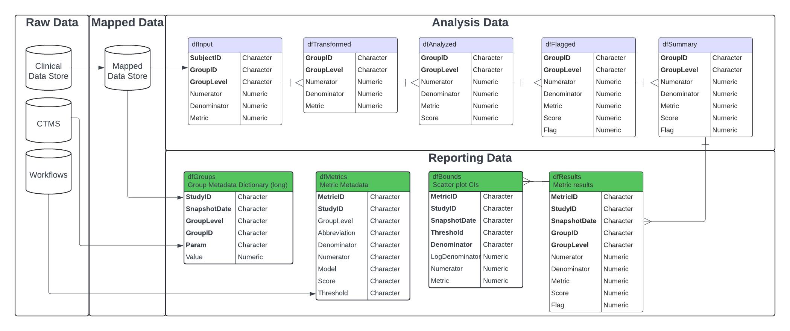

```{r setup, include = FALSE}
knitr::opts_chunk$set(
  collapse = TRUE,
  comment = "#>",
  message = FALSE
)
```

```{r packages}
library(gsm.reporting)
library(dplyr)
```

## Introduction

The `{gsm}` suite of packages monitors clinical trials with Key Risk Indicators (KRIs). `{gsm.reporting}` sits between analysis and reporting: it takes the output of metric workflows and produces the four tables of the reporting data model.

{width="100%"}

| Table | Function | Contents |
|---|---|---|
| `Reporting_Groups` | `dplyr::bind_rows()` | Long-format metadata for each study, site, and country |
| `Reporting_Metrics` | `MakeMetric()` | One row of metadata per metric |
| `Reporting_Results` | `BindResults()`, `CalculateChange()`, `FilterByLatestSnapshotDate()` | Stacked results for every metric and group |
| `Reporting_Bounds` | `MakeBounds()` | Predicted bounds used to draw flag thresholds in charts |

Each table has a YAML workflow in `inst/workflow/3_reporting`. This vignette builds each table step by step and then runs the workflows. The inputs are sample data from `{gsm.core}` and mapped data from `{gsm.mapping}`.

For the full pipeline, from metric calculation through charts and HTML reports, see the `{gsm.kri}` documentation.

## Inputs

The reporting workflows need three inputs:

- `lWorkflows`: metric workflows, whose `meta` sections describe each metric.
- `lAnalyzed`: analysis output, with one element per metric containing an `Analysis_Summary` data frame.
- `Mapped_STUDY`, `Mapped_SITE`, `Mapped_COUNTRY`: group metadata from `{gsm.mapping}`.

In practice, `lWorkflows` and `lAnalyzed` come from metric workflows such as those in `{gsm.kri}`. Here they are reconstructed from `{gsm.core}` sample data, so the vignette depends on no metric package.

```{r inputs}
lWorkflows <- gsm.core::reportingMetrics |>
  select(-MetricID) |>
  split(~ID) |>
  purrr::map(\(meta) list(meta = as.list(meta)))

dfLatest <- gsm.core::reportingResults |>
  filter(SnapshotDate == max(SnapshotDate))

lAnalyzed <- dfLatest |>
  select(GroupID, GroupLevel, Numerator, Denominator, Metric, Score, Flag, MetricID) |>
  split(~MetricID) |>
  purrr::map(\(df) list(Analysis_Summary = select(df, -MetricID)))

names(lAnalyzed)
```

Group metadata comes from the `{gsm.mapping}` workflows:

```{r mapping, results = "hide"}
mappings_wf <- workr::MakeWorkflowList(
  strPath = "workflow/1_mappings",
  strPackage = "gsm.mapping"
)
# These domains are not present in gsm.core::lSource
mappings_wf <- mappings_wf[
  setdiff(names(mappings_wf), c("AntiCancer", "Baseline", "Consents"))
]
lRaw <- gsm.mapping::Ingest(
  gsm.core::lSource,
  gsm.mapping::CombineSpecs(mappings_wf)
)
mapped <- workr::RunWorkflows(mappings_wf, lRaw)
```

## Step by step

### Groups

`Reporting_Groups` stacks the long-format study, site, and country metadata. Each row is one `Param`/`Value` pair for a group.

```{r groups}
dfGroups <- bind_rows(
  mapped$Mapped_STUDY,
  mapped$Mapped_SITE,
  mapped$Mapped_COUNTRY
)
dfGroups
```

### Metrics

`MakeMetric()` collects the `meta` section of each workflow into one row per metric and adds `MetricID` (`{Type}_{ID}`).

```{r metrics}
dfMetrics <- MakeMetric(lWorkflows)
dfMetrics |>
  select(MetricID, Abbreviation, Metric, Model, Threshold)
```

### Results

`BindResults()` stacks the `Analysis_Summary` of each metric. It adds `MetricID` from the list names, along with the snapshot date and study ID.

```{r results}
dfResults <- BindResults(
  lAnalysis = lAnalyzed,
  strName = "Analysis_Summary",
  dSnapshotDate = max(dfLatest$SnapshotDate),
  strStudyID = unique(dfLatest$StudyID)
)
dfResults
```

When results from earlier snapshots are available, `CalculateChange()` adds the previous value, change, and percent change for `Numerator`, `Denominator`, `Metric`, `Score`, and `Flag`. It returns rows for all snapshots, so `FilterByLatestSnapshotDate()` keeps only the current one.

```{r change}
dfHistorical <- gsm.core::reportingResults |>
  filter(SnapshotDate < max(SnapshotDate))

dfResultsChanges <- CalculateChange(
  dfResults = dfResults,
  dfResultsLongitudinal = dfHistorical
) |>
  FilterByLatestSnapshotDate()

dfResultsChanges |>
  select(GroupID, MetricID, Score, Score_Previous, Flag, Flag_Previous, Flag_Change)
```

### Bounds

`MakeBounds()` predicts, for each metric, the metric values at which flags change across the range of denominators. Charts use these to draw threshold lines. Metrics whose model has no predicted bounds, such as identity metrics, contribute no rows. A metric with no `Threshold` triggers a parsing warning and is skipped.

```{r bounds}
dfBounds <- MakeBounds(dfResults = dfResults, dfMetrics = dfMetrics)
dfBounds
```

## Running the reporting workflows

The same steps run automatically through the YAML workflows in `inst/workflow/3_reporting`. Supply `Reporting_Results_Longitudinal` to include changes from earlier snapshots; without it, `CalculateChange()` logs a message and returns `Reporting_Results` without change columns.

```{r workflows, results = "hide"}
reporting_wf <- workr::MakeWorkflowList(
  strPath = "workflow/3_reporting",
  strPackage = "gsm.reporting"
)
reporting <- workr::RunWorkflows(
  reporting_wf,
  lData = c(
    mapped,
    list(
      lAnalyzed = lAnalyzed,
      lWorkflows = lWorkflows,
      Reporting_Results_Longitudinal = dfHistorical,
      dSnapshotDate = max(dfLatest$SnapshotDate)
    )
  )
)
```

```{r workflow-output}
purrr::map(reporting, dim)
```

The output is the input for downstream reporting, such as the KRI charts and reports in `{gsm.kri}`.
